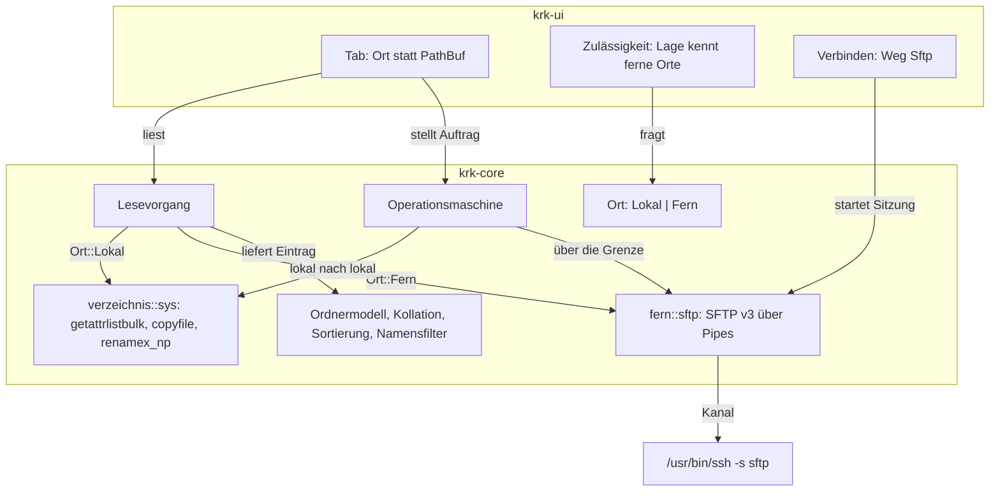

# Analysis: sftp-Verbindung als Dateisystem im Dateifenster

**Date:** 2026-10-16 17:46
**Type:** Feasibility
**Status:** Complete
**Requested by:** user (über den Dispatch an den analyst)

## Question

Kann ein Klick auf eine Verbindung `sftp://konto@rechner:22` den entfernten Ordner in einem Dateifenster öffnen, sodass Kopieren, Verschieben, Umbenennen, Anlegen und Löschen zwischen einem lokalen und einem entfernten Fenster so wirken wie zwischen zwei lokalen Ordnern? Welche Wege gibt es dafür (System, Drittsoftware, eigener Client in KRK, Zwischenwege), was kostet jeder an Installation, an Zusagen des Projekts und an Bauumfang, und welcher ist zu empfehlen? Nebenfrage: erscheint nach einem NetFS-Einhängen (smb, afp, nfs, webdav, ftp) der Einhängepunkt heute im Dateifenster?

Anlass ist die Meldung „kein Programm zum Öffnen der URL festgelegt“ beim Klick auf das Lesezeichen `sftp://stalmann.org@ssh.strato.de:22`, und der Wunsch des Nutzers, wörtlich: „ich wollte das so implementiert haben, dass wir zwischen den dateilisten über das protokoll kopieren etc können, also so als wäre das das file:// protocol.“

## Scope

Gelesen: `crates/krk-core/src/heimordner/verbindung.rs`, `crates/krk-ui/src/appkit/verbinden.rs`, der Ausgang des Verbindens in `crates/krk-ui/src/appkit/anwendung.rs`, die Systemschicht `crates/krk-core/src/verzeichnis/sys.rs`, die Kopfmodule von `verzeichnis/` und `operation/`, `operation/auftrag.rs`, `operation/verschieben.rs`, `appkit/papierkorb.rs`, `kommandos/loeschwarnung.rs`, `appkit/volumes.rs`, die zehn Zeitzusagen aus C8 (`260802-1036_*_spec-navigator-geruest.md`), der Datensatz `261016-0306-auf-welchem-weg-verlassen-zugangsdaten-aus-secrets-txt-krk-wenn-eine-verbindung-hergestellt-wird.md` und das Paket `261016-0229-secrets-mit-sechs-feldern-schluesselcache-und-verbindungen`, die Runde `260817-0833-jeder-loeschweg-mit-rueckfrage-und-nur-noch-papierkorb`.

Am System gefahren: `sw_vers`, Auflistung der Dateisystem- und NetFS-Bausteine, FSKit-Köpfe im installierten SDK, Homebrew-Auskünfte (nichts installiert), `cargo tree` in Wegwerfprojekten unter dem Scratchpad, ein SFTP-v3-Gespräch mit `/usr/libexec/sftp-server` über Pipes, Rundlaufzeit zu `ssh.strato.de`. Nichts im Repository geändert, nichts eingehängt, kein Anmeldeversuch am entfernten Rechner.

**Baumstand:** HEAD `437578b0` vom 2026-10-16 16:55 +0200, Zweig `main`, `## main...origin/main` (gleichauf, `git status -sb`). Der Arbeitsbaum trägt nicht eingetragene Änderungen an `HowTo.md`, `appkit/anwendung.rs`, `appkit/leiste.rs`, `kommandos/kontextmenue.rs`, `leistenmodell.rs` und `orchestrator-events.jsonl` (Auswerfen in der Geräteleiste, `git diff --stat`); keine davon berührt die Wege dieser Analyse. Während der Analyse sind genau diese Änderungen als `c461b3a1` („feat(leiste): Datentraeger unter "Geraete und Orte" auswerfen“) eingetragen worden; die Zeilenangaben unten gelten für `c461b3a1`, nachgesehen an `anwendung.rs:7392` und `:9089`. **Gerät:** macOS 15.8.1 (24H32), Intel Core i9-9880H, `x86_64` (`sw_vers`, `uname -m`). **SDK:** 26.2 (`xcrun --show-sdk-version`).

Markierung im Folgenden: **geprüft** heißt gelesen oder gefahren, mit Beleg; **erschlossen** (`inference:`) heißt aus Geprüftem gefolgert; **vermutet** (`speculation:`) heißt aus Kenntnis ohne Beleg an diesem Gerät.

## Findings

### 0. Was heute geschieht

**sftp geht heute an das System, und das System hat dafür kein Programm.** Geprüft: `Protokoll::weg` ordnet `Ssh`, `Sftp`, `Vnc`, `Http`, `Https` dem `Weg::Uebergeben` zu (`crates/krk-core/src/heimordner/verbindung.rs:142-156`); der Übergabeweg ruft allein `NSWorkspace.openURL:` (`crates/krk-ui/src/appkit/verbinden.rs:460-465`). Auf diesem Gerät ist kein Programm für `sftp:` angemeldet, das ist die Meldung des Nutzers; ein Programm, das sie beantwortet, gehört nicht zum System (Abschnitt 1).

**Nach einem NetFS-Einhängen erscheint der Einhängepunkt im aktiven Dateifenster, im Code.** Geprüft: `verbindung_einziehen` liest bei `Eingehaengt(punkt)` und `SchonEingehaengt(Some(punkt))` den Punkt über `dateifenster(aktiv).quelle().ordner_lesen(&punkt, None)` (`crates/krk-ui/src/appkit/anwendung.rs:9089-9101`). Am laufenden Bündel gegen einen echten Server ist das nicht gefahren; der Modulkopf von `verbinden.rs` nennt das ausdrücklich Nutzerarbeit (`verbinden.rs:80-88`). Drei Einschränkungen gehören dazu:

| Einschränkung | Stand | Beleg |
|---|---|---|
| ftp hängt nur lesend ein | geprüft | `man mount_ftp`, Abschnitt BUGS: „mount_ftp only supports mounting read-only.“ |
| Löschen auf einem Netzlaufwerk ohne Papierkorb wird gemeldet und nicht ausgeführt | Regel geprüft, Befund für SMB erschlossen | `kommandos/loeschwarnung.rs:394-403` (`Vorstufe::OhnePapierkorb`), Directive der Runde `260817-0833-jeder-loeschweg-mit-rueckfrage-und-nur-noch-papierkorb`: „Ein Ziel ohne Papierkorb wird nicht gelöscht, sondern gemeldet.“ `inference:` SMB-, NFS- und FUSE-Freigaben führen gewöhnlich keinen Papierkorb, `fuehrt_einen_papierkorb` (`appkit/papierkorb.rs:191-206`) antwortet dann `Nein`. |
| Ein Pfad hinter der Freigabe (`smb://nas/daten/projekte`) wird nicht angesteuert | erschlossen | KRK liest den Punkt, den NetFS zurückgibt (`anwendung.rs:9091-9094`), und keinen Unterpfad. `inference:` NetFS gibt den Einhängepunkt der Freigabe zurück, also `/Volumes/daten`; nicht an einem Server nachgesehen. |

Für smb, afp, nfs und webdav ist der Wunsch „wie file://“ damit schon erfüllt, mit der Ausnahme des Löschens. Es geht in dieser Analyse also um sftp und ssh.

### 1. Systemweg

**macOS 15 kann sftp ohne Drittsoftware nicht einhängen.** Geprüft:

- NetFS kennt die Schemata `afp`, `ftp`/`ftps`, `http`/`https`, `nfs`, `smb`/`cifs`, dazu ein `xpc`-Baustein ohne eigenes Schema (`plutil -p /System/Library/Filesystems/NetFSPlugins/*.bundle/Contents/Info.plist`, Schlüssel `CFBundleURLSchemes`). Kein `sftp`, kein `ssh`.
- Unter `/sbin` steht kein `mount_sftp` oder `mount_ssh` (`ls /sbin | grep mount`: `mount_9p`, `mount_acfs`, `mount_afp`, `mount_apfs`, `mount_cd9660`, `mount_cddafs`, `mount_devfs`, `mount_exfat`, `mount_fdesc`, `mount_ftp`, `mount_hfs`, `mount_msdos`, `mount_nfs`, `mount_smbfs`, `mount_tmpfs`, `mount_udf`, `mount_virtiofs`, `mount_webdav`).
- `/Library/Filesystems` trägt nur ein leeres `NetFSPlugins`; `sshfs` ist nicht installiert (`which sshfs`).

**FSKit trägt ein Netzdateisystem erst ab macOS 26, und das Gerät läuft auf 15.8.1.** Geprüft im SDK 26.2: `FSGenericURLResource`, die Ressource „for some sort of network address for a remote file system“ mit dem Info.plist-Schlüssel `FSSupportedSchemes` (das Beispiel im Kopf nennt `rsh` und `ssh`), trägt `FSKIT_API_AVAILABILITY_V2`, und das ist `API_AVAILABLE(macos(26.0))` (`FSKit.framework/Headers/FSResource.h`, `@interface FSGenericURLResource`; `FSKitDefines.h`, `FSKIT_API_AVAILABILITY_V2`). Die Fassung V1 ab macOS 15.4 kennt nur `FSBlockDeviceResource`, also Datenträger. Auf dem Gerät sind die Module `com.apple.fskit.msdos` und `com.apple.fskit.exfat` angemeldet (`pluginkit -m -p com.apple.fskit.fsmodule`).

Was ein eigenes FSKit-Modul für KRK hieße, ist zum größeren Teil erschlossen:

- Es ist eine App-Erweiterung (`.appex`) im Bündel, die das ganze SSH und SFTP selbst sprechen muss; FSKit liefert nur die Dateisystemseite. Bindungen gibt es (`objc2-fs-kit` 0.3.2, `cargo search`).
- `inference:` App-Erweiterungen laufen in der Sandbox, das Modul bräuchte dort Netzzugriff; es könnte deshalb das System-`ssh` nicht starten und bräuchte eine SSH-Kiste im Prozess (Abschnitt 3: allein `makiko` hält die C-Freiheit).
- `speculation:` Das FSKit-Recht (`com.apple.developer.fskit.fsmodule`) verlangt ein Bereitstellungsprofil; der Bündelbau signiert mit der selbst ausgestellten Identität `KRK Entwicklung` (`README.md`, `## Signierung`), an der kein Profil hängen kann. Nur die Auslieferung mit Developer ID und Beglaubigung (`xtask/src/release.rs`, Stationen 6 und 7) käme dafür in Frage.
- `speculation:` Der Nutzer schaltet das Modul einmal in den Systemeinstellungen frei (Allgemein, Anmeldeobjekte und Erweiterungen, Dateisystemerweiterungen), wie heute schon für FSKit-Module ab 15.4.
- Das Zielsystem von KRK ist macOS 15 (`.cargo/config.toml`, `MACOSX_DEPLOYMENT_TARGET=15.0`); ein Modul ab 26 wäre ein Weg, den das Gerät des Nutzers heute nicht hat.

**File Provider ist der Systemweg, der auf macOS 15 stünde, und er ist ein Synchronisationsmodell.** `inference:` Eine `NSFileProviderReplicatedExtension` legt unter `~/Library/CloudStorage/` einen Ordner an, dessen Einträge KRK als gewöhnliche Pfade sieht; Inhalte holt das System beim ersten Zugriff, Änderungen meldet es der Erweiterung zum Hochladen. Für KRK hieße das eine zweite App-Erweiterung mit derselben Sandbox-, Profil- und SSH-Frage wie bei FSKit, eine App-Gruppe und ein Bau im `xtask`, den es heute nicht gibt. Bindungen gibt es (`objc2-file-provider` 0.3.2). Der Ordner läge zudem unter `~/Library/CloudStorage/`, den die Runde 12 als benannten Ort der lauten Löschwarnung führt (`_c_circle.md` jener Runde, Zeile 42).

### 2. Drittsoftware: sshfs über macFUSE oder FUSE-T

Was der Nutzer installieren müsste, geprüft über Homebrew (nichts installiert):

| Paket | Fassung | Bedingung | Beleg |
|---|---|---|---|
| `macfuse` (Cask) | 5.4.0 | „macfuse requires a kernel extension to work“, Freigabe unter Datenschutz & Sicherheit | `brew info --cask macfuse` |
| `sshfs-mac` (Cask) | 3.7.5 | braucht `macfuse` | `brew info --cask sshfs-mac` |
| `fuse-t` (Cask) | 1.2.9 | „Kext-less implementation of FUSE“ | `brew info --cask fuse-t` |
| `sshfs` (Formel) | 3.7.6 | braucht `libfuse`, `inference:` eine Linux-Abhängigkeit, auf macOS also nicht der Weg | `brew info sshfs` |

`speculation:` FUSE-T bringt sein eigenes `sshfs` über ein eigenes Homebrew-Verzeichnis mit (`macos-fuse-t/homebrew-cask`); hier nicht nachgesehen. `speculation:` macFUSE 5 bietet auf macOS 26 eine FSKit-Unterlage ohne Kernerweiterung; auf diesem Gerät mit macOS 15 und Intel-Prozessor bliebe es bei der Kernerweiterung samt Freigabe und Neustart. `speculation:` Das Projekt `libfuse/sshfs` wird seit 2022 nicht mehr gepflegt.

**Ein Einhängen aus KRK heraus ist machbar und im Zuschnitt des NetFS-Wegs.** Erschlossen aus `verbinden.rs`: ein dritter `Weg` neben `Einhaengen` und `Uebergeben`, auf dem Faden `krk-verbinden` ein Kindprozess `sshfs konto@rechner:<pfad> <punkt> -o password_stdin,volname=<name>,reconnect`, danach dieselbe Rückmeldung `Eingehaengt(punkt)` an `verbindung_einziehen`, und das Dateifenster liest den Punkt wie heute. Den Punkt kann KRK nicht unter `/Volumes` anlegen: der Ordner gehört `root` mit `drwxr-xr-x` (`ls -ld /Volumes`, geprüft). Er läge also unter einem Ordner des Nutzers, etwa im Ablageordner von KRK.

**Das Passwort ginge über die Standardeingabe des Kindprozesses**, nicht über Argument, Umgebung oder Datei. `password_stdin` steht in der Dokumentation von sshfs; auf diesem Gerät ist sshfs nicht installiert und die Option deshalb nicht gefahren. Das ist ein zweiter Weg, auf dem das Passwort KRK verlässt, und er widerspricht dem umgesetzten Datensatz `261016-0306-auf-welchem-weg-verlassen-zugangsdaten-aus-secrets-txt-krk-wenn-eine-verbindung-hergestellt-wird.md` (Möglichkeit 1: „Das Passwort verlässt KRK allein als Funktionsargument von `NetFSMountURLSync`“); die Probe `das_passwort_wird_allein_an_netfs_preisgegeben` (`verbinden.rs:536-581`) verlangt genau einen Rufer von `Passwort::preisgeben` und würde rot. Jeder Weg dieser Analyse außer dem Schlüssel ohne Passwort braucht deshalb einen neuen Entscheid.

**Ein FUSE-Laufwerk trifft eine Schwäche, die KRK bei Netzlaufwerken schon heute hat: Systemaufrufe auf dem Hauptfaden.** Geprüft: der Löschweg ruft vor der Rückfrage `std::fs::canonicalize(&quellordner)` und `fuehrt_einen_papierkorb` im Kommandoweg des Anwendungsdelegierten (`anwendung.rs:7385-7397`). `inference:` Hängt die SSH-Verbindung unter sshfs, wartet dieser Aufruf auf das Zeitlimit des Dateisystems, und die Ereignisschleife steht so lange; L1 und L9 fielen dann nicht an der Messstrecke, sondern im Betrieb. Die Probe `ist_und_sonderdatei_stellen_keinen_systemaufruf` (`crates/krk-core/tests/heimordner.rs`, Doc-Kommentar) beschreibt denselben Schaden für einen anderen Rufer.

### 3. Eigener Client in KRK

#### 3a. Kisten und die C-Freiheits-Zusage

Gefahren in Wegwerfprojekten unter dem Scratchpad, je Projekt `cargo tree --target <ziel> -e normal,build` für `aarch64-apple-darwin` und `x86_64-apple-darwin`, gefiltert auf `cc`, Pakete auf `-sys`, `ring`, `aws-lc*`, `openssl*`. Beide Ziele lieferten jeweils dasselbe Ergebnis. Der Baum von KRK selbst ist auf beiden Zielen leer (Gegenprobe im Repository, nur gelesen).

| Variante | Fund auf beiden Mac-Zielen | Zusage |
|---|---|---|
| `russh =0.64.1` + `russh-sftp =3.0.1`, Vorgabemerkmale (`flate2`, `aws-lc-rs`, `rsa`) | `aws-lc-rs`, `aws-lc-sys`, `cc`, `cmake`, `core-foundation-sys` | fällt |
| `russh` mit `ring` statt `aws-lc-rs` | `ring`, `cc`, `core-foundation-sys` | fällt |
| `russh` ohne beide Kryptomerkmale | übersetzt nicht: „`russh` requires enabling either the `ring` or `aws-lc-rs` feature as a crypto backend.“ (`cargo check`) | nicht baubar |
| `russh =0.45.0` + `russh-sftp =2.0.3` | `core-foundation-sys` | fällt am Namen |
| `ssh2 0.9` | `libssh2-sys`, `openssl-sys`, `libz-sys`, `cc` | fällt |
| `ssh-rs =0.5.0` | `ring`, `cc` | fällt |
| `makiko =0.2.5` | nichts | hält |

`core-foundation-sys` kommt über `russh-sftp` → `chrono` mit Vorgabemerkmalen → `iana-time-zone` (`cargo tree -i core-foundation-sys`); `russh-sftp` 3.0.1 bindet `chrono` ohne `default-features = false` (`[dependencies.chrono]` in seiner `Cargo.toml`), also lässt es sich von außen nicht abschalten. Die Kiste baut kein C, verletzt aber die Zusage am Wortlaut „kein Paket mit einem Namen auf `-sys`“.

`makiko` hält die Zusage und übersetzt (`cargo check --target aarch64-apple-darwin`, 22 s). Sie spricht nur SSH, kein SFTP, bringt `tokio` und RustCrypto mit (`aes-gcm`, `chacha20`, `ed25519-dalek`, `x25519-dalek`, `rsa 0.9`, `p256`, `p384`), 142 Pakete im Baum gegen 309 bei KRK (`cargo tree … | sort -u | wc -l`, beide Zahlen mit Kopfzeile). Ihre Pflege ist dünn: zuletzt veröffentlicht am 2025-03-29, 6 171 Abrufe in den letzten 90 Tagen, gegen 3,6 Millionen bei `russh` (crates.io-API, Feld `recent_downloads`). `speculation:` `rsa 0.9` trägt den Hinweis RUSTSEC-2023-0071 (Zeitseitenkanal); für eine Anmeldung mit Passwort signiert der Client nichts mit RSA.

**Ein Weg ohne jede neue Kiste besteht, und er ist der von sshfs selbst: das System-`ssh` trägt den Kanal, KRK spricht SFTP darüber.** `ssh -s konto@rechner sftp` startet das Teilsystem `sftp` auf dem Server und reicht dessen Bytes über Standardein- und -ausgabe durch; Verschlüsselung, Rechnerschlüssel (`~/.ssh/known_hosts`), Schlüssel, Agent und `~/.ssh/config` bleiben bei OpenSSH. `/usr/bin/ssh` ist Teil des Systems (`ssh -V`: `OpenSSH_9.9p2, LibreSSL 3.3.6`). Geprüft ist die Protokollseite gegen den Server des Systems ohne Netz, mit einem kleinen Gesprächsskript über Pipes (`scratchpad/sftp_probe.py` gegen `/usr/libexec/sftp-server`):

- `SSH_FXP_VERSION` 3, Erweiterungen `posix-rename@openssh.com`, `statvfs@openssh.com`, `fstatvfs@openssh.com`, `hardlink@openssh.com`, `fsync@openssh.com`, `lsetstat@openssh.com`, `limits@openssh.com`, `expand-path@openssh.com`, `copy-data`, `home-directory`, `users-groups-by-id@openssh.com`.
- Ein Ordner mit 10 000 Dateien kommt in 101 `READDIR`-Antworten zu je höchstens 100 Namen, 10 002 Namen samt `.` und `..`, 93 ms lokal.
- Jeder Name trägt Größe, Rechte, Zugriffs- und Änderungszeit. Das deckt die Felder von `Eintrag` (`name`, `groesse`, `geaendert`, `typ`, `versteckt`, `crates/krk-core/src/verzeichnis/eintrag.rs`); `versteckt` folgt dann dem Punkt im Namen, `UF_HIDDEN` gibt es auf diesem Weg nicht.

Ob der Strato-Server das Teilsystem `sftp` mit denselben Erweiterungen anbietet, ist nicht geprüft; es gab keinen Anmeldeversuch. `speculation:` ein OpenSSH-Server liefert dieselbe Liste.

Das Passwort ginge bei diesem Weg über `SSH_ASKPASS` mit `SSH_ASKPASS_REQUIRE=force` (`man ssh`, Abschnitt ENVIRONMENT, geprüft): `ssh` startet das genannte Programm mit dem Abfragetext als Argument und liest das Passwort von dessen Standardausgabe. Das Programm wäre KRKs eigenes Binärziel in einer Hilfsrolle, das sich das Passwort über einen Unix-Socket beim Elternprozess abholt; Argument, Umgebung und Platte sähen allein den Socketpfad. `inference:` Dieselbe Hilfsrolle beantwortet die Frage nach einem unbekannten Rechnerschlüssel, denn auch die geht unter `force` an das Programm; KRK müsste dafür den Abfragetext von OpenSSH unterscheiden, und der ist keine zugesicherte Schnittstelle. Mit einem Schlüssel im Agenten verlässt kein Passwort KRK.

Gemessen ist auch die Rundlaufzeit zum Rechner des Nutzers: `ping -c 4 ssh.strato.de` 23,5 bis 35,6 ms, Mittel 28,4 ms; ein TCP-Verbindungsaufbau auf Port 22 0,03 bis 0,06 s (`nc -z`, dreimal).

#### 3b. Was ein entferntes Dateisystem für KRKs Bau heißt

**Der Lesepfad hat eine schmale Naht, die Operationsmaschine eine breite.** Geprüft: Das Dateifenster startet jeden Lesevorgang an genau einer Stelle, `Lesevorgang::starten(&tab.ordner, generation)` (`crates/krk-ui/src/tabs.rs:1544`), und dessen Ausgabe `Eintrag` ist frei von Systemtypen; Kollation, Sortierung, Ordnermodell und Namensfilter lassen sich deshalb unverändert mit Einträgen aus SFTP füttern. Die Operationsmaschine dagegen trägt `PathBuf` in jedem Feld von `Auftrag` und in jeder `Art` (`crates/krk-core/src/operation/auftrag.rs:20`, `:148`) und ruft in ihren Rümpfen `copyfile(3)`, `renamex_np(2)` und `std::fs` direkt (`verzeichnis/sys.rs`, Modulkopf, Schaubild der acht Schnittstellen). Ein Vorbild für die Umkehr besteht: der Papierkorb kommt als Schnittstelle `trait Papierkorb` in den Kern (`operation/loeschen.rs:45`, `appkit/papierkorb.rs`, Modulkopf).

Erschlossen ist daraus die Form der Abstraktion: **ein Ort, kein Dateisystem-Objekt hinter jedem Pfad.** Ein Wert `Ort` mit den zwei Fällen „lokal, ein `PathBuf`“ und „fern, eine Sitzung und ein Pfad auf dem Server“ ersetzt `PathBuf` dort, wo ein Tab, ein Auftrag oder ein Lesezeichen auf einen Ordner zeigt. Die Frage „ist dieser Ort lokal?“ ist dann am Wert entscheidbar und kein Systemaufruf. Der lokale Fall behält jeden heutigen Rumpf; ein `trait` mit dynamischem Aufruf vor jedem lokalen Zugriff wäre die schlechtere Wahl, weil er die gemessenen Wege der zehn Zusagen anfasst.

Selbstprüfung des Schaubilds: zwei Schichten, keine Zyklen, kein Knoten mit überwiegendem Ausgrad; `op` zeigt auf beide Seiten, weil eine Übertragung über die Grenze beide braucht. Jede Kante steht im Text dieses Abschnitts.

Wie viele Dateien einen Pfadtyp nennen, sagt `grep -rlE '\bPathBuf\b|&Path\b' crates/krk-core/src crates/krk-ui/src | wc -l`, Stand `437578b0`: 79. Die meisten davon blieben lokal (Ablage, Sprache, Belegung, Heimordner). Berührt wären diese Module, nach Aufgabe:

| Bereich | Module | Was sich ändert | Schwere |
|---|---|---|---|
| Protokoll | neu `krk-core/src/fern/` (SFTP-v3-Pakete, Antwortzuordnung nach Anfrage-Kennung, Sitzung) | ganz neu; prüfbar gegen `/usr/libexec/sftp-server` ohne Netz | groß |
| Sitzung und Anmeldung | `krk-ui/src/appkit/verbinden.rs`, `krk-ui/src/tresorweg.rs`, `krk-ui/src/main.rs` (Hilfsrolle für `SSH_ASKPASS`), `krk-core/src/heimordner/verbindung.rs` (`Weg`) | dritter Weg, Kindprozess, Socket, Lebensdauer, Wiederaufbau | mittel |
| Ort | `krk-ui/src/tabs.rs`, `krk-ui/src/fenstermodell.rs`, `krk-ui/src/fenstertitel.rs`, `krk-ui/src/kommandos/pfadeingabe.rs`, Sitzungsdatei über `ablage/`, `krk-core/src/ablage/lesezeichen.rs` (`Ziel::Verbindung` besteht schon) | `PathBuf` des Ordners wird `Ort` | groß, weil breit |
| Lesen | `krk-core/src/verzeichnis/leser.rs`, `verzeichnis/mod.rs` (`aufwaerts`), `verzeichnis/verweisziel.rs` | zweiter Zweig in `Lesevorgang`; `READLINK` für Verknüpfungen | mittel |
| Tiefe Suche, Inhaltsfilter | `verzeichnis/durchlauf.rs`, `verzeichnis/inhalt.rs`, `verzeichnis/umfang.rs` | auf fernen Orten abschalten oder deckeln (siehe Zusagen) | klein bis mittel |
| Operationen | `operation/mod.rs`, `auftrag.rs`, `kopieren.rs`, `verschieben.rs`, `umbenennen.rs`, `anlegen.rs`, `duplizieren.rs`, `loeschen.rs`, `fortschritt.rs`; `zippen.rs` und `entpacken.rs` nur lokal | Übertragung lokal↔fern in Blöcken mit Fortschritt und Abbruch zwischen den Blöcken; Konflikt über `STAT`; Umbenennen über `posix-rename@openssh.com`; Duplizieren auf dem Server über `copy-data` | groß |
| Löschen | `operation/loeschen.rs`, `kommandos/loeschwarnung.rs`, `appkit/papierkorb.rs` | ein ferner Ort hat keinen Papierkorb; heute heißt das „nicht löschen“ | Entscheid |
| Vorschau, Editor | `vorschaumodell.rs`, `appkit/vorschau.rs`, `leseprofil/*`, `bild/aufnahmedatum.rs`, `editormodell.rs`, `text/datei.rs` | Lesen bis zur Grenze über `READ`; Sichern über temporären Namen und `posix-rename`; Leseprofile und Bildfolge auf fernen Orten zunächst aus | mittel |
| Was nur lokal geht | `appkit/git.rs`, `gitmodell.rs`, `appkit/standardprogramm.rs`, `appkit/oeffnenmit.rs`, `appkit/finder.rs`, `appkit/terminal.rs`, `appkit/zwischenablage.rs` (Dateiverweise), `appkit/abwurf.rs`, Teilen, `auffrischung.rs` mit `appkit/fsevents.rs` | über die Zulässigkeit ausgrauen, nicht scheitern lassen; Abwurf aus dem Finder auf ein fernes Fenster wäre ein Hochladen | mittel, weil viele Stellen |
| Zulässigkeit | `kommandos/zulaessigkeit.rs` (`Lage`), `kommandos/kontextmenue.rs` | die Lage trägt, ob der Ort des Fensters fern ist | klein |

`inference:` Ein Kopieren zwischen zwei Dateifenstern auf **demselben** Server ginge über `copy-data` ohne Umweg über das Gerät; zwischen zwei Servern liefe es über das Gerät.

**Verschieben über die Grenze entfernt die Quelle, und das tut KRK schon heute.** Geprüft: über Datenträger hinweg kopiert `eintrag_verschieben` und ruft danach `loeschen::baum_entfernen` auf die Quelle (`operation/verschieben.rs:146`), endgültig und ohne Papierkorb, weil die Daten am Ziel liegen. Ein Verschieben von fern nach lokal oder umgekehrt folgte derselben Regel und ist keine neue Frage. Das **Löschen** auf einem fernen Ort ist dagegen eine: die Runde 12 hat den endgültigen Löschweg gestrichen, und „ein Ziel ohne Papierkorb wird gemeldet“ gilt für jeden Weg dieser Analyse, auch für sshfs.

#### 3c. Die zehn Zeitzusagen

Die Zusagen sind auf lokalen Prüfordnern definiert (C8, Prüfordner A, B und der mit 100 000 Einträgen). Für ferne Orte kann kein Weg sie halten, und der Grund ist die Rundlaufzeit, nicht der Bau. Erschlossen aus den zwei Messungen oben (100 Namen je `READDIR`, 28 ms Rundlauf):

| Zusage | lokal | fern, erschlossen |
|---|---|---|
| L1, L9 | bleiben, wenn kein ferner Aufruf den Hauptfaden erreicht | dieselbe Bedingung; das ist die eine Zusage, die ein ferner Ort nie brechen darf |
| L2 (erste Seite in 100 ms) | unberührt | `OPENDIR` und erstes `READDIR` etwa zwei Rundläufe, rund 60 ms bei stehender Sitzung; der Aufbau einer Sitzung (Prozessstart, SSH-Handschlag, Anmeldung) kommt beim ersten Mal dazu und ist ungemessen |
| L3 (10 000 Einträge, 1000 ms kalt) | unberührt | 101 Rundläufe, rund 2,9 s; `READDIR` auf einem Handle lässt sich nicht parallel stellen |
| L6 (1000 Einträge, 100 ms) | unberührt | rund 12 Rundläufe, rund 340 ms |
| L7 (Vorschau bis 1 MB, 100 ms) | unberührt | `OPEN`, `READ` in parallel gestellten Blöcken, `CLOSE`: mindestens drei Rundläufe plus Übertragung |
| L8 (Fortschritt nach 200 ms) | unberührt | hält, wenn die Statuszeile vor dem ersten Block erscheint |
| L10 | unberührt | wie L3, zehnfach |
| L4, L5 | unberührt, sofern ein ferner Tab beim Start nicht verbindet | ein wiederhergestellter ferner Tab darf den Start nicht abwarten |

sshfs sähe dieselben Zahlen, denn es spricht dasselbe Protokoll; der Zwischenspeicher im Kern würde Wiederholungen abfangen, das erste Lesen nicht. Für den lokalen Fall gefährdet der Weg nach 3b nichts, solange der lokale Zweig unverändert bleibt. Ein Abnahmelauf am Bündel wäre trotzdem geschuldet, weil `Lesevorgang`, `Auftrag` und die Tabs umgebaut werden; das ist Nutzerarbeit, wie jeder Abnahmelauf dieses Projekts.

### 4. Zwischenwege

| Zwischenweg | Was er gibt | Was er kostet | Urteil |
|---|---|---|---|
| Lokaler Spiegel: ferner Ordner wird in einen Zwischenordner geholt, KRK arbeitet dort, Änderungen gehen zurück | jede lokale Funktion, auch Vorschau, Git und Papierkorb | zwei Wahrheiten: wann zurückschreiben, was bei einer Änderung auf dem Server dazwischen gilt, was ein Löschen im Spiegel auf dem Server heißt. Das ist ein Synchronisationswerkzeug mit Konfliktmodell | verworfen; die Konfliktfrage ist größer als der ganze Weg 3 |
| Nur Übertragen: ferner Ordner lesend im Dateifenster, Kopieren in beide Richtungen, sonst nichts | die Hälfte des Wunsches, nämlich das Kopieren, ohne Umbenennen, Anlegen, Löschen | dieselbe Ort-Abstraktion wie 3b, nur mit weniger Zweigen in der Operationsmaschine | kein eigener Weg, sondern die erste Ausbaustufe von Möglichkeit 2 |
| Batch-`sftp` als Kindprozess, Ausgabe von `ls -l` lesen | kein eigenes Protokoll | Zerlegen einer Textausgabe, die keine Schnittstelle ist; Dateinamen mit Leerzeichen und Zeilenumbruch | verworfen, weil `ssh -s sftp` dieselbe Abhängigkeit ohne das Zerlegen trägt |

## Implications

Für die vier NetFS-Protokolle ist der Wunsch im Code erfüllt, bis auf das Löschen, das an der Papierkorbregel der Runde 12 scheitert. Für sftp gibt es auf macOS 15 keinen Weg ohne entweder Drittsoftware oder einen eigenen Protokollteil in KRK. FSKit wäre der saubere Systemweg, kommt aber erst mit macOS 26 und verlangt eine App-Erweiterung samt Profil, die der heutige Bündelbau nicht signieren kann.

Unabhängig vom Weg stehen zwei Entscheide an: wie das Passwort KRK auf einem zweiten Weg verlassen darf (der umgesetzte Datensatz erlaubt nur NetFS), und ob auf einem Ort ohne Papierkorb gelöscht werden darf. Ohne den zweiten Entscheid ist „Löschen wie lokal“ auf keinem fernen Ort zu haben, auch auf smb nicht.

## Recommendations

### Möglichkeit 1: sshfs einhängen, KRK startet es

- **Installation beim Nutzer:** entweder macFUSE 5.4.0 mit Kernerweiterung (Freigabe unter Datenschutz & Sicherheit, `speculation:` ein Neustart) und `sshfs-mac` 3.7.5, oder FUSE-T 1.2.9 ohne Kernerweiterung und dessen sshfs. KRK müsste prüfen, ob `sshfs` da ist, und es sonst sagen.
- **Zusagen:** die C-Freiheit hält, denn sshfs ist ein fremdes Programm und steht in keinem `cargo tree`. Die zehn Zusagen bleiben lokal unberührt. Der Schutz von L1 und L9 hängt daran, dass kein Systemaufruf auf einem Einhängepunkt den Hauptfaden erreicht, und das stimmt heute nicht (`anwendung.rs:7385-7397`). Das Passwort verlässt KRK über die Standardeingabe von sshfs, also Entscheid nötig.
- **Was der Nutzer bekommt:** genau „wie file://“, weil der Punkt ein gewöhnlicher Pfad ist: Kopieren, Verschieben, Umbenennen, Anlegen, Vorschau, Editor, sogar Git, alles über die heutigen Wege. Löschen nicht (kein Papierkorb). Bei hängender Verbindung hängen Aufrufe bis zum Zeitlimit.
- **Bauumfang, klein bis mittel:** (1) Entscheid zum Passwortweg; (2) `Weg::Einhaengen` um eine Spielart sshfs erweitern, Protokoll `sftp` dorthin legen, `ssh` bleibt beim Übergeben; (3) Kindprozess auf `krk-verbinden`, Passwort über die Standardeingabe, Zeitlimit, Einhängepunkt unter einem Ordner des Nutzers; (4) Auswerfen über den vorhandenen Auswurfweg prüfen; (5) die Hauptfaden-Aufrufe im Löschweg auf einen Faden legen; (6) `HowTo.md`: was zu installieren ist.

### Möglichkeit 2: SFTP in KRK über das System-`ssh`

- **Installation beim Nutzer:** keine. `ssh` gehört zum System; ein Schlüssel im Agenten erspart sogar das Passwort.
- **Zusagen:** die C-Freiheit hält ohne jede neue Kiste; der Protokollteil ist eigener Rust-Code im Kern. Die zehn Zusagen bleiben lokal unberührt, wenn `Ort` den lokalen Zweig unverändert lässt; ein Abnahmelauf am Bündel ist wegen des Umbaus geschuldet (Nutzerarbeit). Für ferne Orte gelten L2, L3, L6, L7 und L10 nicht und können es nicht; L1 und L9 halten strukturell, weil jeder ferne Aufruf auf einem Faden läuft. `#![deny(unsafe_code)]` bleibt unberührt: Kindprozess und Pipes gehen über `std::process`. Das Passwort verlässt KRK über `SSH_ASKPASS`, also Entscheid nötig.
- **Was der Nutzer bekommt:** ferner Ordner im Dateifenster, Kopieren und Verschieben in beide Richtungen mit Fortschritt, Abbruch und Konfliktblatt, Umbenennen, Anlegen, Duplizieren, Vorschau von Text und Bild bis zur Grenze, Editor. Ausgegraut auf fernen Orten: Git, Inhaltsfilter, Zip und Unzip, Finder, Teilen, Standardprogramm, Dateiverweise in der Zwischenablage, bis jedes davon einen eigenen Weg bekommt. Löschen nur nach Entscheid.
- **Bauumfang, groß, in Schritten, jeder für sich lieferbar:**
  1. Entscheide: Passwortweg über `SSH_ASKPASS`; Löschen auf Orten ohne Papierkorb; Umgang mit unbekanntem Rechnerschlüssel.
  2. `krk-core/src/fern/`: SFTP-v3-Pakete und Antwortzuordnung, Proben gegen `/usr/libexec/sftp-server` über Pipes, ohne Netz und in `make check`.
  3. Sitzung: `ssh -s … sftp` als Kindprozess auf einem eigenen Faden, Hilfsrolle für `SSH_ASKPASS`, Schließen, Wiederaufbau; `Weg::Sftp` statt `Weg::Uebergeben`.
  4. `Ort` in Tab, Sitzungsdatei, Fenstertitel und Pfadeingabe; Lesen über den zweiten Zweig von `Lesevorgang`. Ab hier ist der ferne Ordner sichtbar und sortierbar.
  5. Operationsmaschine: Kopieren lokal↔fern, dann Verschieben, Umbenennen, Anlegen, Duplizieren. Ab hier gilt „wie file://“ für das Kopieren.
  6. Zulässigkeit: `Lage` kennt ferne Orte, die nur lokalen Befehle grauen aus.
  7. Vorschau und Editor über ferne Orte.
  8. Abnahmelauf L1 bis L10 am Bündel (Nutzer) und eine Messung ferner Orte als Bericht unter `messungen/`, ohne neue Zusage.

### Möglichkeit 3: eigenes FSKit-Modul oder File-Provider-Erweiterung

- **Installation:** keine Drittsoftware, aber eine Freigabe der Erweiterung in den Systemeinstellungen; FSKit erst ab macOS 26, das Gerät läuft auf 15.8.1.
- **Zusagen:** C-Freiheit nur mit `makiko` (dünn gepflegt) oder eigenem SSH, weil die Erweiterung in der Sandbox `ssh` nicht starten kann (`inference:`); Signatur mit Profil, die der Bündelbau mit `KRK Entwicklung` nicht leisten kann (`speculation:`).
- **Bauumfang, fundamental:** eine zweite Programmeinheit im Bündel, ein Bau dafür im `xtask`, SSH und SFTP in der Erweiterung, dazu alles aus Möglichkeit 1 zum Hauptfaden.

### Empfehlung

Wir empfehlen **Möglichkeit 2**, vorbehaltlich der zwei Entscheide zum Passwortweg und zum Löschen. Sie verlangt vom Nutzer keine Installation, hält die C-Freiheit ohne neue Kiste, nutzt die eine Lesenaht `Lesevorgang::starten` und das Vorbild der Papierkorb-Schnittstelle, und sie hält L1 und L9 durch den Bau statt durch die Hoffnung, ein Einhängepunkt antworte schnell. Ihr Preis ist der Umbau von `PathBuf` zu `Ort` durch Tabs und Operationsmaschine, und der ist groß. Die Schritte 2 bis 5 liefern das Kopieren zwischen lokalem und fernem Fenster, das der Nutzer verlangt hat; alles danach erweitert.

Möglichkeit 1 ist die richtige Wahl, wenn der Nutzer „wie file://“ bald und vollständig will und FUSE-T zu installieren bereit ist. Sie ist billiger, gibt Vorschau, Editor und sogar Git sofort, legt aber KRKs Verhalten unter einen Kernbaustein, dessen Hänger den Hauptfaden heute erreichen. Wer sie wählt, zieht Schritt 5 ihrer Liste vor.

Möglichkeit 3 empfehlen wir nicht, solange das Zielsystem macOS 15 ist.

Weiter an: `requirements-designer` für den Spec der gewählten Möglichkeit, nachdem der Nutzer die zwei Entscheide getroffen hat; danach `implementation-planner`.

## Filed Issues

Keine. Die zwei offenen Fragen sind Entscheide und gehören zum Spec der gewählten Möglichkeit; der nicht angesteuerte Unterpfad hinter einer NetFS-Freigabe ist erschlossen und nicht beobachtet und steht deshalb unter den offenen Fragen.

## Sources

- `crates/krk-core/src/heimordner/verbindung.rs:142-156` (`Protokoll::weg`), Modulkopf Zeilen 8-45
- `crates/krk-ui/src/appkit/verbinden.rs:59-88`, `:161-176` (NetFS-Bindung), `:292-339` (`einhaengen`), `:460-465` (`uebergeben`), `:536-581` (Probe zu `preisgeben`)
- `crates/krk-ui/src/appkit/anwendung.rs:9074-9101` (`verbindung_einziehen`), `:7385-7397` (`canonicalize` und Papierkorbfrage im Löschweg)
- `crates/krk-ui/src/tabs.rs:1544` (`Lesevorgang::starten`)
- `crates/krk-core/src/verzeichnis/sys.rs`, Modulkopf; `verzeichnis/mod.rs`, Modulkopf; `verzeichnis/eintrag.rs`, `pub struct Eintrag`
- `crates/krk-core/src/operation/mod.rs`, Modulkopf; `operation/auftrag.rs:20`, `:148`; `operation/verschieben.rs:146`; `operation/loeschen.rs:45`
- `crates/krk-ui/src/appkit/papierkorb.rs:191-206`; `crates/krk-ui/src/kommandos/loeschwarnung.rs:394-403`
- `crates/krk-core/tests/heimordner.rs`, Doc-Kommentar von `ist_und_sonderdatei_stellen_keinen_systemaufruf`
- `260802-1036_*_spec-navigator-geruest.md`, `### C8: Messbare Geschwindigkeit`
- `261016-0306-auf-welchem-weg-verlassen-zugangsdaten-aus-secrets-txt-krk-wenn-eine-verbindung-hergestellt-wird.md`, Möglichkeit 1 und Zeile `Implemented:`
- `260817-0833-jeder-loeschweg-mit-rueckfrage-und-nur-noch-papierkorb` (Circle-Datensatz `_c_circle.md`, Directive)
- `README.md`, `## Signierung`; `xtask/src/release.rs`, Modulkopf
- System: `sw_vers`; `uname -m`; `ls /System/Library/Filesystems`, `…/NetFSPlugins`, `/Library/Filesystems`, `/sbin`; `plutil -p …/NetFSPlugins/*.bundle/Contents/Info.plist`; `pluginkit -m -p com.apple.fskit.fsmodule`; `ls -ld /Volumes`; `man mount_ftp`; `man ssh` (`SSH_ASKPASS_REQUIRE`); `ssh -V`
- SDK 26.2: `FSKit.framework/Headers/FSResource.h` (`FSGenericURLResource`, `FSPathURLResource`), `FSKitDefines.h` (`FSKIT_API_AVAILABILITY_V1`, `_V2`)
- Homebrew: `brew info --cask macfuse`, `--cask sshfs-mac`, `--cask fuse-t`, `brew info sshfs`
- Wegwerfprojekte unter dem Scratchpad `/private/tmp/claude-502/-Users-k1-Projects-productive-krk/e916c6b7-ed6b-45e0-9311-56d1aa80de0e/scratchpad/sshprobe-*`, je `cargo tree --target {aarch64,x86_64}-apple-darwin -e normal,build`; `cargo check` für `russh` ohne Kryptomerkmal und für `makiko`; `cargo tree -i core-foundation-sys`; `cargo info russh@0.64.1`, `russh-sftp@3.0.1`, `makiko@0.2.5`; crates.io-API für Veröffentlichungsdatum und Abrufe
- Protokollprobe `scratchpad/sftp_probe.py` gegen `/usr/libexec/sftp-server`, einmal auf `~/Library/Caches/krk-messplatz/fotoordner`, einmal auf einem Ordner mit 10 000 leeren Dateien im Scratchpad
- Netz: `ping -c 4 ssh.strato.de`; `nc -z -G 3 ssh.strato.de 22`, dreimal

## Open Questions

- [ ] Darf das Passwort aus `secrets.txt` KRK auf einem zweiten Weg verlassen, und auf welchem: Standardeingabe von `sshfs` (Möglichkeit 1) oder `SSH_ASKPASS` über einen Socket (Möglichkeit 2)? Der umgesetzte Datensatz erlaubt nur NetFS.
- [ ] Darf KRK auf einem Ort ohne Papierkorb löschen, mit welcher Rückfrage, und gilt das dann für smb, nfs und FUSE ebenso wie für sftp? Heute gilt „gemeldet statt gelöscht“ (Runde 12).
- [ ] Wie antwortet KRK auf einen unbekannten Rechnerschlüssel: Blatt mit Fingerabdruck über die Hilfsrolle, `StrictHostKeyChecking=accept-new`, oder Abweisen bis zum Eintrag in `~/.ssh/known_hosts`?
- [ ] Bietet `ssh.strato.de` das Teilsystem `sftp` mit `posix-rename@openssh.com` und `copy-data` an? Nur mit einer Anmeldung des Nutzers prüfbar.
- [ ] Steuert KRK nach dem Einhängen von `smb://nas/daten/projekte` den Unterordner `projekte` an? Erschlossen: nein; am Bündel gegen eine Freigabe zu prüfen.
