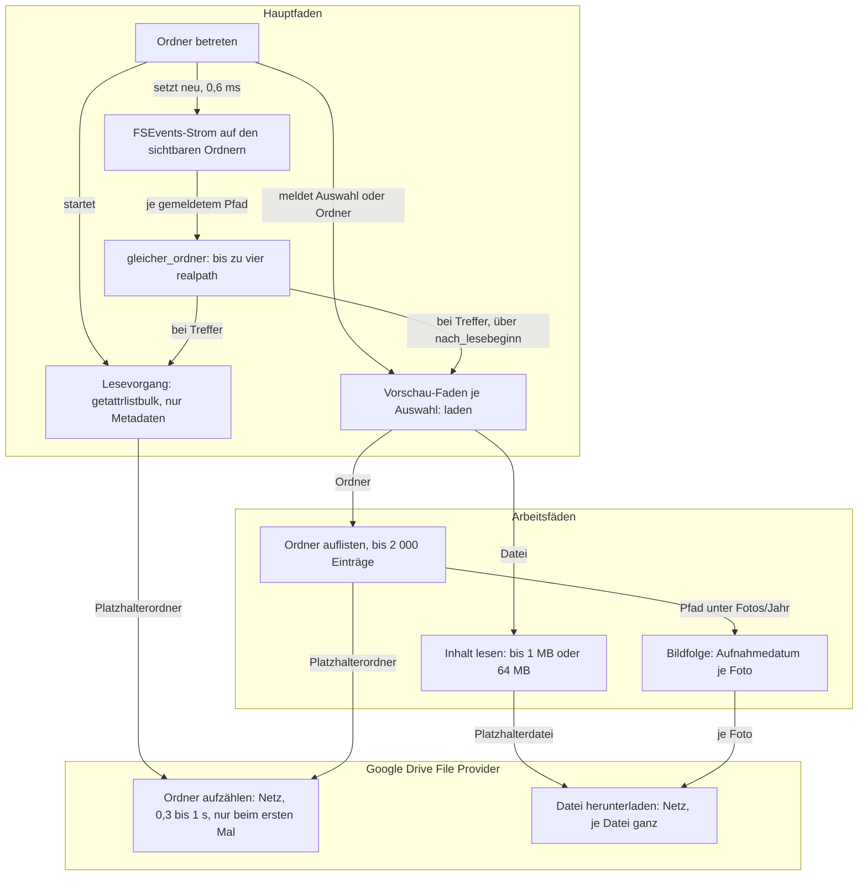

# Analysis: Warum die Navigation auf Google Drive zuweilen extrem langsam ist

**Date:** 2026-10-25 11:09
**Type:** Failure Investigation (mit Impact-Anteil)
**Status:** Complete
**Requested by:** orchestrator, für den Nutzer („Analysiere warum die Navigation auf dem Google drive zuweilen extrem langsam ist“)

## Question

Welche Wege in KRK berühren beim Betreten und Anzeigen eines Ordners auf `/Users/k1/Google Drive/Meine Ablage` das Dateisystem, welche davon werden auf einem File-Provider-Laufwerk teuer, und was macht die Navigation mal schnell und mal sehr langsam?

## Scope

- Code: `crates/krk-core/src/verzeichnis/` (`leser.rs`, `sys.rs`, `inhalt.rs`, `verweisziel.rs`), `crates/krk-core/src/text/datei.rs`, `crates/krk-core/src/leseprofil/` (`bildfolge.rs`, `defaultprofil.rs`, `mod.rs`), `crates/krk-core/src/git/lauf.rs`, `crates/krk-ui/src/vorschaumodell.rs`, `crates/krk-ui/src/auffrischung.rs`, `crates/krk-ui/src/tabs.rs`, `crates/krk-ui/src/appkit/fsevents.rs`, `crates/krk-ui/src/appkit/anwendung.rs`.
- Konfiguration des Nutzers, nur gelesen: `~/Library/Application Support/KRK/readers.toml`, `settings.toml`, `session.toml`, `bookmarks.toml`.
- Messungen gegen das Laufwerk, nur Metadaten: `scandir` und `lstat` über den ganzen Baum unter `Meine Ablage`, `realpath(3)`-Zeiten, ein FSEvents-Strom mit KRKs Parametern über drei Minuten, Anlegen und Abbauen eines Stroms. **Kein Dateiinhalt gelesen, keine Datei geöffnet, nichts geschrieben, KRK weder gebaut noch gestartet.** Die Skripte liegen unter `/private/tmp/claude-502/-Users-k1-Projects-productive-krk/30a8f18d-4756-46f5-a821-816b2ea70198/scratchpad/mess/`.
- Eine Nebenwirkung der Messung: der erste Lauf hat 20 Ordner zum ersten Mal aufgezählt, die bis dahin selbst Platzhalter waren. Ihr Inhalt ist danach als Liste auf dem Gerät, heruntergeladen ist keine Datei.
- Baum: `/Users/k1/Projects/productive/krk`, HEAD `c762e770`, 2026-10-25 10:55 +0100, Branch `main`, `## main...origin/main [voraus 1]`. Ausgeliefert und laufend ist KRK 3.10.0 (`/Applications/KRK.app`, PID 10842 zur Zeit der Messung).

## Findings

### Evidenzinventar

| Beleg | Was er sagt |
|---|---|
| `walk1.json` (erster Metadatenlauf) | 4 309 Ordner, 27 901 Dateien, davon 27 897 mit `SF_DATALESS` (184 GB). 20 Ordner waren selbst Platzhalter; ihr erstes `readdir` kostete 290 bis 994 ms. Ganzer Lauf 9,6 s, davon 7,5 s `readdir`. |
| `walk2.json` (gleich danach, warm) | Derselbe Baum in 0,7 s, `readdir` zusammen 0,2 s, langsamster Ordner 0,46 ms. |
| Zählung unter `pr/Fotos` | 10 087 Dateien in Jahres- und Monatsordnern, alle Platzhalter, rund 57 GB; `Fotos/2024` allein 1 648 Dateien, 11,3 GB. |
| `rp` (`realpath`) | 29 µs für `…/Google Drive/Meine Ablage`, 42 µs für einen Monatsordner darunter, 24 µs für einen lokalen Pfad. |
| `fsstart` | Anlegen, Starten und Abbauen eines FSEvents-Stroms: Median 0,6 ms, auf dem Laufwerk wie lokal. |
| `fsw_root.log` | Drei Minuten mit KRKs Parametern (0,3 s, nur `UseCFTypes`) auf `Meine Ablage`: **null** Meldungen. Das Laufwerk war in Ruhe. |
| Konfiguration | `readers.toml` trägt die Profile „Fotos: ein Jahr“ (`pfad = '/Fotos/[0-9]{4}$'`, `bildfolge = { ordner = "*" }`) und „Fotos: ein Monat“. `session.toml`: rechtes Fenster, aktiver Tab `/Users/k1/Google Drive/Meine Ablage`, Git-Bereich und Markenspalte aus. `settings.toml`: der Notizordner liegt auf dem Laufwerk. |

### Der Weg beim Betreten eines Ordners

Kein Knoten ist ohne Kante, die Richtung läuft von der Navigation über die Fäden zum Provider, und die einzige Rückkante ist die vom Strom zurück zum Lesevorgang und zur Vorschau; sie ist gewollt (Auffrischung) und steht in der Prosa unter B5.

### Ursachen nach Gewicht

| Nr. | Ursache | Codestelle | Faden | Beleg |
|---|---|---|---|---|
| B1 | Die Vorschau liest den Inhalt jeder ausgewählten Datei, und auf dem Laufwerk ist jede Datei ein Platzhalter, also lädt jeder Cursorschritt eine Datei herunter. | `vorschaumodell.rs`, `Ladevorgang::starten`, `laden`, `Leseart::von` | Arbeitsfaden, je Auswahl ein neuer, keiner wird abgebrochen | 27 897 von 27 901 Dateien `SF_DATALESS` (gemessen); Download beim Lesen ist das dokumentierte Verhalten von File Provider (`inference:` für Google Drive nicht nachgemessen) |
| B2 | Die Größenprüfung kommt nach dem Öffnen. Eine Datei über der Grenze wird abgewiesen, aber erst, nachdem sie geöffnet ist. | `text/datei.rs`, `bis_zur_grenze_lesen`, `anlesen`; Rufer `vorschaumodell::laden`, `verzeichnis::inhalt` | Arbeitsfaden | Code gelesen; 5 843 `.m4a` und 3 178 `.mov` fallen in den Textzweig (gemessen). `inference:` `open(2)` zum Lesen löst die Materialisierung schon aus; ungemessen, weil die Messung den Download auslöste |
| B3 | Steht der Cursor auf `pr/Fotos/<Jahr>` oder einem Monat darunter, liest die Bildfolge das Aufnahmedatum jedes Fotos, bis 7 500 Fotos und 60 Gruppen. | `leseprofil/bildfolge.rs`, `Bildverzeichnis::gruppe_ordnen`; `vorschaumodell::nachliefern`; Profile in `readers.toml` | Arbeitsfaden; Abbruchmarke greift vor dem nächsten Foto | `Fotos/2024`: 1 648 Platzhalter, 11,3 GB (gemessen). `inference:` ohne Teilabruf beim Provider holt jedes Lesen von 256 KB die ganze Datei |
| B4 | Der erste Besuch eines Ordners verlangt eine Aufzählung beim Provider, und die kostet einen Netzumlauf. Beim Betreten zählt KRK den Ordner zweimal parallel auf (Dateiliste und Vorschau des Ordners ohne Auswahl), und jeder Cursorschritt auf einen Unterordner zählt diesen auf. | `verzeichnis/leser.rs`, `Lesevorgang::starten`; `vorschaumodell::laden` → `leseprofil::zusammenfassen` → `leser::lesen_hoechstens` | Arbeitsfäden | 290 bis 994 ms je Platzhalterordner, warm 0,05 ms (gemessen) |
| B5 | Jede FSEvents-Meldung kostet auf dem Hauptfaden bis zu vier `realpath`, und unter dem Pfad über die Verknüpfung `Google Drive` scheitert der Zeichenvergleich immer. | `auffrischung.rs`, `gleicher_ordner`, `ort_neu_lesen`; Senke in `anwendung.rs`, `dateisystemwache_nachziehen` | **Hauptfaden** | 29 bis 42 µs je `realpath` (gemessen), also rund 0,15 ms je Pfad; in Ruhe null Meldungen in drei Minuten (gemessen). Unter Synchronisation ungemessen |

**B1, die Vorschau lädt herunter.** `laden` entscheidet über die Endung: Bild und PDF gehen bis `BILDGRENZE` (64 MB), JSON-Zeilen und Trenntext bis `TEXTGRENZE` (1 MB) angelesen, **jede andere Endung** geht in `Leseart::Text` und wird bis 1 MB gelesen. Dazu gehören auch Dateien ohne Endung (3 015 auf dem Laufwerk) und Google-Docs-Verweise. Jeder Auswahlwechsel startet in `Ladevorgang::starten` einen neuen Faden `krk-vorschau`; der alte verliert nur seinen Empfänger und liest weiter, bis seine Datei da ist. Wer mit gehaltener Pfeiltaste über zwanzig PDFs läuft, startet zwanzig Downloads gleichzeitig. KRK hängt dabei nicht, die Oberfläche bleibt bedienbar, aber die Vorschau zeigt lange „lädt“, und `speculation:` die Aufzählungen, auf die die Dateiliste wartet, stehen beim Google-Drive-Prozess hinter diesen Downloads an. Das Kennzeichen `SF_DATALESS` liefert `getattrlistbulk` schon mit (`sys.rs`, `ATTR_CMN_FLAGS`, ausgewertet in `satz_zerlegen` allein für `UF_HIDDEN`), und `laden` hat `st_flags` aus `symlink_metadata` in der Hand. Kein Weg im Baum fragt danach (`grep -rni dataless crates` ergibt nichts).

**B2, zu spät geprüft.** `bis_zur_grenze_lesen` öffnet über `sys::ohne_warten_oeffnen` und vergleicht danach die `fstat`-Größe. Für eine lokale Platte ist der Unterschied ein überflüssiges `open`. Auf dem Laufwerk entscheidet er, ob eine 300-MB-Aufnahme heruntergeladen wird, um danach als „zu groß“ in die Metadaten zu fallen. Derselbe Weg trägt den Inhaltsfilter (`verzeichnis/inhalt.rs`): mit „Content“ und „Deep“ in `Meine Ablage` öffnet ein Filterlauf jede der 27 901 Dateien, also bis zu 184 GB. Den Filter stößt der Nutzer selbst an; die Vorschau nicht.

**B3, die Bildfolge.** Das ist der stärkste Einzelfall und der, der am besten zu „extrem“ passt. Die Profile des Nutzers treffen `…/Meine Ablage/pr/Fotos/2024` und jeden Monat darunter. Die Erhebung (`verzeichnis_erheben`) öffnet keine Datei, die Ordnung (`gruppe_ordnen`) liest je Foto über `bild::aufnahmedatum` bis `HOECHSTENS_BYTES_JE_FOTO` (256 KB), und `nachliefern` ordnet Gruppe für Gruppe weiter, solange die Auswahl steht. Wer in den Jahresordner hineingeht, landet auf dem ersten Monat, und dessen Profil startet die nächste Folge. Ein Monat mit 400 HEIC-Fotos zu je 3 bis 7 MB sind 1 bis 3 GB Download, ausgelöst durch einen Cursor, der dort nur kurz stand.

**B4, der erste Besuch.** Die Dateiliste selbst ist sauber gebaut: `Lesevorgang::starten` liest auf einem eigenen Faden mit `getattrlistbulk` und fordert nur Name, Typ, Änderungsdatum, Kennzeichen und Länge an, nichts davon lädt herunter. Teuer ist allein die erste Aufzählung eines Ordners, den der Provider noch nicht kennt: 0,3 bis 1 s je Ordner, gemessen. Seit dem Nutzerentscheid vom 260825-1740 beschreibt die Vorschau ohne Auswahl den angezeigten Ordner, also läuft beim Betreten neben dem Lesevorgang ein zweites `lesen_hoechstens` über denselben Ordner. Und jeder Cursorschritt auf einen Unterordner zählt diesen auf (Default-Profil, Kennzeichenerkennung). Das Vorlesen ist sogar ein Vorteil, sobald der Nutzer hineingeht; auf einem Ordner mit vielen Unterordnern, über die er nur hinwegläuft, sind es viele Netzumläufe hintereinander, die sich mit B1 und B3 den Provider teilen. Ein kleiner Nebenweg: die Profile „Projektwurzel mit flight-Werkbank“ und „…fusion-Werkbank“ lesen ein Feld aus `.flight-setup` bzw. `.fusion-setup`, und unter `qa/Operation/pitches/flight-workbench` liegt eine solche Werkbank. Das ist eine kleine Datei, aber ein Download.

**B5, der Hauptfaden.** Das ist der einzige Teil, der die Oberfläche selbst anhalten kann, und gemessen ist er klein. Die Senke in `dateisystemwache_nachziehen` ruft je gemeldetem Pfad `ordner_neu_lesen`, das für beide Fensterseiten `gleicher_ordner` fragt. Der Tab trägt `/Users/k1/Google Drive/Meine Ablage`, FSEvents meldet `/Users/k1/Library/CloudStorage/GoogleDrive-kai@qantr.com/Meine Ablage/…`, also scheitert der Zeichenvergleich immer, und beide Seiten werden aufgelöst. Mit 0,15 ms je Pfad kostet ein Stapel von tausend Pfaden 150 ms auf dem Hauptfaden. In drei Minuten Ruhe kam kein Stapel. Wie groß die Stapel werden, wenn Google Drive nach einer Änderung auf einem anderen Gerät einen Ordnerbaum nachzieht, ist ungemessen; der Strom beobachtet den ganzen Unterbaum des angezeigten Ordners, und mit `Meine Ablage` als Ordner ist das das ganze Laufwerk. Die Kosten beziffert der offene Defekt `260826-1442_*_gleicher-ordner-ruft-canonicalize-je-gemeldetem-pfad-und-dateifenster-und-die-kosten-sind-ungemessen.md` bisher nicht; die Zahlen hier sind die erste Hälfte davon. Trifft ein Stapel den angezeigten Ordner, liest die Dateiliste neu und die Vorschau ebenso (`260825-1922_*_eine-auffrischung-stoesst-die-vorschau-mit-an-und-die-kosten-sind-ungemessen.md`); nach B1 ist die Datei dann schon da, das Neulesen kostet also wenig.

### Was nicht beteiligt ist

| Weg | Warum nicht | Beleg |
|---|---|---|
| Git-Bereich, Markenspalte | Ein Gitlauf startet nur, wenn der Befund gefragt ist, und in der Sitzung sind beide aus. Eingeschaltet liefe `gix::discover` auf einem Faden; unter `repo/git/spottr.git` liegt ein nacktes Repository auf dem Laufwerk. | `tabs.rs`, `gitlauf_nachziehen_an`; `session.toml` |
| Symbole, Vorschaubilder | KRK fragt `NSWorkspace` nach keinem Symbol und keine Vorschaubilder ab. | `grep iconForFile\|QuickLook` ohne Treffer |
| Verknüpfungsziele | Aufgelöst wird allein beim Einstieg, einmal und am Namen (`verweisziel::bestimmen`), nicht beim Lesen. | `verweisziel.rs`, Modulkopf |
| Aufsetzen des FSEvents-Stroms | 0,6 ms je Navigation. | `fsstart` |
| Löschweg auf dem Hauptfaden | Trifft nur das Löschen, nicht die Navigation. | `261016-1956-der-loeschweg-fragt-canonicalize-und-den-papierkorb-auf-dem-hauptfaden-und-ein-haengendes-netzlaufwerk-haelt-die-ereignisschleife-an.md` |
| Platzhalterlauf mit 2 000 Verzeichnissen | Kein Profil des Nutzers mit `ordner = "*"` trifft einen Ordner auf dem Laufwerk außer der Bildfolge unter `Fotos/<Jahr>`, und dort sind es höchstens zwölf Monate. | `260825-1953_*_ein-platzhalterlauf-oeffnet-bis-zu-zweitausend-verzeichnisse-und-die-eintragsschranke-faengt-das-nicht.md`; `readers.toml` |

### Warum „zuweilen“

| Lage | Schnell oder langsam | Grund |
|---|---|---|
| Ordner schon einmal aufgezählt, Cursor auf Ordnern oder kleinen Dateien, die schon geladen sind | schnell | Metadaten kommen aus dem lokalen Bestand des Providers, der ganze Baum in 0,7 s (gemessen). |
| Erster Besuch eines Ordners, oder ein Ordner, den der Provider wieder zum Platzhalter gemacht hat | 0,3 bis 1 s je Ordner, mehrfach beim Darüberlaufen | Netzumlauf je Aufzählung (gemessen); `speculation:` Google Drive gibt Ordnerlisten bei Speicherdruck wieder frei |
| Cursor auf einer PDF, einem Bild oder einer Datei ohne bekannte Endung, die nie geöffnet wurde | Vorschau steht Sekunden bis Minuten, andere Ordner listen träger | B1, B2: Download der ganzen Datei |
| Cursor auf `Fotos/<Jahr>` oder einem Monat | Minuten, viel Netzlast | B3: Hunderte Fotos werden heruntergeladen |
| Schnelles Blättern über viele Dateien | wird mit jedem Schritt schlimmer | B1: ein Download je Schritt, keiner bricht ab |
| Google Drive synchronisiert gerade (Änderung auf einem anderen Gerät, Hochladen) | ungleichmäßig | `speculation:` Aufzählungen warten beim Provider; B5 wächst mit der Stapelgröße |

Eine einmal heruntergeladene Datei bleibt da, bis Google Drive sie wieder freigibt. Der zweite Besuch desselben Ordners ist deshalb schnell, und dieselbe Bewegung über denselben Ordner wirkt am nächsten Tag wieder langsam. Das ist der Wechsel, den der Nutzer „zuweilen“ nennt.

## Implications

Das Problem ist keine Blockade des Hauptfadens. Die Bauregel „kein Systemaufruf auf dem Hauptfaden“ hält auf dem ganzen Navigationsweg bis auf B5, und B5 ist gemessen klein. Das Problem ist, dass drei Leser im Hintergrund (Vorschau, Bildfolge, Inhaltsfilter) annehmen, Lesen sei eine Sache der lokalen Platte. Auf einem File-Provider-Laufwerk ist Lesen ein Download, und KRK löst ihn aus, ohne dass der Nutzer ihn verlangt hat. Dieselbe Annahme trägt jeder andere Cloud-Speicher unter `~/Library/CloudStorage` (iCloud Drive, OneDrive, Dropbox), also ist das kein Sonderfall für Google.

Die Zeitzusagen aus C8 messen auf einem lokalen Prüfordner und sehen das nicht. Sie stehen seit dem 261017 ohnehin alle ohne Abnahmelauf.

## Recommendations

Gegenmittel, nicht umgesetzt, das erste als der eine Mechanismus, der B1 bis B3 zugleich deckt:

1. **Die Hintergrundleser dürfen nicht materialisieren.** macOS hat dafür eine Faden-Richtlinie: `setiopolicy_np(IOPOL_TYPE_VFS_MATERIALIZE_DATALESS_FILES, IOPOL_SCOPE_THREAD, IOPOL_MATERIALIZE_DATALESS_FILES_OFF)`. Auf dem Vorschau-Faden, dem Bildfolge-Nachlieferer und dem Durchlauf gesetzt, scheitert ein Lesen an einem Platzhalter mit einem Fehler, statt herunterzuladen, und die Vorschau fällt auf den Weg zurück, den sie für jedes Lesehindernis schon hat (die Metadaten). Das deckt auch die Wege, die heute niemand kennt, statt jeden Leser einzeln zu prüfen. Kosten: eine weitere Schnittstelle in `verzeichnis/sys.rs` (der Modulkopf zählt dann zwölf), Untergrenze und genaue Fehlersemantik am SDK-Kopf `sys/resource.h` nachzulesen (`inference:` seit macOS 10.15 vorhanden). Wichtig: dieselbe Richtlinie verbietet auch das Aufzählen eines Platzhalterordners, sie gehört also nicht auf den Lesevorgang der Dateiliste. → implementation-planner.
2. **Ein Hinweis statt Schweigen.** Das Kennzeichen `SF_DATALESS` kommt mit `ATTR_CMN_FLAGS` schon an (`satz_zerlegen`). Die Vorschau zeigt dann „liegt nur in der Cloud“ statt einer Metadatenanzeige ohne Grund, und die Bildfolge nimmt das Änderungsdatum, den Rückfall, den `gruppe_ordnen` schon hat. Wie der Nutzer den Inhalt doch anfordert, ist eine eigene Frage für den requirements-designer. Defekt: `261025-1110-die-vorschau-liest-platzhalterdateien-eines-cloudlaufwerks-schon-beim-bewegen-der-auswahl-und-ein-auswahlwechsel-bricht-das-herunterladen-nicht-ab.md`.
3. **Erst die Größe, dann das Öffnen.** `laden` hält `roh.len()` gegen `Leseart::grenze`, der Durchlauf gegen `Eintrag::groesse`, bevor `bis_zur_grenze_lesen` öffnet. Lokal spart das ein `open`, auf dem Laufwerk einen Download. Defekt: `261025-1109-bis-zur-grenze-lesen-oeffnet-die-datei-vor-der-groessenpruefung-und-holt-auf-einem-cloudlaufwerk-jede-zu-grosse-datei-herunter.md`. → code-implementer.
4. **Die aufgelöste Form der beobachteten Ordner einmal beim Aufsetzen des Stroms halten**, wie `260826-1442_*_gleicher-ordner-ruft-canonicalize-je-gemeldetem-pfad-und-dateifenster-und-die-kosten-sind-ungemessen.md` es vorschlägt. Damit kostet jeder Pfad ein `realpath` statt bis zu vier. Niedriger Rang, weil gemessen klein.
5. Nicht empfohlen: eine Verzögerung der Vorschau nach dem Cursorschritt als eigene Regel. Sie mildert B1, ändert das Verhalten auf jeder lokalen Platte mit und ist nach Punkt 1 überflüssig.

Der Nutzer kann bis dahin selbst zwei Dinge tun: die Vorschau ausblenden, solange er im Laufwerk navigiert (bei ausgeblendeter Vorschau liest `vorschau_fuellen` nichts), und den Ordner `Fotos` in Google Drive als „offline verfügbar“ markieren.

## Filed Issues

- `261025-1109-bis-zur-grenze-lesen-oeffnet-die-datei-vor-der-groessenpruefung-und-holt-auf-einem-cloudlaufwerk-jede-zu-grosse-datei-herunter.md`: Größenprüfung nach dem Öffnen, Vorschau und Inhaltsfilter.
- `261025-1110-die-vorschau-liest-platzhalterdateien-eines-cloudlaufwerks-schon-beim-bewegen-der-auswahl-und-ein-auswahlwechsel-bricht-das-herunterladen-nicht-ab.md`: Vorschau und Bildfolge laden Platzhalter herunter, ohne Abbruch.
- Ergänzt, nicht neu angelegt: `260826-1442_*_gleicher-ordner-ruft-canonicalize-je-gemeldetem-pfad-und-dateifenster-und-die-kosten-sind-ungemessen.md` und `260825-1922_*_eine-auffrischung-stoesst-die-vorschau-mit-an-und-die-kosten-sind-ungemessen.md`, je mit einer Zeile `Also seen:`.

## Sources

- `crates/krk-ui/src/vorschaumodell.rs`: Modulkopf (`# Der Arbeitsfaden`, `# Die Bildfolge liefert nach`), `Ladevorgang::starten`, `laden`, `Leseart::von`, `Leseart::grenze`
- `crates/krk-core/src/text/datei.rs`: `bis_zur_grenze_lesen`, `anlesen`
- `crates/krk-core/src/verzeichnis/sys.rs`: Attributmaske in `Schwungleser::oeffnen`, `satz_zerlegen`
- `crates/krk-core/src/verzeichnis/leser.rs`: Modulkopf, `Lesevorgang::starten`, `lesen_hoechstens`
- `crates/krk-core/src/verzeichnis/inhalt.rs`: Modulkopf
- `crates/krk-core/src/leseprofil/bildfolge.rs`: Modulkopf, `gruppe_ordnen`; `leseprofil/mod.rs`: `HOECHSTENS_*`
- `crates/krk-ui/src/auffrischung.rs`: Modulkopf, `ort_neu_lesen`, `gleicher_ordner`
- `crates/krk-ui/src/appkit/fsevents.rs`: Modulkopf, `SAMMELVERZOEGERUNG`, `KENNZEICHEN_CF_TYPEN`
- `crates/krk-ui/src/appkit/anwendung.rs`: `dateisystemwache_nachziehen`, `vorschau_fuellen`, `lokaler_papierkorbbefund`
- `crates/krk-ui/src/tabs.rs`: `verknuepfung_pruefen`, `gitlauf_nachziehen_an`
- `crates/krk-core/src/git/lauf.rs`: Modulkopf
- `~/Library/Application Support/KRK/readers.toml`, `settings.toml`, `session.toml`, `bookmarks.toml`
- Messskripte und Ergebnisse: `/private/tmp/claude-502/-Users-k1-Projects-productive-krk/30a8f18d-4756-46f5-a821-816b2ea70198/scratchpad/mess/` (`walk.py`, `walk1.json`, `walk2.json`, `rp.swift`, `fsstart.swift`, `fsw.swift`, `fsw_root.log`)

## Open Questions

- [ ] Löst bei Google Drive schon `open(2)` den Download aus, oder erst `read(2)`, und holt der Provider die ganze Datei oder nur den gelesenen Teil? Prüfbar an einer bekannten Platzhalterdatei mit `ls -lO` vor und nach einem `open` ohne `read`; der Nutzer entscheidet, ob dafür ein Download in Kauf genommen wird.
- [ ] Wie groß werden FSEvents-Stapel auf `Meine Ablage`, während Google Drive Änderungen von einem anderen Gerät nachzieht? In Ruhe kam keiner.
- [ ] Wie fordert der Nutzer den Inhalt eines Platzhalters in der Vorschau doch an? Eine Frage für den requirements-designer, bevor Punkt 1 und 2 gebaut werden.
