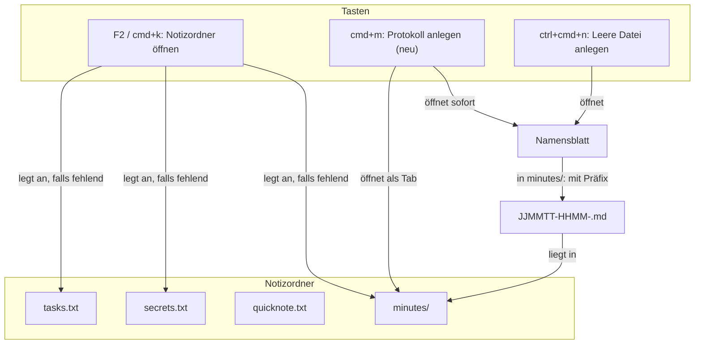

# Spec: Menü „Navigation“, Notizordner mit drei Dateien und Protokollordner `minutes/`

**Date:** 2026-11-11
**Source:** Nutzeranfrage vom 261111, wörtlich:

> Änderung im Menu:
> - Kürze "Leiste und Fokus" -> "Leiste"
> - "Dateioperationen" -> "Dateioperation"
> - "Dateilisting" -> "Dateliste"
> - Lege neues Item an neben Dateiliste: "Navigation"
> - Bewege die ersten 8 Dateilisting Operationen -> Navigation, benso die anderen Navigationsbefehle: Pfad einegebn und springen, zur Zwischenablage springen etc
>
> Die Datei scratch.txt in quicknote.txt umbenennen.
>
> DIe apointment.md und die notes.txt Funktionen komplett entfernen.
> Nur secrets, tasks und quicknote bleiben in krkhome.
>
> krkhome bekommt aber einen neuen Unterordner: minutes/
> Dateien, die in diesem Ornder angelegt werden mit Option+Shiift+n erhalten ein Profix "YYMMDD-TTHHMM-" + <eingegebener Name> + ".md"
> Außerdem brauche ich einen Kurzbefhl, der den Ornder minutes/ in einem neuen Tab öffnet und sofort in den Datei-öffnen Dialog springt: am besten etwas mit M wie cmd+M.

Antworten des Nutzers auf die vier Rückfragen, wörtlich:

> 1a 3a 4:gemeint war:YYMMDD-HHMM-<..>.md
> 2:Control+Shift+N bleibt der eine Dateianlagebefehl und legt nur in minutes/ die Datei immer mit Prefix an. Zusätzlich kommt ein neues CMD+MBefehl dazu, der wie bei 3a in minutes/ springt und sofort Datei öffnen mit Prefix macht.

**Lesart der Antworten** (vom Auftraggeber dieser Spezifikation festgelegt, hier kenntlich gemacht):

- Frage 1, Antwort A: ins Menü „Navigation“ wandern die zehn genannten Befehle und dazu „Ordner der angezeigten Datei zeigen“ und „Anderes Dateifenster auf diesen Ordner stellen“.
- Frage 2, der Sache nach Antwort B: es gibt genau einen Befehl „Leere Datei anlegen“, keine zweite Taste und keinen eigenen Befehl für Protokolle. Der Nutzer schreibt „Control+Shift+N“; die Auslieferungsbelegung führt den Befehl auf `ctrl+cmd+n`. Wegen des Wortes „bleibt“ gilt die bestehende Taste. Ob er eine Umbelegung meinte, steht unter `## User Decisions Pending`.
- Frage 3, Antwort A: `cmd+m` öffnet `minutes/` und springt sofort ins Namensblatt von „Leere Datei anlegen“.
- Frage 4, Antwort A: das Präfix ist `JJMMTT-HHMM-`, ohne Buchstaben.

Den acht Vorgaben, die mit den Rückfragen vorgelegt wurden, hat der Nutzer nicht widersprochen. Sie stehen unten je Fähigkeit als Vorgabe.

## Directive

Die Menüleiste bekommt ein Menü „Navigation“ und drei kürzere Titel. Der Notizordner führt danach allein `tasks.txt`, `secrets.txt`, `quicknote.txt` und den Unterordner `minutes/`; die Funktionen für Notizen und Termine entfallen vollständig. Eine in `minutes/` angelegte Datei trägt immer Datum und Uhrzeit vor ihrem Namen, und `cmd+m` führt von jeder Stelle aus in einem Zug dorthin und in das Anlegen.

## Gestalt

Die Quicknote schreibt `quicknote.txt` selbst und steht deshalb an keiner Taste dieses Bildes. Außerhalb von `minutes/` legt das Namensblatt die Datei unter genau dem getippten Namen an wie bisher; dieser Weg ist unverändert und im Bild nicht gezeichnet.

## Capabilities

### C1: Menüleiste mit „Navigation“ und drei kürzeren Titeln

**Description:** Drei Menüs bekommen einen neuen Titel, und rechts neben „Dateiliste“ steht ein neues Menü „Navigation“. Es sammelt die Befehle, mit denen der Nutzer sich in der Liste bewegt und den angezeigten Ordner wechselt. Tasten und Wirkung jedes Befehls bleiben, wie sie sind; allein der Platz in der Leiste ändert sich. Die Belegungsansicht (F1) und die Markdown-Ausgabe der Tastenbelegung zeigen dieselbe Gliederung wie das Hauptmenü, weil KRK für alle drei eine einzige Gliederung führt.

**Acceptance criteria:**
- [ ] C1.1 Bei deutscher Oberfläche lauten die drei Titel „Leiste“ (bisher „Leiste und Fokus“), „Dateioperation“ (bisher „Dateioperationen“) und „Dateiliste“ (bisher „Dateilisting“). Die alten Titel stehen an keiner Stelle der Menüleiste mehr.
- [ ] C1.2 Bei englischer Oberfläche lauten sie „Bar“, „File Operation“ und „File List“, bei französischer „Barre“, „Opération sur les fichiers“ und „Liste de fichiers“.
- [ ] C1.3 Die Menüleiste führt ein Menü „Navigation“ (in allen drei Sprachen derselbe Titel), unmittelbar rechts neben „Dateiliste“. Die Folge der übrigen Menüs ist unverändert.
- [ ] C1.4 „Navigation“ enthält genau diese zwölf Einträge, in dieser Reihenfolge: „Auswahl einen Eintrag nach oben“, „Auswahl einen Eintrag nach unten“, „Auswahl eine Bildschirmseite nach oben“, „Auswahl eine Bildschirmseite nach unten“, „An den Anfang der Liste“, „An das Ende der Liste“, „In den ausgewählten Ordner einsteigen“, „In den übergeordneten Ordner“, „Ordner der angezeigten Datei zeigen“, „Anderes Dateifenster auf diesen Ordner stellen“, „Pfad eingeben und dorthin springen“, „Zum Inhalt der Zwischenablage springen“.
- [ ] C1.5 Keiner dieser zwölf Einträge steht noch unter „Dateiliste“. „Dateiliste“ beginnt mit den Markierungsbefehlen und führt weiter Markieren, Sortieren, die Schalter für versteckte Einträge, Spalten, „Deep“ und „Content“ und das Einfügen in den Filter.
- [ ] C1.6 Jeder der zwölf Befehle löst mit derselben Taste dasselbe aus wie vor der Änderung, und sein Menüeintrag zeigt dasselbe Kürzel wie vorher.
- [ ] C1.7 Jeder Befehl der Tastenbelegung steht weiterhin genau einmal in der Menüleiste.
- [ ] C1.8 Die Belegungsansicht (F1) und die Markdown-Ausgabe der Tastenbelegung zeigen die Abschnitte mit denselben Titeln, in derselben Folge und mit denselben Befehlen je Abschnitt wie die Menüleiste.
- [ ] C1.9 `HowTo.md` und `README.md` nennen keinen der drei alten Menütitel mehr, wo sie ein Menü der laufenden Anwendung meinen.

**Decisions made:**
- Umfang von „etc.“: die zehn genannten Befehle und dazu „Ordner der angezeigten Datei zeigen“ und „Anderes Dateifenster auf diesen Ordner stellen“ (Nutzer, Antwort 1a). „Notizordner öffnen“ bleibt unter „Home“, die Tabbefehle bleiben unter „Tabs“.
- „Dateliste“ in der Anfrage: gelesen als „Dateiliste“ (Vorgabe, Tippfehler).
- Titel in Englisch und Französisch: wie in C1.2 (Vorgabe; Französisch für „Dateiliste“ bleibt beim heutigen Wortlaut).
- Platz des neuen Menüs: unmittelbar rechts neben „Dateiliste“ (Vorgabe aus „neben Dateiliste“).
- Die Fokusbefehle bleiben unter „Leiste“, obwohl der Titel „Fokus“ nicht mehr nennt (Vorgabe).
- Reihenfolge innerhalb von „Navigation“: die heutige Reihenfolge dieser Befehle untereinander (Vorgabe).

### C2: Die Quicknote sichert sich als `quicknote.txt`

**Description:** Die Datei, in der die Quicknote ihren Text im Notizordner hält, heißt `quicknote.txt` statt `scratch.txt`. Am Verhalten der Quicknote ändert sich sonst nichts. Wer aus einer früheren Fassung eine `scratch.txt` hat, findet ihren Text ohne Zutun in der Quicknote wieder.

**Acceptance criteria:**
- [ ] C2.1 In einem Notizordner ohne `scratch.txt` und ohne `quicknote.txt` entsteht nach dem ersten Sichern der Quicknote eine `quicknote.txt` mit dem getippten Text, und keine `scratch.txt`.
- [ ] C2.2 Steht im Notizordner eine `scratch.txt` und keine `quicknote.txt`, zeigt die Quicknote beim ersten Öffnen nach dem Start den Inhalt der `scratch.txt`; danach steht im Ordner eine `quicknote.txt` mit diesem Inhalt und keine `scratch.txt` mehr.
- [ ] C2.3 Stehen beide Dateien im Notizordner, zeigt die Quicknote den Inhalt der `quicknote.txt`, und `scratch.txt` bleibt Byte für Byte unverändert liegen.
- [ ] C2.4 KRK überschreibt bei der Umbenennung nie eine vorhandene `quicknote.txt`, auch dann nicht, wenn sie zwischen Prüfung und Umbenennung entsteht.
- [ ] C2.5 Sichern nach einer Sekunde Ruhe, beim Schließen und beim Beenden, Leeren, Kopieren, Rückgängig und die Meldungen ohne Notizordner verhalten sich wie vor der Änderung, nur mit dem neuen Dateinamen.
- [ ] C2.6 `quicknote.txt` ist im Editor und in der Vorschau eine gewöhnliche Textdatei, und F2 legt sie nicht an.
- [ ] C2.7 `HowTo.md` nennt als Ort des Quicknote-Texts `quicknote.txt` und beschreibt in einem Satz, was mit einer vorhandenen `scratch.txt` geschieht.

**Decisions made:**
- Bestand `scratch.txt`: einmalige Umbenennung beim ersten Öffnen der Quicknote, nie über eine vorhandene Datei hinweg; stehen beide, bleiben beide (Vorgabe nach dem Vorbild der Umbenennung von `.secrets.txt` in `secrets.txt`).

### C3: Notizen und Termine entfallen

**Description:** KRK behandelt `notes.txt` und `appointments.md` nicht mehr als besondere Dateien. Sie sind danach gewöhnliche Text- und Markdown-Dateien, an jedem Ort. Die Aufgaben in `tasks.txt`, die Geheimnisse in `secrets.txt` mit PIN und Verbindungen und die Tabelle für CSV- und TSV-Dateien bleiben unverändert.

**Acceptance criteria:**
- [ ] C3.1 `notes.txt` im Notizordner öffnet sich im Editor als gewöhnlicher Text; eine Tabellenansicht bietet der Editor für sie nicht an, und die Eintragsbefehle unter „Home“ sind vor ihr ausgegraut.
- [ ] C3.2 `appointments.md` im Notizordner öffnet sich im Editor als gewöhnliches Markdown, mit Rohansicht und Formatansicht wie jede andere `.md`-Datei; eine Termintabelle, eine Ordnung nach Datum und eine Marke für den heutigen Tag gibt es nicht.
- [ ] C3.3 Die Vorschau zeigt `notes.txt` wie jede andere Textdatei (ohne Kästchen) und `appointments.md` wie jedes andere Markdown (in der Reihenfolge der Datei).
- [ ] C3.4 Der Befehl „Termine: Sortierrichtung umkehren“ steht in keinem Menü, nicht in der Belegungsansicht und nicht in der Markdown-Ausgabe. „Nach Name sortieren“ zeigt im Menü das Kürzel `cmd+1`.
- [ ] C3.5 F2 in einem leeren oder fehlenden Notizordner legt weder `notes.txt` noch `appointments.md` an.
- [ ] C3.6 Vorhandene `notes.txt` und `appointments.md` bleiben bei F2, beim Start und bei jedem anderen Befehl dieser Arbeit Byte für Byte unverändert liegen; KRK löscht und verschiebt sie nicht.
- [ ] C3.7 F2 in einem neu angelegten Notizordner übernimmt die alten Notizzettel `note-1.txt` und `note-2.txt` aus dem Ablageordner nicht mehr; die zwei Dateien bleiben dort unverändert liegen, und keine Meldung verspricht eine Übernahme.
- [ ] C3.8 `tasks.txt` zeigt im Editor weiter die Aufgabentabelle mit Hinzufügen, Bearbeiten, Verschieben, Löschen und Abhaken, und die Vorschau zeigt sie weiter mit Kästchen.
- [ ] C3.9 `secrets.txt` verhält sich wie vorher: PIN festlegen, eingeben und ändern, Tabelle der Geheimnisse, zehn Minuten ohne erneute PIN, Verbindungen anlegen und herstellen. Eine vor dieser Änderung gesicherte `secrets.txt` öffnet sich mit ihrer PIN und zeigt dieselben Einträge.
- [ ] C3.10 Eine eigene `keymap.toml`, die den entfallenen Befehl noch nennt, wird weiter geladen; die übrigen eigenen Zuweisungen des Nutzers gelten weiter.
- [ ] C3.11 In keiner der drei Sprachen zeigt KRK noch eine Meldung, einen Spaltentitel oder einen Menüeintrag, der von einer Notiztabelle, einer Termintabelle oder einem Termin spricht. Das Feld „Notizen:“ im Blatt „Verbinden“ und in der Tabelle der Geheimnisse bleibt.
- [ ] C3.12 `HowTo.md` enthält die Abschnitte „Notizen in der Tabelle bearbeiten“ und „Termine in `appointments.md`“ nicht mehr und nennt als Inhalt des Notizordners `tasks.txt`, `secrets.txt`, `quicknote.txt` und `minutes/`. Es sagt in einem Satz, dass vorhandene `notes.txt` und `appointments.md` liegen bleiben und gewöhnliche Dateien sind. `README.md` und die Kommentare der mitgelieferten `settings.toml` nennen die zwei Dateien nicht mehr als Inhalt des Notizordners.

**Decisions made:**
- Umfang von „komplett entfernen“: Tabellenansichten, besondere Vorschau, der Befehl „Termine: Sortierrichtung umkehren“, das Anlegen durch F2, die Übernahme der alten Notizzettel, alle zugehörigen Texte und Anleitungsabschnitte (Vorgabe, dem Nutzer als Liste vorgelegt, ohne Widerspruch).
- Bestand: vorhandene Dateien bleiben unberührt liegen (Vorgabe; KRK überschreibt und löscht im Notizordner nie eine vorhandene Datei).
- Übernahme der alten Notizzettel: entfällt, weil ihr Ziel `notes.txt` entfällt; die Zettel bleiben im Ablageordner (Vorgabe).

### C4: Unterordner `minutes/` mit Datum und Uhrzeit vor dem Namen

**Description:** Der Notizordner bekommt den Unterordner `minutes/` für Protokolle. Eine Datei, die der Nutzer dort mit „Leere Datei anlegen“ anlegt, heißt immer `JJMMTT-HHMM-<getippter Name>.md`. Der Befehl selbst bleibt der eine Anlegebefehl mit seiner Taste; außerhalb von `minutes/` legt er die Datei unter genau dem getippten Namen an wie bisher.

**Acceptance criteria:**
- [ ] C4.1 F2 legt `minutes/` im Notizordner an, wenn der Ordner fehlt, auch in einem Notizordner, den es schon gibt. Ein vorhandenes `minutes/` und sein Inhalt bleiben unverändert.
- [ ] C4.2 Zeigt das aktive Dateifenster `minutes/` unmittelbar im eingestellten Notizordner, und der Nutzer legt über „Leere Datei anlegen“ mit dem Namen `besprechung` eine Datei an, heißt sie `<JJMMTT>-<HHMM>-besprechung.md`, wobei Datum und Uhrzeit die Ortszeit im Augenblick des Bestätigens sind (Beispiel: am 11.11.2026 um 14:32 Uhr `261111-1432-besprechung.md`).
- [ ] C4.3 Die Regel aus C4.2 gilt für jeden Weg auf den Befehl: die Taste, den Eintrag im Menü „Dateioperation“ und den Weg über `cmd+m` aus C5.
- [ ] C4.4 Endet der getippte Name schon auf `.md` (Groß- und Kleinschreibung gleichgültig), wird die Endung nicht verdoppelt: `besprechung.md` ergibt `<JJMMTT>-<HHMM>-besprechung.md`.
- [ ] C4.5 Ein getippter Name mit einer anderen Endung behält sie und bekommt `.md` dahinter: `liste.txt` ergibt `<JJMMTT>-<HHMM>-liste.txt.md`.
- [ ] C4.6 In jedem anderen Ordner, auch in einem Unterordner von `minutes/` und in einem Ordner namens `minutes` außerhalb des Notizordners, legt „Leere Datei anlegen“ die Datei unter genau dem getippten Namen an, ohne Präfix und ohne angehängte Endung.
- [ ] C4.7 „Ordner anlegen“, Umbenennen, Stapelumbenennen, Duplizieren, Kopieren und Verschieben setzen in `minutes/` kein Präfix und hängen keine Endung an.
- [ ] C4.8 Steht in `minutes/` schon eine Datei mit dem entstehenden Namen, wird sie nicht überschrieben, und KRK meldet den vergebenen Namen so, wie „Leere Datei anlegen“ es in jedem anderen Ordner tut.
- [ ] C4.9 Nach dem Anlegen ist die neue Datei in der Liste ausgewählt, wie nach „Leere Datei anlegen“ in jedem anderen Ordner.
- [ ] C4.10 Solange der Nutzer den Namen im Namensblatt tippt, zeigt das Blatt in `minutes/` einen Hinweis, dass Datum, Uhrzeit und `.md` ergänzt werden. Der Hinweis steht in allen drei Sprachen.
- [ ] C4.11 `HowTo.md` beschreibt `minutes/`, die Namensregel mit einem Beispiel und die Grenze aus C4.6 und C4.7.

**Decisions made:**
- Ein Befehl, keine zweite Taste, kein eigener Befehl für Protokolle; in `minutes/` setzt er immer das Präfix (Nutzer, Antwort 2).
- Form des Präfix: `JJMMTT-HHMM-` ohne Buchstaben (Nutzer, Antwort 4).
- Geltung allein unmittelbar in `minutes/` des eingestellten Notizordners und allein für „Leere Datei anlegen“ (Vorgabe).
- Zeit: Ortszeit beim Bestätigen des Namens (Vorgabe).
- Endung: `.md` wird angehängt, außer der Name endet schon auf `.md` (Vorgabe; C4.5 folgt daraus).
- Hinweis im Namensblatt (C4.10): Vorgabe dieser Spezifikation, weil der entstehende Name sonst vom getippten abweicht, ohne dass das Blatt es sagt. Der Nutzer kann das Kriterium bei der Durchsicht streichen.
- Folge der Regel „immer mit Präfix“: über KRK lässt sich in `minutes/` keine Datei ohne Präfix anlegen. Wer eine braucht, legt sie woanders an und verschiebt sie, oder benennt sie um.

### C5: `cmd+m` öffnet `minutes/` und springt ins Anlegen

**Description:** Ein neuer Befehl führt von jeder Stelle der Anwendung in einem Zug zum neuen Protokoll: er zeigt `minutes/` im aktiven Dateifenster und öffnet sofort das Namensblatt von „Leere Datei anlegen“. Der Nutzer tippt den Namen, bestätigt, und die Datei steht mit Präfix in `minutes/`.

**Acceptance criteria:**
- [ ] C5.1 Das Menü „Home“ führt einen neuen Eintrag für diesen Befehl, mit dem Kürzel `cmd+m`, unmittelbar hinter „Notizordner öffnen“. Er trägt in allen drei Sprachen einen Namen; deutsch „Protokoll anlegen“.
- [ ] C5.2 `cmd+m` wirkt, gleich wo der Fokus steht (Leiste, Dateifenster, Vorschau, Editor, Git-Bereich), so wie F2.
- [ ] C5.3 Nach `cmd+m` zeigt das aktive Dateifenster `minutes/` des eingestellten Notizordners, der Fokus steht dort, und das Namensblatt von „Leere Datei anlegen“ ist offen und nimmt Eingaben an, ohne einen weiteren Tastendruck.
- [ ] C5.4 Steht im aktiven Dateifenster schon ein Tab auf `minutes/`, wird dieser Tab sichtbar; sonst entsteht ein neuer Tab. Ein zweiter Tab auf `minutes/` im selben Dateifenster entsteht durch `cmd+m` nicht.
- [ ] C5.5 Name tippen und bestätigen legt die Datei nach den Regeln aus C4 an; sie ist danach in der Liste ausgewählt.
- [ ] C5.6 `esc` im Namensblatt schließt das Blatt und legt nichts an. Der Tab auf `minutes/` bleibt stehen, mit dem Fokus in der Liste.
- [ ] C5.7 Fehlt `minutes/` oder der Notizordner, legt `cmd+m` sie an wie F2 (samt `tasks.txt` und `secrets.txt`, wenn sie fehlen) und fährt dann fort wie in C5.3.
- [ ] C5.8 Lässt sich der Ordner nicht anlegen oder nicht öffnen (eine gewöhnliche Datei an seiner Stelle, der Ordner darüber fehlt, kein gültiger Notizordner in `settings.toml`), nennt die Statuszeile den Grund wie bei F2, und weder ein Tab noch ein Blatt geht auf.
- [ ] C5.9 Solange ein Blatt offen ist, tut `cmd+m` nichts, wie F2.
- [ ] C5.10 Mit einer eigenen `keymap.toml` steht der Befehl ohne Taste im Menü „Home“ und lässt sich in der Belegungsansicht (F1) auf `cmd+m` legen; die übrige eigene Belegung bleibt unberührt.
- [ ] C5.11 `HowTo.md` beschreibt den Befehl beim Notizordner, samt dem Satz für Nutzer mit eigener `keymap.toml`.

**Decisions made:**
- Ziel des Sprungs: das Namensblatt von „Leere Datei anlegen“ (Nutzer, Antwort 3a). Die neue Datei geht nicht von selbst im Editor auf; dafür bleibt `f4`.
- Taste: `cmd+m` (Nutzer). In der Auslieferungsbelegung ist sie frei.
- Tab: vorhandenen Tab auf `minutes/` sichtbar machen, sonst neuen anlegen, im aktiven Dateifenster (Vorgabe, wie F2 heute).
- Wirkung überall und Anlegen fehlender Ordner auf dem Weg von F2 (Vorgabe).
- Name des Befehls: „Protokoll anlegen“ / „New Minutes File“ / „Créer un compte rendu“ (Vorgabe; bei der Durchsicht änderbar).
- Platz im Menü: unter „Home“ hinter „Notizordner öffnen“ (Vorgabe, weil „Home“ alle Befehle des Notizordners führt).

## Stops when

- Zeigt die Probe am laufenden Bündel, dass `cmd+m` das Fenster minimiert oder von macOS abgefangen wird, bevor KRK die Taste sieht, hält die Arbeit an C5 an und legt dem Nutzer die Wahl einer anderen Taste vor. Geprüft ist bisher allein, dass die Auslieferungsbelegung `cmd+m` nicht führt und das Hauptmenü keinen Eintrag „Minimieren“ hat.
- Zeigt die Arbeit an C3, dass die Tabelle oder das Dateiformat von `secrets.txt` ohne die Bausteine der Notizen nicht bestehen kann, bleiben diese Bausteine als Teil der Geheimnisse stehen. C3.9 hat Vorrang vor der Vollständigkeit der Entfernung, und was stehen bleibt, wird dem Nutzer genannt.

## Constraints

- Jeder Text, den der Nutzer in Fenstern, Blättern, Menüs oder der Statuszeile liest, steht in allen drei Sprachen (Deutsch, Englisch, Französisch).
- KRK überschreibt und löscht im Notizordner nie eine vorhandene Datei. Das gilt für die Umbenennung aus C2 und für alles, was C3 liegen lässt.
- `secrets.txt` geht weiter allein verschlüsselt auf die Platte, und die PIN-Sperre gilt für jeden Weg in die Datei. Nichts an dieser Arbeit darf einen Klartextweg öffnen.
- Tasten und Wirkung aller Befehle, die diese Spezifikation nicht nennt, bleiben unverändert.
- Die Kennungen der Befehle in einer eigenen `keymap.toml` des Nutzers bleiben gültig; eine eigene Belegung darf durch diese Arbeit nicht verworfen werden.
- `session.toml`, `bookmarks.toml` und `settings.toml` aus der Fassung davor werden weiter gelesen. Ein wiederhergestellter Tab auf den Notizordner oder auf `minutes/` legt beim Start nichts an.
- Die zehn Zeitzusagen der ersten Runde werden nicht verändert und nicht um eine elfte ergänzt.
- Projektsprache der Prosa ist Deutsch; nutzersichtbare deutsche Texte tragen Umlaute.

## Out of Scope

- Eine Tabellenansicht, eine besondere Vorschau oder ein Leseprofil für die Dateien in `minutes/`. Sie sind gewöhnliche Markdown-Dateien.
- Eine Vorlage oder ein vorgefüllter Inhalt für ein neues Protokoll. Die Datei entsteht leer.
- Das Öffnen der neuen Datei im Editor als Teil von `cmd+m`.
- Ein einstellbarer Name oder Ort für `minutes/` und eine einstellbare Form des Präfix.
- Das Umbenennen vorhandener Dateien in `minutes/` auf die neue Namensform.
- Das Löschen, Verschieben oder Umwandeln vorhandener `notes.txt`, `appointments.md`, `note-1.txt` und `note-2.txt`.
- Ein Menüeintrag „Minimieren“ und jede Änderung am Menü „Fenster“.
- Änderungen an den Befehlen selbst, die nach „Navigation“ wandern, und eine neue Reihenfolge der übrigen Menüs.
- Ein Abnahmelauf gegen die zehn Zeitzusagen; ob diese Arbeit einen schuldet, entscheidet die Planung nach dem, was sie an den gemessenen Wegen ändert.

## Open for Planner

- Wie die Gliederung der Befehle erweitert wird, damit Menüleiste, Belegungsansicht und Markdown-Ausgabe weiter aus einer Quelle kommen, und welche Stellen eine weitere Menügruppe nachzieht.
- Wie die zwölf Befehle in die Reihenfolge von C1.4 kommen, obwohl „Pfad eingeben“ und „Zur Zwischenablage springen“ in der Belegungsdatei heute nicht bei den übrigen stehen.
- Auf welchem Faden und zu welchem Zeitpunkt die Umbenennung von `scratch.txt` läuft, und wie sie ohne Überschreiben auskommt (C2.4); die Umbenennung von `.secrets.txt` ist das Vorbild im Baum.
- Welche Bausteine der Notizen und Termine fallen und welche die Geheimnisse weiter brauchen (zweite Klausel unter `## Stops when`), samt der Zählproben und Listen, die an den entfallenden Werten hängen.
- Was mit dem Vermerk über die übernommenen Notizzettel in `reported.toml` geschieht, wenn die Übernahme entfällt.
- Wie eine eigene `keymap.toml` geladen wird, die den entfallenen Befehl „Termine: Sortierrichtung umkehren“ nennt (C3.10).
- Wo die Erkennung „unmittelbar in `minutes/` des Notizordners“ sitzt, ohne dass der Hauptfaden die Platte fragt, und wie sie mit den zwei Schreibweisen des Notizordners umgeht.
- Wie `cmd+m` das Namensblatt erst öffnet, wenn der Tab auf `minutes/` steht, und was es tut, wenn das Lesen des Ordners scheitert oder hängt.
- Wortlaut des Hinweises im Namensblatt (C4.10) und der Befehlsnamen in den drei Sprachen.
- Ob `opt+shift+n`, das die Anfrage nennt und das nach Antwort 2 keine Taste bekommt, in der Belegungsdatei als bewusst frei vermerkt wird.

## User Decisions Pending

- [ ] Taste von „Leere Datei anlegen“: der Nutzer schreibt „Control+Shift+N bleibt der eine Dateianlagebefehl“; ausgeliefert liegt der Befehl auf `ctrl+cmd+n`, und `ctrl+shift+n` ist heute unbelegt. Diese Spezifikation lässt die Taste auf `ctrl+cmd+n`. Zu bestätigen bei der Abnahme der Spezifikation: (a) die Taste bleibt `ctrl+cmd+n`, oder (b) sie wird auf `ctrl+shift+n` umgelegt. Bei (b) kommt ein Kriterium zu C4 hinzu, und Nutzer mit eigener `keymap.toml` behalten ihre Zuweisung.
