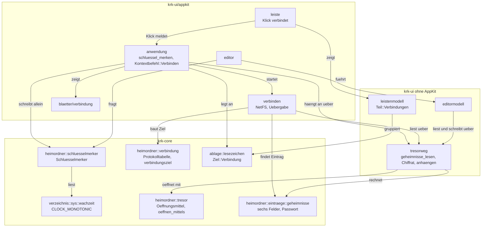
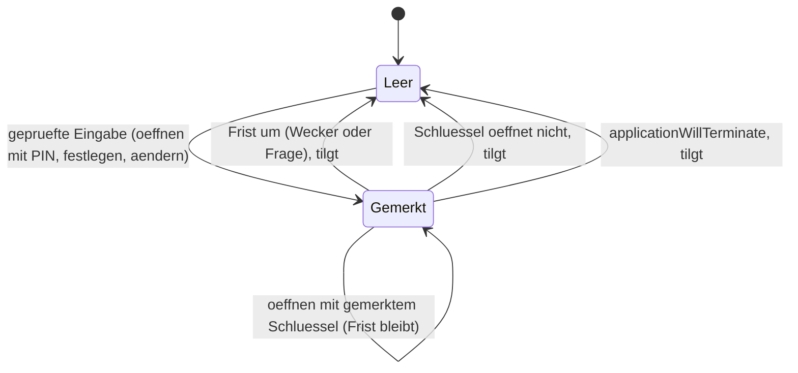
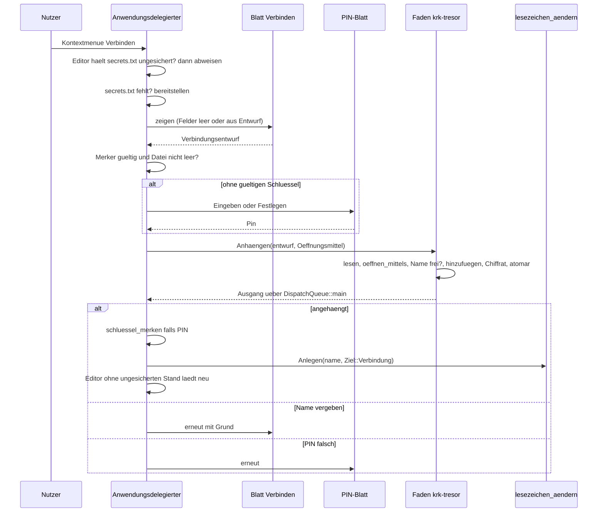
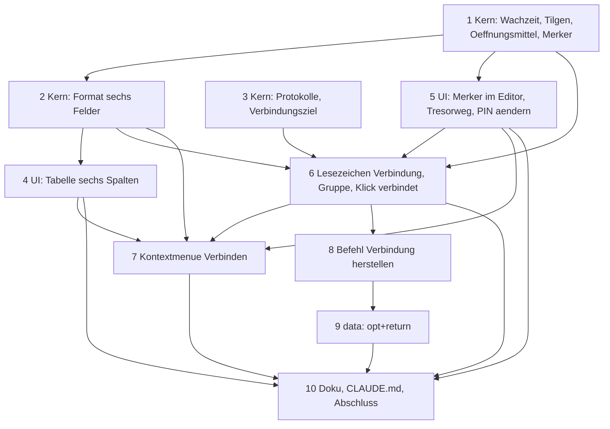

# Implementation Plan: secrets.txt mit sechs Feldern, zehn Minuten gemerkter Schlüssel und Verbindungen als Lesezeichen

**Date:** 2026-10-16
**Spec:** none — planned from raw request (`261016-0229-secrets-mit-sechs-feldern-schluesselcache-und-verbindungen.md`, Abschnitt `## Directive`, der wörtliche Auftrag des Nutzers; Paket im Modus `autonomous`, also ohne Rückfragen)
**Decidability:** Der Plan trägt drei tragende Fragen. (a) „Gilt der gemerkte Schlüssel noch?“ ist aus dem Zeitpunkt der Eingabe und einer Uhr, die den Ruhezustand mitzählt, entscheidbar; der Mechanismus liest dafür `CLOCK_MONOTONIC` und nicht `Instant`. (b) „Welcher Eintrag gehört zu diesem Lesezeichen?“ ist aus dem entschlüsselten Stand und dem Namen entscheidbar, solange der Name eindeutig ist; bei zwei Treffern antwortet der Mechanismus ausdrücklich „mehrdeutig“ und verbindet nicht, statt zu raten. (c) „Verlässt das Passwort KRK allein über NetFS?“ ist am Quelltext allgemein **nicht** entscheidbar (jede Funktion könnte den Wert weiterreichen); der Mechanismus wechselt deshalb von „jeder Rufer passt auf“ auf einen Typ `Passwort` mit privatem Feld und genau einer herausgebenden Methode, deren Ruferzahl eine Probe hält. Was die Probe nicht sieht, steht unter Risiken.

## Directive

Vier Erweiterungen der Geheimnisse im Notizordner, so wie der Nutzer sie verlangt hat: die Geheimnistabelle zeigt sechs Spalten statt zwei; ein eingegebener Schlüssel gilt zehn Minuten im Arbeitsspeicher; das Kontextmenü der Dateiliste trägt „Verbinden…“, das einen Eintrag in `secrets.txt` und ein Lesezeichen in einer neuen Gruppe „Verbindungen“ anlegt; ein Klick auf ein solches Lesezeichen stellt die Verbindung mit den Zugangsdaten aus `secrets.txt` her. Die verbindliche Formulierung steht im Paket und wird hier nicht wiederholt.

## Current State

Gelesen am Baum auf `e57b5c7`, nicht erinnert.

- **Format und Kern.** `secrets.txt` ist ein Chiffrat aus 60 Byte Kopf und XChaCha20-Poly1305, Schlüssel aus Argon2id über die vierstellige PIN (`crates/krk-core/src/heimordner/tresor.rs`, Modulkopf). Der Klartext hat die Form von `notes.txt`; `crates/krk-core/src/heimordner/eintraege.rs` zerlegt ihn mit `Notizen::lesen`, und `appointments.md` rechnet seit dem Termin-Paket als „Notiz, deren Thema ein Datum ist“ über dieselbe Zerlegung. `tresor::oeffnen` leitet ab, `tresor::oeffnen_mit` nimmt einen gehaltenen `Schluessel`. Der Modulkopf sagt ausdrücklich zu, **nicht** zu tilgen, und `Cargo.toml` begründet, warum `zeroize` ausbleibt.
- **Editor.** `crates/krk-ui/src/editormodell.rs` hält `Schutz::Verschluesselt { schluessel, pin, kopf_auf_platte }`; `pin` dient allein dem Vergleich bei „PIN ändern“. `Leseauftrag::Geheimnisse(Pin)` liest auf dem Faden `krk-editor` über `geheimnisse_lesen`. Geschrieben wird `secrets.txt` allein als `Chiffrat` (privates Feld, entsteht in `Chiffrat::verschliessen`, geschrieben in `Chiffrat::schreiben`); die Probe `kein_weg_schreibt_klartext_nach_secrets_txt` hält das am Quelltext. `crates/krk-ui/src/appkit/editor.rs` zeigt die Geheimnisse als `Editorform::Geheimnisse` in der Notiztabelle (`eintragsart_der_form` bildet sie auf `Eintragsart::Notizen` ab, `zellenrechnung` rechnet über `notizen::aendern`). `oeffnungsweg` fragt bei jedem neuen Öffnen nach der PIN; die PIN gilt, solange die Datei offen ist (`260926-0007_*_wie-lange-gilt-eine-eingegebene-pin.md`, umgesetzt).
- **Lesezeichen.** `crates/krk-core/src/ablage/lesezeichen.rs` führt eine Liste mit zwei Sorten in einer unmarkierten Aufzählung `Ziel { Ordner, Textstelle }`, abgelegt in `bookmarks.toml`. `crates/krk-ui/src/leistenmodell.rs` baut daraus zwei Teile mit Überschrift, Lesezeichen und Geräte; `crates/krk-ui/src/appkit/leiste.rs` meldet jede Auswahländerung, ob durch Klick oder Pfeiltaste, an `Anwendungsdelegierter::leistenauswahl_ausfuehren`, und die Auswahl öffnet ihr Ziel.
- **Kontextmenü.** `crates/krk-ui/src/kommandos/kontextmenue.rs`, `Kontextbefehl` mit `ALLE`, `titel`, `menuemarke`, Ausführungszweig in `Anwendungsdelegierter::kontextbefehl_ausfuehren`. Jüngstes Muster: `Kontextbefehl::Auswerfen` (`bb2f861`) mit `appkit/auswurf.rs`, Rückweg über `DispatchQueue::main().exec_async`.
- **Blätter.** `crates/krk-ui/src/appkit/blaetter/pin.rs` (drei Formen, `NSSecureTextField`, `Blattgriff::verdeckt_machen` für das Tastenprotokoll), `blaetter/namenseingabe.rs` (geprüfte Gestalt), gemeinsame Mechanik in `blaetter/mod.rs` (`waechter_anhaengen`, `bestaetigung_pruefen`).
- **Bindung an C-Frameworks.** `crates/krk-ui/src/appkit/fsevents.rs` bindet CoreServices von Hand mit `#[link(name = …, kind = "framework")]`; das ist das Muster für NetFS. `NetFSMountURLSync` steht im SDK dieses Geräts seit macOS 10.8 und nimmt Benutzer und Passwort als eigene Argumente; `kNAUIOptionKey`/`kNAUIOptionNoUI` sind `CFSTR("UIOption")`/`CFSTR("NoUI")` (`NetFS.h`, geprüft am 261016).
- **Uhr.** `man clock_gettime` auf diesem Gerät: `CLOCK_MONOTONIC` „will continue to increment while the system is asleep“ (geprüft). Dass `std::time::Instant` auf macOS `CLOCK_UPTIME_RAW` liest und den Ruhezustand nicht mitzählt, ist **inference**: der Quelltext der Toolchain liegt hier nicht vor (`rust-src` nicht installiert).

## Approach

Ein Weg je Frage, und jeder neue Weg setzt auf einen vorhandenen auf, statt einen zweiten daneben zu bauen. Das Format der Geheimnisse wird eine Verengung der Notizform wie bei den Terminen; die Verbindung wird eine dritte Sorte der einen Lesezeichenliste; gelesen und geschrieben wird `secrets.txt` weiter über die eine Leseroutine und den einen Chiffrat-Weg, nur aus `editormodell.rs` in ein eigenes Modul gehoben, damit Editor, Klick und „Verbinden…“ dieselben benutzen. Der Schlüssel, der zehn Minuten gilt, ist ein Wert des Prozesses mit genau einem Schreiber.



### Entscheidungen

Was über diesen Plan hinaus bindet, steht zusätzlich in drei Datensätzen: die Entscheidungen 1 und 2 im Datensatz zum Format, 3 bis 6 im Datensatz zum Merker, 8 bis 12 im Datensatz zum Verbindungsweg. Der Plan zitiert sie und schreibt die Folgen für die Schritte aus; die übrigen gelten allein für diese Arbeit.

1. **Format der Geheimnisse: eine Notiz, deren Text mit bis zu vier Feldzeilen beginnt** (`261016-0306-in-welcher-form-traegt-secrets-txt-sechs-felder-und-was-wird-aus-den-alten-eintraegen.md`). `## <Name>`, dann höchstens je einmal `protocol:`, `address:`, `account:`, `password:`, danach die Notizen. Schlüssel englisch, beim Lesen ohne Rücksicht auf Groß- und Kleinschreibung, geschrieben klein. Die Grundform schreibt alle vier Feldzeilen, leer ohne Leerzeichen hinter dem Doppelpunkt.
2. **Übergang ohne Umbaulauf.** Ein alter Eintrag ist ein Geheimnis mit leeren Feldern (Thema wird Name, Text wird Notizen) und bekommt seine Grundform beim ersten Ändern einer seiner Zellen. Lesen und Schreiben ohne Handlung ergeben dieselben Bytes. Damit geht beim Übergang nichts verloren, weil nichts geschrieben wird, das der Nutzer nicht berührt hat; das alte Format bleibt dauerhaft lesbar, weil es eine gültige Form des neuen ist.
3. **Gemerkt wird der abgeleitete Schlüssel, zehn Minuten ab der Eingabe, gemessen mit `CLOCK_MONOTONIC`, getilgt mit `zeroize`** (`261016-0306-wie-lange-gilt-ein-eingegebener-schluessel-fuer-secrets-txt-und-was-wird-gemerkt.md`). Gemerkt wird nach jeder geprüften Eingabe (Öffnen mit PIN, Festlegen, Ändern), nie nach einem Öffnen mit dem gemerkten Schlüssel. Getilgt wird beim Ablauf, beim Ersetzen und in `applicationWillTerminate:`. „PIN ändern“ ersetzt den gemerkten Schlüssel durch den neuen.
4. **Ein Merker je Prozess mit genau einem Schreiber.** `AnwendungsIvars` hält ihn als `Rc<RefCell<Schluesselmerker>>`, der `Editorbereich` bekommt dasselbe `Rc` zum Lesen. Geschrieben wird er allein in `Anwendungsdelegierter::schluessel_merken` (setzt auch den Ablaufwecker) und `Anwendungsdelegierter::schluessel_verwerfen`; eine Quelltextprobe hält die Rufer von `Schluesselmerker::merken`. Der Ablaufwecker ist ein einmaliger `NSTimer` auf die Restdauer; feuert er, fragt er den Merker mit `wachzeit()` und stellt sich neu, falls die Frist (etwa nach dem Aufwachen) noch nicht um ist. Die Frage `gueltiger(jetzt)` prüft bei jedem Lesen selbst, der Wecker sorgt allein für das Tilgen.
5. **Die offene Datei behält ihre Regel.** Der Editor hält den Schlüssel der offenen `secrets.txt`, solange sie offen ist, über die zehn Minuten hinaus. Der Merker beantwortet allein, ob ein neues Öffnen, ein Klick auf eine Verbindung oder „Verbinden…“ ohne PIN-Blatt geht. „Verbinden…“ und der Klick nehmen nie den Schlüssel aus dem Editor, sondern allein den Merker, damit die zehn Minuten auch für diese zwei Wege gelten.
6. **Ein Schlüssel, der nicht öffnet, fällt, und KRK fragt nach der PIN.** Das deckt einen anderen Notizordner, eine von einer zweiten Instanz geänderte PIN und ein verändertes Byte mit einer Regel. Eine leere `secrets.txt` geht immer über `Pinform::Festlegen`, auch bei gültigem Merker, weil eine neue Datei ein frisches Salz bekommt.
7. **Die Verbindung ist eine dritte Sorte der einen Lesezeichenliste**: `Ziel::Verbindung { verbindung: String }` in `bookmarks.toml` als `verbindung = "<Name>"` neben `name`. Die Gruppe folgt aus der Sorte (`Ziel::gruppe`), eine zweite Liste gibt es nicht. Die Leiste zeigt drei Teile in der Folge Lesezeichen, Verbindungen, Geräte; die Überschrift „Verbindungen“ steht, sobald mindestens eine Verbindung abgelegt ist, und fehlt sonst. `lesezeichen_hoch`/`_runter` tauschen mit dem nächsten Eintrag derselben Gruppe. Eine Verbindung ist in der Leiste immer gültig: ob ihr Eintrag besteht, lässt sich ohne Entschlüsseln nicht sagen, und `Lesezeichen::gueltig` stellt keine Frage, die mehr kostet als einen Systemaufruf.
8. **In `bookmarks.toml` steht aus `secrets.txt` allein der Name** (`261016-0306-auf-welchem-weg-verlassen-zugangsdaten-aus-secrets-txt-krk-wenn-eine-verbindung-hergestellt-wird.md`). Protokoll, Adresse, Konto, Passwort und Notizen nie.
9. **Der Name ist der Schlüssel, getrimmt verglichen, und er muss eindeutig sein.** „Verbinden…“ legt keinen Namen an, der in `secrets.txt` schon steht. Findet ein Klick zwei Einträge, verbindet KRK nicht und meldet es; findet er keinen, ebenso. Umbenennen des Lesezeichens ändert allein die Beschriftung (`name`), nicht `verbindung`; Löschen des Lesezeichens lässt den Eintrag in `secrets.txt` stehen.
10. **Protokolle und Wege.** Einhängen über `NetFSMountURLSync` für `smb`, `afp`, `nfs`, `webdav` (URL `http://`), `webdavs` (URL `https://`) und `ftp`; Konto und Passwort gehen als eigene Argumente, die URL ist `<schema>://<adresse>`, die Öffnungsoption `UIOption = NoUI`. Übergabe an das System über `NSWorkspace` für `http`, `https`, `ssh`, `sftp` und `vnc`, als `<schema>://[konto@]adresse`, bei `http` und `https` ohne Konto, immer ohne Passwort. Protokollnamen ohne Rücksicht auf Groß- und Kleinschreibung; jedes andere Protokoll ergibt eine Meldung in der Statuszeile, die das Protokoll nennt. Nach einem gelungenen Einhängen zeigt das aktive Dateifenster den Einhängepunkt. Meldet NetFS `EEXIST` (17), sucht KRK den schon eingehängten Datenträger in den Einhängepunkten, deren `NSURLVolumeURLForRemountingKey` zu Schema, Rechner und Freigabe passt, und zeigt ihn; findet es keinen, meldet es „schon verbunden“.
11. **Das Passwort verlässt KRK allein als Argument von NetFS, und dieser Weg steht neben und nicht unter der Regel um `haelt_geheimnisse`** (Datensatz wie Entscheidung 8). Er liest keinen Editorinhalt, sondern den gesicherten Stand der Platte auf dem Faden `krk-verbinden`, ist eine Ausfuhr durch den Nutzer mit festem Empfänger und wird von einem Typ gehalten: `Passwort` im Kern, privates Feld, kein `Display`, `Debug` verdeckt, Tilgen in `Drop`, genau eine Methode `preisgeben`, deren einzigen Rufer (die NetFS-Bindung) eine Quelltextprobe hält. Klartext, Eintrag und Passwort fallen auf dem Faden.
12. **Verbunden wird allein auf einen ausdrücklichen Anstoß**: Mausklick auf die Zeile einer Verbindung (über die `action` der Tabelle, also auch auf eine schon gewählte Zeile) oder der Befehl „Verbindung herstellen“ (`opt+return`, Wirkungsbereich Leiste). Eine Auswahl, die mit den Pfeiltasten über eine Verbindung läuft, wählt nur. Ordner und Textmarken öffnen weiter bei Auswahl.
13. **„Verbinden…“: erst der Dialog, dann der Schlüssel, dann ein einziger Schreibgang.** Weil der Schlüssel erst nach dem Dialog gebraucht wird, verliert eine falsche PIN keine Eingabe: die Felder bleiben bis zum Ausgang im Speicher (`Verbindungsentwurf`, `Debug` ohne Passwort, Passwort als `Passwort`). Ausgänge des Schreibgangs: angehängt; Name vergeben (Dialog geht mit allen Feldern und dem Grund wieder auf); PIN falsch (PIN-Blatt geht wieder auf, Felder bleiben); jeder andere Fehler (Statuszeile, Felder fallen). Nach dem Anhängen legt KRK das Lesezeichen über den einen Durchgang `lesezeichen_aendern` an; scheitert nur dieser, sagt die Statuszeile, dass der Eintrag steht und das Lesezeichen fehlt.
14. **Fehlt `secrets.txt` oder ihre PIN.** Fehlt die Datei, legt „Verbinden…“ sie über `heimordner::bereitstellen` an, denselben Weg wie F2, ohne einen Tab zu öffnen, und fährt fort wie bei einer leeren Datei. Eine leere Datei fragt `Pinform::Festlegen` (zweimal), und der erste Schreibgang schreibt das erste Chiffrat. Ein Klick auf eine Verbindung bei fehlender oder leerer Datei meldet „kein Eintrag“ in der Statuszeile und fragt keine PIN, weil es nichts zu finden gibt. Größe und Dasein erfragt je ein `stat(2)` auf dem Hauptfaden, wie `Editorbereich::datei_oeffnen` es für das PIN-Blatt schon tut.
15. **Der Editor und `secrets.txt` auf der Platte.** Hält der Editor `secrets.txt` mit ungesichertem Stand, weist „Verbinden…“ vor dem Dialog ab („erst sichern“). Nach einem gelungenen Schreibgang lädt ein Editor, der `secrets.txt` ohne ungesicherten Stand hält, sie über `Editormodell::neu_laden` mit seinem gehaltenen Schlüssel neu; hat er inzwischen einen ungesicherten Stand, lädt er nicht, und sein nächstes Sichern sieht die Änderung von außen über den vorhandenen Weg aus C4. Ein Klick liest immer den gesicherten Stand der Platte, nie den ungesicherten des Editors.
16. **Das Blatt „Verbinden“** (`appkit/blaetter/verbindung.rs`): sechs Felder, Passwort als `NSSecureTextField`, die übrigen als `NSTextField`; Notizen einzeilig im Dialog (Absätze gehen in der Tabelle). Bestätigen ist abgeschaltet, bis gilt: Name nicht leer, Protokoll bekannt (Entscheidung 10), Adresse nicht leer und ohne `://`, kein Zeilenumbruch in einem Feld. Das Blatt trägt `verdeckt_machen`, also zeigt das Tastenprotokoll für jedes seiner Felder `(verdeckt)`. Beim Beginn jeder Bearbeitung ruft es `textautomatik::automatiken_abschalten` am Feldeditor, wie der Zelleneditor es tut; eine eigene Quelltextprobe hält den Aufruf, weil `jede_bearbeitbare_textflaeche_schaltet_die_automatiken_ab` Felder mit dem Feldeditor des Fensters nicht sieht.
17. **Die Passwortspalte der Tabelle zeigt den Klartext.** Der Auftrag verlangt keine Verdeckung, die Rohansicht derselben Datei zeigt den Klartext ohnehin, und das Bedrohungsmodell der Datei ist das versehentliche Lesen durch Werkzeuge, nicht der Blick über die Schulter (Modulkopf `tresor.rs`). Eine Verdeckung allein in der Tabelle verspräche einen Schutz, den die zweite Ansicht nicht hält.
18. **Spaltenregeln der Tabelle.** Spalten in der Folge Name, Protokoll, Adresse, Konto, Passwort, Notizen. Die ersten fünf sind einzeilig und folgen bei `esc` der Datumszelle der Termine (verwerfen), die Notizen sind mehrzeilig und folgen der Notizzelle (übernehmen); `esc_regel` bekommt die Unterscheidung nach Spalte wie für die Termine. Stelle und Zeile bleiben dieselbe Zahl, die Tabelle ordnet in der Folge der Datei.
19. **`zeroize` als neue Kiste**, ohne Vorgabemerkmale außer dem nötigen, auf eine feste kleine Fassung genagelt, mit Begründung und gezählter Baumgröße in der Wurzel-`Cargo.toml` und der Wendung „Namen auf `-sys`“ an ihrer Zusage. `Pin` bleibt `Copy` und wird nicht getilgt; Klartext in Textflächen und Feldern wird nicht getilgt. Beides steht im Modulkopf von `tresor.rs` und in `HowTo.md`, damit die Zusage nicht größer klingt, als sie ist.
20. **Fäden und Rückweg.** Lesen, Entschlüsseln (samt Ableitung bei PIN), Finden, Einhängen und Anhängen laufen auf benannten Fäden (`krk-verbinden`, `krk-tresor`); der Ausgang kommt über `DispatchQueue::main().exec_async` zurück, wie in `appkit/auswurf.rs`. Ein zweiter Klick, während ein Gang läuft, meldet „Verbindung läuft schon“. Der Hauptfaden stellt auf diesen Wegen keinen Systemaufruf außer dem einen `stat(2)` aus Entscheidung 14.





## Implementation Steps

1. **Kern: Wachzeit, Tilgen, Öffnungsmittel und Schlüsselmerker**
   - Executor: code-implementer
   - Files: `Cargo.toml` (Wurzel), `crates/krk-core/Cargo.toml`, `crates/krk-core/src/verzeichnis/sys.rs`, `crates/krk-core/src/heimordner/tresor.rs`, neu `crates/krk-core/src/heimordner/schluesselmerker.rs`, `crates/krk-core/src/heimordner/mod.rs`, `crates/krk-core/tests/heimordner.rs`
   - Changes: (a) `zeroize` aufnehmen (Entscheidung 19): Fassung festnageln, Vorgabemerkmale aus, Begründung neben `chacha20poly1305`/`argon2`, die Zeile „`zeroize` bleibt aus …“ dort ersetzen, Baumgröße je Mac-Ziel mit `cargo tree --target <ziel> -e normal,build` vor und nach erheben und eintragen, Satz mit „Namen auf `-sys`“. (b) `verzeichnis::sys::wachzeit() -> Duration` über `clock_gettime_nsec_np(CLOCK_MONOTONIC)`, Konstante am SDK-Kopf `time.h` geprüft und im Doc-Kommentar mit Fundstelle genannt; vorher am Quelltext der Toolchain (`rustup component add rust-src` oder die Fassung auf GitHub zum Tag 1.97.1) prüfen, welche Uhr `Instant` auf macOS liest, und das Ergebnis im Modulkopf von `schluesselmerker.rs` festhalten; die eine Stelle, an der die Uhr gelesen wird, hält eine Probe wie `die_uhr_der_termine_wird_an_einer_stelle_gelesen`. (c) `impl Drop for Schluessel` mit `zeroize` auf die 32 Byte; Modulkopf von `tresor.rs` „Ebenso wenig sagt es zu …“ auf den neuen Stand (Schlüssel getilgt, Klartext und PIN nicht). (d) `pub enum Oeffnungsmittel { Pin(Pin), Schluessel(Schluessel) }` und `pub fn oeffnen_mittels(bytes, &Oeffnungsmittel) -> Result<Geoeffnet, Oeffnungsfehler>`, die eine Stelle über `oeffnen` und `oeffnen_mit`; `Geoeffnet` sagt, ob der Schlüssel aus einer Eingabe stammt (`eingegeben: bool` oder gleichwertig). (e) `Schluesselmerker` rein, ohne Uhr: `merken(schluessel, jetzt)`, `gueltiger(jetzt) -> Option<&Schluessel>` (tilgt bei Ablauf), `verwerfen()`, `restdauer(jetzt)`, `GUELTIGKEIT = 600 s`, `Debug` ohne Schlüsselbytes.
   - Akzeptanz: Proben für Ablauf genau an der Grenze (599 s gültig, 600 s nicht), kein Verlängern durch `gueltiger`, Ersetzen, Verwerfen; eine Probe, dass ein fallengelassener `Schluessel` seine Bytes nullt (über einen beobachtbaren Weg, den der Implementierer wählt und im Doc-Kommentar begründet, oder, falls keiner ohne `unsafe` besteht, als ausdrücklich benannte Lücke im Modulkopf); `oeffnen_mittels` öffnet mit beiden Mitteln und weist einen Schlüssel mit fremdem Salz mit `PinFalschOderVeraendert` ab; `make check` grün; `cargo tree --target aarch64-apple-darwin -e normal,build` und `--target x86_64-apple-darwin` ohne `cc` und ohne Paket auf `-sys`.
   - Dependencies: none

2. **Kern: das Format der Geheimnisse mit sechs Feldern**
   - Executor: code-implementer
   - Files: `crates/krk-core/src/heimordner/eintraege.rs`, `crates/krk-core/src/sprache/schluessel.rs`, `crates/krk-core/src/sprache/tabelle/de.rs`, `fr.rs`, `en.rs`, `crates/krk-core/tests/heimordner.rs`
   - Changes: Modul `geheimnisse` neben `termine`, rechnend über `Notizen::lesen` (Entscheidungen 1, 2). `Feld { Name, Protokoll, Adresse, Konto, Passwort, Notizen }`; `Geheimnis<'a>` mit den sechs Werten; `Geheimnisse::geheimnis(stelle)`; Handlungen `hinzufuegen(stand, &Geheimnisentwurf)`, `aendern(stand, stelle, feld, wert)` (schreibt den Block in der Grundform, Trenner bleibt, `Ok(None)` bei unverändertem Wert), `loeschen` und `verschieben` über `notizen`. Abweisungen: Zeilenumbruch in einem einzeiligen Feld, `## ` am Zeilenanfang der Notizen; je ein Text in allen drei Tabellen. `Passwort` (Entscheidung 11) mit privatem Feld, `Debug` verdeckt, `Drop` tilgt, `preisgeben(self) -> zeroize::Zeroizing<String>`. `finden(stand, name) -> Result<Verbindungsdaten, Suchfehler { Keiner, Mehrdeutig(usize) }>` mit getrimmtem Vergleich. `name_frei(stand, name) -> bool`. Modulkopf von `eintraege.rs` um die Form der Geheimnisse ergänzen, nach dem Muster des Absatzes über Termine.
   - Akzeptanz: Proben (1) ein Stand im alten Format liest sich ohne Verlust (jeder alte Thementext steht als Name, jeder Text als Notizen, bytegleich zurückgeschrieben); (2) Rundreise ohne Handlung byte-treu, auch mit CRLF und ohne Schlussumbruch; (3) `aendern` an einem alten Eintrag schreibt die Grundform mit allen vier Feldzeilen und lässt jeden anderen Block Byte für Byte; (4) eine Notizzeile `password: x` nach einer Grundform bleibt Notiz; (5) doppelter Schlüssel beendet die Feldfolge; (6) `finden` mit keinem, einem und zwei Treffern; (7) `Debug` eines `Passwort` und eines `Verbindungsdaten` enthält den Wert nicht; Sprachtabellen in allen drei Sprachen, `jede_alle_liste_fuehrt_genau_die_varianten_ihrer_aufzaehlung` grün; `make check` grün.
   - Dependencies: 1

3. **Kern: Protokolltabelle und Verbindungsziel**
   - Executor: code-implementer
   - Files: neu `crates/krk-core/src/heimordner/verbindung.rs`, `crates/krk-core/src/heimordner/mod.rs`, Sprachtabellen (`schluessel.rs`, `de.rs`, `fr.rs`, `en.rs`), `crates/krk-core/tests/heimordner.rs`
   - Changes: reine Funktionen ohne Systemaufruf (Entscheidung 10). `Protokoll` als Aufzählung mit `ALLE`, `aus_text` ohne Rücksicht auf Groß- und Kleinschreibung, `weg() -> Weg { Einhaengen, Uebergeben }`, `url_schema()`. `verbindungsziel(protokoll, adresse, konto) -> Result<Verbindungsziel, Zielfehler>`: Einhängen liefert die URL ohne Konto und das Konto getrennt; Übergeben liefert `<schema>://[konto@]adresse` mit prozentkodiertem Konto, bei `http`/`https` ohne Konto. Zielfehler: unbekanntes Protokoll (nennt es), leere Adresse, `://` in der Adresse. Eine Funktion `protokoll_pruefen` für das Blatt, damit Dialog und Klick dieselbe Regel fragen. Kein Passwort in irgendeinem Wert dieses Moduls; der Typ nimmt keines an.
   - Akzeptanz: Proben für jedes Protokoll aus `Protokoll::ALLE` (Schema, Weg, URL), Groß- und Kleinschreibung, Konto mit `@` und Leerzeichen (kodiert), unbekanntes Protokoll, leere Adresse; eine Quelltextprobe, dass `verbindung.rs` `Passwort` nicht nennt; Texte in allen drei Tabellen; `make check` grün.
   - Dependencies: none

4. **Oberfläche: die Geheimnistabelle mit sechs Spalten**
   - Executor: code-implementer
   - Files: `crates/krk-ui/src/appkit/eintragsansicht.rs`, `crates/krk-ui/src/appkit/editor.rs`, `crates/krk-ui/src/kommandos/zulaessigkeit.rs` (soweit der Übersetzer es verlangt), Sprachtabellen (Spaltenköpfe)
   - Changes: `Eintragsart::Geheimnisse`, `Zeilen::Geheimnisse(Vec<Geheimniszeile>)`, sechs Spaltenkonstanten; `eintragsart_der_form` und `eintragsart_des_typs` bilden die Geheimnisse auf die neue Art ab; `zellenrechnung` rechnet über `geheimnisse::aendern` je Spalte; `esc_regel` nach Entscheidung 18; „Eintrag hinzufügen“ in Tabelle und Rohansicht legt einen leeren Eintrag in der Grundform an; Löschen und Verschieben wie bisher. Stelle und Zeile bleiben dieselbe Zahl; die Naht `stelle_der_zeile`/`zeile_der_stelle` wird für die neue Art trotzdem durchlaufen, nicht umgangen.
   - Akzeptanz: die Proben, die heute `Editorform::Geheimnisse` auf `Eintragsart::Notizen` festhalten (u. a. in `appkit/editor.rs` nahe `flaeche_der_form`/`eintragsart_der_form` und `rohansicht_und_tabelle_nennen_dieselbe_eintragsart`), sind auf die neue Art umgestellt und grün; eine Probe je Spalte, dass das Ändern einer Zelle genau das Feld ändert; eine Probe, dass ein alter Eintrag in der Tabelle mit leeren Feldern und vollständigen Notizen erscheint; `das_loeschen_ist_in_jeder_der_vier_tabellen_zuruecknehmbar` deckt die neue Art; Spaltenköpfe in drei Sprachen; `make check` grün.
   - Dependencies: 2

5. **Oberfläche: der Merker im Editor, ein Tresorweg, PIN ändern über den Schlüssel**
   - Executor: code-implementer
   - Files: neu `crates/krk-ui/src/tresorweg.rs`, `crates/krk-ui/src/main.rs` (Modul), `crates/krk-ui/src/editormodell.rs`, `crates/krk-ui/src/appkit/editor.rs`, `crates/krk-ui/src/appkit/anwendung.rs`, Sprachtabellen falls neue Sätze
   - Changes: (a) `geheimnisse_lesen`, `GEHEIMNISGRENZE` und `Chiffrat` (samt `verschliessen`, `schreiben`) ziehen nach `tresorweg.rs`; `geheimnisse_lesen` nimmt ein `Oeffnungsmittel` und ruft `tresor::oeffnen_mittels`; die Quelltextproben `kein_weg_schreibt_klartext_nach_secrets_txt` und `die_sperre_fragt_die_sonderdatei_vor_dem_lesen` ziehen mit und lesen beide Dateien. (b) `Leseauftrag::Geheimnisse(Oeffnungsmittel)`; `Schutz::Verschluesselt { schluessel, kopf_auf_platte }` ohne `pin`. (c) `pin_aendern(alte, neue)`: der Faden `krk-pin` leitet erst mit Salz und Parametern des gehaltenen Schlüssels aus `alte` ab und vergleicht, dann leitet er `neue` ab; falsche alte PIN ist ein `Pinwechselausgang::Gescheitert` mit dem bisherigen Satz. (d) `oeffnungsweg` bekommt die Frage, ob der Merker gültig ist und die Datei nicht leer; dann `Laden` mit `Oeffnungsmittel::Schluessel`, sonst `PinErfragen`. (e) Der Ladeausgang trägt einen Schlüssel aus einer Eingabe (Öffnen mit PIN, Festlegen), der Pinwechselausgang den neuen; der Anwendungsdelegierte reicht beide an `schluessel_merken`. Ein Öffnen mit gemerktem Schlüssel, das scheitert, ruft `schluessel_verwerfen` und öffnet das PIN-Blatt (Entscheidung 6). (f) `schluessel_merken`/`schluessel_verwerfen` mit dem Ablaufwecker (Entscheidung 4); `applicationWillTerminate:` ruft `schluessel_verwerfen`. (g) `editormodell.rs` Modulkopf (Abschnitt `secrets.txt`) und der Doc-Kommentar von `Schutz` auf den neuen Stand.
   - Akzeptanz: Proben (1) ein zweites Öffnen von `secrets.txt` innerhalb der Frist geht ohne PIN (am Modell mit einem eingespielten Merker und einer Uhr als Parameter), (2) nach Ablauf mit PIN, (3) ein Öffnen mit gemerktem Schlüssel merkt nicht neu (Frist unverändert), (4) ein fremdes Salz führt auf das PIN-Blatt und leert den Merker, (5) „PIN ändern“ mit falscher alter PIN scheitert ohne Schreiben, mit richtiger schreibt es und der Merker trägt den neuen Schlüssel, (6) `Schluesselmerker::merken` hat genau die Rufer, die die Probe mit Namen führt, (7) `applicationWillTerminate:` ruft `schluessel_verwerfen` (Quelltextprobe); die verschobenen Proben grün; `make check` grün.
   - Dependencies: 1

6. **Lesezeichensorte Verbindung, die Gruppe „Verbindungen“ und das Herstellen per Klick**
   - Executor: code-implementer
   - Files: `crates/krk-core/src/ablage/lesezeichen.rs`, `crates/krk-core/tests/` (Ablage-Rundreise), `crates/krk-ui/src/leistenmodell.rs`, `crates/krk-ui/src/appkit/leiste.rs`, `crates/krk-ui/src/appkit/anwendung.rs`, neu `crates/krk-ui/src/appkit/verbinden.rs`, `crates/krk-ui/src/appkit/mod.rs`, `crates/krk-ui/src/tresorweg.rs`, `Cargo.toml` (Merkmale `objc2-core-foundation`/`objc2-foundation`, falls `CFURL`, `CFDictionary` oder `NSURL` fehlen), Sprachtabellen
   - Changes: (a) Kern: `Ziel::Verbindung { verbindung: String }` als dritte unmarkierte Sorte (Entscheidung 7), `Lesezeichen::verbindung(name)`, `Ziel::gruppe()`, `Lesezeichen::gueltig` für die Verbindung `true` mit Begründung, `Lesezeichenliste::verschieben` innerhalb der Gruppe; Modulkopf „Eine Liste mit zwei Sorten“ auf drei. (b) Leiste: `Teil::Verbindungen` mit Überschrift „Verbindungen“ (drei Sprachen), drei Teile in der Folge aus Entscheidung 7, `Sinnbild::Verbindung` (Systembild nach Wahl, im Untergrenzen-Abschnitt genannt), `Auswahl::pfad` wird `Option<&Path>`. (c) Klick: die Tabelle bekommt eine `action`, die für eine Verbindungszeile (`clickedRow`) `verbindung_herstellen(name)` ruft; `leistenauswahl_ausfuehren` tut für `Ziel::Verbindung` nichts (Entscheidung 12). (d) `verbindung_herstellen`: Dasein und Größe von `secrets.txt` (Entscheidung 14), Merker oder PIN-Blatt, dann Faden `krk-verbinden`: `tresorweg::geheimnisse_lesen` mit dem Mittel, `geheimnisse::finden`, `verbindung::verbindungsziel`, dann Einhängen über `NetFSMountURLSync` mit `UIOption = NoUI` (Bindung mit `#[link(name = "NetFS", kind = "framework")]` nach dem Muster von `fsevents.rs`, Konto und `Passwort::preisgeben` als `CFString`, Ergebnis als Rust-Wert) oder Rückgabe der Übergabe-URL; Ausgang über `DispatchQueue::main().exec_async`; auf dem Hauptfaden `NSWorkspace` für die Übergabe, `ordner_lesen` für den Einhängepunkt, `EEXIST` nach Entscheidung 10, Meldungen für keinen Eintrag, mehrdeutig, unbekanntes Protokoll, Anmeldung abgewiesen (`EAUTH`, `ENETFSNOAUTHMECHSUPP`), nicht erreichbar, sonstiger Code; `schluessel_merken` bei PIN, `schluessel_verwerfen` bei abgewiesenem Merker. Ein zweiter Klick während eines Gangs meldet es. (e) Modulkopf von `verbinden.rs` mit Untergrenzen-Abschnitt (NetFS seit 10.8 laut `NetFS.h`), mit der Einordnung zur Regel um `haelt_geheimnisse` (Entscheidung 11) und mit dem Satz, warum die Hülle keine Probe mit echtem Einhängen trägt (wie `auswurf.rs`).
   - Akzeptanz: Proben (1) Rundreise von `bookmarks.toml` über alle drei Sorten liefert dieselbe Datei, (2) eine `bookmarks.toml` mit einer Verbindung, die über `Ziel::Verbindung` gebaut ist, enthält außer `name` und `verbindung` keinen Wert aus dem Eintrag (die Probe legt einen Eintrag mit eindeutigen Feldwerten an und sucht jeden davon in der geschriebenen Datei), (3) Verschieben bleibt in der Gruppe, (4) Leistenmodell zeigt die Überschrift nur bei mindestens einer Verbindung und die Teile in der Folge, (5) Pfeiltasten auf eine Verbindung lösen nichts aus (Modell- oder Quelltextprobe), (6) `Passwort::preisgeben` hat genau einen Rufer, in `appkit/verbinden.rs`, (7) der Hauptfaden stellt auf diesem Weg keinen Systemaufruf außer dem `stat(2)` aus Entscheidung 14 (Quelltextprobe nach dem Muster `der_duplikatweg_stellt_auf_dem_hauptfaden_keinen_systemaufruf`), (8) die Untergrenzen-Proben aus `crates/krk-core/tests/baum.rs` grün; Texte in drei Sprachen; `make check` grün.
   - Dependencies: 1, 2, 3, 5

7. **„Verbinden…“ im Kontextmenü der Dateiliste**
   - Executor: code-implementer
   - Files: `crates/krk-ui/src/kommandos/kontextmenue.rs`, neu `crates/krk-ui/src/appkit/blaetter/verbindung.rs`, `crates/krk-ui/src/appkit/blaetter/mod.rs`, `crates/krk-ui/src/appkit/anwendung.rs`, `crates/krk-ui/src/tresorweg.rs`, Sprachtabellen, die Probe über die Rufer von `heimordner::bereitstellen`
   - Changes: `Kontextbefehl::Verbinden` mit Titel „Verbinden…“/„Se connecter…“/„Connect…“ in `ALLE` (neben „Auswerfen“), unabhängig von der Auswahl erreichbar. Ausführung nach Entscheidungen 13 bis 16: Vorprüfung Editor, `bereitstellen` bei fehlender Datei, Blatt `verbindung::zeigen(entwurf, grund)`, Schlüssel aus Merker oder PIN-Blatt (Form nach Größe), dann `tresorweg::anhaengen(pfad, entwurf, mittel)` auf dem Faden `krk-tresor`: lesen, öffnen (leere Datei mit PIN über `neuer_schluessel`), `geheimnisse::name_frei`, `geheimnisse::hinzufuegen`, `Chiffrat::verschliessen`, `Chiffrat::schreiben`; Ausgang zurück über `DispatchQueue::main`. Danach `schluessel_merken` bei PIN, `lesezeichen_aendern(Aenderung::Anlegen { name, ziel: Ziel::Verbindung })`, Editor neu laden nach Entscheidung 15, Leiste nachziehen. Das Blatt trägt `verdeckt_machen` und schaltet die Automatiken bei jedem Bearbeitungsbeginn ab (Entscheidung 16).
   - Akzeptanz: Proben (1) `anhaengen` an eine leere Datei schreibt ein Chiffrat, das mit der PIN aufgeht und genau den Eintrag in Grundform trägt, (2) an eine Datei im alten Format: alle alten Einträge byte-gleich, der neue hinten, (3) vergebener Name ergibt den Ausgang „Name vergeben“ und schreibt nichts (Bytes und Stempel unverändert), (4) falsche PIN schreibt nichts, (5) die Quelltextprobe zum Chiffrat-Weg nennt `anhaengen` als zweiten Rufer von `Chiffrat::schreiben` und bleibt sonst unverändert streng, (6) `Kontextbefehl::titel`, `menuemarke` und Ausführungszweig ohne Auffangzweig, `jede_alle_liste_fuehrt_genau_die_varianten_ihrer_aufzaehlung` grün, (7) das Blatt ist verdeckt (`Blattgriff`), (8) Quelltextprobe `das_verbindungsblatt_schaltet_die_automatiken_ab`, (9) Prüfregel des Blattes als reine Funktion mit Proben (leerer Name, unbekanntes Protokoll, `://`, Zeilenumbruch), (10) die Rufer-Probe von `bereitstellen` führt den neuen Rufer mit Namen, die Probe, dass der Start ihn nicht ruft, bleibt grün; Texte in drei Sprachen; `make check` grün.
   - Dependencies: 2, 4, 5, 6

8. **Befehl „Verbindung herstellen“**
   - Executor: code-implementer
   - Files: `crates/krk-core/src/tasten/belegung.rs`, `crates/krk-ui/src/belegungsmodell.rs`, `crates/krk-ui/src/appkit/leiste.rs` oder `appkit/anwendung.rs` (Ausführungszweig), Sprachtabellen (`kommandoname` je Sprache), `crates/krk-core/tests/belegung.rs`
   - Changes: `Kommando::VerbindungHerstellen` (Kennung `verbindung_herstellen`), `Wirkungsbereich::Leiste`, Zeile in `Kommando::KENNUNGEN`, in `bereich_des_kommandos` und in den drei `kommandoname`; Ausführung: ist die Auswahl der Leiste eine Verbindung, `verbindung_herstellen(name)`, sonst ein Satz in der Statuszeile. Noch keine Kombination ab Werk (die setzt Schritt 9).
   - Akzeptanz: `jede_variante_von_kommando_steht_genau_einmal_in_kennungen` grün; eine Probe, dass der Ausführungszweig für das Kommando einen eigenen Arm hat (Quelltext), weil der Auffangzweig in `kommando_ausfuehren` ihn sonst still schluckte; `make menue` zeigt den Eintrag; `make check` grün.
   - Dependencies: 6

9. **Belegung: `opt+return` für „Verbindung herstellen“**
   - Executor: data-implementer
   - Files: `resources/default-keymap.toml`
   - Changes: ein Block `[[funktion]] id = "verbindung_herstellen" tasten = ["opt+return"]` im Abschnitt C5 der Leiste, mit Kommentar nach dem Muster der Datei (warum `opt+return`: `return` trägt zwei Funktionen, die Grenze ist zwei; `opt+return` ist ab Werk frei, nachgezählt gegen jede `tasten`-Zeile der Datei, Datum der Zählung).
   - Akzeptanz: `make check` grün. Wird dabei eine Probe in einer Code-Datei rot, die die ausgelieferte Belegung aufzählt, ist das ein Halt und kein Anlass, die Probe zu ändern: melden mit Name und Datei.
   - Dependencies: 8

10. **Dokumentation, CLAUDE.md und Abschlussprüfung**
    - Executor: code-implementer
    - Files: `HowTo.md`, `README.md`, `CLAUDE.md`
    - Changes: `HowTo.md`: Abschnitt „Geheimnisse in `secrets.txt`“ auf sechs Spalten und das Format (alte Einträge erscheinen mit leeren Feldern und bekommen ihre Grundform beim ersten Ändern), neuer Unterabschnitt „Zehn Minuten ohne erneute PIN“ (ab Eingabe, Ruhezustand zählt mit, offene Datei bleibt offen, was getilgt wird und was nicht), neuer Abschnitt „Verbindungen“ (Verbinden…, Gruppe in der Leiste, Klick und `opt+return`, Pfeiltasten verbinden nicht, Protokolltabelle mit Weg, Passwort allein beim Einhängen, Umbenennen und Löschen des Lesezeichens, Mehrdeutigkeit). Abschnitt „Lesezeichen“ um die dritte Sorte. `README.md` `## Das Dateiformat von secrets.txt`: der Satz „Heraus kommt Text … in derselben Form wie `notes.txt`“ auf die Form aus Entscheidung 1, mit einem Beispiel und der Leseregel. `CLAUDE.md`: die Absätze unten unter „CLAUDE.md-Stellen, die diese Arbeit falsch macht“ nachziehen, keine Zahl einführen, wo der Absatz eine Erhebung nennt. Abschlussprüfung auf dem Stand nach allen Schritten.
    - Akzeptanz: `make check` grün; `cargo xtask bundle` baut und signiert `target/KRK.app`; `cargo tree --target aarch64-apple-darwin -e normal,build` und `--target x86_64-apple-darwin` ohne `cc` und ohne `-sys`-Paket; ``grep -rn --exclude-dir=fusion-workbench --include='*.md' --include='*.toml' --include='*.rs' 'Namen auf `-sys`' .`` findet die Zusage an der neuen Stelle in `Cargo.toml`; jede Stelle aus der Liste unten ist nachgezogen oder als unberührt begründet (Antwort im Bericht, Stelle für Stelle).
    - Dependencies: 4, 5, 6, 7, 9



### CLAUDE.md-Stellen, die diese Arbeit falsch macht

- „**`chacha20poly1305` und `argon2` stehen seit der Arbeit an `~/krkhome` ebenso ohne Vorgabemerkmale daneben**“: `zeroize` kommt als weitere Kiste mit eigener Begründung dazu.
- „**Die PIN-Sperre sitzt in `Editormodell::lesen_beginnen` …** Ohne PIN weist es `secrets.txt` ab“: ohne PIN **und** ohne gültigen gemerkten Schlüssel; die Sperre fragt jetzt ein `Oeffnungsmittel`.
- „**`secrets.txt` geht allein als Chiffrat auf die Platte** … `Chiffrat::schreiben` (`krk-ui/src/editormodell.rs`) … hat in `krk-ui` keinen zweiten Rufer … wer einen zweiten Sicherungsweg neben `sichern_ueber` baut, … macht sie rot“: `Chiffrat` wohnt in `tresorweg.rs`, und `tresorweg::anhaengen` ist der zweite, in der Probe benannte Rufer.
- „**Jeder Weg, auf dem Editorinhalt KRK verlässt, muss `Editormodell::haelt_geheimnisse` fragen** … Heute fragen zwei“: der Verbindungsweg kommt als Ausfuhr ohne Editorinhalt mit festem Empfänger dazu, gehalten vom Typ `Passwort` und der Rufer-Probe von `preisgeben` (Entscheidung 11); das Blatt „Verbinden“ ist verdeckt.
- Unter „Was man nicht sieht“: ein neuer Absatz zum Schlüsselmerker (ein Schreiber, Frist ab Eingabe, `CLOCK_MONOTONIC` statt `Instant`, die offene Datei behält ihren Schlüssel, ein Schlüssel, der nicht öffnet, fällt) und einer zur Sorte Verbindung (Klick statt Auswahl, Pfeiltasten verbinden nicht, nur der Name in `bookmarks.toml`, Mehrdeutigkeit verbindet nicht).
- Die Absätze über `Wirkungsbereich`, `Kommando` und `Kontextbefehl` nennen keine Zahl und bleiben; geprüft wird nur, ob ein Satz eine Sorte von Lesezeichen oder eine Leistenstruktur mit zwei Teilen behauptet.

## Where this work stops

- Jeder der zehn Schritte ist in der Steuerdatei des Plans auf `done`, und `make check` ist auf dem Stand nach Schritt 10 grün.
- `cargo xtask bundle` baut und signiert `target/KRK.app` auf diesem Stand.
- `cargo tree --target <ziel> -e normal,build` zeigt für beide Mac-Ziele weder `cc` noch ein Paket mit einem Namen auf `-sys`.
- Die Proben aus den Akzeptanzen der Schritte 1, 2, 5, 6 und 7 stehen im Baum und laufen in `make check` mit: Ablauf an der Grenze, Formatübergang ohne Verlust, kein Klartext außer dem Namen in `bookmarks.toml`, ein Rufer von `Passwort::preisgeben`, Rufer von `Schluesselmerker::merken`, Chiffrat-Weg mit zwei benannten Rufern.
- Jede neue nutzersichtbare Zeichenkette steht in `de.rs`, `fr.rs` und `en.rs`, und die zwei Nahtproben der Sprachtabelle sind grün.
- `HowTo.md` und `README.md` beschreiben sechs Spalten, den Merker und die Verbindungen; jede Stelle aus „CLAUDE.md-Stellen, die diese Arbeit falsch macht“ ist nachgezogen.
- **Kein Abnahmelauf gegen die zehn Zusagen aus C8 ist geschuldet**, unter drei Bedingungen, deren jede eine Probe hält: der Start liest keine weitere Datei; der Hauptfaden stellt auf dem Verbindungs- und dem Anhängeweg keinen Systemaufruf außer dem einen `stat(2)` aus Entscheidung 14; der Leistenaufbau stellt für eine Verbindung keine Frage an das Dateisystem. Hält eine davon nicht, ist die Arbeit nicht fertig, und die Frage nach dem Abnahmelauf geht an den Nutzer.
- Vorbedingung jeder Auslieferung dieses Stands: alle Klauseln oben sind ja. **Nicht** Vorbedingung, sondern ausdrücklich Nutzerarbeit am laufenden Bündel, die das Paket nicht abwartet: ein echtes Einhängen einer SMB-Freigabe über ein Verbindungs-Lesezeichen, ein Ablauf des Merkers über einen Ruhezustand des Macs und die Sichtprüfung der Tabelle in drei Sprachen. Gebaut ist dann die richtige Aussage über das Paket, abgenommen nicht.

## Data Structures

- `krk_core::heimordner::tresor::Oeffnungsmittel { Pin(Pin), Schluessel(Schluessel) }`; `Schluessel` mit `Drop` (tilgt).
- `krk_core::heimordner::schluesselmerker::Schluesselmerker { eintrag: Option<(Schluessel, Duration)> }`, `GUELTIGKEIT: Duration = 600 s`.
- `krk_core::heimordner::eintraege::geheimnisse::{Feld, Geheimnis, Geheimnisentwurf, Passwort, Verbindungsdaten, Suchfehler}`.
- `krk_core::heimordner::verbindung::{Protokoll, Weg, Verbindungsziel, Zielfehler}`.
- `krk_core::ablage::lesezeichen::Ziel::Verbindung { verbindung: String }`, `Gruppe { Lesezeichen, Verbindungen }`.
- `krk_ui::leistenmodell::{Teil::Verbindungen, Sinnbild::Verbindung}`; `krk_ui::appkit::eintragsansicht::{Eintragsart::Geheimnisse, Zeilen::Geheimnisse}`.

Beispiel eines Eintrags in Grundform im Klartext:

```text
## NAS Büro
protocol: smb
address: nas.local/daten
account: kai
password: ••••••
Zugang nur im Büronetz.
```

(Das Passwort steht im Klartext der Datei als Text; die Punkte hier stehen für ihn.)

## API Changes

- `tresor::oeffnen_mittels(bytes, &Oeffnungsmittel)`; `verzeichnis::sys::wachzeit()`.
- `Editormodell::oeffnen(pfad, Option<Oeffnungsmittel>)` statt `Option<Pin>`; `Leseauftrag::Geheimnisse(Oeffnungsmittel)`; `Schutz::Verschluesselt` ohne `pin`.
- `tresorweg::{geheimnisse_lesen, anhaengen, Chiffrat}` (aus `editormodell.rs` herausgehoben).
- `Anwendungsdelegierter::{schluessel_merken, schluessel_verwerfen, verbindung_herstellen}`.
- `Kontextbefehl::Verbinden`; `Kommando::VerbindungHerstellen` (`verbindung_herstellen`).
- `Lesezeichenliste::verschieben` tauscht innerhalb der Gruppe; `Auswahl::pfad() -> Option<&Path>`.

## Testing Strategy

Rein prüfbar im Kern: Format (Lesen alt und neu, Rundreise byte-treu, Grundform, Feldfolge), Merker (Grenze, keine Verlängerung, Ersetzen, Verwerfen), Protokolltabelle und Zielbau, Lesezeichen-Rundreise über drei Sorten samt Suche nach Feldwerten in der geschriebenen Datei. In `krk-ui` am Modell ohne Fenster: Öffnungsweg mit und ohne Merker, PIN-Wechsel über Schlüsselvergleich, `anhaengen` an leere, alte und neue Dateien in einem `Pruefordner` mit kleinen Argon2-Parametern (wie die Proben in `tresor.rs`), Blattprüfregel. Am Quelltext: Rufer von `merken`, `preisgeben`, `Chiffrat::schreiben`, `bereitstellen`; Automatiken im Verbindungsblatt; kein Systemaufruf auf dem Hauptfaden der zwei Wege; `applicationWillTerminate:` verwirft. Nicht prüfbar ohne Netz und Nutzer: das echte Einhängen über NetFS und die Übergabe an Terminal und Bildschirmfreigabe; diese stehen als Nutzerarbeit unter „Where this work stops“, und `verbinden.rs` sagt im Modulkopf, warum die Hülle keine Probe mit echtem Einhängen trägt.

## Risks & Mitigations

| Risk | Mitigation |
|------|------------|
| Ein älteres KRK liest eine `bookmarks.toml` mit einer Verbindung nicht (die unmarkierte Aufzählung kennt die dritte Sorte nicht) und legt die Datei als beschädigt beiseite. | Die Datei geht nicht verloren (`.beschaedigt`-Kopie über `Zugang::beiseite_legen`); `HowTo.md` nennt den Fall beim Zurückgehen auf eine ältere Fassung. Kein Umbau des Formats, weil der Rückweg auf ältere Fassungen sonst nirgends zugesagt ist. |
| Die Probe zu `Passwort::preisgeben` sieht einen Weg nicht, der den herausgegebenen `String` danach weiterreicht (etwa in eine Meldung). | Die eine Rufstelle liegt in der NetFS-Hülle und gibt den Wert unmittelbar als `CFString` weiter; der Modulkopf von `verbinden.rs` schreibt die Grenze der Probe aus, statt sie dem Probennamen zu überlassen. |
| `zeroize` tilgt die Schlüsselbytes, nicht aber Kopien, die der Optimierer oder `argon2`/`chacha20poly1305` intern anlegen, und nicht den Klartext in Textflächen. | Die Zusage im Modulkopf von `tresor.rs` und in `HowTo.md` nennt genau, was getilgt wird; das Bedrohungsmodell der Datei bleibt das versehentliche Lesen durch Werkzeuge. |
| NetFS fragt trotz `NoUI` nach oder kehrt bei unerreichbarem Rechner erst nach langer Zeit zurück. | Der Faden blockiert nicht den Hauptfaden; ein zweiter Klick meldet den laufenden Gang. Ein Abbruch ist nicht Teil dieses Plans (Open Questions). |
| Ein Nutzer hat im alten Format Notizen mit einer ersten Zeile `password: …` und sieht sie danach in der Passwortspalte. | Gewollt (Entscheidung 2); nichts geht verloren. `HowTo.md` beschreibt die Leseregel. |
| Die Verschiebung von `Chiffrat` und `geheimnisse_lesen` nach `tresorweg.rs` lockert die Quelltextproben, die bisher eine Datei lasen. | Akzeptanz von Schritt 5 verlangt, dass die Proben beide Dateien lesen und die Zählungen nur um die benannten Rufer wachsen. |
| `opt+return` kollidiert mit einer Eigenbelegung des Nutzers in `keymap.toml`. | `Belegung::konflikte` meldet es wie jede andere; der Befehl bleibt über das Hauptmenü erreichbar. |

## Open Questions

- [ ] Soll ein eigener Befehl „Schlüssel vergessen“ den Merker vor Ablauf der zehn Minuten leeren, und soll das Sperren des Bildschirms ihn leeren? Nicht verlangt, nicht gebaut; der Ruhezustand zählt über `CLOCK_MONOTONIC` ohnehin mit.
- [ ] Braucht ein laufendes Einhängen einen Abbruch? NetFS bietet ihn nur über `NetFSMountURLAsync` und `NetFSMountURLCancel`; dieser Plan nimmt die synchrone Form auf einem Faden.
- [ ] Sollen weitere Protokolle (`rdp`, `cifs` als Alias von `smb`) in die Tabelle? Die Tabelle steht an einer Stelle (`Protokoll::ALLE`), eine Ergänzung ist ein Eintrag samt Proben und Text.
