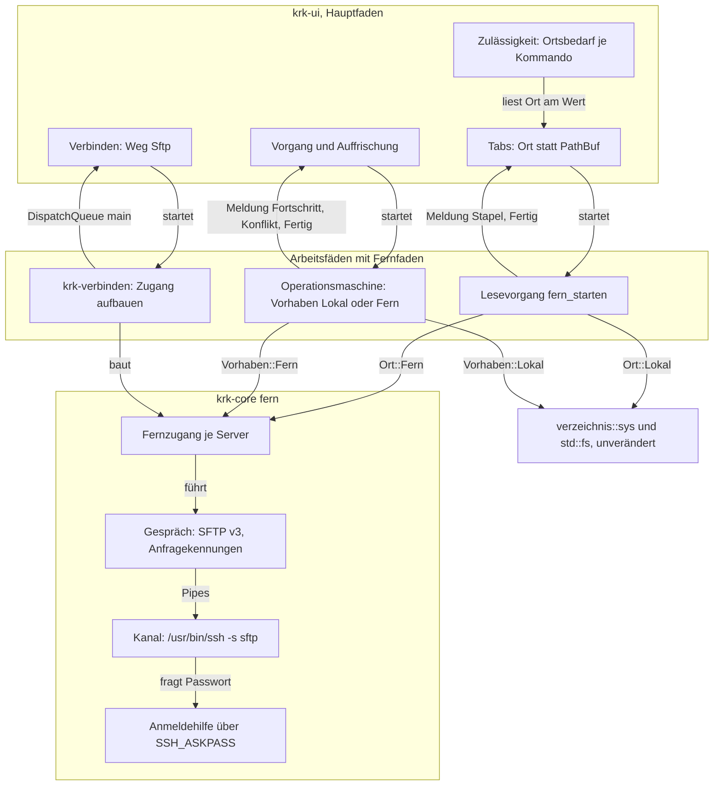
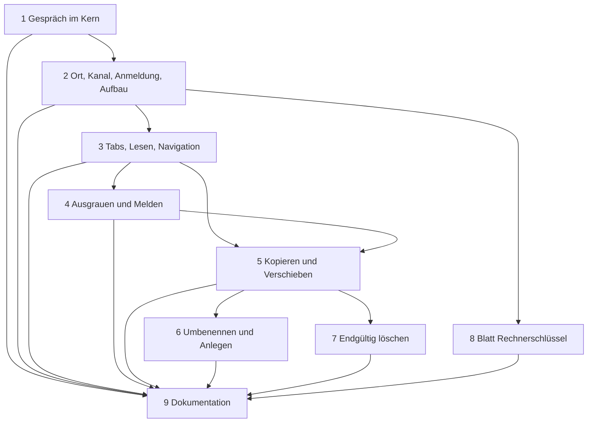

# Implementation Plan: Eine sftp-Verbindung öffnet den entfernten Ordner im Dateifenster, und Kopieren und Verschieben gehen wie lokal

**Date:** 2026-10-16
**Spec:** none — planned from raw request (Narrativ `261016-1945-sftp-ordner-im-dateifenster-wie-lokal.md` mit den wörtlichen Nutzerworten, Machbarkeitsanalyse `261016-1746-sftp-verbindung-als-dateisystem-machbarkeit.md` Möglichkeit 2, drei beantwortete Entscheide `261016-1946-…`, `261016-1947-…`, `261016-1948-…`)
**Decidability:** Die tragende Frage lautet: „Kann ein Aufruf, der auf das Netz wartet, den Hauptfaden erreichen?“ Sie ist entscheidbar, und zwar beim Übersetzen: jede Anfrage an den Server verlangt ein `&Fernfaden`, das nur in einem frisch gestarteten Faden entsteht und nicht `Send` ist (Entscheidung 4, Datensatz `261016-1956-welche-form-hat-ein-ort-im-dateifenster-und-wie-haelt-der-bau-fernaufrufe-vom-hauptfaden-fern.md`). Die zweite tragende Frage, „ist dieser Ort entfernt, und hat er einen Papierkorb?“, beantwortet der Wert `Ort` ohne Systemaufruf. **Eine Frage ist in der vom Auftrag nahegelegten Form nicht entscheidbar, und der Plan wechselt deshalb den Mechanismus:** ob ein Aufruf von `SSH_ASKPASS` nach dem Passwort, nach der Passphrase eines Schlüssels oder nach einem unbekannten Rechnerschlüssel fragt, steht allein im Abfragetext von OpenSSH, und der ist keine zugesicherte Schnittstelle. Der Plan liest ihn nie. Statt dessen stellt er die Lage so her, dass jede Abfrage eine Passwortabfrage ist: mit Passwort wird die Anmeldung über Schlüssel abgeschaltet, ohne Passwort gilt `BatchMode=yes`, und Rechnerschlüssel fragt `ssh` mit `StrictHostKeyChecking=yes` nie. Ob ein Rechnerschlüssel bekannt ist, fragt KRK vorher über `ssh -G` und `ssh-keygen -F`, zwei dokumentierte Ausgaben (Entscheidungen 5 und 6).

## Directive

Der Nutzer will, wörtlich, „zwischen den dateilisten über das protokoll kopieren etc können, also so als wäre das das file:// protocol“, und hat dafür Möglichkeit 2 der Machbarkeitsanalyse gewählt: KRK spricht SFTP selbst über `/usr/bin/ssh -s … sftp`. Erreicht ist das Paket, wenn ein Klick auf ein sftp-Verbindungs-Lesezeichen den entfernten Ordner im aktiven Dateifenster zeigt und Kopieren, Verschieben, Umbenennen, Anlegen und endgültiges Löschen dort wirken wie lokal; was am fernen Ort noch nicht geht, ist ausgegraut oder meldet sich, und lokale Ordner bleiben, wie sie sind. Der Plan stellt die Directive nicht neu auf, er legt fest, wie sie gebaut wird.

## Current State

Gelesen am Stand `c461b3a1`; Zeilenangaben gelten dort.

- **Verbinden.** `Protokoll::Sftp` geht heute über `Weg::Uebergeben` an `NSWorkspace openURL:` (`crates/krk-core/src/heimordner/verbindung.rs`, `Protokoll::weg`). Der Klick läuft von der Leiste über `Anwendungsdelegierter::verbindung_herstellen` zum Faden `krk-verbinden` (`crates/krk-ui/src/appkit/verbinden.rs`, `herstellen`), der `tresorweg::verbindung_vorbereiten` ruft und über `DispatchQueue::main()` an `verbindung_einziehen` antwortet. Ein eingehängter Punkt wird dort über `ordner_lesen(&punkt, None)` im aktiven Fenster gelesen.
- **Passwort.** `Passwort::preisgeben` hat genau einen Rufer, `verbinden.rs`, `einhaengen`; die Probe `das_passwort_wird_allein_an_netfs_preisgegeben` zählt Nennungen über alle `.rs`-Dateien unter `crates/`.
- **Tabs und Lesen.** `Tabinhalt` hält `ordner: PathBuf` (`crates/krk-ui/src/tabs.rs`). Gelesen wird an genau einer Stelle, `Tabliste::lesen_starten` → `Lesevorgang::starten(&tab.ordner, generation)`. Der Leser schickt `Meldung::Stapel` zu je 1024 Einträgen und einmal `Meldung::Fertig` über einen `sync_channel(1)` (`crates/krk-core/src/verzeichnis/leser.rs`); eingezogen wird über einen Takt von 1/60 s auf dem Hauptfaden (`appkit/tabelle.rs`, `stapelEinziehen:`). `Eintrag::mit_versteckt` baut einen Eintrag ohne Systemaufruf, Kollationsschlüssel eingeschlossen. Einen Navigationsverlauf gibt es nicht; „aufwärts“ rechnet `verzeichnis::aufwaerts` am Pfad.
- **Verbraucher des Tabordners.** FSEvents über `auffrischung::sichtbare_ordner`, der Vergleich `gleicher_ordner` mit `canonicalize`, `Gitlauf::starten`, `durchlauf_nachziehen_an` (tiefe Suche und Inhaltsfilter), die Pfadeingabe mit `metadata`, `read_dir` und `canonicalize` auf dem Hauptfaden, der Fenstertitel, die Vorschau über `zu_beschreiben` und jeder Rufer von `angezeigter_ordner()` in `appkit/anwendung.rs`.
- **Operationsmaschine.** `Auftrag { quellen: Vec<PathBuf>, art, konfliktregel, uebertragung }`, `Art` mit sieben Werten, alle Ziele `PathBuf` (`crates/krk-core/src/operation/auftrag.rs`). `operation::starten` startet den Faden `krk-operation`; Fortschritt, Konfliktfrage und Bericht gehen über `fortschritt::Meldung`, die Konfliktfrage blockiert auf einem `sync_channel(1)`. Gleichzeitig läuft höchstens ein Vorgang. Neuer Ordner, neue Datei und das Umbenennen einer Zeile laufen synchron auf dem Hauptfaden, an der Maschine vorbei.
- **Löschen.** Allein in den Papierkorb. Vor der Rückfrage fragt der Hauptfaden `canonicalize` und `fuehrt_einen_papierkorb`; `Nein` und `Unentschieden` enden in `Vorstufe::OhnePapierkorb` und einer Meldung statt eines Blatts. Diesen Hauptfadenzugriff hält der Defekt `261016-1956-der-loeschweg-fragt-canonicalize-und-den-papierkorb-auf-dem-hauptfaden-und-ein-haengendes-netzlaufwerk-haelt-die-ereignisschleife-an.md` fest; dieses Paket behebt ihn nicht.
- **Zulässigkeit.** `Lage` in `crates/krk-ui/src/kommandos/zulaessigkeit.rs`, vier Bestandteile, jede Prüfung vollständig über `Wirkungsbereich`. Das Kontextmenü graut nach eigener Regel nie etwas aus, ein Eintrag meldet sein Ergebnis in der Statuszeile (`appkit/tabelle.rs`, Kommentar vor `eigene_kontexteintraege_anfuegen`).
- **Prozesse.** Kein Betriebscode von `krk-core` oder `krk-ui` startet heute einen Prozess; `main.rs` kennt keine Hilfsrolle.
- **Gerät.** `/usr/bin/ssh` (OpenSSH 9.9p2), `/usr/bin/ssh-keygen`, `/usr/bin/ssh-keyscan` und `/usr/libexec/sftp-server` stehen im System (geprüft mit `ls`).

## Approach

Ein Wert `Ort` ersetzt den Ordnerpfad an den Nähten, an denen ein Tab, ein Auftrag oder die Auffrischung einen Ordner nennt. Jede dieser Nähte verzweigt vollständig über `Ort::Lokal` und `Ort::Fern`, und der lokale Zweig ruft genau den Code, der heute läuft. Hinter `Ort::Fern` steht ein `Fernzugang` je Server und Prozess, der ein SFTP-v3-Gespräch über die Pipes eines `ssh`-Kindprozesses führt. Anfragen stellen allein Arbeitsfäden, belegt durch das Pfand `Fernfaden`; Antworten erreichen den Hauptfaden über die Wege, die es schon gibt.



Selbstprüfung des Schaubilds: drei Schichten (Hauptfaden, Arbeitsfäden, Kern), dazu die unveränderte lokale Schicht. Die drei Rückkanten von den Arbeitsfäden zum Hauptfaden sind die Antwortwege, die heute schon bestehen, und kein Zyklus im Aufbau: jede ist ein Kanal oder die Hauptschlange. Kein Knoten zeigt auf mehr als drei andere; `op` und `leser` zeigen auf beide Seiten, weil die Fallunterscheidung über `Ort` genau dort steht. Jede Kante steht im Text dieses Abschnitts oder in den Entscheidungen.

## Entscheidungen

Die nummerierten Entscheidungen sind die Antworten, die der Auftrag verlangt. Jeder Schritt zitiert die Nummern, die er umsetzt.

### E1. Die Form von `Ort`

`krk_core::ort::Ort` ist `Lokal(PathBuf)` oder `Fern(FernerOrt)`. `FernerOrt` trägt `zugang: Arc<Fernzugang>` und `pfad: Fernpfad`; `Fernpfad` ist ein absoluter POSIX-Pfad auf dem Server als UTF-8-Text, mit rein lexikalischem `verbinden(name)` und `aufwaerts()`. Gleichheit und `Debug` gehen über die Serverkennung (Rechner klein geschrieben, Port, Konto) und den Pfad, nie über den Zeiger. Die Abwägung gegen ein `trait Dateisystem` und gegen eine Quelltextprobe steht im Datensatz `261016-1956-welche-form-hat-ein-ort-im-dateifenster-und-wie-haelt-der-bau-fernaufrufe-vom-hauptfaden-fern.md`; der Plan baut auf dessen Empfehlung, Möglichkeit 1.

### E2. Wo `Ort` den `PathBuf` ersetzt, und wo nicht

| Stelle | Entscheidung |
|---|---|
| Tab (`Tabinhalt` in `krk-ui/src/tabs.rs`) | Der Ordner wird `Tabort`: `Lokal(PathBuf)` oder `Fern { ort: FernerOrt, rueckkehr: PathBuf }`. `rueckkehr` ist der lokale Ordner, den der Tab vor dem Wechsel auf den Server zeigte. Zwei Leser ersetzen `ordner()`: `ort() -> Ort` für jeden, der beide Fälle kann, und `lokaler_ordner() -> Option<&Path>` für jeden, der nur lokal arbeitet. Wer `None` bekommt, meldet `Text::AmFernenOrtNichtVerfuegbar` in der Statuszeile und tut sonst nichts. |
| Lesevorgang | `Lesevorgang::starten(pfad, generation)` bleibt unverändert. Daneben tritt `Lesevorgang::fern_starten(ort: FernerOrt, generation)`, das denselben Typ mit demselben Meldungskanal liefert. `Tabliste::lesen_starten` verzweigt über `Tabort`. |
| Aufträge | Der lokale `Auftrag` behält seinen Typ und seine Rümpfe. Ein Vorgang, bei dem eine Seite fern ist, ist ein `Fernauftrag` mit eigener `Fernart`; `operation::starten` nimmt `Vorhaben::Lokal(Auftrag)` oder `Vorhaben::Fern(Fernauftrag)`. Zippen, Entpacken, Duplizieren, Stapelumbenennen und der Papierkorb sind damit für einen fernen Ort nicht baubar. |
| Meldungen der Maschine | `fortschritt::Meldung::Konflikt` und der Bericht nennen Quelle und Ziel als `Ort`. Die Konfliktfrage liest heute keine Platte (`appkit/blaetter/konflikt.rs` ruft weder `fs::` noch `metadata`), also genügt der Wert. |
| Auffrischung | `Dateifenstersicht::ordner` liefert `Ort`. `sichtbare_ordner` gibt FSEvents allein die lokalen. `gleicher_ordner` vergleicht ferne Orte am Wert, ohne `canonicalize`; der lokale Zweig bleibt. |
| Lesezeichen | Unverändert. `Ziel::Verbindung` nennt den Eintrag in `secrets.txt`, und dessen Adresse trägt den Startordner (E7). „Lesezeichen anlegen“ ist an einem fernen Ort ausgegraut (E13), ein `Ziel::Ordner` mit fernem Pfad entsteht also nie. |
| `session.toml` | Format unverändert, kein neues Feld. Ein ferner Tab schreibt als `ordner` seinen `rueckkehr`-Ordner. Nach einem Neustart steht der Tab also dort, wo er vor dem Verbinden stand. Begründung: ein wiederhergestellter ferner Tab müsste beim Start verbinden oder ein PIN-Blatt zeigen, und L4 und L5 verlangen einen Start, der auf nichts wartet. Eine ältere Fassung von KRK liest die Datei unverändert. Ob der Nutzer ferne Tabs lieber wiederhergestellt hätte, steht unter den offenen Fragen. |

### E3. Eine Verbindung pro Server und Prozess

- **Wiederverwendung.** Der Anwendungsdelegierte hält ein Register `Arc<Mutex<HashMap<Serverkennung, Weak<Fernzugang>>>>`. Allein der Faden `krk-verbinden` liest und schreibt es: er entschlüsselt den Eintrag, bildet die Serverkennung und nimmt einen lebenden Zugang, statt einen zweiten `ssh` zu starten. Der Hauptfaden fasst das Register nie an.
- **Schließen.** Ein `Fernzugang` lebt, solange ein Tab, ein Lesevorgang oder ein Vorgang ein `Ort::Fern` auf ihn hält. Fällt der letzte `Arc`, schließt `Drop` die Standardeingabe von `ssh`; `ssh` endet darauf, und der Lesefaden des Gesprächs erntet den Kindprozess mit `wait`. `Drop` wartet auf nichts, auch wenn er auf dem Hauptfaden läuft. Beim Beenden von KRK schließen die Pipes mit dem Prozess.
- **Abbruch.** Endet die Ausgabe von `ssh` oder liefert ein Paket Unsinn, setzt das Gespräch seinen Zustand auf `Getrennt(grund)` und beantwortet jede wartende Anfrage mit `Fernfehler::Getrennt`. `ssh` erkennt eine tote Leitung über `ServerAliveInterval=15` und `ServerAliveCountMax=3`.
- **Wiederaufbau.** Nie still im Hintergrund, denn er braucht die Zugangsdaten und damit unter Umständen die PIN. Er geht über denselben Klick auf das Verbindungs-Lesezeichen (oder `Kommando::VerbindungHerstellen`): `krk-verbinden` findet im Register den getrennten Zugang und setzt ein neues Gespräch in ihn ein. Danach liest jeder Tab auf diesem Server neu. Ein Tab, dessen Lesen an `Getrennt` scheitert, meldet `Text::FernVerbindungGetrennt` mit dem Namen der Verbindung.

### E4. Die Fäden und der Weg der Antworten

- **Gesprächsfaden** `krk-sftp-<rechner>`: liest die Standardausgabe von `ssh`, zerlegt Pakete und reicht jede Antwort über ihre Anfragekennung an den `mpsc::Sender`, der auf sie wartet. Geschrieben wird von den anfragenden Fäden selbst, unter einem `Mutex` um die Standardeingabe; ein Paket wird ganz oder gar nicht geschrieben.
- **Fehlerfaden** `krk-sftp-fehler`: liest die Fehlerausgabe von `ssh` mit und hält die letzten Zeilen für die Meldung, sonst hielte eine volle Pipe `ssh` an.
- **Anfragende Fäden:** der Fernzweig des Lesevorgangs, der Faden `krk-operation`, der Faden `krk-verbinden`. Jede blockierende Anfrage nimmt `&Fernfaden`. `Fernfaden` entsteht allein in `krk_core::fern::faden(name, f)`, das einen Faden startet und das Pfand hineinreicht, und trägt `PhantomData<*const ()>`, ist also nicht `Send` und kommt nie in einen Block für `DispatchQueue::main()`. Die drei Fäden starten über `fern::faden` statt über `std::thread::Builder`; der Faden `krk-verbinden` tut das für alle Protokolle, der NetFS-Zweig übergeht das Pfand.
- **Antworten an den Hauptfaden:** der Lesevorgang über seinen Kanal und den Einzugstakt, die Maschine über ihre `Meldung` und den Faden `krk-vermittler`, das Verbinden über `DispatchQueue::main()`. Einen vierten Weg gibt es nicht.
- **Nebenläufigkeit:** SFTP erlaubt mehrere offene Anfragen; Lesen und Schreiben in Blöcken stellen bis zu 16 Anfragen zugleich. Ein Lesevorgang im linken Tab, einer im rechten und ein Vorgang teilen sich ein Gespräch.

### E5. Der `ssh`-Aufruf und die Anmeldung

Der Aufruf ist eine reine Funktion `fern::kanal::ssh_plan(&Fernziel, Anmeldung) -> Kanalplan` (Programm, Argumente, Umgebung) und damit ohne Netz prüfbar:

```
/usr/bin/ssh -o StrictHostKeyChecking=yes -o ConnectTimeout=10
  -o ServerAliveInterval=15 -o ServerAliveCountMax=3
  -o ForwardAgent=no -o ForwardX11=no -o ClearAllForwardings=yes -o PermitLocalCommand=no
  [mit Passwort:  -o BatchMode=no -o PubkeyAuthentication=no
                  -o PreferredAuthentications=keyboard-interactive,password
                  -o NumberOfPasswordPrompts=1]
  [ohne Passwort: -o BatchMode=yes]
  [-p <port>] [-l <konto>] -s -- <rechner> sftp
```

- **Mit Passwort** setzt KRK in der Umgebung des Kindprozesses `SSH_ASKPASS=<eigenes Programm>`, `SSH_ASKPASS_REQUIRE=force` und `KRK_ANMELDEHILFE=<Socketpfad>`. Keine dieser Variablen trägt das Passwort. Das eigene Programm ist das Binärziel `krk` (`std::env::current_exe()`, auf dem Faden gefragt). `main` prüft `KRK_ANMELDEHILFE` als erste Handlung, vor jeder Berührung von AppKit und der Sprache, und läuft dann als Anmeldehilfe: sie verbindet sich mit dem Socket, liest das Passwort, schreibt es mit Zeilenende auf ihre Standardausgabe und endet.
- **Der Socket** liegt in einem frisch angelegten Verzeichnis mit den Rechten `0700` unter `std::env::temp_dir()`, sofern keine Probe des Baums einen zweiten Rufer von `temp_dir` abweist; sonst unter `~/Library/Caches/KRK/`. Ein Faden `krk-anmeldehilfe` beantwortet **höchstens eine** Verbindung je Aufbau und gibt das Passwort dabei genau einmal heraus. Endet der Aufbau, gleich wie, fallen Socket, Verzeichnis und Passwort (`Zeroizing`).
- **Warum das ohne Lesen des Abfragetexts reicht:** mit Passwort ist die Anmeldung über Schlüssel aus, also fragt `ssh` keine Passphrase; `StrictHostKeyChecking=yes` stellt keine Frage zum Rechnerschlüssel. Fragt `ssh` ein zweites Mal, etwa nach einem zweiten Faktor, bekommt die Hilfe keine Antwort, und die Anmeldung scheitert mit `Text::FernAnmeldungAbgewiesen`. Ohne Passwort im Eintrag gilt `BatchMode=yes`: Schlüssel und Agent oder nichts.
- **Der zweite Rufer von `Passwort::preisgeben`** steht in `crates/krk-ui/src/anmeldehilfe.rs`, `passwort_reichen`. Die Probe heißt danach `das_passwort_wird_allein_an_netfs_und_ssh_preisgegeben` und verlangt genau die zwei Stellen `verbinden.rs` (`einhaengen`) und `anmeldehilfe.rs` (`passwort_reichen`), je einmal. So verlangt es der Entscheid `261016-1947-darf-das-passwort-einer-verbindung-krk-ausser-an-netfs-auch-an-ssh-gehen.md`.
- `~/.ssh/config` gilt weiter; die Optionen auf der Befehlszeile gehen ihr vor. Der Rechnername steht hinter `--`, und eine Adresse, deren Rechner mit `-` beginnt, weist schon die Prüfung im Kern ab.

### E6. Der unbekannte Rechnerschlüssel

- `StrictHostKeyChecking=yes` immer; `accept-new` nie, weil es einen Schlüssel annähme, den der Nutzer nie gesehen hat.
- **Vorprüfung auf dem Faden `krk-verbinden`:** `ssh -G` mit denselben `-p`, `-l` und demselben Rechner liefert `hostname`, `port`, `hostkeyalias`, `userknownhostsfile` und `globalknownhostsfile`. Dann fragt `ssh-keygen -F <name> -f <datei>` jede vorhandene Datei, mit `<name>` gleich `hostkeyalias`, sonst `hostname` bei Port 22 und `[hostname]:port` bei jedem anderen. Exit 0 in einer Datei heißt bekannt. Beide Ausgaben sind dokumentiert (`man ssh`, `-G`; `man ssh-keygen`, `-F`); gelesen werden die Schlüsselwörter der Zeilen, kein Fließtext.
- **Unbekannt:** Ab Schritt 8 holt KRK auf dem Faden die Schlüssel mit `ssh-keyscan -T 10 -p <port> <hostname>`. Die Fingerabdrücke berechnet `ssh-keygen -l -f <datei>` über die gescannten Zeilen. Ein Blatt zeigt Rechner, Port und je Schlüsseltyp den Fingerabdruck `SHA256:…`. „Annehmen“ hängt genau die gescannten Zeilen an die erste `userknownhostsfile` an (Verzeichnis `0700`, Datei `0600`, wenn sie fehlen) und verbindet danach mit `StrictHostKeyChecking=yes`. `ssh` prüft dann gegen genau die gezeigten Schlüssel. „Abbrechen“ endet mit `Text::FernRechnerschluesselUnbekannt`. Bis Schritt 8 endet jeder unbekannte Rechner mit dieser Meldung, und sie nennt den Rechner.
- **Geänderter Schlüssel:** Die Vorprüfung findet den Namen, `ssh` scheitert an der Abweichung, und KRK meldet `Text::FernVerbindungAbgewiesen` mit der letzten Zeile der Fehlerausgabe von `ssh` als Platzhalter. KRK bietet kein Überschreiben an; das bleibt eine Handlung des Nutzers in `known_hosts`.

### E7. Adresse und Startordner

`Protokoll::Sftp` bekommt `Weg::Sftp` und `Verbindungsziel::Sftp(Fernziel)`; `Ssh` bleibt beim Übergeben. `Fernziel { rechner, port: Option<u16>, konto: Option<String>, startpfad: Startpfad }` entsteht aus Adresse und Konto des Eintrags in einer reinen Funktion, die das Blatt „Verbinden“ und der Klick gemeinsam fragen (dieselbe Regel wie `adresse_pruefen`). Die Adresse lautet `rechner[:port][/pfad]`, IPv6 als `[adresse]:port`.

| Adresse | Startordner |
|---|---|
| `ssh.strato.de` oder `ssh.strato.de:22` | das Anmeldeverzeichnis, `REALPATH(".")` |
| `ssh.strato.de/~/htdocs` | `htdocs` unter dem Anmeldeverzeichnis |
| `ssh.strato.de/htdocs` | `/htdocs`, absolut, wie in einer `sftp://`-URL |

Aufgelöst wird auf dem Faden `krk-verbinden` mit `REALPATH` und `STAT`. Ist der Ordner nicht da oder kein Ordner, zeigt das Fenster das Anmeldeverzeichnis, und die Statuszeile sagt `Text::FernStartordnerFehlt` mit dem Pfad. Abgewiesen werden ein leerer Rechner, ein Rechner mit Leerraum oder führendem `-` und ein Port außerhalb von 1 bis 65535.

### E8. Lesen eines fernen Ordners

`OPENDIR`, dann `READDIR` bis `SSH_FX_EOF`, dann `CLOSE`. Der Abbruch wird vor jedem `READDIR` gefragt. Je Name entsteht ein `Eintrag` über `Eintrag::mit_versteckt`:

- `typ` aus den Rechtebits (`S_IFDIR` Ordner, `S_IFLNK` Verknüpfung, sonst Datei, auch ohne Rechteangabe);
- `groesse` aus der Größe, Ordner 0;
- `geaendert` aus `mtime`, ohne Angabe die Unix-Epoche;
- `versteckt` genau dann, wenn der Name mit einem Punkt beginnt.

`.` und `..` fallen weg. Ein Name, der kein UTF-8 ist, wird übersprungen und gezählt; der Tab nennt die Zahl über `Text::FernNamenUebersprungen`, weil ein ersetzter Name auf keinen Eintrag mehr zeigte. Gesendet wird in Stapeln zu 1024 über denselben Kanal wie lokal, also bleiben Ordnermodell, Kollation, Sortierung und Namensfilter unberührt (E14). Einer Verknüpfung folgt der Leser nicht. Ein Doppelklick auf sie versucht `OPENDIR` auf ihren Pfad und tritt ein, wenn das gelingt; sonst meldet die Statuszeile `Text::AmFernenOrtNichtVerfuegbar`.

### E9. Kopieren und Verschieben

- **Richtungen:** lokal→fern, fern→lokal und fern→fern, auf demselben Server wie zwischen zweien. Alle laufen durch **eine** Übertragungsschleife zwischen einer Lesequelle und einem Schreibziel, von denen jedes eine lokale Datei oder ein ferner Handle ist. Lokal→lokal bleibt `Vorhaben::Lokal` und geht diesen Weg nie. Fern→fern auf demselben Server läuft ebenfalls über das Gerät; die Erweiterung `copy-data` wird nicht benutzt, weil sie einen zweiten Kopierweg neben der Schleife wäre und der Server sie nicht anbieten muss.
- **Blöcke:** 32 KiB je `READ` oder `WRITE`, bis zu 16 offen. Nach jedem Block kommen Fortschritt in Bytes und Einträgen (`Steuerung::zwischenstand`) und die Frage nach dem Abbruch. Ein abgebrochenes Ziel wird entfernt (lokal `remove_file`, fern `REMOVE`), wie heute in `kopieren::datei_uebertragen`.
- **Konflikt:** Das Ziel wird exklusiv angelegt, fern mit `OPEN` und `SSH_FXF_CREAT|SSH_FXF_EXCL|SSH_FXF_WRITE`, lokal mit `OpenOptions::create_new`. Dieses Anlegen ist die eine Prüfung, ob der Name frei ist. Scheitert es, fragt `LSTAT` am Ziel, ob ein Eintrag dort steht; SFTP v3 kennt keinen eigenen Code für „vorhanden“. Steht einer da, geht die Konfliktfrage über `Steuerung::konflikt_loesen` an dasselbe Blatt wie lokal, mit `konfliktform` für die neuen Arten. „Überschreiben“ entfernt das vorhandene Ziel endgültig, bei einem Ordner samt Inhalt, und legt dann neu an; so tut es lokal `ziel_klaeren`, und das Blatt sagt „endgültig“ schon heute (`operationen::ersetzungsweg`). Ordner auf Ordner ist kein Konflikt, die Inhalte werden zusammengeführt.
- **Verschieben** auf demselben Server: `SSH_FXP_RENAME` (E10), bei einem vorhandenen Ziel dieselbe Konfliktfrage. Über eine Grenze hinweg, also zwischen Gerät und Server oder zwischen zwei Servern: kopieren und danach die Quelle entfernen, allein wenn nichts übersprungen wurde. Das ist die Regel von `verschieben::ueber_datentraeger`.
- **Angaben am Ziel:** Rechte (`& 0o7777`) und Änderungszeit, fern über `SETSTAT`, lokal über `set_permissions` und `File::set_modified`. Erweiterte Attribute und Ressourcengabeln gehen auf dem Weg zum Server verloren; `HowTo.md` sagt das.
- **Verknüpfungen** werden als Verknüpfungen übertragen. Fern→lokal läuft über `READLINK` und `std::os::unix::fs::symlink`. Lokal→fern läuft über `SYMLINK`, aber nur, wenn der Server sich durch `posix-rename@openssh.com` in seiner `VERSION` als OpenSSH zu erkennen gibt; dann gilt die Argumentfolge von OpenSSH, die von der des Entwurfs abweicht. Sonst wird die Verknüpfung übersprungen und im Bericht genannt.
- **Abwurf** aus dem Finder oder aus dem anderen Fenster auf ein fernes Fenster ist ein Kopieren oder Verschieben lokal→fern über denselben Auftrag. Ziehen **aus** einem fernen Fenster bietet KRK nicht an (E13).

### E10. Umbenennen

`SSH_FXP_RENAME` und nicht `posix-rename@openssh.com`. Der Entwurf von SFTP v3 schreibt vor, dass `RENAME` scheitert, wenn das Ziel existiert. Der Server des Systems setzt das über `link` und `unlink` um (`inference:` aus der Quelle von OpenSSH, belegt wird es in Schritt 1 durch die Probe `rename_weist_ein_vorhandenes_ziel_ab`). `posix-rename` ersetzt dagegen ein vorhandenes Ziel still, und genau das schließt die lokale Regel aus, die `renamex_np` mit `RENAME_EXCL` ruft. Ein vorhandener Name führt zu derselben Antwort wie lokal. Der Vorschlag des Auftrags, `posix-rename` zu nehmen, wo es angeboten wird, ist damit verworfen. Das Umbenennen einer Zeile an einem fernen Ort läuft als `Fernart::Umbenennen` über die Maschine, nicht synchron auf dem Hauptfaden wie lokal. Es gilt deshalb auch die Regel „ein Vorgang zur Zeit“. Der lokale Weg bleibt synchron.

### E11. Neuer Ordner, neue Datei

`MKDIR`, und für eine leere Datei `OPEN` mit `CREAT|EXCL` und danach `CLOSE`, als `Fernart::Anlegen { name, typ }` über die Maschine. Ein vorhandener Name scheitert am Anlegen selbst und meldet dasselbe wie lokal. Danach wählt das Fenster den neuen Eintrag, wie `anlegen_ausfuehren` es lokal tut.

### E12. Endgültiges Löschen

- **Wo:** an jedem Ort ohne Papierkorb, also an jedem fernen Ort (am Wert entschieden, ohne Systemaufruf) und an jedem lokalen, für den `fuehrt_einen_papierkorb` heute `Nein` oder `Unentschieden` sagt (Entscheid `261016-1948-darf-krk-an-einem-ort-ohne-papierkorb-nach-rueckfrage-endgueltig-loeschen.md`, Möglichkeit 1). `Vorstufe::OhnePapierkorb` führt dann nicht mehr zur Meldung, sondern zur endgültigen Rückfrage.
- **Rückfrage:** dasselbe Blatt aus `loeschbestaetigung`, in einer zweiten Gestalt. Die Überschrift spricht „endgültig“ aus (`Text::LoeschenEndgueltigFrage`, „<n> Einträge endgültig löschen? Dieser Ort hat keinen Papierkorb; gelöschte Einträge lassen sich nicht zurückholen.“), die bestätigende Schaltfläche heißt „Endgültig löschen“ und ist als zerstörend gekennzeichnet, Vorgabe bleibt „Abbrechen“. Die lauten Warnungen der Runde 12 (Netzlaufwerk, Arbeitsbaum, Umfang) bleiben für lokale Orte. Für einen fernen Ort entfallen Arbeitsbaum und Umfang, weil beide lokale Systemaufrufe brauchen; das Blatt nennt dann die Zahl der gewählten Einträge.
- **Ausführung:** lokal `Art::EndgueltigLoeschen` über `loeschen::baum_entfernen`, fern `Fernart::Loeschen` über `REMOVE`, `RMDIR` und rekursives `READDIR`. Beide halten am ersten Fehler eines Eintrags an und gehen zum nächsten gewählten. Der Papierkorbweg bleibt Zeile für Zeile, wie er ist.

### E13. Was am fernen Ort ausgegraut ist oder sich meldet

Zwei Mechanismen, nach der Regel des Projekts für die jeweilige Fläche:

- **Tasten und Hauptmenü** grauen aus, über die Zulässigkeit. `Kommando::ortsbedarf() -> Ortsbedarf { Ueberall, Lokal }` steht vollständig und ohne Auffangzweig in `krk-core/src/tasten/belegung.rs`; `Lage` bekommt `aktiv_fern` (der aktive Tab des aktiven Dateifensters zeigt einen fernen Ort, am Wert gelesen); `ort_passt` tritt als weitere Hälfte des dritten Bestandteils neben `folge_passt`. `Lokal` tragen: `TerminalOeffnen`, `MitStandardprogrammOeffnen`, `Teilen`, `OrdnerpfadKopieren`, `EintragspfadKopieren`, `LesezeichenAnlegen`, `Bearbeiten`, `TiefeSucheUmschalten`, `InhaltssucheUmschalten`, `UmbenennenStapel`. Jedes andere Kommando trägt `Ueberall`. Das schließt `Kopieren`, `Verschieben`, `InPapierkorb`, `OrdnerAnlegen`, `DateiAnlegen`, `Umbenennen`, `Oeffnen`, `OrdnerAufwaerts`, `OrdnerAngleichen` und `Pfadeingabe` ein: sie wirken am fernen Ort nach E8 bis E12. Findet der Bearbeiter ein weiteres Kommando, das einen lokalen Pfad aus dem Tab liest, bekommt es `Lokal`, und der Bericht nennt es.
- **Das Kontextmenü** graut nach seiner Regel nichts aus. Öffnen mit, Zippen, Entpacken, Duplizieren, Im Finder öffnen, Im Finder anzeigen und Teilen melden an einem fernen Ort `Text::AmFernenOrtNichtVerfuegbar` in der Statuszeile. Auswerfen und Verbinden gehören zur Leiste und bleiben, wie sie sind. Die Directive verlangt „nicht still wirkungslos“, und die Meldung erfüllt das auf der Fläche, deren Regel das Ausgrauen ausschließt.
- **Die Ankreuzfelder „Deep“ und „Content“** sind in einem fernen Tab nicht bedienbar (`setEnabled:`), und `durchlauf_nachziehen_an` startet für einen fernen Tab keinen Durchlauf. Der Namensfilter wirkt flach über den angezeigten Ordner.
- **Der Git-Bereich** startet für einen fernen Tab keinen `Gitlauf` und zeigt `Text::GitAmFernenOrt`.
- **Vorschau:** Für eine ferne Auswahl zeigt sie Name, Größe, Änderungszeit und Typ aus dem `Eintrag` des Ordnermodells und liest keinen Inhalt. Ohne Auswahl zeigt sie dieselben Angaben für den fernen Ordner, ohne das Default-Profil zu zählen. **Entschieden ist auch, dass die Vorschau über einen begrenzten Lesevorgang gehen kann:** `OPEN` und `READ` bis zur Grenze liefern dieselben Bytes, die `bis_zur_grenze_lesen` lokal liefert, und L7 sagte für ferne Orte ohnehin nichts zu. Der Inhalt ferner Dateien ist trotzdem nicht Teil dieses Pakets. Text, Bild, PDF, Leseprofile und Bildfolge brauchen je eine Bytequelle statt eines Pfades, die Directive verlangt sie nicht, und ein eigenes Paket kann sie auf `Fernzugang` aufsetzen.
- **Editor:** Eine ferne Datei öffnet er nicht (`Bearbeiten` trägt `Lokal`), und ein Doppelklick auf eine ferne Datei meldet `Text::AmFernenOrtNichtVerfuegbar`.
- **Zwischenablage und Ziehen:** `cmd+c` und `cmd+x` legen aus einem fernen Fenster keine Dateiverweise ab und melden. Eine Zeile eines fernen Fensters lässt sich nicht in den Finder ziehen.

### E14. Sortierschlüssel und Namensfilter

Unverändert. Ein ferner Eintrag entsteht über denselben Konstruktor wie ein lokaler, sein Kollationsschlüssel also auch. `Ordnermodell`, `filter.rs`, `ZEICHENSCHWELLE` und `sortierung.rs` bekommen keine Zeile.

### E15. Fenstertitel, Pfadeingabe, Navigation

- **Fenstertitel** eines fernen Ordners: `konto@rechner:/pfad`, mit Port `konto@rechner:port:/pfad`; `fenstertitel::titel` nimmt dafür `&Ort`.
- **Pfadeingabe** in einem fernen Fenster: Der Text ist ein Pfad auf demselben Server, absolut oder mit `~/` relativ zum Anmeldeverzeichnis, rein lexikalisch bereinigt, ohne Systemaufruf. Steht dort kein Ordner, sagt es der Lesevorgang im Tab. Zurück zu einem lokalen Ordner geht es über ein Lesezeichen, die Geräteleiste oder `OrdnerAngleichen` von einem lokalen Fenster aus.
- **Aufwärts und Eintreten** rechnen am `Fernpfad`. Oberhalb von `/` gibt es kein Aufwärts.
- **Neuer Tab** in einem fernen Fenster zeigt denselben fernen Ort mit demselben `rueckkehr`.

### E16. Abnahmelauf gegen C8: ja

Lokal soll sich nichts ändern, aber die Nähte, an denen sich nichts ändern soll, werden umgebaut. `Tabliste::lesen_starten` speist L2, L3, L6 und L10. `operation::starten` und der Vorgang speisen L8. Der Wechsel von `PathBuf` zu `Tabort` geht durch jeden Rufer von `angezeigter_ordner()`. Das unterscheidet das Paket von den Fällen, in denen eine Runde Arbeit **neben** die gemessenen Wege legte und auf den Lauf verzichtete (`260819-2216_*_schuldet-diese-runde-einen-abnahmelauf-gegen-die-zusage-l7.md`, `261016-1429-schuldet-das-paket-einen-abnahmelauf-wenn-der-hauptfaden-drei-zugriffe-statt-eines-stellt.md`). Der Lauf ist Nutzerarbeit im Vordergrund; er steht unter „Where this work stops“. Für ferne Orte entsteht keine Zusage. Eine Messung ferner Orte gegen den Server des Nutzers darf als Bericht unter `messungen/` entstehen, ohne Zahl in C8.

### E17. Keine neue Kiste

Das Paket fügt weder der Wurzel-`Cargo.toml` noch einer Kiste eine Abhängigkeit hinzu. Prozesse und Pipes gehen über `std::process`, der Socket über `std::os::unix::net`, die Verzeichnisrechte über `std::os::unix::fs::DirBuilderExt`. Fingerabdrücke rechnet `ssh-keygen`, nicht KRK. Damit bleiben C-Freiheit und `#![deny(unsafe_code)]` ohne neue Ausnahme.

## Implementation Steps

Gemeinsame Akzeptanz jedes Schritts (im Folgenden „Grundabnahme“): `make check` grün; `cargo xtask bundle` baut und signiert `target/KRK.app`; `cargo tree --target aarch64-apple-darwin -e normal,build` und `cargo tree --target x86_64-apple-darwin -e normal,build` führen weder `cc` noch ein Paket mit einem Namen auf `-sys`; `git diff c461b3a1 -- Cargo.toml crates/*/Cargo.toml Cargo.lock` ist leer (E17); `grep -rn '^#!\[allow(unsafe_code)\]' crates xtask` nennt weiter allein `verzeichnis/sys.rs` und `appkit/mod.rs`. Jeder neue nutzersichtbare Text steht in `de.rs`, `fr.rs` und `en.rs`. Jeder neue Rückgabewert, dessen stilles Fallenlassen unbemerkt bliebe, trägt `#[must_use]`. Jede neue Aufzählung wird ohne Auffangzweig verzweigt, und jede neue Liste `ALLE` hält `jede_alle_liste_fuehrt_genau_die_varianten_ihrer_aufzaehlung`. Jede neue Datei unter `appkit/` mit Frameworkimport trägt den Untergrenzen-Abschnitt.

1. **SFTP-v3-Gespräch im Kern**
   - Executor: code-implementer
   - Files: neu `crates/krk-core/src/fern/mod.rs`, `fern/paket.rs`, `fern/gespraech.rs`, `fern/faden.rs`; `crates/krk-core/src/lib.rs`; neu `crates/krk-core/tests/fern.rs`
   - Changes: Pakete (`INIT`/`VERSION` mit Erweiterungen, `REALPATH`, `STAT`, `LSTAT`, `OPENDIR`, `READDIR`, `OPEN`, `READ`, `WRITE`, `CLOSE`, `SETSTAT`, `MKDIR`, `RMDIR`, `REMOVE`, `RENAME`, `READLINK`, `SYMLINK`; Antworten `STATUS`, `HANDLE`, `DATA`, `NAME`, `ATTRS`) als reine Kodierung und Zerlegung. Ein Paket über 256 KiB Länge wird abgewiesen, statt Speicher anzulegen. `Gespraech` über ein beliebiges `Read`/`Write`-Paar eines `std::process::Child`, mit Gesprächsfaden, Fehlerfaden, Kennungstabelle, Zustand `Offen | Getrennt(grund)`, Pipelining (E4). `Fernfaden` und `fern::faden` (E4) mit `compile_fail`-Dokumentationsbeispiel. Modulkopf mit Fadenbild nach dem Muster von `verbinden.rs`. Die Proben starten `/usr/libexec/sftp-server` unmittelbar, ohne `ssh` und ohne Netz, in einem `Wegwerfordner` aus `tests/gemeinsam`. Umsetzt E1 (nur `Fernpfad`), E4, die Protokollhälfte von E8 bis E11.
   - Akzeptanz: Grundabnahme; dazu die Proben
     - `jedes_paket_uebersteht_den_rundlauf`,
     - `ein_paket_ueber_der_grenze_wird_abgewiesen`,
     - `das_gespraech_liest_einen_ordner_mit_zehntausend_eintraegen` (10 002 Namen samt `.` und `..`, wie in der Analyse gemessen),
     - `rename_weist_ein_vorhandenes_ziel_ab` (belegt E10 am Server des Systems),
     - `ein_exklusives_oeffnen_scheitert_an_einem_vorhandenen_namen`,
     - `sechzehn_offene_lesungen_liefern_die_datei_in_ihrer_reihenfolge`,
     - `ein_beendeter_server_beantwortet_jede_wartende_anfrage_mit_getrennt`,
     - `fernfaden_entsteht_an_genau_einer_stelle` (Quelltextprobe über `crates/`),
     - `compile_fail`-Beispiel: ein `Fernfaden` lässt sich nicht in einen `Send`-Abschluss bewegen.
   - Dependencies: none

2. **Ort, Adresse, `ssh`-Kanal, Anmeldehilfe und Verbindungsaufbau**
   - Executor: code-implementer
   - Files: neu `crates/krk-core/src/ort.rs`, `fern/adresse.rs`, `fern/kanal.rs`, `fern/zugang.rs`, `fern/rechnerschluessel.rs` (nur die Vorprüfung); `crates/krk-core/src/heimordner/verbindung.rs`; `crates/krk-ui/src/tresorweg.rs`; neu `crates/krk-ui/src/anmeldehilfe.rs`; `crates/krk-ui/src/main.rs`; `crates/krk-ui/src/appkit/verbinden.rs`; `crates/krk-ui/src/appkit/anwendung.rs` (Register als Feld der Ivars, `verbindung_einziehen`); `crates/krk-core/src/sprache/schluessel.rs` und `tabelle/{de,fr,en}.rs`; `crates/krk-core/tests/heimordner.rs`, `tests/fern.rs`
   - Changes: `Ort`, `FernerOrt`, `Serverkennung` (E1). `Weg::Sftp` und `Verbindungsziel::Sftp(Fernziel)` mit Adressprüfung (E7), dieselbe Prüfung im Blatt „Verbinden“. `Verbindungsplan::Sftp { ziel, passwort }` in `tresorweg`. `ssh_plan` als reine Funktion (E5). `Fernzugang::aufbauen(&Fernfaden, Kanalplan)` startet den Kindprozess, führt `INIT` und löst den Startordner auf (E7). Vorprüfung des Rechnerschlüssels über `ssh -G` und `ssh-keygen -F` (E6); unbekannt endet hier mit `Text::FernRechnerschluesselUnbekannt`. `anmeldehilfe.rs` mit beiden Hälften: `passwort_reichen` auf dem Faden `krk-anmeldehilfe` und `fragen` für die Rolle in `main`. Diese Rolle prüft `main` als erste Handlung. Register und Wiederverwendung (E3). `verbinden::herstellen` startet `krk-verbinden` über `fern::faden` (E4). `Verbindungsausgang::Fern(FernerOrt)` mit `zu_merken` wie bisher. Bis Schritt 3 zeigt `verbindung_einziehen` für `Fern` allein `Text::FernVerbunden` mit Verbindung und Startordner in der Statuszeile; die Fehlerausgänge (`FernAnmeldungAbgewiesen`, `FernNichtErreichbar`, `FernVerbindungAbgewiesen` mit der Zeile von `ssh`, `FernRechnerschluesselUnbekannt`, `FernStartordnerFehlt`) gehen über `antwort_zeigen`. Umsetzt E1, E3, E4, E5, E6 (ohne Blatt), E7.
   - Akzeptanz: Grundabnahme; dazu die Proben
     - `das_passwort_wird_allein_an_netfs_und_ssh_preisgegeben`, die `das_passwort_wird_allein_an_netfs_preisgegeben` ersetzt und genau `krk-ui/src/appkit/verbinden.rs` und `krk-ui/src/anmeldehilfe.rs` mit je einer Nennung verlangt, die zweite im Rumpf von `passwort_reichen`;
     - `der_ssh_aufruf_traegt_die_festen_optionen_und_nie_ein_passwort` (Argumente und Umgebung für beide Anmeldungen, `--` vor dem Rechner, absolute Programmpfade, kein Wert der Umgebung gleich dem Passwort);
     - `eine_sftp_adresse_wird_in_rechner_port_und_startordner_zerlegt` (die drei Zeilen der Tabelle in E7, IPv6, Abweisungen);
     - `die_anmeldehilfe_gibt_hoechstens_einmal_heraus` (über einen echten Socket im `Wegwerfordner`, ohne `ssh`);
     - `main_prueft_die_anmeldehilfe_vor_jeder_andern_handlung` (Quelltextprobe über den Rumpf von `main`);
     - `ein_bekannter_rechner_wird_in_known_hosts_gefunden` und `ein_unbekannter_nicht`, beide über `ssh-keygen -F` an einer Datei im `Wegwerfordner`;
     - `ein_zweiter_aufbau_zum_selben_server_nimmt_den_lebenden_zugang` und `ein_getrennter_zugang_bekommt_ein_neues_gespraech`, über einen Kanalplan auf `/usr/libexec/sftp-server`;
     - `der_verbindungsweg_stellt_auf_dem_hauptfaden_nur_den_einen_stat`, erweitert um die neuen Rümpfe des Anwendungsdelegierten;
     - `das_verbindungsziel_nennt_den_typ_der_zugangsdaten_nicht`, unverändert grün.
   - Dependencies: 1

3. **Ein ferner Ordner im Dateifenster: Tabs, Lesen, Navigation, Sitzung**
   - Executor: code-implementer
   - Files: `crates/krk-core/src/verzeichnis/leser.rs` (`fern_starten`); `crates/krk-ui/src/tabs.rs`; `crates/krk-ui/src/appkit/tabelle.rs`; `crates/krk-ui/src/auffrischung.rs`; `crates/krk-ui/src/fenstertitel.rs`; `crates/krk-ui/src/kommandos/pfadeingabe.rs`; `crates/krk-ui/src/appkit/anwendung.rs` (jeder Rufer von `angezeigter_ordner()`, `sitzung_bauen`, `verbindung_einziehen`, `Dateifenstersicht`); `crates/krk-ui/src/vorschaumodell.rs`, `crates/krk-ui/src/appkit/vorschau.rs` (Angaben aus dem Eintrag); `crates/krk-ui/src/appkit/git.rs` oder `gitmodell.rs` (kein Lauf am fernen Ort); Sprachtabellen; `crates/krk-core/tests/fern.rs`
   - Changes: `Tabort` mit `ort()` und `lokaler_ordner()` (E2). Der Übersetzer nennt jeden Verbraucher, und jeder wählt einen der zwei Leser; wer nur lokal kann, meldet `Text::AmFernenOrtNichtVerfuegbar`. `Lesevorgang::fern_starten` nach E8, gestartet über `fern::faden`, mit demselben `Meldung`-Kanal. `lesen_starten` verzweigt über `Tabort`, der lokale Aufruf bleibt wörtlich. `verbindung_einziehen` setzt für `Fern` den aktiven Tab auf `Tabort::Fern { ort, rueckkehr: <bisheriger lokaler Ordner> }` und liest ihn; nach einem Wiederaufbau liest jeder Tab auf diesem Server neu (E3). Fenstertitel, Pfadeingabe, Aufwärts, Eintreten, neuer Tab nach E15. `sitzung_bauen` schreibt für einen fernen Tab `rueckkehr` (E2). FSEvents nur für lokale Orte, `gleicher_ordner` für ferne am Wert (E2). Kein `Gitlauf` und kein Durchlauf für einen fernen Tab (E13). Die Vorschau zeigt für eine ferne Auswahl die Angaben aus dem Eintrag (E13); `zu_beschreiben` liefert dafür einen Wert, der lokal einen Pfad und fern die Eintragsangaben trägt. Umsetzt E2, E8, E13 (Git, Durchlauf, Vorschau), E15, den Wiederaufbau aus E3.
   - Akzeptanz: Grundabnahme; dazu die Proben
     - `fern_und_lokal_liefern_fuer_denselben_ordner_dieselben_eintraege` (derselbe Ordner im `Wegwerfordner`, einmal über `Lesevorgang::starten`, einmal über `fern_starten` auf `/usr/libexec/sftp-server`; gleiche Namen, Größen, Typen und Versteckt-Kennzeichen, Änderungszeit auf die Sekunde);
     - `ein_name_ohne_utf8_wird_uebersprungen_und_gezaehlt`;
     - `ein_abgebrochener_ferner_lesevorgang_schickt_genau_ein_fertig`;
     - `ein_ferner_ort_wird_nie_beobachtet` (`sichtbare_ordner`);
     - `die_sitzung_nennt_keinen_fernen_ort` (Quelltext- oder Modellprobe an `sitzung_bauen`);
     - `die_ferne_pfadeingabe_stellt_keinen_systemaufruf` (Rumpfprobe nach dem Muster der Duplikatprobe, verbotene Nadeln `fs::`, `metadata(`, `canonicalize(`, `read_dir(`);
     - `der_fenstertitel_nennt_konto_rechner_und_pfad`;
     - `aufwaerts_endet_an_der_wurzel_des_servers`.
     - Die Proben der Tabs, der Auffrischung und der Pfadeingabe, die es schon gibt, bleiben grün, ohne dass ihre Erwartungen geändert werden.
   - Dependencies: 2

4. **Ausgrauen und Melden am fernen Ort**
   - Executor: code-implementer
   - Files: `crates/krk-core/src/tasten/belegung.rs` (`Ortsbedarf`, `Kommando::ortsbedarf`); `crates/krk-ui/src/kommandos/zulaessigkeit.rs` (`Lage::aktiv_fern`, `ort_passt`, Proben); `crates/krk-ui/src/appkit/anwendung.rs` (`lage()`, `kontextbefehl_ausfuehren`, `cmd+c` und `cmd+x`); `crates/krk-ui/src/kommandos/kontextmenue.rs`; `crates/krk-ui/src/appkit/tabelle.rs` (Ankreuzfelder, Ziehquelle, Teilen); `crates/krk-core/tests/belegung.rs`; Sprachtabellen
   - Changes: Nach E13. `ort_passt` ist vollständig über `Ortsbedarf` und fragt allein `lage.aktiv_fern`. Der Ereignisabgriff und `validateMenuItem:` rufen weiter dieselbe `zulaessig` auf derselben `Lage`. Kontextbefehle an einem fernen Ort melden; Teilen ebenso. Die Ankreuzfelder „Deep“ und „Content“ folgen dem Ort des aktiven Tabs. Eine Zeile eines fernen Fensters ist keine Ziehquelle. Umsetzt E13.
   - Akzeptanz: Grundabnahme; dazu die Proben
     - `an_einem_fernen_ort_sind_genau_diese_befehle_ausgegraut` (schreibt die Namen aus E13 aus; ein weiteres `Lokal` macht sie rot);
     - `an_einem_lokalen_ort_aendert_der_ortsbedarf_nichts` (jede Lage der Tafel mit `aktiv_fern = false` gibt dieselbe Antwort wie vor dem Schritt);
     - `jeder_kontextbefehl_meldet_an_einem_fernen_ort`;
     - `einander_ausschliessende_bereiche_sind_nie_zugleich_zulaessig` und `eine_verengung_ist_nie_ohne_ihren_weiteren_bereich_zulaessig` bleiben grün, über die um `aktiv_fern` erweiterte Tafel.
   - Dependencies: 3

5. **Kopieren und Verschieben in alle Richtungen**
   - Executor: code-implementer
   - Files: `crates/krk-core/src/operation/mod.rs` (`Vorhaben`, `starten`); neu `crates/krk-core/src/operation/fern.rs` (`Fernauftrag`, `Fernart::{Kopieren, Verschieben}`, Übertragungsschleife, Zielklärung); `crates/krk-core/src/operation/fortschritt.rs` (`Ort` in `Meldung::Konflikt` und im Bericht); `crates/krk-ui/src/kommandos/operationen.rs` (`konfliktform`, `ersetzungsweg` für die neuen Arten); `crates/krk-ui/src/auffrischung.rs` (`schiebt_auffrischung_auf` für `Fernart`); `crates/krk-ui/src/appkit/anwendung.rs` (`uebertragen`, `auftrag_stellen`, `auftrag_starten`, `Vorgang::ordner`, `abwurf_ausfuehren`, `vorgang_beenden`); `crates/krk-ui/src/appkit/tabelle.rs` (Abwurf auf ein fernes Fenster); neu `crates/krk-core/tests/fern_operation.rs`
   - Changes: Nach E9. Der Vorgang wählt `Vorhaben::Lokal`, wenn Quelle und Ziel lokal sind, sonst `Vorhaben::Fern`; der Vergleich „Quelle gleich Ziel“ geht über `Ort`. Nach dem Ende liest die Auffrischung beide Seiten, auch ferne, über `ordner_neu_lesen` mit `Ort`. Umsetzt E9.
   - Akzeptanz: Grundabnahme; dazu die Proben, alle gegen `/usr/libexec/sftp-server` im `Wegwerfordner`:
     - `eine_datei_kommt_lokal_nach_fern_und_zurueck_byte_fuer_byte` (Datei über mehrere Blöcke, Rechte und Änderungszeit am Ziel);
     - `ein_ordnerbaum_kommt_fern_nach_fern_vollstaendig_an`;
     - `ein_abbruch_mitten_in_der_datei_laesst_kein_halbes_ziel_stehen`, je Richtung;
     - `ein_vorhandenes_ziel_stellt_die_konfliktfrage_und_ueberschreiben_ersetzt_es`;
     - `ordner_auf_ordner_fuehrt_zusammen_ohne_frage`;
     - `verschieben_auf_demselben_server_benennt_um_und_ueber_die_grenze_entfernt_es_die_quelle_nur_ohne_uebersprungene`;
     - `eine_verknuepfung_kommt_mit_ihrem_ziel_an`;
     - `der_lokale_auftrag_ist_unveraendert` (Quelltextprobe: `Auftrag`, `Art` und die Rümpfe von `einen_abarbeiten`, `kopieren.rs` und `verschieben.rs` nennen weder `Ort` noch `fern`).
     - Die vorhandenen Proben der Operationsmaschine bleiben grün, ohne geänderte Erwartungen.
   - Dependencies: 3, 4

6. **Umbenennen und Anlegen am fernen Ort**
   - Executor: code-implementer
   - Files: `crates/krk-core/src/operation/fern.rs` (`Fernart::{Umbenennen, Anlegen}`); `crates/krk-ui/src/kommandos/operationen.rs`; `crates/krk-ui/src/auffrischung.rs`; `crates/krk-ui/src/appkit/anwendung.rs` (`umbenennen_ausfuehren`, `anlegen_ausfuehren`, Auswahl des neuen Namens nach dem Bericht); `crates/krk-core/tests/fern_operation.rs`; Sprachtabellen
   - Changes: Nach E10 und E11. Die zwei Rufer verzweigen über `Tabort`; der lokale Zweig bleibt synchron und unverändert, der ferne stellt einen `Fernauftrag`. Ein vorhandener Name meldet denselben Text wie lokal. Umsetzt E10, E11.
   - Akzeptanz: Grundabnahme; dazu die Proben
     - `ein_ferner_name_wird_umbenannt_und_ein_vergebener_nicht_ueberschrieben`;
     - `ein_ferner_ordner_und_eine_ferne_datei_entstehen_und_ein_vergebener_name_scheitert`;
     - `das_ferne_umbenennen_stellt_auf_dem_hauptfaden_keinen_systemaufruf` (Rumpfprobe über den fernen Zweig von `umbenennen_ausfuehren` und `anlegen_ausfuehren`).
   - Dependencies: 5

7. **Endgültiges Löschen an Orten ohne Papierkorb**
   - Executor: code-implementer
   - Files: `crates/krk-core/src/operation/auftrag.rs` (`Art::EndgueltigLoeschen`), `operation/mod.rs`, `operation/loeschen.rs`; `crates/krk-core/src/operation/fern.rs` (`Fernart::Loeschen`); `crates/krk-ui/src/kommandos/loeschwarnung.rs`; `crates/krk-ui/src/appkit/blaetter/loeschbestaetigung.rs` (zweite Gestalt); `crates/krk-ui/src/kommandos/operationen.rs`; `crates/krk-ui/src/auffrischung.rs`; `crates/krk-ui/src/appkit/anwendung.rs` (`loeschen_nach_rueckfrage`, `loeschtexte`, `loeschauftrag_stellen`); Sprachtabellen; Proben in `crates/krk-core/tests/` und `kommandos/loeschwarnung.rs`
   - Changes: Nach E12. Für einen fernen Tab fragt `loeschen_nach_rueckfrage` weder `canonicalize` noch `fuehrt_einen_papierkorb` noch `umfang::zaehlen` und geht unmittelbar zur endgültigen Rückfrage. Für einen lokalen Tab bleibt die Frage nach dem Papierkorb, und `Vorstufe::OhnePapierkorb` führt zur endgültigen Rückfrage statt zur Meldung. `Text::LoeschenOhnePapierkorb` fällt, wenn kein Rufer bleibt. Umsetzt E12.
   - Akzeptanz: Grundabnahme; dazu die Proben
     - `ohne_papierkorb_folgt_die_endgueltige_rueckfrage_statt_der_meldung` (Tafel von `vor_der_rueckfrage`);
     - `die_endgueltige_rueckfrage_sagt_endgueltig_in_jeder_sprache` (Überschrift und Schaltfläche in `de`, `fr`, `en`);
     - `der_papierkorbweg_ist_unveraendert` (die Proben des Papierkorbwegs bleiben grün, ohne geänderte Erwartungen);
     - `ein_ferner_baum_wird_endgueltig_entfernt` und `ein_lokaler_baum_ohne_papierkorb_wird_endgueltig_entfernt`;
     - `der_ferne_loeschweg_stellt_auf_dem_hauptfaden_keinen_systemaufruf` (Rumpfprobe über den fernen Zweig von `loeschen_nach_rueckfrage` und `loeschtexte`, Nadeln `canonicalize(`, `fuehrt_einen_papierkorb(`, `umfang::zaehlen(`, `fs::`).
   - Dependencies: 5

8. **Blatt für einen unbekannten Rechnerschlüssel**
   - Executor: code-implementer
   - Files: `crates/krk-core/src/fern/rechnerschluessel.rs` (Scan, Fingerabdrücke, Anhängen); neu `crates/krk-ui/src/appkit/blaetter/rechnerschluessel.rs`; `crates/krk-ui/src/appkit/blaetter/mod.rs`; `crates/krk-ui/src/appkit/verbinden.rs`; `crates/krk-ui/src/appkit/anwendung.rs` (`verbindung_einziehen`, zweiter Aufbau nach „Annehmen“); `crates/krk-core/tests/baum.rs` (benannter Schreiber von `known_hosts`, falls eine Probe des Baums Schreiber zählt); Sprachtabellen
   - Changes: Nach E6. `Verbindungsausgang::RechnerschluesselUnbekannt { rechner, port, schluessel }` mit den gescannten Zeilen und Fingerabdrücken, gesammelt auf `krk-verbinden`. Das Blatt zeigt sie; „Annehmen“ startet auf einem Faden das Anhängen und danach denselben Aufbau noch einmal, ohne die PIN erneut zu verlangen, solange der Schlüssel gemerkt ist. Das Anhängen ist der eine Schreiber an `known_hosts` und schreibt allein die gescannten Zeilen. Umsetzt E6.
   - Akzeptanz: Grundabnahme; dazu die Proben
     - `die_fingerabdruecke_kommen_von_ssh_keygen` (gegen eine Datei mit bekannten Schlüsselzeilen im `Wegwerfordner`, ohne Netz);
     - `das_anhaengen_legt_verzeichnis_und_datei_mit_den_engen_rechten_an_und_schreibt_nur_die_gescannten_zeilen`;
     - `known_hosts_hat_genau_einen_schreiber` (Quelltextprobe über `crates/`);
     - `der_verbindungsweg_stellt_auf_dem_hauptfaden_nur_den_einen_stat`, erweitert um die Rümpfe des Blatts;
     - Untergrenzen-Proben grün für die neue Blattdatei.
   - Dependencies: 2

9. **`HowTo.md`, `README.md` und `CLAUDE.md` nachziehen**
   - Executor: code-implementer
   - Files: `HowTo.md`, `README.md`, `CLAUDE.md`
   - Changes:
     - **`HowTo.md`:** sftp-Verbindung anlegen, Adresse mit Port und Pfad (E7), was beim ersten Verbinden das Blatt mit dem Fingerabdruck heißt, Anmeldung mit Passwort oder Schlüssel. Dazu was am fernen Ort geht und was nicht (E13), dass Rechte und Änderungszeit mitgehen, erweiterte Attribute nicht (E9), endgültiges Löschen an Orten ohne Papierkorb, auch an Freigaben (E12), und dass ferne Tabs nach dem Neustart am vorherigen lokalen Ordner stehen (E2).
     - **`README.md`:** die Hilfsrolle des Binärziels über `KRK_ANMELDEHILFE` und dass das Bündel `ssh`, `ssh-keygen` und `ssh-keyscan` des Systems aufruft.
     - **`CLAUDE.md`:** im Abschnitt „Was man nicht sieht“ je ein Absatz zu `Fernfaden` (E4), zum zweiten Empfänger des Passworts (E5), zu „Lokal unverändert, Fern daneben“ in Tabs und Maschine (E2), zur Regel `RENAME` statt `posix-rename` (E10) und zum Löschweg ohne Papierkorb (E12). Den Absatz über Prozesse anpassen, weil der Betriebscode jetzt einen startet, und die Zeile zu „Außerhalb aller bisher gefahrenen Runden … Zugriff über Server-Protokolle“ berichtigen. Keine Zahlen, die eine Erhebung ersetzt (Regel der Datei).
   - Akzeptanz: Grundabnahme. ``grep -rnE --exclude-dir=fusion-workbench --exclude-dir=target '[Dd]ie alte.{0,24}löschen' .`` findet dieselben Stellen wie vorher. Jede neu genannte Datei, Funktion und Probe steht im Baum (`grep -rn` je Name).
   - Dependencies: 1, 2, 3, 4, 5, 6, 7, 8



Selbstprüfung: jede Kante ist eine Abhängigkeit, die ein Schritt oben nennt, und jede genannte Abhängigkeit ist eine Kante. Der Graph hat keinen Zyklus. Schritt 9 sammelt alle, weil er sie beschreibt; Schritt 8 hängt allein an 2 und darf deshalb vor 3 laufen, wenn der Nutzer den Test gegen `ssh.strato.de` früh fahren will.

## Where this work stops

- Die Schritte 1 bis 9 sind abgeschlossen, und für jeden ist seine Akzeptanz am Baum erfüllt, Grundabnahme eingeschlossen.
- `das_passwort_wird_allein_an_netfs_und_ssh_preisgegeben` ist grün und nennt als Rufer von `Passwort::preisgeben` allein `einhaengen` in `verbinden.rs` und `passwort_reichen` in `anmeldehilfe.rs`.
- **Nutzerarbeit: der Test gegen `ssh.strato.de` ist am Bündel gefahren, und sein Ergebnis steht als Datensatz im Paket.** Geprüft werden dabei die Anmeldung über die Verbindung `sftp://stalmann.org@ssh.strato.de:22` mit Passwort aus `secrets.txt` und das Blatt zum Rechnerschlüssel, falls der Schlüssel unbekannt ist. Dazu kommen Anzeige und Navigation des Startordners, Kopieren und Verschieben je in beide Richtungen mit Fortschritt, ein Abbruch mitten in einer großen Datei und die Konfliktfrage, schließlich Umbenennen, neuer Ordner und endgültiges Löschen samt Rückfrage. Ja oder nein: der Datensatz liegt vor, und jede gescheiterte Prüfung hat einen Defekt im Paket.
- Bietet `ssh.strato.de` das Teilsystem `sftp` nicht an oder weicht `RENAME` dort von E10 ab, ist ein Defekt im Paket abgelegt, und das Paket schließt nicht, bis er behoben oder vom Nutzer zurückgestellt ist.
- **Nutzerarbeit: der Abnahmelauf L1 bis L10 aus C8 ist am Bündel im Vordergrund gefahren, und alle zehn halten**, oder der Nutzer hat in einem Entscheid dieses Pakets ausdrücklich auf ihn verzichtet (E16).
- Das endgültige Löschen an einer eingehängten Freigabe ohne Papierkorb ist am Bündel geprüft, oder der Testdatensatz vermerkt ausdrücklich, dass keine Freigabe zur Hand war.
- Der Entscheid `261016-1956-welche-form-hat-ein-ort-im-dateifenster-und-wie-haelt-der-bau-fernaufrufe-vom-hauptfaden-fern.md` ist beantwortet, bevor Schritt 2 beginnt.
- Ein Auslieferungslauf, der diese Arbeit enthält, setzt voraus, dass der Test gegen `ssh.strato.de` bestanden ist.

## Data Structures

```rust
// krk-core/src/ort.rs
pub enum Ort { Lokal(PathBuf), Fern(FernerOrt) }
pub struct FernerOrt { pub zugang: Arc<Fernzugang>, pub pfad: Fernpfad }   // PartialEq über kennung() und pfad
pub struct Fernpfad(String);              // absolut, POSIX, UTF-8; verbinden(&str), aufwaerts(), name()
pub struct Serverkennung { rechner: String, port: Option<u16>, konto: Option<String> }

// krk-core/src/fern/
pub struct Fernfaden { _nicht_send: PhantomData<*const ()> }
pub fn faden<F: FnOnce(&Fernfaden) + Send + 'static>(name: String, f: F) -> io::Result<JoinHandle<()>>;
pub struct Fernzugang { kennung: Serverkennung, verbindung: String, zustand: Mutex<Zugangszustand>, erweiterungen: … }
enum Zugangszustand { Offen(Gespraech), Getrennt(Trennung) }
pub enum Fernfehler { Getrennt(Trennung), Status { code: u32, text: String }, Protokoll(String), Abgebrochen }
pub struct Fernziel { pub rechner: String, pub port: Option<u16>, pub konto: Option<String>, pub startpfad: Startpfad }
pub enum Startpfad { Anmeldeverzeichnis, UnterAnmeldeverzeichnis(String), Absolut(String) }
pub enum Anmeldung<'a> { Passwort { hilfe: &'a Path, programm: &'a Path }, OhnePasswort }
pub struct Kanalplan { pub programm: PathBuf, pub argumente: Vec<OsString>, pub umgebung: Vec<(OsString, OsString)> }

// krk-core/src/operation/
pub enum Vorhaben { Lokal(Auftrag), Fern(Fernauftrag) }
pub struct Fernauftrag { pub quelle: Ort /* Ordner */, pub namen: Vec<String>, pub art: Fernart, pub konfliktregel: Konfliktregel }
pub enum Fernart { Kopieren { ziel: Ort }, Verschieben { ziel: Ort }, Umbenennen { neuer_name: String },
                   Anlegen { name: String, typ: Anlegetyp }, Loeschen }
// Art bekommt EndgueltigLoeschen (lokal, E12); sonst unverändert.

// krk-core/src/tasten/belegung.rs
pub enum Ortsbedarf { Ueberall, Lokal }

// krk-ui
enum Tabort { Lokal(PathBuf), Fern { ort: FernerOrt, rueckkehr: PathBuf } }
```

Die Namen sind Vorschläge; bindend sind die Fälle und wer welchen Wert hält. `Fernauftrag` nennt Quellordner und Namen statt einer Pfadliste, weil alle Quellen eines Vorgangs in einem Fenster stehen.

## API Changes

- `krk_core::verzeichnis::Lesevorgang::fern_starten(FernerOrt, u64) -> Lesevorgang` (neu); `starten` unverändert.
- `krk_core::operation::starten(Vorhaben, Arc<dyn Papierkorb>) -> Lauf` statt `starten(Auftrag, …)`; jeder lokale Rufer reicht `Vorhaben::Lokal(auftrag)`.
- `fortschritt::Meldung::Konflikt { quelle: Ort, ziel: Ort, antwort }` statt `PathBuf`.
- `heimordner::verbindung::Weg::Sftp`, `Verbindungsziel::Sftp(Fernziel)`; `tresorweg::Verbindungsplan::Sftp { ziel, passwort }`; `verbinden::Verbindungsausgang::{Fern(FernerOrt), RechnerschluesselUnbekannt { … }}` und die neuen Fehlerausgänge.
- `fenstertitel::titel(…, &Ort, …)`; `pfadeingabe::pruefen` bekommt einen fernen Zweig ohne Systemaufruf.
- `Kommando::ortsbedarf() -> Ortsbedarf` (neu); `Lage::aktiv_fern` (neu).
- Binärziel `krk`: Umgebungsvariable `KRK_ANMELDEHILFE=<socket>` schaltet die Hilfsrolle ein. Ein `argv`-Schalter kommt nicht dazu, weil `ssh` das Programm mit dem Abfragetext als einzigem Argument ruft.

## Testing Strategy

- **Ohne Netz in `make check`:** Jede Protokoll-, Lese- und Operationsprobe startet `/usr/libexec/sftp-server` unmittelbar über einen `Kanalplan` und läuft gegen einen `Wegwerfordner`. Derselbe Code wie gegen einen Server, nur ohne `ssh` davor. Die Gleichheitsprobe in Schritt 3 hält den fernen Leser am lokalen fest.
- **Reine Funktionen:** `ssh_plan`, Adresszerlegung, `Fernpfad`, `ort_passt`, `Kommando::ortsbedarf`, die Tafel von `vor_der_rueckfrage`.
- **Am Typ:** `Fernfaden` ist nicht `Send` (`compile_fail`), `Vorhaben::Fern` kennt kein Zippen, `Ortsbedarf` und `Fernart` ohne Auffangzweig.
- **Am Quelltext:** die Preisgabeprobe mit zwei Stellen, die Erstprüfung in `main`, die Rumpfproben ohne Systemaufruf für Pfadeingabe, fernes Umbenennen, fernen Löschweg und Verbindungsweg, ein Schreiber für `known_hosts`, eine Entstehungsstelle für `Fernfaden`. Jede dieser Proben schreibt in ihrem Doc-Kommentar aus, was sie nicht sieht, nach dem Muster der vorhandenen.
- **Nicht in `make check`:** echtes `ssh`, echte Anmeldung, echter Rechnerschlüssel; das ist der Test gegen `ssh.strato.de` (Nutzerarbeit). Ebenso der Abnahmelauf aus C8 (Nutzerarbeit, E16).

## Risks & Mitigations

| Risk | Mitigation |
|---|---|
| `ssh.strato.de` bietet kein Teilsystem `sftp` oder einen Server, der kein OpenSSH ist (`speculation:` ProFTPD mit `mod_sftp` ist bei Hostern verbreitet) | Der Plan setzt allein SFTP v3 nach Entwurf voraus. Verknüpfungen zum Server laufen nur bei erkanntem OpenSSH (E9). Der Nutzertest ist Haltebedingung, und eine Abweichung wird ein Defekt. |
| Ein Server, der `RENAME` entgegen dem Entwurf überschreibt | Dieselbe Bedingung im Nutzertest. Die Probe in Schritt 1 belegt das Verhalten des Systemservers, nicht das jedes Servers. |
| Groß- und Kleinschreibung: `a` → `A` auf einem Server mit Dateisystem ohne Unterscheidung scheitert an `RENAME`, weil das Ziel als vorhanden gilt | Hingenommen und in `HowTo.md` genannt. Ein Umweg über einen Zwischennamen wäre ein Sonderfall neben der einen Regel. |
| Ein zweiter Faktor oder eine zweite Abfrage bei der Anmeldung | Die Anmeldehilfe antwortet einmal; die Anmeldung scheitert mit eigener Meldung (E5). Ein Schlüssel im Agenten mit leerem Passwort im Eintrag bleibt der Weg dafür. |
| `ssh` aus `~/.ssh/config` mit `ControlMaster` und `ControlPersist` hält nach dem Schließen einen Hauptprozess offen | Kein Schaden für KRK. Der Hinweis gehört in `README.md`, falls der Nutzertest es zeigt. |
| Die breite Naht in Schritt 3 verändert unbemerkt einen lokalen Weg | Der lokale Aufruf von `Lesevorgang::starten` bleibt wörtlich, jede vorhandene Probe bleibt mit unveränderter Erwartung grün, und der Abnahmelauf aus C8 ist Haltebedingung (E16). |
| Schritt 3 ist der größte Schritt und könnte eine Dispatch sprengen | Der Übersetzer zählt die Rufer von `angezeigter_ordner()` vollständig auf. Jeder Rufer wählt mechanisch `ort()` oder `lokaler_ordner()`. Reicht eine Dispatch nicht, berichtet der Bearbeiter den Stand, und der Rest läuft in einer zweiten Dispatch unter derselben Schrittnummer. |
| Der Hauptfaden fragt beim lokalen Löschen weiter `canonicalize` und den Papierkorb | Außerhalb dieses Pakets, abgelegt als Defekt `261016-1956-der-loeschweg-fragt-canonicalize-und-den-papierkorb-auf-dem-hauptfaden-und-ein-haengendes-netzlaufwerk-haelt-die-ereignisschleife-an.md`. Für ferne Orte hält Schritt 7 die Frage vom Hauptfaden fern. |
| Unix-Socket-Pfade sind auf 104 Byte begrenzt | Das Verzeichnis trägt einen kurzen Namen. Schritt 2 prüft die Länge und weicht sonst auf den Ort in E5 aus. |
| Das Passwort steht kurz im Speicher der Anmeldehilfe und im Puffer der Pipe zu `ssh` | Die Hilfe ist ein eigener kurzlebiger Prozess; KRK tilgt seine Seite (`Zeroizing`). `HowTo.md` nennt den Weg unter „Was getilgt wird und was nicht“. |

## Open Questions

- [ ] **Entscheid zur Architektur:** Form von `Ort` und Fadenpfand, Datensatz `261016-1956-welche-form-hat-ein-ort-im-dateifenster-und-wie-haelt-der-bau-fernaufrufe-vom-hauptfaden-fern.md`, offen mit der Empfehlung Möglichkeit 1. Der Plan baut darauf; eine andere Antwort ändert die Schritte 1 bis 5.
- [ ] **Ferne Tabs nach dem Neustart:** Der Plan stellt sie nicht wieder her, der Tab steht nach dem Neustart an seinem Rückkehrordner (E2), weil ein Start, der verbindet oder nach der PIN fragt, L4 und L5 berührt. Will der Nutzer sie wiederhergestellt haben, etwa als getrennter Tab, der beim ersten Hinsehen verbindet, ist das ein weiterer Schritt mit einem neuen Feld in `session.toml`. Dafür muss vorher die offene Frage `260907-1407_*_bekommt-session-toml-eine-fassungsangabe-damit-auch-die-zweite-haelfte-der-bestandsregel-greifen-kann.md` beantwortet werden.
- [ ] **Folgepaket:** Vorschau mit Inhalt, Editor, Duplizieren und Stapelumbenennen am fernen Ort sind ausgegraut oder melden sich (E13). Soll dafür ein eigenes Paket angelegt werden?
- [ ] **Abnahmelauf aus C8 (E16):** Der Plan hält ihn für geschuldet. Will der Nutzer, wie bei `261016-1429-…`, darauf verzichten, braucht es einen Entscheid in diesem Paket.
