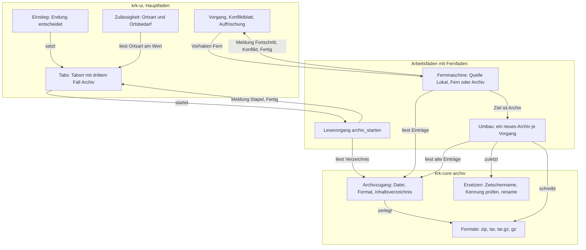
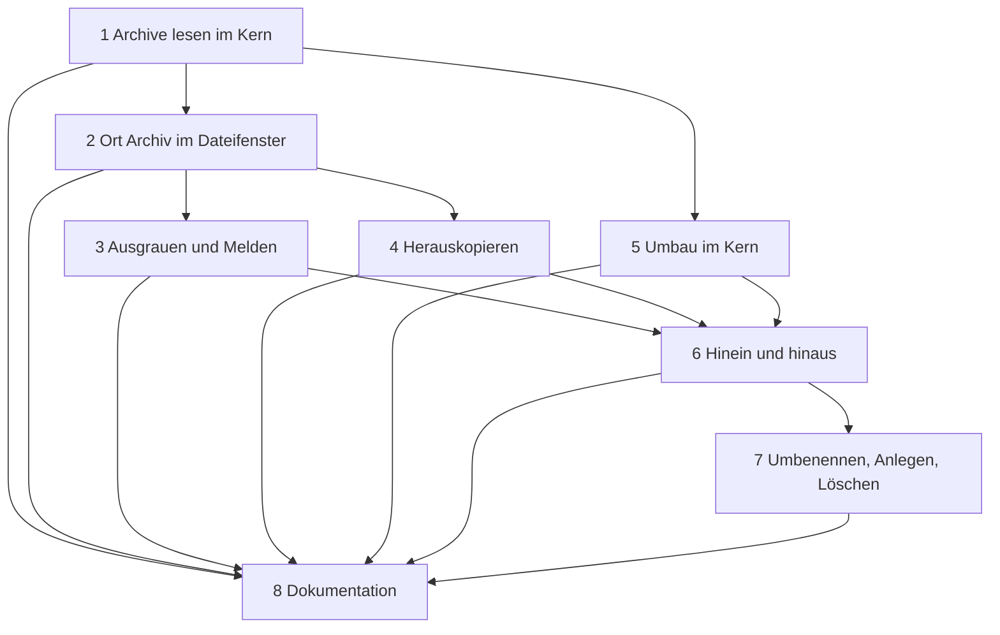

# Implementation Plan: Zip- und gz-Dateien lassen sich im Dateifenster wie ein Ordner betreten, durchblättern und beschreiben

**Date:** 2026-10-17
**Spec:** keiner; geplant nach dem Auftrag (Narrativ `261017-1029-zip-und-gz-wie-ordner-im-dateifenster.md` mit den wörtlichen Nutzerworten), bindend in der Bauweise der Plan `261016-1956-plan-sftp-ordner-im-dateifenster-wie-lokal.md` und der umgesetzte Entscheid `261016-1956-welche-form-hat-ein-ort-im-dateifenster-und-wie-haelt-der-bau-fernaufrufe-vom-hauptfaden-fern.md`. Zwei Entscheide dieses Pakets sind offen mit Empfehlung: `261017-1036-wird-ein-archiv-ein-dritter-fall-von-ort-und-schreibt-krk-hinein-ueber-einen-umbau-des-ganzen-archivs.md` und `261017-1036-liest-und-schreibt-krk-tar-ueber-die-kiste-tar-oder-ueber-einen-eigenen-leser.md`.
**Decidability:** Die tragende Frage lautet: „Kann ein Fehlschlag das Archiv beschädigen?“ Sie ist entscheidbar, und zwar an einer einzigen Stelle: KRK öffnet das Original nie zum Schreiben. Jede Änderung entsteht als vollständiges neues Archiv unter einem Zwischennamen im selben Ordner, und erst danach ersetzt ein einziges `rename(2)` das Original (E12). Vor diesem `rename` ist das Original unberührt, danach ist das neue vollständig. Die zweite Frage, „ist dieser Ort ein Archiv, und darf hineingeschrieben werden?“, beantwortet der Wert: `Ort::Archiv` und das Format aus der Endung, ohne Systemaufruf (E1, E2). Die dritte, „kann ein Lesen eines Archivs den Hauptfaden erreichen?“, hält der Übersetzer, weil jeder Zugriff auf das Inhaltsverzeichnis das Pfand `Fernfaden` verlangt (E9). **Eine Frage ist in der naheliegenden Form nicht entscheidbar, und der Plan wechselt deshalb den Mechanismus:** ob ein anderes Programm das Archiv zwischen KRKs Prüfung und KRKs `rename` beschreibt, lässt sich ohne Sperre nicht feststellen, und macOS kennt keine verbindliche Sperre. Der Plan behauptet deshalb keine Erkennung. Er fragt eine entscheidbare Frage: Ist die Datei unter dem Namen unmittelbar vor dem `rename` dieselbe (Gerät, Inode, Größe, Änderungszeit in Nanosekunden) wie beim Öffnen? Das verbleibende Fenster nennt er als Grenze (E12, Risiken). Ebenso nicht entscheidbar ist die entpackte Größe einer `.gz`-Datei aus ihrem Kopf, weil das Feld `ISIZE` nur das letzte Glied und nur modulo 2³² zählt; der Plan liest sie deshalb nicht dort, sondern zählt sie beim einmaligen Durchlauf (E5).

## Directive

Der Nutzer will Zip- und gz-Dateien „genauso wie das dateisystem“ navigieren und auf die Frage nach dem Hineinkopieren, Umbenennen und Löschen „auch schreiben“. Erreicht ist das Paket, wenn Pfeil rechts und Doppelklick eine `.zip`-, `.gz`-, `.tar`-, `.tar.gz`- oder `.tgz`-Datei im Dateifenster betreten, Pfeil links bis in den Ordner des Archivs zurückführt und Kopieren, Verschieben, Umbenennen, neuer Ordner und Löschen darin wirken wie in einem Ordner, ohne dass ein Fehlschlag das Archiv beschädigt. Der Plan stellt die Directive nicht neu auf; er legt fest, wie sie gebaut wird.

## Current State

Gelesen am Stand `6d4371b9`, dazu die uncommittete Änderung des getrennten Defektlaufs in `crates/krk-ui/src/appkit/anwendung.rs` (eine Reproduktionshilfe `repro_temp`, die nicht zu diesem Plan gehört).

- **Ort.** `krk_core::ort::Ort` ist `Lokal(PathBuf)` oder `Fern(FernerOrt)`, mit `lokal()` und `fern()`; Gleichheit über Serverkennung und Pfad (`crates/krk-core/src/ort.rs`). Im Tab steht `Tabort::Lokal(PathBuf)` oder `Tabort::Fern { ort, rueckkehr }` mit `ort()`, `lokaler_ordner()` und `sitzungsordner()` (`crates/krk-ui/src/tabs.rs`). `Ort::Fern` und `Tabort::Fern` werden in acht Dateien ausgeschrieben (`grep -rln "Ort::Fern\|Tabort::Fern" crates`); die übrigen Verbraucher gehen über `lokaler_ordner()`.
- **Pfand.** `krk_core::fern::faden` startet einen Faden und reicht ihm ein `&Fernfaden`, das nicht `Send` ist (`fern/faden.rs`).
- **Lesen.** `Lesevorgang::starten` lokal und `Lesevorgang::fern_starten(FernerOrt, generation)` mit demselben Meldungskanal, Zähler `uebersprungen` für ausgelassene Namen, `Abschluss::{Vollstaendig, Abgebrochen, Fehler, Fern}` (`crates/krk-core/src/verzeichnis/leser.rs`).
- **Einstieg.** `Kommando::Oeffnen` liegt auf `right`. `auswahl_oeffnen` und der Doppelklick gehen beide über `in_zeile_einsteigen` (`crates/krk-ui/src/appkit/tabelle.rs`), das allein Ordner und Verknüpfungen auf Ordner betritt. Auf einer Datei tut Pfeil rechts nichts, der Doppelklick reicht sie an das System. `return` trägt `mit_standardprogramm_oeffnen` (`resources/default-keymap.toml`), auch auf einem Ordner.
- **Operationsmaschine.** `Vorhaben::Lokal(Auftrag)` oder `Vorhaben::Fern(Fernauftrag)`. `Fernauftrag { quellen: Vec<Ort>, art: Fernart, konfliktregel }` mit `Fernart::{Kopieren, Verschieben, Umbenennen, Anlegen, Loeschen}` (`crates/krk-core/src/operation/fern.rs`). Innen arbeitet die Maschine über `enum Stelle` (lokal oder fern) mit Lese- und Schreibhandlungen, die sofort wirken: exklusives Anlegen, Konfliktfrage über `Steuerung::konflikt_loesen_mit`, Tausch über Zwischennamen `.krk-ersatz-…` und `.krk-alt-…`, Bericht mit `bezeichnung(&Ort)`.
- **Zip im Baum.** `zip = 8.6` ohne Vorgabemerkmale mit `deflate-flate2` und `unreserved`, daneben `flate2 = "1"` (Wurzel-`Cargo.toml`). `operation/zippen.rs` schreibt Rechte und die Zeitfelder `0x5455` und `0x5855` und schaltet ZIP64 je Eintrag über `set_auto_large_file`. `operation/entpacken.rs` versperrt zwei Wege aus dem Zielordner (`enclosed_name` und `kette_anlegen`) und liest das Datum allein aus den zwei Zeitfeldern, nie aus dem MS-DOS-Feld. Die Kiste bietet `by_index_raw`, `raw_copy_file` und `raw_copy_file_rename` (geprüft in der Quelle von `zip-8.6.0`).
- **tar.** Steht nicht im Baum. `filetime` und `libc` stehen schon darin, `filetime` über `gix-index` (`cargo tree -i filetime --target aarch64-apple-darwin`).
- **Zulässigkeit.** `Ortsbedarf::{Ueberall, Lokal, LokalImDateifenster}` in `Kommando::ortsbedarf`, `ort_passt(bedarf, aktiv_fern, fokus)` in `crates/krk-ui/src/kommandos/zulaessigkeit.rs`; `aktiv_fern` hat dort 22 Nennungen (`grep -rn aktiv_fern crates/krk-ui/src | wc -l`).
- **Löschen.** An einem Ort ohne Papierkorb folgt seit dem sftp-Paket die endgültige Rückfrage, fern über `Fernart::Loeschen` (Entscheid `261016-1948-darf-krk-an-einem-ort-ohne-papierkorb-nach-rueckfrage-endgueltig-loeschen.md`).
- **Werkzeuge im System.** `/usr/bin/zip`, `/usr/bin/gzip` und `/usr/bin/tar` stehen da (geprüft mit `ls`).
- **Absturz.** Pfeil rechts und links auf einer Zip-Datei bringen KRK heute zum Absturz. Der getrennte Defektlauf behebt das; dieser Plan setzt auf dessen Ergebnis auf.

## Approach

Ein Archiv wird der dritte Fall von `Ort`. Jede Naht, die heute über `Lokal` und `Fern` verzweigt, bekommt einen dritten Arm, und der Übersetzer nennt sie alle. Gelesen wird über ein Inhaltsverzeichnis je Archivdatei. Ein Zugang hält es, solange die Datei unverändert ist, und baut es allein auf einem Faden mit Pfand. Kopieren **heraus** geht durch die vorhandene Fernmaschine: die Archivstelle ist dort eine weitere Lesequelle, und für das Ziel gilt deren Zielklärung, Konfliktfrage und Tausch unverändert. Geschrieben wird ein Archiv dagegen nie Eintrag für Eintrag, sondern über **einen** Umbau je Vorgang. Dieser Umbau trifft zuerst alle Entscheidungen samt Konfliktfragen am Inhaltsverzeichnis, schreibt dann das neue Archiv vollständig neben das alte und ersetzt das alte zuletzt atomar. Die Trennung folgt einer einzigen Frage: Schreibt der Vorgang in ein Archiv? Dann Umbau, sonst die Maschine wie bisher. Das ist entscheidbar am Wert von Ziel und Quelle (E10).



Selbstprüfung des Schaubilds: drei Schichten (Hauptfaden, Arbeitsfäden, Kern). Die zwei Rückkanten zum Hauptfaden sind die bestehenden Antwortwege der Lesevorgänge und der Maschine und kein Zyklus im Aufbau. `zugang` hat drei Leser und ist damit die eine Stelle, an der ein Archiv gelesen wird; `ersetzen` hat genau einen Rufer, den Umbau. Kein Knoten zeigt auf mehr als drei andere. Jede Kante steht im Text oder in den Entscheidungen.

## Entscheidungen

Jeder Schritt zitiert die Nummern, die er umsetzt. Wo eine Entscheidung eine des sftp-Plans übernimmt, sagt sie es; „wie fern“ heißt dann: dieselbe Regel, derselbe Code-Weg.

### E1. Welche Formate, erkannt woran

| Endung (ohne Rücksicht auf Groß- und Kleinschreibung) | Format | beschreibbar |
|---|---|---|
| `.zip` | Zip | ja |
| `.tar` | Tar | ja |
| `.tar.gz`, `.tgz` | TarGz | ja |
| `.gz`, sofern nicht `.tar.gz` | Gz (eine Datei) | nein (E6) |

- **Die Endung entscheidet, ob eine Datei betreten wird**, auf dem Hauptfaden am Namen, ohne Systemaufruf. Eine Magieprüfung dort wäre ein `open` und ein `read` je Einstieg auf dem Hauptfaden, und an einem hängenden Netzlaufwerk hielte sie die Ereignisschleife an.
- **Ob die Datei wirklich ein solches Archiv ist, entscheidet der Leser des Formats auf dem Arbeitsfaden**: bei Zip das Ende des Zentralverzeichnisses, bei gz die Bytes `1f 8b`, bei tar die Kopfsumme jedes Kopfs. Scheitert er, meldet der Tab `Text::ArchivUngueltig` mit Format und Grund, wie ein Ordner ohne Leserecht sich aus dem Lesevorgang meldet. Eine Datei mit falscher Endung wird also betreten und meldet sich; sie wird nicht still als anderes Format gelesen.
- `.jar`, `.docx`, `.epub` und andere Zip-Abkömmlinge betritt KRK nicht; die Liste ist geschlossen und steht an einer Stelle, `Archivformat::aus_namen`. `.tar.bz2`, `.tar.xz`, `.7z` und `.rar` sind nicht Teil dieses Pakets, weil keine Kiste ohne C sie heute im Baum liest.
- `.gz` wird mit `MultiGzDecoder` gelesen, also auch ein Strom aus mehreren gzip-Gliedern.

### E2. Die Form von `Ort::Archiv`

- `Ort::Archiv(Archivort)`; `Archivort { zugang: Arc<Archivzugang>, innen: Innenpfad }`.
- `Archivzugang { datei: PathBuf, format: Archivformat, verzeichnis: Mutex<Option<Arc<Inhaltsverzeichnis>>> }`. **`datei` ist ein lokaler Pfad.** Ein Archiv auf einem Server ist in diesem Paket kein Ort (E15).
- `Innenpfad` ist ein relativer Pfad im Archiv als UTF-8-Text mit `/` als Trenner, ohne leere Glieder, ohne `.` und `..`; die Wurzel ist der leere Pfad. Er rechnet rein lexikalisch wie `Fernpfad` (`verbinden`, `aufwaerts`, `name`).
- Gleichheit über `datei` und `innen`, nie über den Zeiger. Anzeige `"/pfad/zum/archiv.zip:/innen/pfad"`, also die Schreibweise des fernen Orts mit dem Doppelpunkt (E16).
- `Ort::lokal()` und `Ort::fern()` antworten für ein Archiv `None`; dazu kommt `Ort::archiv()`. `Ort::art() -> Ortsart { Lokal, Fern, Archiv { beschreibbar } }` antwortet am Wert, `beschreibbar` allein aus dem Format.
- **Ein Register je Prozess**, `Archivregister: HashMap<PathBuf, Weak<Archivzugang>>`, liegt beim Anwendungsdelegierten und wird allein auf dem Hauptfaden gefragt. Die Frage ist ein Nachschlagen ohne Systemaufruf. Zwei Tabs auf demselben Archiv teilen damit ein Inhaltsverzeichnis. Der Schlüssel ist der Pfad, wie er im Tab steht, nicht der aufgelöste; zwei Schreibweisen derselben Datei bekommen zwei Zugänge, und das kostet allein ein zweites Lesen.
- Im Tab: `Tabort::Archiv { ort: Archivort, rueckkehr: PathBuf }`, `rueckkehr` ist der Ordner der Archivdatei. `lokaler_ordner()` antwortet `None`. Wer `None` bekommt, meldet den Text, den `nicht_verfuegbar_text(&Ort)` für die Art des Orts liefert: fern wie bisher `Text::AmFernenOrtNichtVerfuegbar`, im Archiv `Text::ImArchivNichtVerfuegbar`. Eine Fallunterscheidung ersetzt damit den festen Text an jedem dieser Rufer.

### E3. Das Inhaltsverzeichnis: Lesen ohne alles zu entpacken

- **Zip:** `ZipArchive::new` liest das Zentralverzeichnis. Je Eintrag fragt der Leser Name, Größe, Rechte, Verschlüsselung, Verfahren und das Datum aus den Zeitfeldern `0x5455` und `0x5855`. Ein Eintrag ohne diese Felder bekommt die Unix-Epoche, wie ein ferner Eintrag ohne Angabe; das MS-DOS-Feld wird aus dem Grund in `entpacken.rs` nicht gelesen. Daten werden nicht entpackt. ZIP64 liest die Kiste selbst. Liest `by_index_raw` je Eintrag den lokalen Kopf, kostet das einen Sprung je Eintrag. Schritt 1 misst das an 100 000 Einträgen und nennt die Zeit im Bericht, ohne eine Zusage daraus zu machen.
- **Tar, TarGz:** ein Durchlauf über den Strom mit der Kiste `tar`. Die Köpfe werden gelesen, die Daten überlesen; für TarGz heißt das, der ganze Strom wird einmal entpackt und verworfen. Für jeden Eintrag merkt sich das Inhaltsverzeichnis seinen Versatz im entpackten Strom.
- **Gz:** ein Durchlauf, der die entpackten Bytes zählt (Decidability). Das Inhaltsverzeichnis hat genau einen Eintrag (E6).
- **Zwischengespeichert** wird es im `Archivzugang`, mit der Kennung der Datei beim Lesen: Gerät, Inode, Größe und Änderungszeit in Nanosekunden. Jeder Zugriff prüft die Kennung mit einem `stat` auf dem Arbeitsfaden. Weicht sie ab, entsteht das Verzeichnis neu. Damit kostet das Betreten eines Unterordners in einem großen tar.gz keinen zweiten Durchlauf.
- **Abbruch:** Der Aufbau fragt die Abbruchmarke des Lesevorgangs je Eintrag und je 1 MiB entpackter Bytes. Ein abgebrochener Aufbau hinterlässt kein halbes Verzeichnis.
- **Obergrenze:** `archiv::HOECHSTENS_EINTRAEGE`, Vorschlag 1 000 000. Schritt 1 misst den Speicher je Eintrag und darf die Zahl begründet ändern. Ein Archiv darüber meldet `Text::ArchivZuGross` und wird nicht gezeigt.
- **Ordner ohne eigenen Eintrag:** `a/b/c.txt` ohne `a/` und `a/b/` erzeugt beide Ordner im Verzeichnis. Sie tragen das Änderungsdatum der Archivdatei und gelten als **erschlossen**, was der Umbau braucht (E13).
- **Doppelte Namen:** Steht ein Name mehrfach, gilt der spätere im Zentralverzeichnis oder im Strom, wie beim Entpacken über die Platte; die früheren zählt `uebersprungen`. Ist ein Name zugleich Datei und Ordner, gilt der Ordner, und die Datei zählt ebenso.

### E4. Unsichere Namen und Zip-Slip

- Ins Verzeichnis kommt ein Eintrag allein, wenn sein Name nach Abstreifen eines führenden `/` und eines führenden `./` ein gültiger `Innenpfad` ist. Er darf also kein `..` enthalten, kein NUL, kein leeres Glied und muss UTF-8 sein (tar trägt Bytes). Jeder andere zählt in `uebersprungen`, und der Tab nennt die Zahl über `Text::ArchivNamenAusgelassen`. Damit entsteht ein solcher Name beim Herauskopieren nie, weil er im Fenster nicht vorkommt und keine Auswahl ihn erreicht.
- **Der zweite Weg über eine Verknüpfung** (`hinaus -> /etc`, dann `hinaus/passwd`) ist im Verzeichnis ausgeschlossen: Ein Eintrag, dessen Weg durch einen Namen führt, der im selben Archiv eine Verknüpfung ist, gilt als unsicher und zählt ebenso. Beim Herauskopieren legt die Maschine Ordner selbst an und folgt keiner Verknüpfung im Ziel (Stand der Fernmaschine).
- Ein Backslash ist ein Zeichen des Namens und kein Trenner.
- Die Prüfung steht an einer Stelle, `Innenpfad::aus_archivname`, und ist die eine Regel für alle drei Formate. Die Probe dazu nimmt die Fälle aus `entpacken.rs` auf.

### E5. Zeitzusagen und der Hauptfaden

- Der Hauptfaden tut beim Einstieg allein drei Dinge: den Namen an `Archivformat::aus_namen` prüfen, den Zugang im Register nachschlagen oder anlegen, ohne die Datei zu öffnen, und den Lesevorgang starten.
- Jeder Zugriff auf die Archivdatei verlangt `&Fernfaden` (E9). Für die zehn Zusagen aus C8 entsteht keine neue Zahl. Ein großes Archiv zeigt seinen Inhalt erst, wenn das Verzeichnis steht, und der Tab zeigt bis dahin, was er für einen langsamen Ordner zeigt.

### E6. `.gz` ohne tar

- Das Fenster zeigt **einen** Eintrag: den Namen der Datei ohne die letzte Endung `.gz` (`bericht.txt.gz` zeigt `bericht.txt`), Größe aus dem Zähldurchlauf, Datum der Archivdatei, Typ Datei. Das Feld `FNAME` im gzip-Kopf liest KRK nicht: Der Name aus dem Dateinamen ist das, was der Nutzer sieht, und `gunzip` ohne `-N` erzeugt genau ihn. Hieße der Rest leer (`.gz`), heißt der Eintrag `inhalt`.
- **Ein gz-Archiv ist allein lesbar.** Hineinkopieren, Verschieben heraus, Umbenennen, Anlegen und Löschen sind darin ausgegraut (E14). Eine gzip-Datei fasst genau einen Strom, und jede dieser Handlungen machte daraus etwas anderes als die Datei, die der Nutzer betreten hat. Herauskopieren geht und entpackt den Strom an das Ziel.

### E7. Archiv in Archiv

Nicht betretbar. Pfeil rechts oder Doppelklick auf einen Eintrag mit einer Endung aus E1 in einem Archiv meldet `Text::ArchivImArchiv`, entschieden am Wert. Herauskopieren und danach betreten geht. Ein betretbares inneres Archiv bräuchte eine Bytequelle mit wahlfreiem Zugriff in ein entpacktes Glied; für tar.gz gibt es die nicht ohne Zwischendatei.

### E8. Einstieg, Navigation und die Taste `return`

- **Pfeil rechts und Doppelklick** betreten eine Datei, deren Name eine Endung aus E1 trägt, im lokalen Tab. Das geschieht in `in_zeile_einsteigen`, dem einen Absteiger: Er bekommt für `Typ::Datei` einen Zweig, der allein den Namen fragt. Eine Verknüpfung, die `verweisziel::bestimmen` als Datei auflöst, wird betreten, wenn ihr Name oder der Name ihres Ziels eine solche Endung trägt. Der Doppelklick reicht ein Archiv damit nicht mehr an das System. Für jede andere Datei bleibt alles, wie es ist.
- **Pfeil links** an der Wurzel des Archivs stellt den Tab auf `Tabort::Lokal(rueckkehr)` und wählt dort die Archivdatei über die Vormerkung, die das lokale Aufwärts schon nutzt. Im Archiv geht Aufwärts am `Innenpfad` und wählt den Ordner, aus dem es kam.
- **`return` bleibt „Mit dem Standardprogramm öffnen“**, auf einem Archiv wie auf einem Ordner. Das ist die wörtliche Lesart von „wie bei einem Ordner“: Auf einem Ordner öffnet `return` heute den Finder und betritt ihn nicht. Der Nutzer behält so einen Weg zum Archivprogramm des Systems. In einem Archivtab ist `return` ausgegraut (E14). Will der Nutzer, dass `return` ein Archiv betritt, steht das unter den offenen Fragen.
- Ein Archiv auf einem fernen Ort meldet beim Einstieg `Text::ArchivAmFernenOrt` (E15).

### E9. Das Pfand für Archivzugriffe

Jede Funktion, die die Archivdatei öffnet oder liest, nimmt `&Fernfaden`: Aufbau und Prüfung des Inhaltsverzeichnisses, das Lesen eines Eintrags und der Umbau. Damit hält der Übersetzer den Hauptfaden fern, mit demselben Mechanismus wie beim Server und ohne Quelltextprobe. Das Pfand behält seinen Namen aus dem sftp-Paket. Sein Modulkopf bekommt einen Satz dazu: Es hält jeden Zugriff, dessen Dauer die Größe einer fremden Datei bestimmt, und nicht nur den Netzweg. Der Lesevorgang startet als `Lesevorgang::archiv_starten(Archivort, generation)` über `fern::faden` und schickt dieselben Meldungen wie lokal: Stapel zu 1024 `Eintrag::mit_versteckt`, `versteckt` bei führendem Punkt, Zähler `uebersprungen`. Ordnermodell, Kollation, Sortierung und Namensfilter bekommen keine Zeile, wie fern.

### E10. Wohin ein Vorgang geht

Ein Vorgang mit einer Archivseite ist ein `Fernauftrag`, und `Vorhaben::Fern` trägt ihn. Ein lokaler `Auftrag` erreicht kein Archiv. Der Name `Fern…` bleibt; der Modulkopf von `operation/fern.rs` sagt, dass er jeden Vorgang mit einer Seite trägt, die kein gewöhnlicher lokaler Ordner ist. In `ausfuehren` entscheidet eine vollständige Fallunterscheidung ohne Auffangzweig:

| Art | Ziel oder Ort der Quelle | Weg |
|---|---|---|
| Kopieren, Verschieben | Ziel ist `Ort::Archiv` | **Umbau des Zielarchivs** (E13). Liegen alle Quellen im selben Archiv, ist es ein Umhängen von Namen ohne Datenkopie. Beim Verschieben aus einem anderen Ort werden die Quellen nach dem gelungenen Umbau entfernt, und zwar allein die vollständig angekommenen. Liegen sie lokal oder fern, geschieht das über die Entfernhandlungen der Maschine; liegen sie in einem anderen Archiv, über einen zweiten Umbau jenes Archivs. |
| Kopieren, Verschieben | Ziel lokal oder fern, Quelle im Archiv | **Maschine wie bisher**, mit der Archivstelle als Lesequelle (E11). Beim Verschieben entfernt danach ein Umbau des Quellarchivs genau die vollständig angekommenen Einträge. |
| Kopieren, Verschieben | Ziel lokal oder fern, Quelle lokal oder fern | Maschine wie bisher, unverändert. |
| Umbenennen, Anlegen, Loeschen | Quelle im Archiv | **Umbau** (E13, E17). |
| Umbenennen, Anlegen, Loeschen | Quelle lokal oder fern | Maschine wie bisher, unverändert. |

Ein Verschieben zwischen zwei Archiven schreibt also erst das Ziel und danach die Quelle neu. Scheitert der zweite Umbau, stehen die Einträge doppelt da und nicht nirgends. Der Bericht nennt sie.

### E11. Herauskopieren: die Archivstelle als Lesequelle

- `operation/fern.rs` trennt Lesen und Schreiben am Typ: `enum Quelle { Stelle(Stelle), Archiv(Archivstelle) }` trägt die Lesehandlungen `name`, `kind`, `angaben`, `liste`, `lesen` und `verknuepfung_lesen`. Die Schreibhandlungen bleiben allein an `Stelle`. Die Kopierwege nehmen `&Quelle` statt `&Stelle` als Quelle. Damit lässt sich eine Schreibhandlung auf einem Archiveintrag gar nicht erst schreiben.
- **Lesen eines Eintrags:** Zip über `by_index` mit wahlfreiem Zugriff. Tar und TarGz über einen **Lesezeiger**, der nur vorwärts läuft: Er hält den Strom offen und liest bis zum Versatz des verlangten Eintrags. Ein Eintrag hinter dem Zeiger beginnt den Strom neu. Die Maschine arbeitet deshalb die Quellen eines Archivs in der Reihenfolge ihres Versatzes ab und die Kinder eines Ordners ebenso. Ein Ordnerbaum aus einem tar.gz kostet so einen Durchlauf und nicht einen je Datei. Gz entpackt den ganzen Strom.
- **Was nicht herauskommt und im Bericht steht:** ein verschlüsselter Eintrag (`Text::ArchivEintragVerschluesselt`), ein Verfahren, das `deflate-flate2` nicht entpackt, also bzip2, lzma, zstd oder deflate64 (`Text::ArchivVerfahrenUnbekannt` mit dem Namen des Verfahrens), ein harter Verweis im tar und eine Gerätedatei oder benannte Röhre im tar.
- Eine Verknüpfung im Archiv entsteht am Ziel als Verknüpfung mit unverändertem Verweistext, wie bei `entpacken.rs` und der Fernmaschine. Rechte (`& 0o7777`) und Änderungszeit gehen mit, wie fern.
- Für das Ziel gelten exklusives Anlegen, Konfliktfrage, „Ordner auf Ordner führt zusammen“ und der Tausch über Zwischennamen unverändert.

### E12. Ersetzen: wie das Original unbeschädigt bleibt

Ein Umbau endet immer in `archiv::ersetzen`, und das ist der einzige Schreiber an einer Archivdatei:

1. Der Zwischenname liegt im Ordner des Archivs, auf demselben Dateisystem: `.krk-umbau-<prozess>-<n>-<name>`, angelegt mit `create_new`. Er bekommt die Rechte der Archivdatei.
2. Das neue Archiv wird vollständig geschrieben, abgeschlossen (`finish`) und mit `sync_all` auf die Platte gebracht.
3. `stat` am Namen des Archivs muss dieselbe Kennung liefern wie das `fstat` des Lesedeskriptors beim Beginn des Umbaus: Gerät, Inode, Größe, Änderungszeit in Nanosekunden. Weicht sie ab, fällt der Zwischenname weg, und der Bericht sagt `Text::ArchivVonAussenVeraendert`.
4. `rename(Zwischenname, Archiv)`.

Abbruch, Fehler und voller Datenträger in den Schritten 1 bis 3 entfernen den Zwischennamen und lassen das Original stehen. Dass es dabei Byte für Byte gleich bleibt, hält eine Probe je Format und je Ausgang. **Eine Verknüpfung auf ein Archiv** wird vor Schritt 1 auf dem Faden aufgelöst. Geschrieben wird am Ziel der Verknüpfung, damit sie eine Verknüpfung bleibt. **Was das nicht hält, und `HowTo.md` sagt es:** Harte Verweise auf das alte Archiv zeigen danach auf das alte. Erweiterte Attribute, Finder-Etiketten und das Erstellungsdatum der Archivdatei gehen verloren. Schreibt ein anderes Programm zwischen Schritt 3 und 4 in das Archiv, landet seine Änderung im alten Inode und ist verloren (Decidability). Ein Absturz von KRK während des Umbaus hinterlässt den Zwischennamen mit führendem Punkt; KRK räumt ihn nicht auf. Geschrieben wird nur, wenn KRK im Ordner des Archivs schreiben darf; das Schreibrecht an der Datei allein genügt nicht.

### E13. Der Umbau

`archiv::umbau::umbauen(&Fernfaden, &Archivzugang, Umbauplan, &mut Steuerung) -> Result<Umgebaut, Umbaufehler>`, in zwei Hälften:

- **Planen, ohne zu schreiben.** Aus dem Fernauftrag entsteht ein `Umbauplan`: Jeder alte Eintrag wird behalten, umbenannt oder fällt weg, und dazu kommen neue Einträge, je mit `Innenpfad`, Typ, Rechten, Datum und einer `Quelle` (E11). Konflikte entscheidet der Plan **vor dem ersten geschriebenen Byte** am Inhaltsverzeichnis, mit derselben Konfliktfrage über `Steuerung` an dasselbe Blatt:
  - Ordner auf Ordner führt zusammen, ohne Frage.
  - „Überschreiben“ ersetzt den Eintrag und bei einem Ordner den ganzen Unterbaum.
  - „Umbenennen“ nimmt einen freien Namen. Ob er frei ist, beantwortet das Verzeichnis samt den schon geplanten Namen, nach der Regel von `freier_name_unter`.
  - „Überspringen“ lässt den Eintrag aus.
  - Quelle gleich Ziel und ein Ordner in sich selbst werden abgewiesen wie lokal.

  Fällt der letzte Eintrag eines erschlossenen Ordners weg, bekommt der Ordner einen eigenen Ordnereintrag, damit er stehen bleibt wie in einem Dateisystem.
- **Schreiben, dann ersetzen.** Zip: Behaltene Einträge gehen roh über `raw_copy_file` oder `raw_copy_file_rename` hinüber, ohne Neupacken, auch solche mit Verfahren, die KRK nicht entpackt. Neue Einträge werden mit Deflate gepackt, mit Rechten und den Zeitfeldern `0x5455` und `0x5855` über dieselben Helfer wie `zippen.rs` und mit ZIP64 je Eintrag über `set_auto_large_file`. Der Archivkommentar bleibt. Tar und TarGz: Der alte Strom wird Kopf für Kopf gelesen und in einen neuen geschrieben; behaltene Einträge mit altem oder neuem Namen, neue dazwischen. Die Reihenfolge ist die alte, neue Einträge stehen am Ende. TarGz packt mit `GzEncoder` auf Stufe 6. Danach `ersetzen` (E12).
- **Fortschritt und Abbruch:** Ein zählender Schreiber um die Ausgabe meldet Bytes über `Steuerung::zwischenstand` und fragt je Block nach dem Abbruch; ist er gesetzt, scheitert das Schreiben, und der Umbau endet wie bei einem Fehler. So reicht der Abbruch auch in `raw_copy_file` hinein, das einen Eintrag in einem Aufruf kopiert.
- **Ein Vorgang ist ganz oder gar nicht.** Ein abgebrochener oder gescheiterter Umbau lässt das Archiv unverändert, auch die Einträge, die bis dahin geschrieben waren. Das weicht bewusst vom lokalen Kopieren ab, nach dem stehen bleibt, was fertig ist; die Zusage der Directive geht vor. Der Bericht sagt es mit `Text::ArchivUnveraendert`.
- **Verschlüsselte Einträge:** Ein Archiv, das einen verschlüsselten Eintrag trägt, schreibt KRK nicht. Der Umbau endet vor der Planung mit `Text::ArchivVerschluesseltNurLesbar`. Dass eine rohe Kopie einen verschlüsselten Eintrag unversehrt hinüberträgt, ist nicht belegt (`inference:`, für Einträge nach AES-Verfahren eher nicht). Lesbar und herauskopierbar bleibt der Rest.
- **Was eine Änderung kostet, und `HowTo.md` sagt es:** Jede Änderung schreibt das ganze Archiv neu. Ein Zip kostet rohe Kopien in seiner Größe, ein tar.gz ein vollständiges Entpacken und Packen. Der Ordner des Archivs braucht vorübergehend so viel freien Platz wie das neue Archiv.

### E14. Was im Archiv ausgegraut ist oder sich meldet

Dieselben zwei Mechanismen wie fern (E13 des sftp-Plans):

- **Tasten und Hauptmenü:** `Lage::aktiv_fern: bool` wird `Lage::aktiv_ort: Ortsart`, gelesen am Wert. `Ortsbedarf` bekommt den vierten Wert `Beschreibbar`: Er wirkt an jedem Ort außer einem Archiv, das nicht `beschreibbar` ist. `ort_passt` verzweigt vollständig über `Ortsbedarf` × `Ortsart`. `Lokal` und `LokalImDateifenster` sagen im Archiv nein wie fern. `Beschreibbar` tragen `Verschieben`, `InPapierkorb`, `OrdnerAnlegen`, `DateiAnlegen` und `Umbenennen`; fern und lokal sagen sie wie bisher ja. Findet der Bearbeiter ein weiteres Kommando, das in den angezeigten Ordner schreibt, etwa das Einfügen von Dateiverweisen, bekommt es `Beschreibbar`, und der Bericht nennt es. `Kopieren` bleibt `Ueberall`. Ist das **andere** Fenster ein Archiv, das nicht beschreibbar ist, meldet der Vorgang `Text::ArchivNurLesbar` vor dem Start, am Wert und ohne Systemaufruf.
- **Kontextmenü:** Öffnen mit, Zippen, Entpacken, Duplizieren, Im Finder öffnen, Im Finder anzeigen und Teilen melden im Archiv `Text::ImArchivNichtVerfuegbar`, wie fern.
- **„Deep“ und „Content“** sind im Archivtab nicht bedienbar, und `durchlauf_nachziehen_an` startet keinen Durchlauf. Der Namensfilter wirkt flach.
- **Git:** kein `Gitlauf`; der Bereich zeigt `Text::GitImArchiv`.
- **Vorschau:** Name, Größe, Änderungszeit und Typ aus dem `Eintrag`, wie fern, und kein Inhalt. Der Inhalt einer Datei im Archiv braucht eine Bytequelle statt eines Pfades, für fern wie für Archiv. Das ist eine Arbeit für beide Orte zusammen und kein Teil dieses Pakets (offene Fragen).
- **Editor:** öffnet keine Datei im Archiv (`Bearbeiten` trägt `Lokal`). Der Doppelklick auf eine Datei im Archiv meldet `Text::ImArchivNichtVerfuegbar`, solange sie kein Archiv ist (dann E7).
- **Zwischenablage und Ziehen:** `cmd+c` und `cmd+x` legen aus einem Archivfenster keine Dateiverweise ab und melden. Eine Zeile lässt sich nicht in den Finder ziehen. Ein Abwurf aus dem Finder oder dem anderen Fenster **auf** ein Archivfenster ist ein Kopieren oder Verschieben hinein (E10).

### E15. Ein Archiv auf einem fernen Ort

Nicht betretbar in diesem Paket; der Einstieg meldet `Text::ArchivAmFernenOrt` („erst herunterkopieren“). Lesen ginge über `READ` mit Versatz. Schreiben bräuchte aber ein atomares Ersetzen auf dem Server, und SFTP v3 hat keines, ohne `posix-rename@openssh.com`, das Entscheidung 10 des sftp-Plans ausschließt. Der Tausch der Fernmaschine hätte ein Fenster, in dem der Name des Archivs keinen Eintrag trägt. Eine lesende Hälfte allein widerspräche dem „auch schreiben“ des Nutzers an genau diesem Ort. `Archivzugang::datei` bleibt deshalb ein `PathBuf`; ein späteres Paket tauscht ihn gegen einen `Ort`.

### E16. Fenstertitel, Pfadeingabe, Sitzung, Auffrischung

- **Fenstertitel:** `"/pfad/zum/archiv.zip:/innen/pfad"`; `fenstertitel::titel` hat `&Ort` schon und bekommt den dritten Arm.
- **Pfadeingabe** im Archivtab: Der Text ist ein lokaler Pfad wie in einem lokalen Tab. Er verlässt das Archiv, und der Weg in ein Archiv führt über den Einstieg. Das ist eine Regel mit einem Zweig weniger als fern, wo der Text ein Serverpfad ist; ein Pfad im Archiv ist mit Pfeiltasten schneller erreicht als getippt.
- **Neuer Tab** im Archivfenster zeigt denselben Archivort mit derselben Rückkehr.
- **Sitzung:** Ein Archivtab schreibt als `ordner` seinen `rueckkehr`-Ordner, wie ein ferner Tab; `session.toml` bekommt kein Feld. Ein Archiv ließe sich beim Start zwar ohne PIN und Netz wiederherstellen, aber nicht ohne neues Feld. Ein neues Feld hängt an der offenen Frage `260907-1407_*_bekommt-session-toml-eine-fassungsangabe-damit-auch-die-zweite-haelfte-der-bestandsregel-greifen-kann.md`. Die Frage steht unter den offenen Fragen.
- **Auffrischung:** `sichtbare_ordner` gibt FSEvents für einen Archivtab den Ordner der Archivdatei. Eine Meldung dort liest den Archivtab neu, und die Kennungsprüfung (E3) macht das billig, wenn sich das Archiv nicht geändert hat. `gleicher_ordner` vergleicht Archivorte am Wert. Nach einem Vorgang liest die Auffrischung beide Seiten neu, auch ein Archiv.

### E17. Löschen im Archiv

Ein Archiv hat keinen Papierkorb, entschieden am Wert, ohne Systemaufruf. `loeschen_nach_rueckfrage` geht für einen Archivtab ohne `canonicalize`, ohne Papierkorbfrage und ohne `umfang::zaehlen` unmittelbar zur endgültigen Rückfrage in der zweiten Gestalt aus dem sftp-Paket. Das Blatt nennt die Zahl der gewählten Einträge. Ausgeführt wird über `Fernart::Loeschen` und damit über den Umbau (E10). Abbruch und Fehler lassen alles stehen (E13).

### E18. Kisten und C-Freiheit

`tar` kommt mit `default-features = false` und genau festgenagelter Fassung in die Wurzel-`Cargo.toml`, mit Begründung nach dem Muster von `zip` und `gix`, unter dem Vorbehalt des Entscheids `261017-1036-liest-und-schreibt-krk-tar-ueber-die-kiste-tar-oder-ueber-einen-eigenen-leser.md`. `zip` und `flate2` bleiben unverändert; `MultiGzDecoder` und `GzEncoder` bringt `flate2` mit. Eine weitere Kiste kommt nicht dazu. `#![deny(unsafe_code)]` bleibt an jeder Kistenwurzel ohne neue Ausnahme.

### E19. Abnahmelauf gegen C8: Frage an den Nutzer, kein Halt des Baus

Berührt werden drei gemessene Nähte. `Tabliste::lesen_starten` bekommt einen dritten Arm, der lokale Aufruf bleibt wörtlich; er speist L2, L3, L6 und L10. `in_zeile_einsteigen` bekommt einen Zweig allein für Dateien, und ein Ordnereinstieg geht nicht durch ihn. `Lage` ändert den Typ eines Feldes, und an `zulaessig` hängt jeder Tastendruck. Neben die Wege von L8 kommt nichts, weil ein lokaler `Auftrag` unverändert bleibt. Das liegt näher bei `261017-0955-schuldet-das-sftp-paket-einen-abnahmelauf-gegen-die-zehn-zusagen.md`, wo der Nutzer bei breiterem Umbau verzichtet hat, als bei einem Fall, der den Lauf schuldet. Gehalten wird der lokale Weg von Proben mit unveränderten Erwartungen und von der Probe `an_einem_lokalen_ort_aendert_der_ortsbedarf_nichts`. Der Plan baut ohne den Lauf und legt die Frage unter „Open Questions“ vor; die Antwort braucht es erst zum Schließen des Pakets.

## Implementation Steps

Gemeinsame Akzeptanz jedes Schritts („Grundabnahme“):

- `make check` grün; `cargo xtask bundle` baut und signiert `target/KRK.app`.
- `cargo tree --target aarch64-apple-darwin -e normal,build` und `cargo tree --target x86_64-apple-darwin -e normal,build` führen weder `cc` noch ein Paket mit einem Namen auf `-sys`.
- Gegenüber dem Stand vor Schritt 1 nennt `git diff -- Cargo.toml crates/*/Cargo.toml` allein die Zeilen für `tar` (E18), und `Cargo.lock` führt allein `tar` als neues Paket.
- `grep -rn '^#!\[allow(unsafe_code)\]' crates xtask` nennt weiter allein `verzeichnis/sys.rs` und `appkit/mod.rs`.
- Jeder neue nutzersichtbare Text steht in `de.rs`, `fr.rs` und `en.rs`. Jede neue Aufzählung wird ohne Auffangzweig verzweigt, jede neue Liste `ALLE` hält `jede_alle_liste_fuehrt_genau_die_varianten_ihrer_aufzaehlung`, und jeder Rückgabewert, dessen stilles Fallenlassen unbemerkt bliebe, trägt `#[must_use]`.
- Jede Probe mit Archiven baut ihre Archive selbst in einem Prüfordner der eigenen Kiste: Zip über `zip::ZipWriter`, tar über `tar::Builder`, gz über `flate2`. Für das verschlüsselte Zip ruft sie `/usr/bin/zip -P` auf, so wie die fernen Proben `/usr/libexec/sftp-server` starten. Keine Probe legt eine Archivdatei als feste Datei in den Baum.
- Vorhandene Proben bleiben grün, ohne dass ihre Erwartungen geändert werden; eine Ausnahme nennt der Schritt ausdrücklich.

1. **Archive lesen im Kern: Formate, Innenpfad, Inhaltsverzeichnis**
   - Executor: code-implementer
   - Files: Wurzel-`Cargo.toml` und `crates/krk-core/Cargo.toml` (`tar`); neu `crates/krk-core/src/archiv/mod.rs`, `archiv/format.rs`, `archiv/innenpfad.rs`, `archiv/verzeichnis.rs`, `archiv/zipform.rs`, `archiv/zugang.rs`; `crates/krk-core/src/lib.rs`; `crates/krk-core/src/operation/zippen.rs` und `operation/entpacken.rs` (Zeit- und Rechtehelfer nach `archiv/zipform.rs`, ohne Verhaltensänderung); `crates/krk-core/src/fern/faden.rs` (Modulkopf, E9); neu `crates/krk-core/tests/archiv.rs`; `crates/krk-core/tests/gemeinsam/mod.rs` (Archivbauer)
   - Changes: `Archivformat` mit `aus_namen` und `beschreibbar` (E1). `Innenpfad` mit `aus_archivname` als der einen Namensregel (E4). `Inhaltsverzeichnis` für Zip, Tar, TarGz und Gz mit Kinderliste je Ordner, erschlossenen Ordnern, Fundstelle je Eintrag, Lesbarkeit je Eintrag (verschlüsselt, Verfahren, harter Verweis, Sonderdatei), Kennung der Datei und Zähler für ausgelassene Namen (E3, E6). `Archivzugang` mit `verzeichnis(&Fernfaden, Abbruchfrage)`, Zwischenspeicher und Kennungsprüfung (E3, E9). Obergrenze gemessen (E3). Vor der ersten Zeile, die `tar` braucht, belegt der Schritt mit `cargo tree` je Mac-Ziel, dass die Kiste allein Pakete mitbringt, die schon im Baum stehen. Bringt sie ein Paket mit `cc` oder einem Namen auf `-sys`, hält der Schritt an und berichtet (Entscheid zu tar). Umsetzt E1, E3, E4, E6, E9, E18.
   - Akzeptanz: Grundabnahme; dazu die Proben
     - `jede_endung_aus_der_tafel_ergibt_ihr_format_und_keine_andere_ein_archiv` (die Tafel in E1, Groß- und Kleinschreibung, `.tar.gz` vor `.gz`, `.jar` und `.docx` nein);
     - `zip_tar_und_tgz_zeigen_denselben_baum_wie_der_ordner_aus_dem_sie_gepackt_sind` (ein Ordnerbaum im Prüfordner, dreimal gepackt; gleiche Namen, Typen, Größen, Rechte und Zeiten auf die Sekunde);
     - `eine_gz_datei_zeigt_einen_eintrag_ohne_endung_mit_der_gezaehlten_groesse` (auch zwei gzip-Glieder hintereinander);
     - `ordner_ohne_eigenen_eintrag_werden_erschlossen`;
     - `unsichere_namen_erscheinen_nicht_und_werden_gezaehlt` (`../x`, `a/../../x`, `/etc/passwd` erscheint als `etc/passwd`, NUL, kein UTF-8 im tar, der Weg über eine Verknüpfung aus E4);
     - `doppelte_namen_zeigen_den_spaeteren`;
     - `ein_verschluesselter_eintrag_wird_gezeigt_und_als_verschluesselt_gekennzeichnet` (`/usr/bin/zip -P`);
     - `ein_zip_mit_mehr_als_65535_eintraegen_wird_gelesen` (ZIP64);
     - `eine_datei_mit_falscher_endung_scheitert_mit_grund_und_nicht_still`;
     - `das_verzeichnis_entsteht_nach_einer_aenderung_der_datei_neu_und_sonst_nicht`;
     - `ein_abgebrochener_aufbau_hinterlaesst_kein_verzeichnis`;
     - die vorhandenen Proben von `zippen.rs` und `entpacken.rs` bleiben grün;
     - der Bericht nennt die gemessene Zeit für 100 000 Zip-Einträge und den Speicher je Eintrag.
   - Dependencies: none

2. **Ein Archiv im Dateifenster: `Ort::Archiv`, Lesen, Einstieg, Navigation, Titel, Sitzung, Auffrischung**
   - Executor: code-implementer
   - Files: `crates/krk-core/src/ort.rs` (`Ort::Archiv`, `Archivort`, `Ortsart`, `Ort::art`, `nicht_verfuegbar_text`); `crates/krk-core/src/verzeichnis/leser.rs` (`archiv_starten`); `crates/krk-core/src/operation/fern.rs` (dritter Arm in jeder Fallunterscheidung über `Ort`; Archivorte im Vorgang melden bis Schritt 4 `Text::ImArchivNichtVerfuegbar` je Quelle); `crates/krk-ui/src/tabs.rs` (`Tabort::Archiv`); `crates/krk-ui/src/appkit/tabelle.rs` (`in_zeile_einsteigen`, Doppelklick, Aufwärts, Ankreuzfelder); `crates/krk-ui/src/appkit/anwendung.rs` (Archivregister, jeder Rufer von `lokaler_ordner()`, `sitzung_bauen`); `crates/krk-ui/src/auffrischung.rs`; `crates/krk-ui/src/fenstertitel.rs`; `crates/krk-ui/src/kommandos/pfadeingabe.rs`; `crates/krk-ui/src/vorschaumodell.rs` und `appkit/vorschau.rs`; `crates/krk-ui/src/appkit/git.rs` oder `gitmodell.rs`; Sprachtabellen; `crates/krk-core/tests/archiv.rs`
   - Changes: Nach E2, E5, E7, E8, E9, E14 (Vorschau, Git, Deep und Content, Editor), E15 und E16. Der Übersetzer nennt jede Naht über `Ort` und `Tabort`. Jeder Verbraucher wählt einen Arm; wer nur lokal kann, meldet über `nicht_verfuegbar_text`. Der lokale Aufruf von `Lesevorgang::starten` bleibt wörtlich. Bis Schritt 4 stellt die Oberfläche keinen Vorgang mit einer Archivseite.
   - Akzeptanz: Grundabnahme; dazu die Proben
     - `ein_archiv_und_sein_ausgepackter_ordner_liefern_ueber_den_lesevorgang_dieselben_eintraege` (je Format; dieselbe Gleichheit wie fern);
     - `ein_abgebrochener_archivlesevorgang_schickt_genau_ein_fertig`;
     - `der_archiveinstieg_stellt_auf_dem_hauptfaden_keinen_systemaufruf` (Rumpfprobe über den Archivzweig von `in_zeile_einsteigen` und den Registerweg; Nadeln `fs::`, `metadata(`, `File::`, `canonicalize(`, `read_dir(`; ihr Doc-Kommentar nennt, was sie nicht sieht);
     - `aufwaerts_an_der_wurzel_des_archivs_waehlt_die_archivdatei`;
     - `ein_archiv_im_archiv_und_ein_archiv_am_fernen_ort_melden_statt_einzusteigen`;
     - `der_fenstertitel_nennt_archiv_und_innenpfad`;
     - `die_sitzung_nennt_kein_archiv` (ein Archivtab schreibt seinen Rückkehrordner);
     - `ein_archivtab_beobachtet_den_ordner_seiner_datei`;
     - `ein_ordner_wird_weiter_ohne_den_dateizweig_betreten` (Rumpfprobe: der Ordnerzweig von `in_zeile_einsteigen` fragt `Archivformat` nicht).
   - Dependencies: 1

3. **Ausgrauen und Melden im Archiv**
   - Executor: code-implementer
   - Files: `crates/krk-core/src/tasten/belegung.rs` (`Ortsbedarf::Beschreibbar`, `Kommando::ortsbedarf`); `crates/krk-ui/src/kommandos/zulaessigkeit.rs` (`Lage::aktiv_ort`, `ort_passt`, Proben); `crates/krk-ui/src/appkit/anwendung.rs` (`lage()`, Kontextbefehle, `cmd+c` und `cmd+x`, Vorprüfung „anderes Fenster nur lesbar“); `crates/krk-ui/src/kommandos/kontextmenue.rs`; `crates/krk-ui/src/appkit/tabelle.rs` (Ziehquelle, Abwurfziel); `crates/krk-core/tests/belegung.rs`; Sprachtabellen
   - Changes: Nach E14. `aktiv_fern` fällt; jede seiner Nennungen liest `aktiv_ort`. Die Proben, die `aktiv_fern` setzen, bekommen den gleichwertigen Wert `Ortsart::Fern`; das ist die eine erlaubte Änderung an vorhandenen Erwartungen, und sie ändert keine Antwort. Umsetzt E14.
   - Akzeptanz: Grundabnahme; dazu die Proben
     - `im_archiv_sind_genau_diese_befehle_ausgegraut` (schreibt die Namen aus, getrennt nach beschreibbarem Archiv und gz);
     - `an_einem_lokalen_ort_aendert_der_ortsbedarf_nichts` und `an_einem_fernen_ort_aendert_der_ortsbedarf_nichts` (jede Lage der Tafel gibt dieselbe Antwort wie vor dem Schritt);
     - `jeder_kontextbefehl_meldet_im_archiv`;
     - `einander_ausschliessende_bereiche_sind_nie_zugleich_zulaessig` und `eine_verengung_ist_nie_ohne_ihren_weiteren_bereich_zulaessig` bleiben grün über die um `Ortsart` erweiterte Tafel.
   - Dependencies: 2

4. **Herauskopieren: die Archivstelle als Lesequelle der Fernmaschine**
   - Executor: code-implementer
   - Files: `crates/krk-core/src/operation/fern.rs` (`Quelle`, `Archivstelle`, Ordnung nach Versatz, Gründe im Bericht); `crates/krk-core/src/archiv/lesen.rs` (neu: Eintrag lesen, Lesezeiger); `crates/krk-ui/src/appkit/anwendung.rs` (`uebertragen`, `auftrag_stellen` für eine Archivquelle); `crates/krk-ui/src/kommandos/operationen.rs`; neu `crates/krk-core/tests/archiv_operation.rs`; Sprachtabellen
   - Changes: Nach E10 (Zeilen „Quelle im Archiv“) und E11. Kopieren aus einem Archiv in ein lokales oder fernes Fenster geht. Verschieben aus einem Archiv meldet bis Schritt 6 je Quelle `Text::ImArchivNichtVerfuegbar` und entfernt nichts. Die Schreibwege der Maschine nehmen weiter `&Stelle`; der Übersetzer weist eine Schreibhandlung an einer `Quelle` ab. Umsetzt E10 teilweise, E11.
   - Akzeptanz: Grundabnahme; dazu die Proben
     - `ein_ordnerbaum_kommt_aus_zip_tar_und_tgz_byte_fuer_byte_heraus` (Rechte und Zeit am Ziel, Verknüpfung als Verknüpfung);
     - `eine_gz_datei_kommt_entpackt_heraus`;
     - `ein_baum_aus_einem_tgz_kostet_einen_durchlauf` (der Lesezeiger zählt Neustarts; null bei einem Ordnerbaum, eins bei absichtlich umgekehrter Reihenfolge);
     - `ein_verschluesselter_und_ein_unbekannt_gepackter_eintrag_stehen_mit_grund_im_bericht`;
     - `herauskopieren_auf_ein_vorhandenes_ziel_stellt_die_konfliktfrage_wie_lokal`;
     - `ein_abbruch_beim_herauskopieren_laesst_kein_halbes_ziel_und_ein_unveraendertes_archiv` (das Archiv gleicht Byte für Byte dem Stand davor);
     - `herauskopieren_auf_einen_fernen_ort_geht` (gegen `/usr/libexec/sftp-server`, wie die fernen Proben);
     - die Proben von `fern_operation.rs` bleiben grün, ohne geänderte Erwartungen.
   - Dependencies: 2

5. **Der Umbau im Kern**
   - Executor: code-implementer
   - Files: neu `crates/krk-core/src/archiv/umbau.rs` und `archiv/ersetzen.rs`; `crates/krk-core/src/archiv/zipform.rs`; `crates/krk-core/tests/archiv.rs`; `crates/krk-core/tests/baum.rs` (benannter Schreiber, falls eine Probe des Baums Schreiber an Dateien oder Rufer von `rename` zählt)
   - Changes: `Umbauplan`, `umbauen` und `ersetzen` nach E12 und E13, ohne Oberfläche und ohne Fernauftrag: Der Plan kommt als Wert herein, die Konfliktfragen gehen über eine hereingereichte `Steuerung`. Rohe Kopie bei Zip, Neuschreiben des Stroms bei Tar und TarGz, zählender und abbrechender Schreiber, Kennungsprüfung, `sync_all`, `rename`. Ein Archiv mit verschlüsseltem Eintrag wird abgewiesen. Gz kennt keinen Umbau: `Archivformat::Gz` erreicht `umbauen` nicht, weil der Typ des Plans für Gz nicht baubar ist oder `umbauen` ihn vor dem ersten Byte abweist; der Bearbeiter wählt die Form, die der Übersetzer hält. Umsetzt E12, E13.
   - Akzeptanz: Grundabnahme; dazu die Proben, je für Zip, Tar und TarGz:
     - `hinzufuegen_umbenennen_und_entfernen_ergeben_das_geplante_archiv` (nach dem Umbau liest das Inhaltsverzeichnis genau die geplanten Einträge; `/usr/bin/unzip -t` und `/usr/bin/tar -tzf` lesen das Ergebnis ohne Fehler);
     - `ein_unveraenderter_zip_eintrag_wird_roh_und_nicht_neu_gepackt` (Prüfsumme und gepackte Bytes gleich, auch ein Eintrag mit einem Verfahren, das KRK nicht entpackt);
     - `ein_abgebrochener_oder_gescheiterter_umbau_laesst_das_archiv_byte_fuer_byte_stehen` (Abbruch mitten in einem großen Eintrag, Fehler beim Lesen einer Quelle, voller Datenträger nachgestellt über einen Schreiber, der nach n Bytes scheitert; kein Zwischenname bleibt zurück);
     - `ein_von_aussen_veraendertes_archiv_wird_nicht_ersetzt`;
     - `eine_verknuepfung_auf_ein_archiv_bleibt_eine_verknuepfung`;
     - `ein_erschlossener_ordner_bleibt_nach_dem_entfernen_seines_letzten_eintrags_stehen`;
     - `der_umbau_behaelt_rechte_der_archivdatei_und_den_zipkommentar`;
     - `ein_archiv_mit_verschluesseltem_eintrag_wird_nicht_umgebaut`;
     - `ein_umbau_ueber_die_zip64_grenze_bleibt_lesbar` (mehr als 65 535 Einträge nach dem Umbau);
     - `archiv_ersetzen_ist_der_einzige_schreiber_an_einer_archivdatei` (Quelltextprobe über `crates/krk-core/src/archiv/`; ihr Doc-Kommentar nennt, was sie nicht sieht).
   - Dependencies: 1

6. **Hinein und hinaus: Kopieren und Verschieben mit einem Archiv als Ziel oder als verschobene Quelle**
   - Executor: code-implementer
   - Files: `crates/krk-core/src/operation/fern.rs` (Fallunterscheidung aus E10 in `ausfuehren`); neu `crates/krk-core/src/operation/archiv.rs` (Fernauftrag zu `Umbauplan`, Konfliktplanung, Entfernen der Quellen nach dem Umbau); `crates/krk-ui/src/appkit/anwendung.rs` (`uebertragen`, `abwurf_ausfuehren`, `vorgang_beenden`); `crates/krk-ui/src/appkit/tabelle.rs` (Abwurf auf ein Archivfenster); `crates/krk-ui/src/kommandos/operationen.rs` (`konfliktform`); `crates/krk-ui/src/auffrischung.rs`; `crates/krk-core/tests/archiv_operation.rs`; Sprachtabellen
   - Changes: Nach E10 und E13. Jede Zeile der Tafel in E10 außer Umbenennen, Anlegen und Löschen im Archiv. Nach dem Ende liest die Auffrischung beide Seiten neu. Umsetzt E10 (Kopieren und Verschieben), E13 in der Oberfläche.
   - Akzeptanz: Grundabnahme; dazu die Proben
     - `ein_ordnerbaum_kommt_lokal_und_fern_ins_archiv_und_wieder_heraus_byte_fuer_byte` (je Format; der ferne Teil gegen `/usr/libexec/sftp-server`);
     - `ein_vorhandener_name_im_archiv_stellt_die_konfliktfrage_und_jede_antwort_wirkt` (Überschreiben, Umbenennen in einen freien Namen, Überspringen, Ordner auf Ordner ohne Frage);
     - `alle_konfliktfragen_kommen_vor_dem_ersten_geschriebenen_byte` (die Steuerung zählt Fragen und Bytes);
     - `verschieben_ins_archiv_entfernt_allein_vollstaendig_angekommene_quellen_und_erst_nach_dem_ersetzen`;
     - `verschieben_aus_dem_archiv_entfernt_dort_allein_vollstaendig_angekommene_eintraege`;
     - `verschieben_im_selben_archiv_haengt_namen_um_ohne_datenkopie`;
     - `verschieben_zwischen_zwei_archiven_laesst_bei_scheitern_des_zweiten_umbaus_die_eintraege_doppelt_und_nicht_nirgends`;
     - `ein_abbruch_beim_hineinkopieren_laesst_das_archiv_unveraendert_und_die_quellen_stehen`;
     - `ein_gz_archiv_als_ziel_wird_vor_dem_start_abgewiesen`;
     - `der_lokale_auftrag_ist_unveraendert` (Quelltextprobe aus dem sftp-Paket, um `archiv` als Nadel erweitert).
   - Dependencies: 3, 4, 5

7. **Umbenennen, neuer Ordner, neue Datei und endgültiges Löschen im Archiv**
   - Executor: code-implementer
   - Files: `crates/krk-core/src/operation/archiv.rs`; `crates/krk-ui/src/appkit/anwendung.rs` (`umbenennen_ausfuehren`, `anlegen_ausfuehren`, `loeschen_nach_rueckfrage`, `loeschtexte`, Auswahl des neuen Namens nach dem Bericht); `crates/krk-ui/src/kommandos/loeschwarnung.rs`; `crates/krk-ui/src/kommandos/operationen.rs`; `crates/krk-ui/src/auffrischung.rs`; `crates/krk-core/tests/archiv_operation.rs`; Sprachtabellen
   - Changes: Nach E13 und E17. Die Rufer verzweigen über `Tabort`. Der lokale Zweig bleibt synchron und unverändert, der ferne bleibt, wie er ist, und der Archivzweig stellt einen `Fernauftrag`, den `ausfuehren` an den Umbau gibt. Ein vergebener Name meldet denselben Text wie lokal. Umsetzt E10 (Umbenennen, Anlegen, Löschen), E17.
   - Akzeptanz: Grundabnahme; dazu die Proben
     - `ein_name_im_archiv_wird_umbenannt_und_ein_vergebener_nicht_ueberschrieben` (Datei und Ordner samt Unterbaum, je Format);
     - `ein_ordner_und_eine_leere_datei_entstehen_im_archiv_und_ein_vergebener_name_scheitert`;
     - `ein_baum_wird_im_archiv_endgueltig_entfernt_und_ein_abbruch_laesst_alles_stehen`;
     - `im_archiv_folgt_die_endgueltige_rueckfrage_ohne_papierkorbfrage` (Tafel von `vor_der_rueckfrage`);
     - `der_archivloeschweg_stellt_auf_dem_hauptfaden_keinen_systemaufruf` (Rumpfprobe über den Archivzweig von `loeschen_nach_rueckfrage` und `loeschtexte`, Nadeln wie im sftp-Paket);
     - die Proben des Papierkorbwegs und des fernen Löschwegs bleiben grün, ohne geänderte Erwartungen.
   - Dependencies: 6

8. **`HowTo.md`, `README.md` und `CLAUDE.md` nachziehen**
   - Executor: code-implementer
   - Files: `HowTo.md`, `README.md`, `CLAUDE.md`
   - Changes:
     - **`HowTo.md`:** welche Endungen sich betreten lassen (E1) und mit welchen Tasten (E8), dass `return` weiter das Archivprogramm des Systems öffnet, wie eine `.gz`-Datei aussieht und dass sie allein lesbar ist (E6). Dazu: was im Archiv geht und was nicht (E14); dass jede Änderung das ganze Archiv neu schreibt, Platz im Ordner braucht und bei einem Abbruch nichts ändert (E13); dass Löschen im Archiv endgültig ist (E17); was beim Ersetzen verloren geht (E12); verschlüsselte Zips und unbekannte Verfahren (E11, E13); dass ein Archivtab nach dem Neustart im Ordner des Archivs steht (E16); dass ein Archiv auf einem Server erst heruntergeladen werden muss (E15).
     - **`README.md`:** die Kiste `tar` mit ihrem Merkmalsverzicht, falls `README.md` die fremden Kisten aufzählt; sonst nichts.
     - **`CLAUDE.md`:** im Abschnitt „Was man nicht sieht“ je ein Absatz zu `archiv::ersetzen` als einzigem Schreiber und zur Kennungsprüfung (E12), zum Umbau „ganz oder gar nicht“ (E13), zur Trennung von `Quelle` und `Stelle` in der Fernmaschine (E11), zum Pfand für Archivzugriffe (E9) und zur einen Namensregel `Innenpfad::aus_archivname` (E4). Im Absatz über die Kisten ohne Vorgabemerkmale eine Zeile zu `tar`, mit der Wendung „Namen auf `-sys`“, damit die Erhebung sie findet. Die Tabelle der Runden und ihre Zählweise berührt der Schritt nicht. Keine Zahl, die eine Erhebung ersetzt.
   - Akzeptanz: Grundabnahme. ``grep -rnE --exclude-dir=fusion-workbench --exclude-dir=target '[Dd]ie alte.{0,24}löschen' .`` findet dieselben Stellen wie vorher. ``grep -rn --exclude-dir=fusion-workbench --include='*.md' --include='*.toml' --include='*.rs' 'Namen auf `-sys`' .`` findet die neue Zeile zu `tar`. Jede neu genannte Datei, Funktion und Probe steht im Baum (`grep -rn` je Name).
   - Dependencies: 1, 2, 3, 4, 5, 6, 7



Selbstprüfung: Jede Kante ist eine Abhängigkeit, die ein Schritt oben nennt, und jede genannte Abhängigkeit ist eine Kante. Der Graph hat keinen Zyklus. Schritt 5 hängt allein an 1 und darf neben 2 bis 4 laufen, weil er keine Datei der Oberfläche berührt. Schritt 7 hängt an 6 und nicht nur an 5 und 3, weil beide dieselben Rümpfe in `anwendung.rs` und dieselbe Datei `operation/archiv.rs` ändern; so bleibt die Reihenfolge der Dispatches frei von Konflikten. Schritt 8 sammelt alle, weil er sie beschreibt.

## Where this work stops

- Die Schritte 1 bis 8 sind abgeschlossen, und für jeden ist seine Akzeptanz am Baum erfüllt, Grundabnahme eingeschlossen.
- Der Defekt zum Absturz bei Pfeil rechts und links auf einer Zip-Datei ist behoben und committet, bevor Schritt 2 beginnt.
- Der Entscheid `261017-1036-liest-und-schreibt-krk-tar-ueber-die-kiste-tar-oder-ueber-einen-eigenen-leser.md` ist beantwortet, bevor Schritt 1 beginnt, und `261017-1036-wird-ein-archiv-ein-dritter-fall-von-ort-und-schreibt-krk-hinein-ueber-einen-umbau-des-ganzen-archivs.md` ist beantwortet, bevor Schritt 2 beginnt.
- `cargo tree` je Mac-Ziel führt nach Schritt 1 weder `cc` noch ein Paket mit einem Namen auf `-sys`, und `Cargo.lock` führt gegenüber dem Stand vor Schritt 1 allein `tar` als neues Paket. Trifft das nicht zu, ist der Entscheid zu tar mit dem Beleg neu vorgelegt und beantwortet, bevor ein weiterer Schritt beginnt.
- `ein_abgebrochener_oder_gescheiterter_umbau_laesst_das_archiv_byte_fuer_byte_stehen` ist für Zip, Tar und TarGz grün.
- **Nutzerarbeit: Der Test am Bündel ist gefahren, und sein Ergebnis steht als Datensatz im Paket.** Geprüft werden dabei mit einem eigenen Zip, einem `.tar.gz` und einer `.gz`-Datei:
  - Betreten mit Pfeil rechts und Doppelklick, Navigation hinein und mit Pfeil links hinaus bis zur gewählten Archivdatei;
  - Herauskopieren in ein lokales Fenster und, falls die Verbindung zur Hand ist, in ein fernes;
  - Hineinkopieren und Verschieben hinein aus dem anderen Fenster und aus dem Finder, die Konfliktfrage und ein Abbruch mitten in einer großen Datei, danach ist das Archiv unverändert;
  - Umbenennen, neuer Ordner und endgültiges Löschen samt Rückfrage;
  - dass `/usr/bin/unzip` oder das Archivprogramm des Systems das geänderte Archiv öffnet.

  Ja oder nein: Der Datensatz liegt vor, und jede gescheiterte Prüfung hat einen Defekt im Paket.
- Der Nutzer hat über den Abnahmelauf L1 bis L10 aus C8 entschieden: Der Lauf ist am Bündel im Vordergrund gefahren und alle zehn halten, oder ein Entscheid in diesem Paket verzichtet ausdrücklich darauf (E19). Diese Bedingung hält keinen Schritt an, nur das Schließen des Pakets.
- Ein Auslieferungslauf, der diese Arbeit enthält, setzt voraus, dass der Test am Bündel bestanden ist.

## Data Structures

```rust
// krk-core/src/ort.rs
pub enum Ort { Lokal(PathBuf), Fern(FernerOrt), Archiv(Archivort) }
pub enum Ortsart { Lokal, Fern, Archiv { beschreibbar: bool } }
pub struct Archivort { pub zugang: Arc<Archivzugang>, pub innen: Innenpfad }   // PartialEq über datei und innen

// krk-core/src/archiv/
pub enum Archivformat { Zip, Tar, TarGz, Gz }                   // aus_namen(&OsStr) -> Option<Self>, beschreibbar()
pub struct Innenpfad(String);                                   // relativ, '/', UTF-8, ohne '.', '..', leere Glieder
pub struct Archivzugang { datei: PathBuf, format: Archivformat, verzeichnis: Mutex<Option<Arc<Inhaltsverzeichnis>>> }
pub struct Dateikennung { geraet: u64, inode: u64, groesse: u64, geaendert_ns: i128 }
pub struct Inhaltsverzeichnis { kennung: Dateikennung, eintraege: Vec<Archiveintrag>,
                                kinder: HashMap<Innenpfad, Vec<usize>>, ausgelassen: u64, verschluesselt: bool }
pub struct Archiveintrag { innen: Innenpfad, typ: Typ, groesse: u64, geaendert: SystemTime, rechte: Option<u32>,
                           fundstelle: Fundstelle, lesbarkeit: Lesbarkeit, erschlossen: bool }
pub enum Fundstelle { Zip(usize), Tar { versatz: u64 }, GzGanz }
pub enum Lesbarkeit { Lesbar, Verschluesselt, Verfahren(String), HarterVerweis, Sonderdatei }
pub struct Umbauplan { behalten: Vec<Behalten>, neu: Vec<Neueintrag> }   // Behalten { eintrag: usize, name: Innenpfad }
pub enum Umbaufehler { Abgebrochen, Verschluesselt, VonAussenVeraendert, Schreiben(io::Error), Lesen(String) }

// krk-core/src/operation/fern.rs
enum Quelle { Stelle(Stelle), Archiv(Archivstelle) }          // Lesehandlungen; Schreibhandlungen allein an Stelle

// krk-core/src/tasten/belegung.rs
pub enum Ortsbedarf { Ueberall, Lokal, LokalImDateifenster, Beschreibbar }

// krk-ui
enum Tabort { Lokal(PathBuf), Fern { ort: FernerOrt, rueckkehr: PathBuf }, Archiv { ort: Archivort, rueckkehr: PathBuf } }
```

Die Namen sind Vorschläge. Bindend sind die Fälle, wer welchen Wert hält, und dass Schreibhandlungen an einem Archiveintrag nicht baubar sind.

## API Changes

- `krk_core::ort::Ort::Archiv`, `Ort::archiv()`, `Ort::art()`, `ort::nicht_verfuegbar_text(&Ort) -> Text` (neu).
- `krk_core::verzeichnis::Lesevorgang::archiv_starten(Archivort, u64) -> Lesevorgang` (neu); `starten` und `fern_starten` unverändert.
- `krk_core::archiv::{Archivformat, Innenpfad, Archivzugang, Inhaltsverzeichnis, umbau::umbauen, ersetzen::ersetzen}` (neu); jeder Zugriff auf die Datei nimmt `&Fernfaden`.
- `Fernauftrag` und `Fernart` unverändert in der Form; sie nehmen `Ort::Archiv` als Quelle und Ziel.
- `Ortsbedarf::Beschreibbar` (neu); `Lage::aktiv_fern` fällt, `Lage::aktiv_ort: Ortsart` tritt an seine Stelle.
- Neue Texte, Namen als Vorschlag: `ImArchivNichtVerfuegbar`, `ArchivAmFernenOrt`, `ArchivImArchiv`, `ArchivUngueltig`, `ArchivZuGross`, `ArchivNamenAusgelassen`, `ArchivNurLesbar`, `ArchivEintragVerschluesselt`, `ArchivVerschluesseltNurLesbar`, `ArchivVerfahrenUnbekannt`, `ArchivVonAussenVeraendert`, `ArchivUnveraendert`, `GitImArchiv`.

## Testing Strategy

- **Echte kleine Archive in `make check`.** Jede Probe baut ihre Archive im Prüfordner mit den Kisten, mit denen KRK sie liest und schreibt. Die Gegenprobe läuft über die Werkzeuge des Systems (`/usr/bin/unzip -t`, `/usr/bin/tar -tzf`, `/usr/bin/zip -P` für das verschlüsselte Zip), damit KRK sich nicht nur selbst bestätigt.
- **Gleichheit gegen den Ordner:** Ein Baum im Prüfordner, gepackt und über `archiv_starten` gelesen, liefert dieselben Einträge wie `Lesevorgang::starten` über den Baum selbst.
- **Byte für Byte:** Jede Probe zum Abbruch oder Fehler vergleicht die Archivdatei vor und nach dem Vorgang und prüft, dass kein Zwischenname bleibt.
- **Am Typ:** `&Fernfaden` für jeden Archivzugriff; `Quelle` ohne Schreibhandlungen; `Ortsbedarf`, `Ortsart`, `Archivformat`, `Fundstelle` und `Lesbarkeit` ohne Auffangzweig.
- **Am Quelltext:** Einstieg und Löschweg ohne Systemaufruf auf dem Hauptfaden, `ersetzen` als einziger Schreiber, der lokale Auftrag unverändert. Jede Probe schreibt in ihrem Doc-Kommentar aus, was sie nicht sieht.
- **Nicht in `make check`:** das laufende Bündel mit den Archiven des Nutzers (Nutzerarbeit) und der Abnahmelauf aus C8 (Frage an den Nutzer, E19).

## Risks & Mitigations

| Risk | Mitigation |
|---|---|
| Die Kiste `tar` bringt entgegen ihrer Beschreibung ein Paket mit `cc` oder `-sys` mit | Schritt 1 belegt es mit `cargo tree` vor der ersten Zeile, die sie nutzt, und hält sonst an (Entscheid zu tar). |
| `by_index_raw` liest je Eintrag den lokalen Kopf, und das Inhaltsverzeichnis großer Zips braucht Sekunden | Gemessen in Schritt 1. Das Lesen läuft auf dem Faden mit Abbruch; der Hauptfaden wartet nicht. Wird es zu langsam, liest ein Folgeschritt die Angaben aus dem Zentralverzeichnis selbst. |
| Ein großes tar.gz: jedes Betreten eines Unterordners entpackte den Strom neu | Das Verzeichnis ist im Zugang zwischengespeichert und an der Kennung der Datei geprüft (E3). Herauskopieren läuft über einen Lesezeiger in Versatzfolge (E11). |
| Eine kleine Änderung an einem großen Archiv dauert so lange wie das Schreiben des ganzen Archivs | Fortschritt und Abbruch je Block (E13); `HowTo.md` nennt den Preis. Anhängen am Original ist verworfen, weil es das Original im Fehlerfall beschädigt (Entscheid zu `Ort::Archiv`, Möglichkeit 3). |
| Ein anderes Programm schreibt zwischen Kennungsprüfung und `rename` in das Archiv | Nicht entscheidbar ohne Sperre (Decidability); das Fenster ist ein Systemaufruf breit. Genannt in `HowTo.md` und im Modulkopf von `ersetzen`. |
| Zip-Bombe beim Herauskopieren füllt den Datenträger | Wie beim Archivprogramm des Systems: Fortschritt und Abbruch je Block, ein voller Datenträger beendet den Eintrag mit Grund. Das Archiv bleibt unberührt. |
| Zips aus Windows ohne Zeitfelder zeigen 1970 | Das MS-DOS-Feld bleibt aus dem Grund in `entpacken.rs` ungelesen; ein Eintrag ohne Zeitfeld ist „unbekannt“ und keine falsche Zeit. Steht unter den offenen Fragen, falls der Nutzertest es störend findet. |
| Groß- und Kleinschreibung: das Archiv unterscheidet `A` und `a`, ein lokales APFS-Ziel meist nicht | Beim Herauskopieren stellt das exklusive Anlegen am Ziel die Konfliktfrage, wie bei jedem Kopieren. |
| Die breite Naht in Schritt 2 verändert unbemerkt einen lokalen Weg | Der lokale Aufruf bleibt wörtlich, die vorhandenen Proben bleiben mit unveränderter Erwartung grün, und die Rumpfprobe zum Ordnereinstieg hält den Dateizweig vom Ordnerzweig getrennt. |
| Schritt 2 oder 6 sprengt eine Dispatch | Der Übersetzer zählt die Nähte vollständig auf. Reicht eine Dispatch nicht, berichtet der Bearbeiter den Stand, und der Rest läuft unter derselben Schrittnummer in einer zweiten. |
| Die Trennung `Quelle` und `Stelle` in der 3 300 Zeilen langen `operation/fern.rs` bricht eine der Behebungen aus den vier Durchsichten des sftp-Pakets | Die Proben von `fern_operation.rs` und das Prüfmodul von `fern.rs` bleiben ohne geänderte Erwartung grün (Akzeptanz Schritt 4). |

## Open Questions

- [ ] **Architektur:** Entscheid `261017-1036-wird-ein-archiv-ein-dritter-fall-von-ort-und-schreibt-krk-hinein-ueber-einen-umbau-des-ganzen-archivs.md`, offen mit Empfehlung Möglichkeit 1. Eine andere Antwort ändert die Schritte 2 und 4 bis 7.
- [ ] **tar:** Entscheid `261017-1036-liest-und-schreibt-krk-tar-ueber-die-kiste-tar-oder-ueber-einen-eigenen-leser.md`, offen mit Empfehlung Möglichkeit 1. Möglichkeit 2 macht aus Schritt 1 zwei Schritte; Möglichkeit 3 streicht tar und tar.gz aus allen Schritten.
- [ ] **Abnahmelauf aus C8 (E19):** Der Plan hält ihn für verzichtbar, aus den Gründen in E19 und wie beim sftp-Paket, und baut ohne ihn. Fährt der Nutzer ihn, oder verzichtet er per Entscheid in diesem Paket?
- [ ] **`return` auf einem Archiv (E8):** Der Plan lässt `return` beim Archivprogramm des Systems, wie bei einem Ordner beim Finder. Soll `return` ein Archiv stattdessen betreten? Dann bekäme `return` auf einem Archiv eine andere Bedeutung als auf jeder anderen Zeile.
- [ ] **`.gz` beschreibbar? (E6):** Der Plan hält eine `.gz`-Datei für allein lesbar. Will der Nutzer den einen Eintrag ersetzen oder umbenennen können, ist das ein weiterer Schritt.
- [ ] **Archivtabs nach dem Neustart (E16):** Sie stehen danach im Ordner des Archivs. Eine Wiederherstellung im Archiv braucht ein Feld in `session.toml` und vorher eine Antwort auf `260907-1407_*_bekommt-session-toml-eine-fassungsangabe-damit-auch-die-zweite-haelfte-der-bestandsregel-greifen-kann.md`.
- [ ] **Folgepaket „Inhalt in der Vorschau für ferne Orte und Archive“ (E14):** Beide brauchen dieselbe Bytequelle statt eines Pfades. Soll dafür ein Paket angelegt werden?
- [ ] **Folgepaket „Archive auf einem Server“ (E15):** Es hängt an einem atomaren Ersetzen auf dem Server, das Entscheidung 10 des sftp-Plans nicht verletzt.
