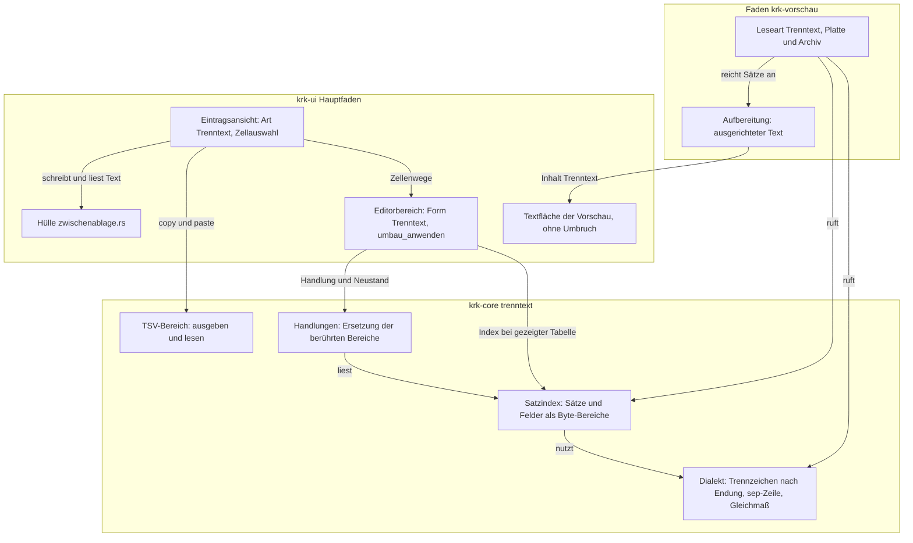
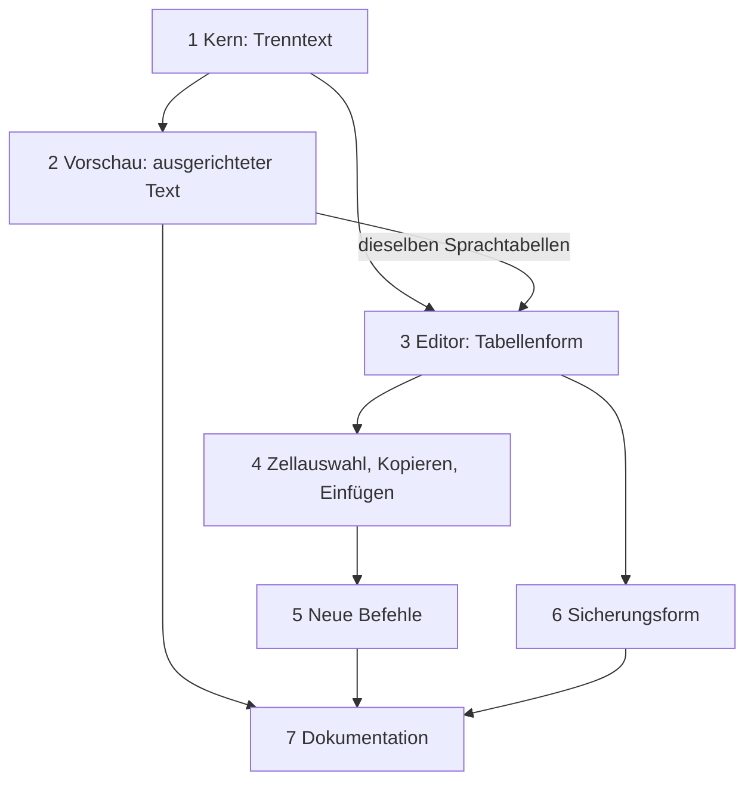

# Implementation Plan: CSV- und TSV-Dateien erscheinen in Vorschau und Editor als Tabelle

**Date:** 2026-10-18
**Spec:** keiner; geplant nach dem Auftrag (Narrativ `261018-0812-csv-und-tsv-als-tabelle-in-vorschau-und-editor.md` mit den wörtlichen Nutzerworten). Die Entscheide dieses Pakets sind offen mit Empfehlung: `261018-0822-wird-eine-csv-datei-eine-weitere-form-der-eintragsansicht-und-rechnet-jede-tabellenhandlung-auf-dem-text.md`, `261018-0822-behaelt-eine-csv-oder-tsv-datei-beim-sichern-ihre-bytefolgenmarke-und-ihre-zeilenenden.md`, `261018-0822-zeigt-die-vorschau-csv-und-tsv-als-ausgerichteten-text-oder-als-tabelle.md` und `261018-0822-schuldet-das-csv-paket-einen-abnahmelauf-gegen-die-zehn-zusagen.md`.
**Decidability:** Die tragende Frage lautet: „Welche Bytes der Datei ändert eine Tabellenhandlung?“ Sie ist entscheidbar, weil jede Handlung im Kern als Ersetzung genau der Byte-Bereiche gerechnet wird, die der Satzindex für die berührten Sätze und Felder meldet; was außerhalb liegt, wird nicht neu geschrieben, und eine Probe vergleicht es Byte für Byte (E5). **Zwei Fragen sind aus dem Inhalt nicht entscheidbar, und der Plan wechselt für beide den Mechanismus, statt zu raten.** Welches Trennzeichen eine `.csv` meint, lässt sich aus den Bytes nicht sicher sagen (`1,5;2` ist mit Komma wie mit Semikolon gültig). KRK behauptet deshalb keine Erkennung, sondern wählt nach einer festen, nachprüfbaren Regel (Endung, `sep=`-Zeile, Gleichmaß der Feldzahl), nennt die Wahl in der Statuszeile und bietet einen Befehl, der sie wechselt, ohne ein Byte zu ändern (E2). Ob die erste Zeile ein Kopf ist, lässt sich ebenso wenig entscheiden; die erste Zeile bleibt deshalb immer eine Datenzeile, und der Spaltenkopf zeigt ihren Text nur an (E6). Die dritte Frage, „erreicht Lesen den Hauptfaden?“, ist durch den Bau entschieden: die Vorschau zerlegt auf dem Faden `krk-vorschau`, der Editor liest auf `krk-editor`, und der Hauptfaden zerlegt allein Text, der schon im Speicher steht, und nur, solange die Tabelle zu sehen ist (E9).

## Directive

Der Nutzer, wörtlich: „Füge dem csv/tsv Support hinzu: sowohl preview wie editor sollten einfache tabellen handhaben können. editor mit insert, append, delete, copy markierten bereich. scroll muss horizontal und vertical funktionieren.“ Erreicht ist das Paket, wenn eine `.csv`- oder `.tsv`-Datei in der Vorschau mit Spalten erscheint, der Editor sie als bearbeitbare Tabelle öffnet, in der Zeilen und Spalten eingefügt, angehängt und gelöscht und ein markierter Zellbereich kopiert werden kann, beide Flächen waagerecht und senkrecht rollen und unveränderte Teile der Datei beim Sichern ihre Form behalten. Der Plan stellt die Directive nicht neu auf; er legt fest, wie sie gebaut wird.

## Current State

Gelesen am Stand `5f29200e`.

- **Keine Zeile für CSV im Baum.** `grep -rni 'csv\|tsv' crates resources` trifft allein die Endungsliste des Prüfordners (`crates/krk-bench/src/fixture.rs`, `ENDUNGEN`). Die Vorschau färbt `.csv` und `.tsv` heute über die Syntaxen „Separated Values“ und „Tab Separated Values“ aus `two-face` ein (`crates/krk-ui/src/hervorhebung.rs`, `sprache_fuer`), mit Umbruch und ohne waagerechten Rollbalken; über `TEXTGRENZE` (1 MiB) zeigt sie nur die Angaben.
- **Die Eintragsansicht** (`crates/krk-ui/src/appkit/eintragsansicht.rs`) ist eine `NSTableView`-Unterklasse `Eintragstabelle` mit eigenem Feldeditor `Zelleneditor` (eigener `NSUndoManager`), `laufende_zelle` ohne gemerkten Zustand, Naht Stelle/Zeile über `Zeilen::stelle_der_zeile`. Sie ist fest auf ihre Arten verdrahtet: `Zeilen { Aufgaben, Notizen, Termine, Geheimnisse }`, `spalten_einrichten` mit hartem `match`, `columnAutoresizingStyle` `LastColumnOnly`, allein ein senkrechter Rollbalken, Einfachauswahl einer Zeile, keine Spaltenauswahl. Zellen werden je Aufruf neu gebaut, und `zellenansicht` klont je Zelle den ganzen Zeilenvektor. `copy:` antwortet an `Eintragstabelle` mit dem Text der gewählten Zeile.
- **Die Tabelle ist eine Sicht auf den Stand.** `Editorbereich::tabelle_nachziehen` leitet die Zeilen nach jeder Standänderung neu ab; `zeilen_zeigen` vergleicht den ganzen Vektor. Jede Handlung rechnet der Kern als `Neustand { text, auswahl }` (`crates/krk-core/src/heimordner/eintraege.rs`), `Editorbereich::umbau_anwenden` bildet einen `Umkehrpunkt` aus dem geänderten Bereich und meldet ihn beim Verwalter der Textfläche an; `stand_einsetzen` schreibt danach den ganzen Stand per `setString` in die verborgene Textfläche.
- **Die Form des Editors** entscheidet allein `editorform(ansicht, typ)` (`appkit/editor.rs`), `Editorform { Text, Aufgaben, Notizen, Geheimnisse, Termine, Quicknote }` steht in `kommandos/zulaessigkeit.rs`, `Dateityp { Markdown, Sonstiges, Eintraege(Sonderdatei) }` in `editormodell.rs`. `ctrl+cmd+e` wechselt die Ansicht und lässt den Stand unberührt.
- **Der gehaltene Stand** ist UTF-8 ohne Bytefolgenmarke mit `\n` als einzigem Zeilenende; gesichert wird immer so (`crates/krk-core/src/text/datei.rs`, `sicherungsform`; Nutzerentscheid vom 260808-0043). Kein UTF-8: `einlesen` gibt `None`, der Editor weist ab. `EDITORGRENZE` ist 16 MiB.
- **Die Vorschau** wählt die Leseart allein nach der Endung (`Leseart { Bild, Pdf, Jsonzeilen, Text }`, `vorschaumodell.rs`), und dieselbe Wahl gilt für Platte und Archiv (`laden`, `archiveintrag_laden`). `.jsonl` ist das jüngste Muster: `anlesen(pfad, TEXTGRENZE + 1)`, Kürzung am letzten Zeilenende mit Hinweis, Aufbereitung in `crates/krk-ui/src/jsonzeilen.rs`. Ferne Orte zeigen nur Angaben (Entscheidung 13 des sftp-Plans). Die Textfläche der Vorschau bricht um (`setHorizontallyResizable(false)`), die Flächen wechselt allein `flaeche_zeigen`.
- **Befehle.** Die Eintragsbefehle `EintragHinzufuegen` (`shift+cmd+return`, `cmd+n`), `EintragBearbeiten` (`cmd+return`), `EintragHoch`/`EintragRunter` (`opt+cmd+up`/`down`), `EintragLoeschen` (`shift+cmd+delete`, `delete`) stehen im Menü „Home“ mit den Wirkungsbereichen `Eintragsdatei`, `Eintraege` und `Reihenfolge`. Frei sind ab Werk unter anderem `opt+cmd+return`, `ctrl+cmd+return`, `ctrl+shift+cmd+return` und `ctrl+shift+cmd+delete` (`grep` über `resources/default-keymap.toml`).
- **Zwischenablage.** Die eine Hülle `appkit/zwischenablage.rs` schreibt Text (`text_schreiben`, `text_auf_ablage_schreiben`) und liest Text über `lesen`, das zuerst einen Dateiverweis und erst dann eine Zeichenkette fragt. `paste:` ist nirgends überschrieben; die Zählprobe `nspasteboard_steht_nicht_im_betrachter_und_copy_cut_und_paste_stehen_an_genannten_stellen` (`appkit/betrachter.rs`) verlangt das.

## Approach

Ein neues Kernmodul `krk_core::trenntext` („Trenntext“: Text aus Sätzen, deren Felder ein Trennzeichen scheidet) liest CSV und TSV nach RFC 4180 in einen Satzindex aus Byte-Bereichen und rechnet jede Handlung als Ersetzung genau dieser Bereiche. Darauf setzen zwei Verbraucher auf, und keiner hat einen eigenen Leser. Die **Vorschau** bekommt eine weitere Leseart, die auf ihrem Faden ausgerichteten Text baut und in der vorhandenen Textfläche ohne Umbruch zeigt (Entscheid zur Vorschau, Möglichkeit 1). Der **Editor** bekommt eine weitere Form, `Editorform::Trenntext`, als weitere Art der Eintragsansicht: dieselbe Tabelle, derselbe Feldeditor, derselbe Rückgängigstapel des Textes, dieselben Zeilenbefehle, dazu Spalten aus der Datei, ein waagerechter Rollbalken, eine Zellauswahl als Rechteck, Kopieren und Einfügen als TSV und die Spaltenbefehle (Entscheid zur Architektur, Möglichkeit 1).



Selbstprüfung des Schaubilds: drei Schichten (Kern, Faden der Vorschau, Hauptfaden), alle Kanten laufen von oben nach unten oder in den Kern, kein Zyklus. `index` ist die eine Stelle, an der zerlegt wird, mit drei Lesern (Vorschau, Editor, Handlungen). Kein Knoten zeigt auf mehr als drei andere. Jede Kante steht in einer Entscheidung unten.

## Entscheidungen

Jeder Schritt zitiert die Nummern, die er umsetzt.

### E1. Erkennung

| Endung (ohne Rücksicht auf Groß- und Kleinschreibung) | Art | Trennzeichen |
|---|---|---|
| `.csv` | Csv | nach E2 |
| `.tsv`, `.tab` | Tsv | Tabulator, fest |

- Die Endung entscheidet, am Namen und ohne Systemaufruf, an einer Stelle: `trenntext::Art::aus_namen`. `Leseart::von` (Vorschau) und `Dateityp::von_pfad` (Editor) fragen sie; eine Datei des Notizordners (`Heimordner::sonderdatei`) wird wie bisher zuerst erkannt, und keiner ihrer Namen trägt eine dieser Endungen.
- `.txt` mit Tabulatoren, `.psv` und ähnliche Formen sind nicht Teil des Pakets. Eine `.csv.gz` in einem Archiv erscheint als Trenntext, weil ihr Eintrag `x.csv` heißt, wie `.jsonl.gz` heute.

### E2. Das Trennzeichen einer `.csv`

In dieser Reihenfolge, die erste Regel, die greift, entscheidet:

1. Ist die erste Zeile genau `sep=X` mit `X` aus Komma, Semikolon oder Tabulator (die Angabe, die Excel liest), gilt `X`. Die Zeile ist **Vorspann**: sie bleibt Byte für Byte stehen und ist keine Zeile der Tabelle.
2. Sonst wird der Anfang (höchstens 64 KiB und 200 Sätze) je Kandidat Komma, Semikolon, Tabulator zerlegt, mit Rücksicht auf Anführungszeichen. Gewählt wird der Kandidat, dessen häufigste Feldzahl größer als 1 ist und den größten Anteil der Sätze trägt; bei Gleichstand gilt die Reihenfolge Komma, Semikolon, Tabulator. Eine deutsche Excel-Datei `Name;Preis` / `Äpfel;1,50` trägt mit Semikolon in jedem Satz zwei Felder und mit Komma einmal eins und einmal zwei, also gewinnt das Semikolon.
3. Greift keine Regel (jede Zerlegung ergibt ein Feld je Satz), gilt Komma.

Die Wahl steht beim Öffnen im Editor in der Statuszeile (`Text::TrenntextTrennzeichen` mit Zeichen und Herkunft) und in der Vorschau in der Kopfzeile über der Tabelle. Der Befehl „Trennzeichen wechseln“ (E14) geht reihum Komma, Semikolon, Tabulator; er ändert die Deutung und kein Byte, gilt für die geöffnete Datei und wird nicht gemerkt.

### E3. Lesen nach RFC 4180, mit benannter Nachsicht

- Ein Satz endet an `\n` oder `\r\n` außerhalb von Anführungszeichen. Ein einzelnes `\r` ist ein Zeichen des Feldes. Ein Feld in `"` darf Trennzeichen, `"` als `""` und Zeilenumbrüche tragen. Das letzte Zeilenende der Datei eröffnet keinen leeren Satz; eine Leerzeile mitten in der Datei ist ein Satz mit einem leeren Feld.
- **Jedes Feld hat genau eine Form**: `Glatt` (ohne `"`), `Gequotet` (vollständig nach RFC 4180) oder `Nachsichtig` (ein `"` in einem ungequoteten Feld, Text hinter dem schließenden `"`). Ein nachsichtiges Feld wird gelesen, wie es dasteht (das `"` als Zeichen, der Text hinter dem schließenden `"` angehängt), und bleibt Byte für Byte stehen, bis seine Zelle geändert wird; dann schreibt es der Kern in kanonischer Form.
- **Ein Anführungszeichen, das bis zum Dateiende nicht schließt, wird gemeldet und nicht still gelesen** (`Satzindex::unterminiert` mit der Nummer des Satzes). Der Editor zeigt die Datei dann in der Rohansicht und meldet den Satz (`Text::TrenntextUnterminiert`); die Vorschau zeigt sie als Text wie heute. Der Rest der Datei würde sonst eine einzige Zelle.
- Die Vorschau zerlegt die Bytes der Datei (Bytefolgenmarke abgeschnitten, `\r\n` gelesen); der Editor zerlegt den gehaltenen Stand, der nur `\n` trägt. Es ist derselbe Leser.

### E4. Kodierung

Allein UTF-8, wie jeder Text in KRK. Eine Datei, die kein UTF-8 ist (etwa „CSV (Trennzeichen-getrennt)“ aus einem älteren deutschen Excel in Windows-1252), weist der Editor ab wie heute, und die Vorschau zeigt die Angaben. Eine Lesung und Schreibung in Windows-1252 bräuchte eine Kodierung im Editormodell und eine Antwort darauf, was mit Zeichen geschieht, die Windows-1252 nicht kennt; das steht unter den offenen Fragen als Folgepaket.

### E5. Byte-Treue der Handlungen

- **Jede Handlung des Kerns ersetzt allein Byte-Bereiche berührter Sätze.** Eine geänderte Zelle ersetzt den Bereich ihres Feldes, nicht den Satz; die anderen Felder des Satzes behalten ihre Rohform samt Anführungszeichen. Eine Zeilenhandlung fügt Sätze ein, entfernt oder vertauscht sie. Eine Spaltenhandlung ersetzt in jedem Satz, dem die Spalte gehört (E7), allein die Stelle zwischen zwei Feldern.
- Geschrieben wird ein Wert über `trenntext::feld_kodieren`: in Anführungszeichen genau dann, wenn er das Trennzeichen, `"`, `\n` oder `\r` trägt; `"` wird verdoppelt. Ein leerer Wert ist ein leeres Feld.
- Die Handlung liefert den ganzen neuen Text und die Auswahl danach, wie `Neustand`, und geht über `umbau_anwenden`; Rückgängig, Abweichungsmarke und Sichern bleiben, wie sie sind.
- Was beim Sichern an Bytefolgenmarke und Zeilenende geschieht, entscheidet der Entscheid zur Sicherungsform (E19).

### E6. Die erste Zeile

Die erste Zeile der Datei ist Zeile 1 der Tabelle, bearbeitbar, löschbar und verschiebbar wie jede andere. **Kein Mechanismus behandelt sie als Kopf.** Der Spaltenkopf der Tabelle zeigt den Buchstaben der Spalte (A bis Z, dann AA) und daneben den Text, den Zeile 1 in dieser Spalte trägt, gekürzt; so bleiben die Spaltennamen beim senkrechten Rollen sichtbar, ohne dass eine Datei ohne Kopf eine Zeile verliert. Die Vorschau zeigt über der Tabelle eine Zeile mit den Buchstaben und links die Nummer jeder Zeile (E17).

### E7. Ungleich lange Zeilen

- Die Spaltenzahl der Tabelle ist die größte Feldzahl aller Sätze, mindestens 1.
- **Ein Satz mit weniger Feldern hat leere Felder am Ende, und sie werden erst geschrieben, wenn eine Handlung sie braucht.** Eine leere Zelle jenseits des Satzendes zeigt die Tabelle leer an.
- Zelle setzen: liegt die Zelle hinter dem letzten Feld, füllt der Kern mit Trennzeichen bis zu ihr auf und schreibt den Wert; ein leerer Wert dort ändert nichts (keine Handlung, kein Rückgängigschritt).
- Spalte einfügen an Stelle `k` (0 bis Spaltenzahl): **jeder Satz mit mindestens `k` Feldern bekommt an Stelle `k` ein leeres Feld**, ein kürzerer bleibt unberührt. Mit `k` gleich der Spaltenzahl ist das das Anhängen; die längsten Sätze bekommen dann ein abschließendes Trennzeichen, und die Spalte steht. Eine Regel ohne Sonderfall für das Anhängen.
- Spalte löschen an Stelle `k`: jeder Satz mit mehr als `k` Feldern verliert das Feld samt einem angrenzenden Trennzeichen (dem folgenden, beim letzten Feld dem vorigen). Hat die Tabelle eine Spalte, wird sie nicht gelöscht (`Text::TrenntextLetzteSpalte`).
- Eine neue Zeile ist so viele Trennzeichen, wie die Spaltenzahl weniger eins angibt, und `\n`. Endet der Stand ohne `\n`, kommt es vor der neuen Zeile dazu. Ausgeschriebene leere Felder liest jedes Werkzeug gleich; eine bloße Leerzeile überspringen manche.

### E8. Spaltenbreiten und Rollen im Editor

- Für die Form `Trenntext` und nur für sie: `NSTableViewNoColumnAutoresizing`, `setHasHorizontalScroller(true)` an der Rolle, Spalten mit Breiten aus den ersten 1000 Sätzen (Zeichenzahl mal mittlere Zeichenbreite der Tabellenschrift, begrenzt auf 48 bis 320 pt), am Kopf ziehbar. Die übrigen Arten behalten `LastColumnOnly` und keinen waagerechten Rollbalken; `spalten_einrichten` stellt beides je Art ein, an der einen Stelle, an der es die Spalten einrichtet.
- Eine erste, schmale Spalte trägt die Zeilennummer, ist nicht bearbeitbar und rollt mit (AppKit kennt keine feste Spalte). Die Spalte 0 der Tabelle ist damit nicht die Spalte 0 der Datei; die Umrechnung steht an einer Stelle neben `stelle_der_zeile`, als `Zeilen::feld_der_spalte` und `spalte_des_feldes`.
- Feste Zeilenhöhe, eine Zeile je Zelle. Ein Zeilenumbruch erscheint als `⏎`, ein Tabulator als `⇥`, zu langer Text endet in „…“. Bearbeitet wird der wirkliche Wert (E16).

### E9. Große Dateien

- Der Editor öffnet bis `EDITORGRENZE`, wie jede Datei. Die Tabellenform zeigt höchstens `trenntext::HOECHSTENS_SPALTEN` Spalten, Vorschlag 1024; eine Datei mit mehr bleibt in der Rohansicht mit `Text::TrenntextZuVieleSpalten`. Schritt 3 misst und darf die Zahl begründet ändern.
- **Der Satzindex entsteht, wenn die Tabelle gezeigt wird, und nur dann.** In der Rohansicht wird beim Tippen nichts zerlegt; der Index gilt dann als veraltet und entsteht beim nächsten Wechsel in die Tabelle oder bei der nächsten Handlung neu. Nach einer Handlung entsteht er ganz neu, eine lineare Zerlegung des Standes. Ein Index, der nur den geänderten Bereich nachzieht, ist erst dann gerechtfertigt, wenn die Messung in Schritt 3 es verlangt.
- `Zeilen::Trenntext` hält den Index hinter einem `Rc` mit einer Generationszahl. `zeilen_zeigen` vergleicht die Generation statt der Zeilen, und `zellenansicht` liest am Index, statt einen Vektor zu klonen. Die Zellansichten der Form `Trenntext` kommen über `makeViewWithIdentifier:owner:`; ein zerlegter Satz wird für die Dauer eines Zeichendurchgangs zwischengespeichert, damit eine Zeile mit 30 sichtbaren Zellen einmal zerlegt wird und nicht 30-mal. Die übrigen Arten bauen ihre Zellen weiter wie bisher.
- Gemessen wird kopflos an einer erzeugten 16-MiB-Datei: Aufbau des Index, eine Zellübernahme samt `umbau_anwenden` und `stand_einsetzen`, eine Spalteneinfügung. Die Zahlen stehen im Bericht von Schritt 3.

### E10. Die Zellauswahl

- **Die Auswahl der Form `Trenntext` ist immer ein Rechteck aus Zellen**, gegeben durch Anker und Ende (`Zellauswahl`, ein reines Modell in `eintragsansicht.rs` ohne AppKit). Hat die Tabelle Zeilen, umfasst sie mindestens eine Zelle; nach dem Öffnen ist es A1. Eine ganze Zeile und eine ganze Spalte sind Rechtecke über alle Spalten oder alle Zeilen, kein eigener Fall.
- Maus: Klick setzt Anker und Ende, `shift`-Klick und Ziehen setzen das Ende, ein Klick auf den Spaltenkopf wählt die Spalte (mit `shift` bis zu ihr), ein Klick in die Nummernspalte wählt die Zeile. `cmd+a` beantwortet die Tabelle über `selectAll:` mit allen Zellen.
- Tastatur: Pfeile bewegen die Zelle, `shift`+Pfeil bewegt das Ende. Die Pfeile sind dort keine Befehle der Belegung, sondern Ereignisse an die Tabelle wie heute die Pfeile hoch und runter in jeder Tabelle; die Belegung bindet nackte Pfeile allein an Befehle des Dateifensters, und die sagen im Editor nein.
- Gezeichnet wird die Auswahl über den Hintergrund der Zellansichten; die native Zeilenhervorhebung ist in dieser Form aus. Stelle und Zeile sind in dieser Form dieselbe Zahl (Reihenfolge der Datei), die Naht bleibt trotzdem die eine in `Zeilen`.
- Die übrigen Arten behalten die Einfachauswahl einer Zeile.

### E11. Kopieren

`cmd+c` erreicht `copy:` an `Eintragstabelle`, die vorhandene Stelle, und legt in der Form `Trenntext` den gewählten Bereich als TSV über `zwischenablage::text_schreiben` ab: Zeilen durch `\n`, Zellen durch Tabulator, jede Zelle über `feld_kodieren` mit Tabulator als Trennzeichen. Eine einzelne Zelle ohne Tabulator, Zeilenumbruch und `"` ist damit ihr bloßer Wert. TSV nimmt Numbers und Excel beim Einfügen in Zellen auf, und es ist das Format, das KRK selbst beim Einfügen liest (E12). Eine laufende Zelle kopiert über ihren Feldeditor wie bisher.

### E12. Einfügen als Zellbereich

Ja. `cmd+v` in der Form `Trenntext` ohne laufende Zelle erreicht ein neues `paste:` an `Eintragstabelle`. Gelesen wird **allein Text** über eine neue Funktion der einen Hülle, `zwischenablage::nur_text_lesen` (allein `NSPasteboardTypeString`), weil `lesen` einen Dateiverweis vorzieht und ein kopierter Finder-Eintrag sonst als Pfad in die Zellen käme. Der Text wird als TSV zerlegt (derselbe Leser, Tabulator fest; ein abschließendes `\n` eröffnet keine Zeile). Der Block überschreibt ab der oberen linken Zelle der Auswahl, hängt Zeilen an und füllt Sätze auf, wo er über das Ende reicht, in **einer** Handlung, die ein `cmd+z` ganz zurücknimmt. Die Auswahl ist danach der eingefügte Bereich. In einer laufenden Zelle fügt der Feldeditor ein wie bisher. Die Zählprobe in `appkit/betrachter.rs` bekommt `eintragsansicht.rs` als einzige Stelle für `paste:`; das ist eine bewusste Änderung ihrer Erwartung.

### E13. Zeilenbefehle über die Eintragsbefehle

Nach dem Entscheid zur Architektur (Möglichkeit 1) wirken in der Form `Trenntext`:

| Befehl | Tasten ab Werk | Wirkung in der CSV-Tabelle |
|---|---|---|
| Eintrag hinzufügen | `shift+cmd+return`, `cmd+n` | eine leere Zeile ans Ende, ihre erste Zelle gewählt und offen |
| Eintrag bearbeiten | `cmd+return` | die obere linke Zelle der Auswahl öffnen; in einer offenen Zelle übernehmen |
| Eintrag löschen | `shift+cmd+delete`, `delete` | die Zeilen der Auswahl löschen, ohne Rückfrage, zurücknehmbar |
| Eintrag nach oben, nach unten | `opt+cmd+up`, `opt+cmd+down` | die Zeilen der Auswahl als Block um eine Stelle verschieben |

- `form_passt` sagt für `Eintraege`, `Reihenfolge` und `Eintragsdatei` in der Form `Trenntext` ja, für `Aufgaben`, `Termine` und `Editortext` nein. `Lage::eintragsdatei` wird für eine Trenntextdatei wahr, weil `eintragsart_des_typs` für sie `Eintragsart::Trenntext` liefert; damit hängt „Eintrag hinzufügen“ in der Rohansicht einer CSV eine leere Zeile als Text an, und die Schreibmarke steht am Anfang der neuen Zeile.
- In einer laufenden Zelle bleibt das nackte `delete` ein Rückschritt (`zellentaste::gehoert_der_zelle`, unverändert).

### E14. Neue Befehle und ihre Tasten

| Kennung | Name (de) | Tasten ab Werk | Wirkung |
|---|---|---|---|
| `trenntext_zeile_einfuegen` | Zeile darüber einfügen | `opt+cmd+return` | so viele leere Zeilen über der Auswahl, wie sie Zeilen umfasst |
| `trenntext_spalte_einfuegen` | Spalte links einfügen | `ctrl+cmd+return` | eine leere Spalte links der Auswahl (E7) |
| `trenntext_spalte_anhaengen` | Spalte anhängen | `ctrl+shift+cmd+return` | eine leere Spalte hinter der letzten (E7) |
| `trenntext_spalte_loeschen` | Spalten löschen | `ctrl+shift+cmd+delete` | die Spalten der Auswahl (E7) |
| `trenntext_trennzeichen_wechseln` | Trennzeichen wechseln | keine | E2; nur für `.csv`, für `.tsv` und `.tab` ausgegraut |

- Ein neuer Wirkungsbereich `Wirkungsbereich::Trenntext` auf `Seite::Editor`: `form_passt` sagt allein in der Form `Trenntext` ja, „Trennzeichen wechseln“ fragt zusätzlich über `datei_passt`, ob die Datei eine `.csv` ist. Ortsbedarf `Ueberall`, weil der Editor allein lokale Dateien hält.
- Die Familie folgt der vorhandenen Ordnung: `cmd+return` bearbeitet, `shift` davor legt an, `opt` davor fügt ein; `ctrl` davor meint die Spalte. Die Kombinationen dieser Tafel waren am Stand `5f29200e` in keiner Tastenliste vergeben und tragen `cmd`, also lässt `zellentaste::gehoert_der_zelle` sie in einer laufenden Zelle wirken, und `ab_werk_trifft_die_regel_zwei_kombinationen_und_eine_begegnet_der_zelle` bleibt unverändert grün. `opt+cmd+delete` bleibt frei, wie der Kommentar in `resources/default-keymap.toml` es festhält. Ob AppKits Feldeditor eine dieser Kombinationen belegt, prüft Schritt 5 an `StandardKeyBinding.dict`.
- Die neuen Befehle stehen im Menü „Editor“ (`Funktionsbereich::Editor`), ihr Block in der Belegung folgt dem Block der Ansichtsbefehle. Die Eintragsbefehle bleiben im Menü „Home“ (offene Frage).

### E15. Rückgängig

Ein Stapel: jede Handlung geht über `umbau_anwenden` in den Verwalter der Textfläche, und `cmd+z` nimmt Tabellenhandlungen und Tippen der Rohansicht in der richtigen Reihenfolge zurück. Eine Spaltenhandlung an einer großen Datei berührt fast jeden Satz; ihr `Umkehrpunkt` umfasst dann fast die ganze Datei, und das Budget `STAPELBUDGET` lässt ihn als die eine Handlung zu, die es sprengen darf (Modulkopf von `appkit/editor.rs`). Ältere Schritte fallen dabei heraus; `HowTo.md` nennt den Preis.

### E16. Bearbeiten einer Zelle

Doppelklick, `cmd+return` und `return` auf der gewählten Zelle öffnen sie mit ihrem wirklichen Wert. In der offenen Zelle übernimmt `return`, `opt+return` schreibt einen Zeilenumbruch (die Belegung des Feldeditors von AppKit), `tab` übernimmt und öffnet die Zelle rechts daneben, am Zeilenende die erste der nächsten Zeile, `shift+tab` geht zurück; `esc` verwirft das Getippte, wie in der Aufgabentabelle (`esc_regel` bildet `Trenntext` auf `Aufgaben` ab). Jeder Text ist erlaubt; `Zellenwege::pruefen` weist in dieser Form nichts ab, der Kern quotet beim Schreiben. `zelle_uebernehmen` und seine Rufer bleiben die eine Übernahme.

### E17. Die Vorschau

Nach dem Entscheid zur Vorschau, Möglichkeit 1:

- `Leseart::Trenntext` neben `Jsonzeilen`, gewählt über `trenntext::Art::aus_namen`, in `laden` und `archiveintrag_laden` zugleich. Gelesen wird mit `anlesen(pfad, TEXTGRENZE + 1)`; ist mehr da, endet die Tabelle am letzten vollständigen Satz innerhalb der Grenze (`trenntext::vollstaendig_bis`, mit Rücksicht auf Umbrüche in Anführungszeichen), und die Kopfzeile sagt, dass gekürzt ist.
- Aufbereitet wird in einem neuen Modul `crates/krk-ui/src/trenntextvorschau.rs` nach dem Muster von `jsonzeilen.rs`:

  ```text
  Semikolon · 1 204 Zeilen · 3 Spalten
      │ A      │ B     │ C
  ────┼────────┼───────┼──────
     1│ Name   │ Preis │ Menge
     2│ Äpfel  │ 1,50  │ 3
  ```

  Eine Kopfzeile mit Trennzeichen, Zeilen- und Spaltenzahl (bei Kürzung mit dem Hinweis), eine Zeile mit den Buchstaben, eine Trennlinie, links die Zeilennummer. Spaltenbreite ist die größte Anzeigebreite der Spalte, höchstens 40; eine längere Zelle endet in „…“, `\n` erscheint als `⏎`, ein Tabulator als `⇥`. Die Anzeigebreite eines Zeichens ist 1 und für ostasiatische Breitzeichen 2, nach einer kleinen festen Bereichstafel im Modul; Zeichen ohne Breite (kombinierende Zeichen) bleiben unberücksichtigt, und der Modulkopf sagt es.
- Neuer Wert `Inhalt::Trenntext(String)`. Der Übersetzer nennt jede Fallunterscheidung über `Inhalt`. Gezeigt wird in der Textfläche mit der Festbreitenschrift der Rohansicht, **ohne Umbruch und mit waagerechtem Rollbalken**, ohne Einfärbung und ohne Nummernspalte. Ob umgebrochen und eingefärbt wird, beantwortet eine Funktion über `Inhalt` ohne Auffangzweig, an der einen Stelle, an der die Fläche ihren Inhalt bekommt.
- Kein Trenntext wird daraus, und die Datei erscheint als Text wie heute, wenn der Leser ein unterminiertes Anführungszeichen meldet, die Datei mehr als `HOECHSTENS_SPALTEN` Spalten trägt oder leer ist.
- Auswahl und Kopieren wirken wie bei JSON-Zeilen: kopiert wird der gezeigte Text. TSV kopiert der Editor (E11).

### E18. Archive und ferne Orte

- **Archiv:** die Vorschau zeigt eine CSV in einem lokalen Archiv als Tabelle, weil `archiveintrag_laden` dieselbe Leseart fragt; der Editor öffnet keine Datei im Archiv (unverändert).
- **Ferner Ort:** die Vorschau zeigt Angaben und keinen Inhalt (Entscheidung 13 des sftp-Plans, unverändert), der Editor öffnet nichts.

### E19. Sicherungsform

Nach dem Entscheid zur Sicherungsform. Bei Möglichkeit 2 merkt sich das Editormodell beim Einlesen einer Trenntextdatei eine `Dateiform { marke: bool, crlf: bool }` (Marke am Anfang der Bytes, erstes Zeilenende `\r\n`); der gehaltene Stand bleibt ohne Marke mit `\n`, und `datei::sichern` bekommt die Form als Argument und stellt beides beim Schreiben wieder her, für jede andere Datei mit der heutigen Form. Bei Möglichkeit 1 entfällt Schritt 6; bei Möglichkeit 3 entfällt er ebenfalls, und das Paket ist ein eigenes.

### E20. Keine neue Kiste

Der Leser ist eine lineare Zerlegung mit drei Zuständen und einer Kodierregel; die Byte-Bereiche, die E5 braucht, liefert die Kiste `csv` nicht in der Form, die ein Spleiß verlangt, und sie brächte `csv-core`, `itoa` und `ryu` mit (`inference:` aus ihrer Beschreibung, nicht am Baum geprüft, weil sie nicht gebraucht wird). Keine Zeile in einer `Cargo.toml` ändert sich; `#![deny(unsafe_code)]` bleibt an jeder Kistenwurzel ohne neue Ausnahme.

### E21. Abnahmelauf gegen C8: Frage an den Nutzer, kein Halt des Baus

Berührt ist allein L7, weil Prüfordner A `.csv`-Dateien enthält und deren Vorschau künftig zerlegt und ausgerichtet wird. Die Arbeit liegt auf dem Faden vor der Endbedingung `laedt_noch`, ist linear in höchstens 1 MiB, und Schritt 2 misst sie kopflos. Der Editor ist nicht gemessen; `Lage` bekommt keinen neuen Feldtyp. Der Plan baut ohne den Lauf und legt die Frage im Entscheid `261018-0822-schuldet-das-csv-paket-einen-abnahmelauf-gegen-die-zehn-zusagen.md` vor; die Antwort braucht es erst zum Schließen.

## Implementation Steps

Gemeinsame Akzeptanz jedes Schritts („Grundabnahme“):

- `make check` grün; `cargo xtask bundle` baut und signiert `target/KRK.app`.
- `cargo tree --target aarch64-apple-darwin -e normal,build` und `cargo tree --target x86_64-apple-darwin -e normal,build` führen weder `cc` noch ein Paket mit einem Namen auf `-sys`.
- `git diff 5f29200e -- Cargo.toml crates/*/Cargo.toml Cargo.lock` ist leer (E20).
- `grep -rn '^#!\[allow(unsafe_code)\]' crates xtask` nennt weiter allein `verzeichnis/sys.rs` und `appkit/mod.rs`.
- Jeder neue nutzersichtbare Text steht in `de.rs`, `fr.rs` und `en.rs`. Jede neue Aufzählung wird ohne Auffangzweig verzweigt, jede neue Liste `ALLE` hält `jede_alle_liste_fuehrt_genau_die_varianten_ihrer_aufzaehlung`, jeder Rückgabewert, dessen stilles Fallenlassen unbemerkt bliebe, trägt `#[must_use]`.
- Jede Probe mit CSV-Dateien erzeugt sie selbst, im Speicher oder im Prüfordner der eigenen Kiste; keine Probe legt eine CSV-Datei als feste Datei in den Baum.
- Vorhandene Proben bleiben grün, ohne dass ihre Erwartungen geändert werden; eine Ausnahme nennt der Schritt ausdrücklich.

1. **Trenntext im Kern: Art, Dialekt, Satzindex, Handlungen, TSV-Bereich**
   - Executor: code-implementer
   - Files: neu `crates/krk-core/src/trenntext/mod.rs`, `trenntext/dialekt.rs`, `trenntext/index.rs`, `trenntext/feld.rs`, `trenntext/handlung.rs`, `trenntext/bereich.rs`; `crates/krk-core/src/lib.rs`; neu `crates/krk-core/tests/trenntext.rs`
   - Changes: `Art::aus_namen` (E1). `Trennzeichen`, `Dialekt` mit Herkunft und `dialekt_erkennen` nach E2, samt Vorspann aus `sep=`. `indexieren` liefert `Satzindex` (Vorspann, Satzbereiche, Spaltenzahl, unterminierter Satz) und `felder` die Felder eines Satzes mit Byte-Bereich, Wert und Form (E3). `feld_kodieren` (E5). Handlungen als reine Funktionen vom alten Text auf `Option<Trenntextstand { text, auswahl: Zellbereich }>`: `zelle_setzen`, `zeilen_einfuegen`, `zeile_anhaengen`, `zeilen_loeschen`, `zeilen_verschieben`, `spalte_einfuegen` (auch das Anhängen, E7), `spalten_loeschen`, `bereich_einsetzen`. `bereich_als_tsv` und `tsv_lesen` (E11, E12). `vollstaendig_bis` (E17). `HOECHSTENS_SPALTEN` (E9). Kein AppKit, keine Zeile in `krk-ui`. Umsetzt E1, E2, E3, E5, E7, E9 (Konstante), E11 und E12 (Kern), E17 (Kürzung), E20.
   - Akzeptanz: Grundabnahme; dazu die Proben
     - `jede_endung_ergibt_ihre_art_und_keine_andere` (die Tafel in E1, Groß- und Kleinschreibung, `.csv.gz` nein, `.txt` nein);
     - `das_trennzeichen_folgt_sep_zeile_gleichmass_und_reihenfolge` (deutsche Excel-Datei mit Semikolon und Dezimalkomma, Komma-Datei mit gequoteten Kommas, Gleichstand, eine Spalte, `sep=;` als Vorspann);
     - `rfc_4180_felder_werden_gelesen_wie_sie_geschrieben_sind` (`""`, Umbruch im Feld, `\r\n`, einzelnes `\r` im Feld, leere Felder, abschließendes Trennzeichen, Leerzeile in der Mitte, Dateiende ohne Umbruch);
     - `nachsichtige_felder_bleiben_stehen_bis_ihre_zelle_geaendert_wird`;
     - `ein_unterminiertes_anfuehrungszeichen_wird_mit_seinem_satz_gemeldet`;
     - `kodieren_und_lesen_kehren_einander_um` (feste Liste schwieriger Werte samt Trennzeichen, `"`, `\n`, `\r`, Leerwert, je Trennzeichen);
     - `jede_handlung_aendert_nur_die_bytes_der_beruehrten_saetze` (erzeugte Tabellen mit festem Startwert eines eigenen Zufallsgenerators, ungleich lange Sätze, gequotete und nachsichtige Felder; je Handlung stimmt jeder unberührte Satz Byte für Byte, und bei `zelle_setzen` auch jedes andere Feld des Satzes);
     - `eine_zelle_jenseits_des_satzendes_fuellt_mit_trennzeichen_auf_und_ein_leerer_wert_aendert_nichts`;
     - `spalte_einfuegen_anhaengen_und_loeschen_folgen_der_regel_der_fehlenden_felder` (die Fälle aus E7, ausgeschrieben);
     - `die_letzte_spalte_wird_nicht_geloescht`;
     - `eine_neue_zeile_traegt_spaltenzahl_weniger_eins_trennzeichen`;
     - `ein_bereich_als_tsv_und_zurueck_ergibt_dieselben_zellen`;
     - `die_kuerzung_endet_am_letzten_vollstaendigen_satz` (Grenze mitten in einem gequoteten Umbruch);
     - die Messprobe `messung_index_einer_16_mib_datei` (`#[ignore]`, `cargo test --release -p krk-core --test trenntext -- --ignored --nocapture`); der Bericht nennt Zeit und Speicher des Index.
   - Dependencies: none

2. **Die Vorschau zeigt CSV und TSV als ausgerichteten Text**
   - Executor: code-implementer
   - Files: neu `crates/krk-ui/src/trenntextvorschau.rs`; `crates/krk-ui/src/main.rs`; `crates/krk-ui/src/vorschaumodell.rs` (`Leseart::Trenntext`, `Inhalt::Trenntext`, `laden`, `archiveintrag_laden`, jede Fallunterscheidung über `Inhalt`); `crates/krk-ui/src/appkit/vorschau.rs` (Umbruch, Rollbalken, Einfärbung, Nummernspalte je Inhalt); `crates/krk-core/src/sprache/schluessel.rs` und die drei Tabellen
   - Changes: nach E17 und E18. Die Entscheidung über Umbruch und Einfärbung steht als reine Funktion über `Inhalt` an der Stelle, an der die Textfläche ihren Inhalt bekommt; `flaeche_zeigen` bleibt die einzige Stelle mit `setHidden`. Umsetzt E17, E18 (Vorschau), E21 (Messung).
   - Akzeptanz: Grundabnahme; dazu die Proben
     - `eine_csv_erscheint_mit_kopfzeile_buchstaben_trennlinie_und_nummern` (genaue Erwartung des Textes für eine kleine Datei mit Semikolon und Umlauten);
     - `eine_lange_zelle_endet_in_auslassung_und_umbrueche_erscheinen_als_zeichen`;
     - `breitzeichen_zaehlen_doppelt`;
     - `eine_csv_ueber_der_grenze_zeigt_ihre_vollstaendigen_saetze_und_sagt_es`;
     - `eine_unterminierte_eine_leere_und_eine_zu_breite_csv_erscheinen_als_text`;
     - `die_auswahl_einer_csv_zeigt_sie_ueber_den_arbeitsfaden` (nach dem Muster der JSON-Zeilen-Probe);
     - `eine_csv_im_zip_erscheint_wie_auf_der_platte`;
     - `nur_der_trenntext_bricht_nicht_um_und_wird_nicht_eingefaerbt` (über jeden Wert von `Inhalt`);
     - `das_vorschaumodell_weiss_von_der_einfaerbung_nichts` und `set_hidden_steht_in_dieser_datei_allein_in_flaeche_zeigen` bleiben grün;
     - der Bericht nennt die kopflos gemessene Zeit von Zerlegung und Aufbereitung für 1 MiB.
   - Dependencies: 1

3. **Der Editor zeigt CSV und TSV als Tabelle: Form, Anzeige, Zellen, Zeilenbefehle, Grenzen**
   - Executor: code-implementer
   - Files: `crates/krk-ui/src/editormodell.rs` (`Dateityp::Trenntext`); `crates/krk-ui/src/kommandos/zulaessigkeit.rs` (`Editorform::Trenntext`, `form_passt`, `JEDE_FORM`, Proben); `crates/krk-ui/src/appkit/editor.rs` (`editorform`, `flaeche_der_form`, `eintragsart_der_form`, `eintragsart_des_typs`, `esc_regel`, `zellenrechnung`, `handlung_rechnen`, `tabelle_nachziehen`, `eintrag_im_text_hinzufuegen`, `schreibstelle_im_letzten_eintrag`, Dialekt je geöffneter Datei, Verweigerung der Tabellenform, Messprobe); `crates/krk-ui/src/appkit/eintragsansicht.rs` (`Eintragsart::Trenntext`, `Zeilen::Trenntext`, `spalten_einrichten`, Nummernspalte, Kopf, Rollbalken und Spaltenbreiten je Art, Wiederverwendung der Zellansichten, `zellenbefehl`, `naechste_zelle`, `abgeleiteter_text`); `crates/krk-ui/src/appkit/anwendung.rs` (allein `lage()`, falls nötig); Sprachtabellen
   - Changes: nach E6, E7, E8, E9, E13 (mit der gewählten Zeile als Auswahl, die Rechteckauswahl folgt in Schritt 4) und E16. Eine `.csv`, `.tsv` oder `.tab` öffnet in der Ansicht, in der eine Eintragsdatei öffnet, und zeigt die Tabelle; meldet der Index ein unterminiertes Anführungszeichen oder zu viele Spalten, stellt der Editorbereich die Ansicht auf Roh und meldet den Grund, und `ctrl+cmd+e` versucht es beim nächsten Mal neu. `editorform` bleibt eine reine Funktion von Ansicht und Typ. Die Messprobe nach E9 läuft als `#[ignore]` an einer Fläche (`an_einer_flaeche`). Umsetzt E6, E7, E8, E9, E13, E16.
   - Akzeptanz: Grundabnahme; dazu die Proben
     - `eine_csv_oeffnet_als_tabelle_mit_spalten_aus_der_datei` (Spaltenzahl gleich der größten Feldzahl, Nummernspalte davor);
     - `der_kopf_zeigt_buchstabe_und_text_der_ersten_zeile_und_die_erste_zeile_bleibt_zeile`;
     - `eine_zellaenderung_schreibt_nur_ihr_feld_und_ein_cmd_z_nimmt_sie_zurueck`;
     - `die_rohansicht_zeigt_denselben_stand_wie_die_tabelle`;
     - `eine_unterminierte_und_eine_zu_breite_csv_bleiben_in_der_rohansicht_mit_meldung`;
     - `nur_die_trenntextform_rollt_waagerecht` (Rollbalken und Autoresize je Art; die übrigen wie vor dem Schritt);
     - `der_index_entsteht_nur_bei_gezeigter_tabelle` (Zähler der Zerlegungen beim Tippen in der Rohansicht bleibt stehen);
     - `tab_geht_in_die_naechste_zelle_und_am_zeilenende_in_die_naechste_zeile`;
     - `eintrag_hinzufuegen_loeschen_und_verschieben_wirken_auf_zeilen_der_csv` (auch das Anhängen in der Rohansicht mit Schreibmarke am Anfang der neuen Zeile);
     - `jede_form_des_editors_steht_in_der_probenliste` mit erweitertem `JEDE_FORM`, `die_sechs_befehle_der_eintragstabelle_wirken_nur_im_editor_in_passender_form` mit dem Arm für `Trenntext` (die einzige erlaubte Erweiterung vorhandener Erwartungen in diesem Schritt; keine vorhandene Antwort ändert sich);
     - `die_zellenuebernahme_hat_genau_diese_rufer` bleibt grün; kommt ein Rufer dazu, steht er mit Namen im Bericht;
     - die Messprobe nennt im Bericht die Zeiten für Index, Zellübernahme und Spalteneinfügung an 16 MiB.
   - Dependencies: 1, 2 (2 nur, weil beide Schritte die Sprachtabellen und `schluessel.rs` ändern; so laufen sie nacheinander)

4. **Zellauswahl als Rechteck, Kopieren als TSV, Einfügen als Bereich**
   - Executor: code-implementer
   - Files: `crates/krk-ui/src/appkit/eintragsansicht.rs` (`Zellauswahl`, Maus und Pfeile in der Form `Trenntext`, Zeichnen über die Zellansichten, `copy:`, neues `paste:`, `selectAll:`); `crates/krk-ui/src/appkit/editor.rs` (Auswahl nach einer Handlung als Bereich; Löschen und Verschieben über die Zeilen der Auswahl; Einfügen als Handlung); `crates/krk-ui/src/appkit/zwischenablage.rs` (`nur_text_lesen`); `crates/krk-ui/src/appkit/betrachter.rs` (Zählprobe)
   - Changes: nach E10, E11, E12 und dem Teil von E13, der „die Zeilen der Auswahl“ sagt. Die übrigen Arten behalten ihre Zeilenauswahl. Umsetzt E10, E11, E12, E13 (Auswahl).
   - Akzeptanz: Grundabnahme; dazu die Proben
     - `die_zellauswahl_ist_immer_ein_rechteck_mit_mindestens_einer_zelle` (reines Modell, jede Folge aus Klick, Umschaltklick, Pfeil und Umschaltpfeil an den Rändern);
     - `ein_klick_auf_den_kopf_waehlt_die_spalte_und_auf_die_nummer_die_zeile`;
     - `cmd_c_legt_den_bereich_als_tsv_ab` (über `text_auf_ablage_schreiben` an einer eigenen Ablage);
     - `cmd_v_setzt_einen_tsv_block_ab_der_zelle_und_ein_cmd_z_nimmt_ihn_ganz_zurueck` (auch über das Ende hinaus);
     - `einfuegen_liest_allein_text_und_keinen_dateiverweis`;
     - `loeschen_nimmt_die_zeilen_der_auswahl_und_verschieben_bewegt_sie_als_block`;
     - `die_uebrigen_arten_behalten_ihre_zeilenauswahl`;
     - `nspasteboard_steht_nicht_im_betrachter_und_copy_cut_und_paste_stehen_an_genannten_stellen` nennt `eintragsansicht.rs` als einzige Stelle für `paste:`; das ist die eine erlaubte Änderung einer vorhandenen Erwartung in diesem Schritt.
   - Dependencies: 3

5. **Die Befehle Zeile einfügen, Spalte einfügen, anhängen und löschen, Trennzeichen wechseln**
   - Executor: code-implementer
   - Files: `crates/krk-core/src/tasten/belegung.rs` (`Kommando`, `KENNUNGEN`, `wirkungsbereich`, `ortsbedarf`, `Wirkungsbereich::Trenntext` mit `seite`, `weiter`, `beschriftung`); `crates/krk-core/tests/belegung.rs`; `crates/krk-ui/src/kommandos/zulaessigkeit.rs` (`form_passt`, `datei_passt`, `folge_passt`, `STELLVERTRETER`); `crates/krk-ui/src/kommandos/fokus.rs`; `crates/krk-ui/src/belegungsmodell.rs`; `crates/krk-ui/src/appkit/anwendung.rs` (Ausführungszweige, `zweigproben::BEFEHLE`); `crates/krk-ui/src/appkit/editor.rs`; `resources/default-keymap.toml`; Sprachtabellen (`kommandoname`, Beschriftung des Wirkungsbereichs, Meldungen)
   - Changes: nach E14 und E2 (Befehl). `resources/default-keymap.toml` ändert dieser Schritt mit, wie jedes Paket, das einen Befehl baut: die Proben des Kerns lesen die Datei, und ein Befehl ohne Block dort ist ein roter Bau. Umsetzt E2 (Befehl), E14.
   - Akzeptanz: Grundabnahme; dazu die Proben
     - `jede_variante_von_kommando_steht_genau_einmal_in_kennungen` und `jede_kennung_beider_listen_steht_in_der_auslieferung` grün;
     - `die_trenntextbefehle_wirken_nur_in_der_trenntextform` (über `JEDE_FORM`; Trennzeichen wechseln nur bei `.csv`);
     - `die_neuen_kombinationen_tragen_ab_werk_keinen_konflikt` (`Belegung::konflikte` der Auslieferung bleibt leer);
     - `ab_werk_trifft_die_regel_zwei_kombinationen_und_eine_begegnet_der_zelle` unverändert grün;
     - `einander_ausschliessende_bereiche_sind_nie_zugleich_zulaessig`, `eine_verengung_ist_nie_ohne_ihren_weiteren_bereich_zulaessig`, `jeder_wirkungsbereich_hat_einen_stellvertreter` und `keine_zwei_wirkungsbereiche_teilen_sich_eine_beschriftung` grün;
     - `der_bereich_editor_fuehrt_genau_die_befehle_des_editors` mit den Befehlen aus E14 in der Folge der Belegung (die eine erlaubte Änderung vorhandener Erwartung in diesem Schritt);
     - `trennzeichen_wechseln_aendert_kein_byte_und_geht_reihum`;
     - `zeile_darueber_und_spalte_links_entstehen_an_der_auswahl`;
     - der Bericht nennt die Prüfung der Kombinationen aus E14 an `StandardKeyBinding.dict`.
   - Dependencies: 4

6. **Eine Trenntextdatei behält beim Sichern Bytefolgenmarke und Zeilenende** (entfällt bei Möglichkeit 1 und 3 des Entscheids zur Sicherungsform)
   - Executor: code-implementer
   - Files: `crates/krk-core/src/text/datei.rs` (`Dateiform`, `sicherungsform`, `sichern`, Modulkopf „Der Preis dieser Wahl“); `crates/krk-ui/src/editormodell.rs` (Form beim Einlesen merken, beim Sichern reichen); `crates/krk-core/tests/` (Probendatei der Textwege)
   - Changes: nach E19. Der gehaltene Stand bleibt ohne Marke und mit `\n`; allein der Schreibweg bekommt die Form. Umsetzt E19.
   - Akzeptanz: Grundabnahme; dazu die Proben
     - `eine_csv_mit_marke_und_crlf_kommt_unveraendert_byte_fuer_byte_zurueck`;
     - `eine_geaenderte_zelle_aendert_in_der_gesicherten_datei_nur_ihre_bytes` (Datei mit Marke und `\r\n`);
     - `jede_andere_datei_sichert_wie_vorher` (eine `.md` mit `\r\n` und Marke kommt mit `\n` und ohne Marke zurück; die vorhandenen Proben von `sicherungsform` bleiben unverändert grün);
     - `der_gehaltene_stand_traegt_weiter_keine_marke_und_kein_cr`.
   - Dependencies: 3

7. **`HowTo.md`, `README.md`, `CLAUDE.md`**
   - Executor: code-implementer
   - Files: `HowTo.md` (neuer Abschnitt „CSV- und TSV-Dateien“ unter „Editor und Vorschau“: Erkennung, Trennzeichen und sein Wechsel, Tabelle und Rohansicht, Griffe und Tasten als Tafel wie bei den Aufgaben, Auswahl, Kopieren als TSV, Einfügen, ungleich lange Zeilen, erste Zeile, Grenzen 16 MiB und Spaltenzahl, Kodierung, Sicherungsform nach E19, Vorschau mit Kürzung, Archiv, Preis großer Spaltenhandlungen für Rückgängig; Tastentafel unter „Die Tastaturbelegung“ falls dort Editorbefehle stehen); `README.md` (kurzer Abschnitt, dass CSV ein eigener Leser ohne Kiste liest, neben „Archive im Dateifenster: womit KRK sie liest und schreibt“); `CLAUDE.md` (Baum `krk-core` um `trenntext/`; Absatz zu den Aufzählungen um `Editorform::Trenntext` und `Wirkungsbereich::Trenntext`, beides ohne Zahl; Absatz zur Hülle um `NSPasteboard` um `paste:` an der Eintragstabelle; Absatz „Der Preis dieser Wahl“ des Sicherns nach E19; die Eintragsansicht mit der Art `Trenntext` und ihrer Rechteckauswahl)
   - Changes: Beschreibt den Stand nach den Schritten 1 bis 6. Keine Zahl, die eine Aufzählung oder Liste wiedergibt; wo eine Menge genannt wird, steht der Befehl, der sie erhebt (`rules/critical-stance.md` §5 und die Regel in `CLAUDE.md`). Eine neue Stelle der Betriebsregel entsteht nicht.
   - Akzeptanz: Grundabnahme; jede Taste in `HowTo.md` stimmt mit `make tasten` überein; `grep -n 'trenntext\|Trenntext' CLAUDE.md` trifft jeden der genannten Absätze; `RUSTDOCFLAGS="-D warnings" cargo doc --workspace --no-deps` grün (in `make check`).
   - Dependencies: 2, 5, 6



Selbstprüfung: jede Kante ist eine Abhängigkeit, die ein Schritt oben nennt, und jede genannte Abhängigkeit ist eine Kante. Der Graph hat keinen Zyklus. Die Kante 2 nach 3 ist keine fachliche, sondern hält zwei Dispatches, die dieselben Sprachdateien ändern, auseinander; sie ist beschriftet. Schritt 6 darf neben 4 und 5 laufen, weil er keine Datei der Eintragsansicht und keine Sprachdatei berührt. Schritt 7 sammelt, weil er beschreibt; Schritt 4 erreicht ihn über 5.

## Where this work stops

- Die Schritte 1 bis 5 und 7 sind abgeschlossen, und für jeden ist seine Akzeptanz am Baum erfüllt, Grundabnahme eingeschlossen.
- Schritt 6 ist abgeschlossen, oder er ist geschlossen, ohne gebaut zu sein, weil der Entscheid zur Sicherungsform mit Möglichkeit 1 oder 3 beantwortet ist.
- Der Entscheid zur Architektur ist beantwortet, bevor Schritt 3 beginnt; der Entscheid zur Vorschau, bevor Schritt 2 beginnt; der Entscheid zur Sicherungsform, bevor Schritt 6 beginnt. Fällt die Antwort zur Architektur anders aus als Möglichkeit 1, wird der Plan für die Schritte 3 bis 5 neu gefasst und nicht fortgeführt.
- Keine `Cargo.toml` und `Cargo.lock` hat sich gegenüber `5f29200e` geändert, und `cargo tree` je Mac-Ziel führt weder `cc` noch ein Paket mit einem Namen auf `-sys`.
- Die Berichte der Schritte 1 bis 3 nennen die gemessenen Zeiten (Index an 16 MiB, Aufbereitung an 1 MiB, Zellübernahme und Spalteneinfügung an 16 MiB). Liegt die Zellübernahme an 16 MiB über 100 ms, steht ein Defekt dazu im Paket, bevor es schließt.
- **Nutzerarbeit: Der Test am Bündel ist gefahren, und sein Ergebnis steht als Datensatz im Paket.** Geprüft werden dabei:
  - eine CSV aus Excel mit Semikolon und Bytefolgenmarke: Vorschau als Tabelle, Trennzeichen in der Kopfzeile, waagerechtes und senkrechtes Rollen; im Editor als Tabelle, Zelle ändern, sichern, in Excel oder Numbers öffnen, Umlaute und unveränderte Zeilen stimmen;
  - eine TSV mit 50 Spalten und 10 000 Zeilen: Rollen in beiden Richtungen ohne Ruckeln, Spaltenbreite ziehen;
  - Zeile darüber einfügen, Zeile anhängen, Zeilen löschen, Spalte links einfügen, Spalte anhängen, Spalten löschen, Trennzeichen wechseln, jeweils mit `cmd+z`;
  - einen Bereich wählen (Ziehen, Umschaltklick, Spaltenkopf, Zeilennummer), mit `cmd+c` kopieren und in Numbers einfügen; einen Bereich aus Numbers mit `cmd+v` einfügen;
  - in einer offenen Zelle: `opt+return` schreibt einen Umbruch, `delete` nimmt ein Zeichen zurück, `esc` verwirft, `tab` geht weiter;
  - eine CSV über 1 MB und eine CSV in einem Zip in der Vorschau.

  Ja oder nein: Der Datensatz liegt vor, und jede gescheiterte Prüfung hat einen Defekt im Paket.
- Der Nutzer hat über den Abnahmelauf L1 bis L10 aus C8 entschieden: der Lauf ist am Bündel im Vordergrund gefahren und alle zehn halten, oder der Entscheid `261018-0822-schuldet-das-csv-paket-einen-abnahmelauf-gegen-die-zehn-zusagen.md` verzichtet ausdrücklich (E21). Diese Bedingung hält keinen Schritt an, nur das Schließen des Pakets.
- Ein Auslieferungslauf, der diese Arbeit enthält, setzt voraus, dass der Test am Bündel bestanden ist.

## Data Structures

```rust
// krk-core/src/trenntext/
pub enum Art { Csv, Tsv }                                   // aus_namen(&OsStr) -> Option<Self>
pub enum Trennzeichen { Komma, Semikolon, Tabulator }       // byte(), naechstes()
pub enum Herkunft { Endung, SepZeile, Gleichmass, Vorgabe, Gewechselt }
pub struct Dialekt { pub trennzeichen: Trennzeichen, pub herkunft: Herkunft }
pub struct Satzindex {
    pub vorspann: Range<usize>,          // sep=-Zeile samt Zeilenende, sonst leer
    pub saetze: Vec<Range<usize>>,       // ohne Zeilenende
    pub spaltenzahl: usize,              // >= 1
    pub unterminiert: Option<usize>,     // erster Satz mit offenem Anführungszeichen
}
pub enum Feldform { Glatt, Gequotet, Nachsichtig }
pub struct Feld<'a> { pub roh: Range<usize>, pub wert: Cow<'a, str>, pub form: Feldform }
pub struct Zellbereich { pub zeilen: Range<usize>, pub spalten: Range<usize> }
pub struct Trenntextstand { pub text: String, pub auswahl: Zellbereich }
pub const HOECHSTENS_SPALTEN: usize = 1024;                 // Vorschlag, Schritt 3 misst

// krk-ui
pub enum Editorform { Text, Aufgaben, Notizen, Geheimnisse, Termine, Trenntext, Quicknote }
pub enum Dateityp { Markdown, Sonstiges, Eintraege(Sonderdatei), Trenntext(trenntext::Art) }
pub enum Eintragsart { /* vorhandene */, Trenntext }
pub enum Zeilen { /* vorhandene */, Trenntext(Trenntextsicht) }   // Rc<Satzindex>, Text, Dialekt, Generation
struct Zellauswahl { anker: (usize, usize), ende: (usize, usize) }    // rein, ohne AppKit
enum Inhalt { /* vorhandene */, Trenntext(String) }              // Vorschau
enum Leseart { Bild, Pdf, Jsonzeilen, Trenntext, Text }

// krk-core/src/tasten/belegung.rs
pub enum Wirkungsbereich { /* vorhandene */, Trenntext }

// krk-core/src/text/datei.rs, nur bei Möglichkeit 2 des Entscheids zur Sicherungsform
pub struct Dateiform { pub marke: bool, pub crlf: bool }
```

Die Namen sind Vorschläge. Bindend sind die Fälle, wer welchen Wert hält, dass jede Handlung allein berührte Byte-Bereiche ersetzt und dass jede neue Aufzählung ohne Auffangzweig verzweigt wird.

## API Changes

- `krk_core::trenntext` (neu): `Art::aus_namen`, `dialekt_erkennen`, `indexieren`, `felder`, `feld_kodieren`, die Handlungen aus Schritt 1, `bereich_als_tsv`, `tsv_lesen`, `vollstaendig_bis`, `HOECHSTENS_SPALTEN`.
- `appkit::zwischenablage::nur_text_lesen() -> Option<String>` (neu, allein `NSPasteboardTypeString`).
- `krk_core::text::datei::sichern(ziel, stand, form)` bekommt die Form, nur bei Möglichkeit 2 des Entscheids zur Sicherungsform; jeder vorhandene Rufer reicht die heutige Form.
- Neue `Kommando`-Werte mit den Kennungen aus E14, ein neuer `Wirkungsbereich::Trenntext`.
- Neue Texte, Namen als Vorschlag: `TrenntextTrennzeichen`, `TrenntextUnterminiert`, `TrenntextZuVieleSpalten`, `TrenntextLetzteSpalte`, `TrenntextGekuerzt`, `TrenntextKopfzeile`, `WirkungsbereichTrenntext`, dazu die Namen der Befehle aus E14.

## Testing Strategy

- **Kern zuerst, ohne AppKit.** Lesen, Kodieren, jede Handlung und die TSV-Wege sind reine Funktionen und in `crates/krk-core/tests/trenntext.rs` geprüft, auch mit erzeugten Tabellen über einen eigenen Zufallsgenerator mit festem Startwert, damit ein Fehler wiederholbar bleibt.
- **Byte für Byte.** Die Proben zu Handlungen und Sichern vergleichen Bytes außerhalb des berührten Bereichs, nicht nur Zellwerte.
- **Gegenprobe mit fremden Werkzeugen** ist in `make check` nicht möglich (kein Excel, kein Numbers) und gehört zur Nutzerarbeit am Bündel.
- **Oberfläche** in `#[cfg(test)]`-Modulen neben dem Code, die AppKit-Proben über `an_einer_flaeche`, weil `krk-ui` kein Bibliotheksziel hat.
- **Am Typ und am Übersetzer:** `Editorform`, `Zeilen`, `Eintragsart`, `Inhalt`, `Leseart`, `Wirkungsbereich`, `Feldform` und `Trennzeichen` ohne Auffangzweig; die vorhandenen Probenlisten (`JEDE_FORM`, `STELLVERTRETER`, `zweigproben::BEFEHLE`) werden erweitert und nicht umgangen.
- **Messungen** als `#[ignore]`-Proben, im Bericht des Schritts genannt; keine neue Zusage.
- **Nicht in `make check`:** das laufende Bündel mit Dateien aus Excel und Numbers (Nutzerarbeit) und der Abnahmelauf aus C8 (Frage an den Nutzer, E21).

## Risks & Mitigations

| Risk | Mitigation |
|---|---|
| `stand_einsetzen` schreibt je Handlung den ganzen Stand in die Textfläche; bei 16 MiB spürbar | Gemessen in Schritt 3 (E9). Über 100 ms ein Defekt im Paket; die naheliegende Behebung ersetzt nur den Bereich des `Umkehrpunkts` und betrifft jede Form, nicht nur CSV. |
| Die Erkennung wählt das falsche Trennzeichen | Feste Regel, Anzeige der Wahl, Befehl zum Wechseln ohne Byteänderung (E2). |
| Excel liest eine von KRK gesicherte Datei ohne Marke als Windows-1252 | Entscheid zur Sicherungsform, empfohlen Möglichkeit 2 (E19). |
| Viele Spalten machen die Tabelle träge | `HOECHSTENS_SPALTEN`, Wiederverwendung der Zellansichten, Zerlegung je Zeile einmal je Zeichendurchgang (E9); Rohansicht als Ausweg. |
| Die Rechteckauswahl über eigene Zeichnung kollidiert mit der nativen Auswahl der Tabelle | Native Hervorhebung in der Form `Trenntext` aus; die übrigen Arten unberührt, gehalten von `die_uebrigen_arten_behalten_ihre_zeilenauswahl`. |
| Die Nummernspalte verschiebt die Spaltenzählung, und eine Handlung trifft die falsche Spalte | Eine Umrechnung `feld_der_spalte` neben `stelle_der_zeile`, an keiner zweiten Stelle (E8); Proben in Schritt 3 und 4 prüfen die Spalte am Text. |
| Eine Spaltenhandlung an einer großen Datei verdrängt den ganzen älteren Rückgängigverlauf | Benannt in `HowTo.md` (E15); das Budget bleibt unverändert. |
| Schritt 3 sprengt eine Dispatch | Der Übersetzer zählt die Stellen über `Editorform` und `Zeilen` vollständig auf. Reicht eine Dispatch nicht, berichtet der Bearbeiter den Stand, und der Rest läuft unter derselben Schrittnummer in einer zweiten. |
| Der Feldeditor von AppKit belegt eine der neuen Kombinationen | Geprüft in Schritt 5 an `StandardKeyBinding.dict`; sonst eine andere freie Kombination und Bericht. |

## Open Questions

- [ ] **Architektur:** Entscheid `261018-0822-wird-eine-csv-datei-eine-weitere-form-der-eintragsansicht-und-rechnet-jede-tabellenhandlung-auf-dem-text.md`, offen mit Empfehlung Möglichkeit 1. Eine andere Antwort fasst die Schritte 3 bis 5 neu.
- [ ] **Sicherungsform:** Entscheid `261018-0822-behaelt-eine-csv-oder-tsv-datei-beim-sichern-ihre-bytefolgenmarke-und-ihre-zeilenenden.md`, offen mit Empfehlung Möglichkeit 2. Möglichkeit 1 lässt Schritt 6 entfallen.
- [ ] **Vorschau:** Entscheid `261018-0822-zeigt-die-vorschau-csv-und-tsv-als-ausgerichteten-text-oder-als-tabelle.md`, offen mit Empfehlung Möglichkeit 1. Möglichkeit 2 fasst Schritt 2 neu.
- [ ] **Abnahmelauf aus C8 (E21):** Entscheid `261018-0822-schuldet-das-csv-paket-einen-abnahmelauf-gegen-die-zehn-zusagen.md`, offen mit Empfehlung Möglichkeit 2.
- [ ] **Menü der Zeilenbefehle (E13, E14):** Die Zeilenbefehle sind die Eintragsbefehle und stehen im Menü „Home“, die Spaltenbefehle im Menü „Editor“. Empfehlung: so lassen; die Alternative wäre, alle Tabellenbefehle ins Menü „Editor“ zu ziehen, was die vom Nutzer gewählte Gestalt des Menüs „Home“ ändert.
- [ ] **Tasten der neuen Befehle (E14):** `opt+cmd+return`, `ctrl+cmd+return`, `ctrl+shift+cmd+return`, `ctrl+shift+cmd+delete`, „Trennzeichen wechseln“ ohne Taste. Empfehlung: so. Die Alternative nach Numbers (`opt` mit Pfeilen) teilte `opt+up` und `opt+down` mit dem Verschieben der Lesezeichen und kostete im Menü die Anzeige des Kürzels.
- [ ] **Windows-1252 (E4):** Ein Folgepaket „CSV aus älterem Excel lesen und schreiben“ anlegen? Empfehlung: ja, getrennt, weil es eine Kodierung im Editormodell braucht.
- [ ] **Kopf umschaltbar (E6):** Der Plan zeigt den Text der ersten Zeile immer im Spaltenkopf und macht daraus nie einen Kopf. Ein Umschalter „Erste Zeile ist Kopf“ wäre ein weiterer Befehl. Empfehlung: ohne Umschalter bauen und nach dem Test am Bündel entscheiden.
