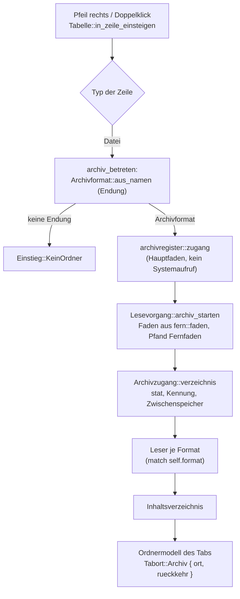

# Analysis: SQLite-Datenbanken im Dateifenster und in der Vorschau durchsehen

**Date:** 2026-10-23 13:24
**Type:** Feasibility (mit Impact und Optionen)
**Status:** Complete
**Requested by:** orchestrator, für das Arbeitspaket `261023-1305-sqlite-datenbanken-im-dateifenster-und-in-der-vorschau-durchsehen`

## Question

Lässt sich in KRK eine SQLite-Datei wie ein Ordner betreten (Pfeil rechts listet ihre Tabellen im Dateifenster, die Auswahl einer Tabelle zeigt deren Inhalt in der Vorschau), ohne die C-Freiheits-Zusage, die Regel `#![deny(unsafe_code)]`, den Hauptfaden und die Zusage „nur lesen“ zu verletzen? Welcher Zuschnitt fügt sich in den Bau, und was muss der Nutzer entscheiden, bevor geplant werden kann?

## Scope

Gelesen: `CLAUDE.md`, `.claude/rules/coding-was-man-nicht-sieht.md` (bis Zeile 43; der Rest deckt sich mit `CLAUDE.md`), der Entscheid und die Erzählung des Archivpakets `261017-1029-zip-und-gz-wie-ordner-im-dateifenster`, dazu der Code an `Ort`, `Tabort`, Archivzugang, Archivregister, Einstieg, Aufstieg, Lesevorgang, Zulässigkeit, Vorschaumodell, Trenntext und Trenntextvorschau, `verzeichnis/sys.rs`, `appkit/verbinden.rs` und die Probe zu den Ausnahmen von `deny(unsafe_code)`.

Gemessen: die Beispieldatei `/Users/k1/Projects/productive/wordlist/wordstore/wordstore.db`, ausschließlich lesend mit `sqlite3` über `file:…?mode=ro&immutable=1` und durch Lesen des Dateikopfs. Änderungszeit, Größe und Inode waren vor und nach jeder Messung gleich (`1791196776`, `19525632`, `227934355`); daneben ist keine Datei entstanden. Versuche, die schreiben oder einen fremden Leser brauchten, liefen an einer Kopie im Scratchpad der Sitzung, nie neben dem Original. Abhängigkeitsbäume fremder Kisten sind mit `cargo tree --target aarch64-apple-darwin -e normal,build` in Wegwerfprojekten im Scratchpad erhoben, nicht im Workspace.

Baum: `main`, HEAD `dc4ed474` vom 2026-10-23 12:58 +0200, `git status -sb` meldet `main...origin/main` ohne Vorsprung oder Rückstand; geändert sind allein `fusion-workbench/orchestrator-events.jsonl` und das unversionierte Paketverzeichnis. Jede Aussage im Präsens gilt für diesen Stand.

## Findings

### 1. Die Beispieldatei (gemessen)

| Angabe | Wert | Woher |
|---|---|---|
| Größe | 19.525.632 Bytes, 4.767 Seiten zu 4.096 Bytes | Dateikopf, Bytes 16–17 und 28–31 |
| Journalform | Rollback (`delete`), kein WAL | Kopf Bytes 18/19 = 1/1; `pragma journal_mode` |
| Kodierung | UTF-8 | Kopf Byte 56; `pragma encoding` |
| Tabellen | 12, **alle `STRICT`**, **6 davon `WITHOUT ROWID`** | `sqlite_schema` |
| Sichten (Views) | 4 (`category`, `sense_category`, `sense_category15`, `sense_de`) | `sqlite_schema` |
| Größte Tabellen | `sense`, `sense_text`, `term` je 51.600 Zeilen; `sense_example` 54.799 | `count(*)` |
| Spaltenzahl | 2 bis 11 je Tabelle, `sense_de` 14 | `pragma_table_info` |
| Weitere Objekte | 9 Indizes, 1 Trigger | `sqlite_schema` |
| Zeit `count(*)` / `limit 1000` | unter 10 ms je Tabelle, `sense_de` 90 ms (Join über vier Tabellen) | `/usr/bin/time -p`, Auflösung 10 ms |

Daraus folgen zwei Anforderungen an jeden Leser: er muss `WITHOUT ROWID`-Tabellen lesen können (das sind Index-B-Bäume, keine Tabellen-B-Bäume), und Sichten lassen sich nur mit einer SQL-Maschine zeigen, denn eine Sicht hat keine Seiten in der Datei, sondern nur ihren `SELECT`-Text.

### 2. Die Anbindung unter der C-Freiheits-Zusage

Die Zusage misst seit der Runde 23 das Bauziel: auf den Mac-Zielen darf weder `cc` noch ein Paket mit einem Namen auf `-sys` im Baum stehen (`CLAUDE.md`, Absatz über `syntect`, `two-face` und die übrigen Kisten; `Cargo.toml:93`, `:153`). Ein von Hand gebundenes System-Framework fällt nicht darunter; das ist der Präzedenzfall NetFS (`crates/krk-ui/src/appkit/verbinden.rs:230-231`, `#[link(name = "NetFS", kind = "framework")] unsafe extern "C"`).

**Wo `unsafe` erlaubt ist, entscheidet der Ort der Datei.** `#![allow(unsafe_code)]` steht genau zweimal, in `crates/krk-core/src/verzeichnis/sys.rs:166` und `crates/krk-ui/src/appkit/mod.rs`; die Probe `genau_zwei_dateien_oeffnen_die_regel_deny_unsafe_code` hält beide mit Namen (`crates/krk-core/tests/baum.rs:74-93`). Die Ausnahme in `appkit/mod.rs` ist ein inneres Attribut und gilt deshalb für jede Datei unter `appkit/`; so kommt `verbinden.rs` ohne eigene Zeile aus. Im Kern gilt sie allein im Modul `verzeichnis::sys`, dessen Kopf sagt: „Ein zweites Modul mit dieser Ausnahme entsteht nicht“ (`verzeichnis/sys.rs:4-8`). Das Inhaltsverzeichnis eines Archivs entsteht im Kern (`archiv/zugang.rs:153-193`), also müsste eine Datenbankbindung ebenfalls im Kern stehen; unter `appkit/` gehörte sie in die falsche Kiste.

#### Die Wege im Vergleich

| | (a) System-`libsqlite3` von Hand | (b1) fremde Kiste in reinem Rust | (b2) eigener Leser des Dateiformats | (c) Prozess `/usr/bin/sqlite3` |
|---|---|---|---|---|
| C-Freiheits-Zusage (Wortlaut) | hält: kein `cc`, kein `-sys`; `libsqlite3.tbd` liegt im SDK (gemessen) | `graphitesql`: hält, keine Abhängigkeit (gemessen); `turso_core`: bricht, `cc` über `aegis` und `core-foundation-sys` über `chrono` (gemessen); `rusqlite`: bricht, `libsqlite3-sys` (gemessen) | hält | hält |
| `unsafe` | rund 15 Bindungen (`open_v2`, `prepare_v2`, `step`, `column_*`, `finalize`, `close_v2`, `errmsg`, `busy_timeout`, `interrupt`); im Kern nur in `verzeichnis/sys.rs` oder in einer dritten Ausnahmedatei | keines | keines | keines |
| Sichten | ja | `graphitesql`: ja, aber `sense_category` 4 s und `sense_de` nach 10 min CPU abgebrochen, wo `sqlite3` 90 ms braucht (gemessen, Release-Bau) | nein, allein der SQL-Text | ja |
| WAL, Sperren gegen einen gleichzeitigen Schreiber | ja, über die POSIX-Sperren und den WAL-Index von SQLite selbst | `graphitesql` sperrt mit `std::fs::File::lock`, also `flock` über die ganze Datei (`std_file.rs`, Kopf von `CpLock`); SQLite sperrt mit `fcntl`-Bereichen, beide sehen einander nicht (aus dem Quelltext, nicht gemessen) | eigene Arbeit: WAL-Rahmen lesen, heißes Journal erkennen; Sperren lassen sich ohne `fcntl` und damit ohne `unsafe` nicht nehmen | wie (a) |
| Werte | typisiert | typisiert | typisiert | Text über die Ausgabe; `-json` zerstört BLOBs (gemessen: `x'00ff10'` kommt als ungültiges UTF-8), tragfähig ist `.mode quote` mit SQL-Literalen |
| Abbruch | `sqlite3_interrupt` | Abbruch zwischen zwei Zeilen | Abbruch zwischen zwei Seiten | Prozess beenden |
| Kosten je Anfrage | Mikrosekunden | Millisekunden für Tabellen | Millisekunden | ein Prozessstart, unter 10 ms (gemessen, `time -p`) |
| Reife | SQLite des Systems, 3.43.2 auf diesem Gerät | `graphitesql` 0.1.7, seit 2026-06-19, ein Anbieter, 110.000 Zeilen, Lizenz „blessing“; Bauzeit 54 s im Release-Profil (gemessen) | neu zu schreiben, Größenordnung 1.500 bis 2.000 Zeilen samt Proben (geschätzt) | wie (a) |
| Bindet an | die C-Schnittstelle von SQLite, seit Jahren stabil | eine junge Kiste | das Dateiformat, dokumentiert und stabil | die Ausgabeform des Kommandozeilenprogramms, keine zugesicherte Schnittstelle |

Weitere Kisten aus der Suche (`sqlite-rs` 0.3.7, zuletzt 2024-01; `sqlite_wasm_reader` 0.3.1 mit `sqlparser` und `syn`; `sqlite-core` 0.12.0, „spike prototype“ mit 30 Paketen samt Kryptografie; `prsqlite` 0.1.0 ohne Lizenzangabe) scheiden an Reife, Lizenz oder Umfang aus; geprüft haben wir sie allein an den Metadaten von crates.io und am Abhängigkeitsbaum.

Einen Weg (d) über Foundation oder Core Data gibt es nicht: Foundation bietet keine SQL-Schnittstelle, und Core Data liest nur eigene Schemata.

**Was jeder Weg vom Nutzer verlangt:**

- (a) eine Entscheidung über `unsafe`: entweder wächst `verzeichnis/sys.rs` von vierzehn auf rund dreißig gebundene Funktionen und wird damit von der „Systemschicht“ zur Systemschicht samt einer Systembibliothek, oder eine dritte Ausnahmedatei entsteht (etwa `krk-core/src/datenbank/sys.rs`), und die Probe in `baum.rs:85-92` bekommt einen dritten Namen. Dazu die Frage, ob die Zusage nach ihrem Wortlaut (kein `cc`, kein `-sys`) oder nach ihrem Sinn (kein fremder C-Code im Prozess) gilt. Der Präzedenzfall NetFS spricht für den Wortlaut.
- (b1) nichts zur Zusage, aber die Annahme einer jungen Kiste mit gemessen unbrauchbaren Sichten und einer Sperrweise, die einen gleichzeitigen Schreiber nicht sieht.
- (b2) den Verzicht auf Sichten und auf jede Sperrabsprache mit einem Schreiber.
- (c) die Annahme, dass KRK die Ausgabe eines Kommandozeilenprogramms deutet. Für `ssh` hat das Projekt genau das abgelehnt (`CLAUDE.md`, „KRK liest den Abfragetext von OpenSSH nie“); `.mode quote` ist allerdings SQL-Literalform und damit enger gefasst als ein Abfragetext.

### 3. Nur lesen: was die Engine tut (gemessen an Kopien)

| Versuch (an einer Kopie im Scratchpad) | Ergebnis |
|---|---|
| Rollback-Datenbank mit `-readonly` öffnen | liest, legt kein `-journal` an |
| WAL-Datenbank ohne `-wal`/`-shm` mit `-readonly` öffnen | **scheitert** mit `unable to open database file (14)`, legt nichts an; auch in einem schreibgeschützten Ordner |
| dieselbe mit `immutable=1` | liest, legt nichts an |
| WAL-Datenbank, während ein Schreiber eine Zeile übergeben, aber nicht zurückgeschrieben hat | `-readonly` sieht 4 Zeilen (richtig), `immutable=1` sieht 3 (veraltet) |

Daraus folgt eine Regel mit einem Fall, nicht eine Kette von Ausnahmen: geöffnet wird mit `SQLITE_OPEN_READONLY`. Scheitert das an einer WAL-Datenbank, neben der kein `-wal` steht, liegt der ganze Inhalt in der Hauptdatei, und `immutable=1` liest dasselbe; die `Dateikennung` vor und nach dem Lesen (`archiv/zugang.rs`, Abschnitt „Zwischenspeicher und Kennung“) fängt einen Schreiber, der in dieser Spanne anfängt. Ein Rollback-Schreiber mit gehaltener Sperre ergibt `SQLITE_BUSY` nach einer kurzen Wartezeit, und KRK meldet „wird gerade geschrieben“. Ein heißes Journal lässt eine nur lesende Verbindung nicht zurückrollen; SQLite meldet das als Fehler, statt halbe Seiten zu liefern (aus der SQLite-Dokumentation, hier nicht gemessen).

**Vermutet, nicht gemessen:** dass eine nur lesende Verbindung bei einem laufenden WAL-Schreiber in die vorhandene `-shm` ihre Lesemarke schreibt. Die Hauptdatei und `-wal` fasst sie nicht an. Wer „KRK verändert neben der Datenbank kein Byte“ wörtlich zusagen will, muss das an `-shm` noch messen.

Die Bibliothek des Systems ist mit `OMIT_LOAD_EXTENSION` gebaut (gemessen über `pragma compile_options` am Kommandozeilenprogramm; dass die Bibliothek dieselben Optionen trägt, ist vermutet). Eine Datenbank kann damit keine Erweiterung nachladen. Tabellennamen gehen als Bezeichner mit verdoppeltem `"` in die Abfrage, nie als SQL-Text aus der Datei; Trigger feuern nur bei Schreibzugriffen, die eine nur lesende Verbindung nicht ausführt.

### 4. Das Dateifenster: eine Datenbank als Ort

#### Wie der Einstieg in ein Archiv gebaut ist

Fundstellen: `appkit/tabelle.rs:3199-3263` (Einstieg und `archiv_betreten`), `archivregister.rs` (Register ohne Systemaufruf, schwach gemerkt), `verzeichnis/leser.rs:341-366` (`archiv_starten`), `archiv/zugang.rs:153-193` (Verzeichnis mit Pfand), `fern/faden.rs:66-75` (das Pfand entsteht allein in `fern::faden`), `ort.rs:40-47` und `tabs.rs:107-125` (die drei Fälle). Der Aufstieg steht in `appkit/tabelle.rs:3462-3473`: an der Wurzel geht Pfeil links in den Ordner der Archivdatei, und die Auswahl steht dort auf ihr.

**Alles davon trägt für eine Datenbank.** Die Endungsfrage stellt keinen Systemaufruf, das Pfand hält jeden Zugriff vom Hauptfaden fern, das Register teilt einen Zugang zwischen zwei Tabs, `rueckkehr` gibt Pfeil links und der Sitzung ihren Ordner, FSEvents beobachtet den Ordner der Datei, und der Fenstertitel schreibt `/pfad/wordstore.db:/sense` (`ort.rs:200-207`).

#### Zwei Zuschnitte

**D1: SQLite als fünftes `Archivformat`, allein lesbar.** `Archivformat::Sqlite` mit `beschreibbar() == false` wie `Gz` (`archiv/format.rs:63-70`). Das Inhaltsverzeichnis führt Tabellen und Sichten als Dateieinträge an der Wurzel; Unterordner gibt es nicht. Der `Archivleser` liefert für eine Tabelle Bytes, nämlich die Zeilen als TSV, kodiert über `trenntext::feld_kodieren` (`trenntext/feld.rs:95`).

Die Zulässigkeit stimmt damit ohne neue Regel: `ort_passt` (`kommandos/zulaessigkeit.rs:569-581`) graut für `Ortsart::Archiv { beschreibbar: false }` genau die elf Befehle mit lokalem Pfad und die fünf schreibenden aus (`zulaessigkeit.rs:3076-3108`, die Probe `im_archiv_sind_genau_diese_befehle_ausgegraut`). Kopieren, Navigation und Markierung bleiben zulässig.

Fallunterscheidungen ohne Auffangzweig, die der neue Wert trifft (vom Übersetzer genannt):

| Stelle | Was dort zu entscheiden ist |
|---|---|
| `archiv/format.rs:64` `beschreibbar` | `false` |
| `archiv/zugang.rs:178` `match self.format` | der Datenbankleser des Inhaltsverzeichnisses |
| `archiv/lesen.rs:354` `liest_strom` | `false` (wahlfrei) |
| `archiv/umbau.rs:557` `Schreibform::zu` | `None`, wie `Gz` |
| `tabs.rs:2538` `archivformatname` | `"sqlite"` |
| `archiv/verzeichnis.rs` `Fundstelle` | ein Fall für die Tabelle (Name oder Wurzelseite) |
| `vorschaumodell.rs:1794` `Leseart` | eine Tabelle wird als `Leseart::Trenntext(Tsv)` aufbereitet, gewählt am Format und nicht an der Endung |

`Archivformat::aus_namen` (`format.rs:43-56`) ist eine `if`-Kette und hält den Bau nicht an; dort entscheidet die Endungsfrage aus Abschnitt 7.

**Was D1 verbiegt:** Meldungen sprechen von einem Archiv. `Text::ImArchivNichtVerfuegbar` lautet „Das geht in einem Archiv nicht.“ (`sprache/tabelle/de.rs:1160`), `Text::ArchivNurLesbar` „dieses Archiv ist allein lesbar“ (`de.rs:188`). `nicht_verfuegbar_text` (`ort.rs:117-123`) und die Melder des Archivwegs müssen am Format verzweigen und für eine Datenbank eigene Texte wählen. Das Herauskopieren wird ein Export (Abschnitt 7, Frage F3). Der Zwischenspeicher fragt allein die Kennung der Hauptdatei; eine WAL-Datenbank ändert beim Schreiben zuerst `-wal`, also muss die Kennung für dieses Format beide Dateien umfassen, sonst bleibt die Tabellenliste veraltet.

**D2: ein vierter Fall `Ort::Datenbank`.** Sauberer im Namen, aber der Übersetzer nennt jede Fallunterscheidung über `Ort`, `Ortsart` und `Tabort` neu. Gezählt mit `grep` (Proben eingeschlossen): `Tabort::Archiv` 29 Stellen in `tabs.rs` und `appkit/tabelle.rs`; `Ort::Archiv` 47 Stellen in elf Dateien, darunter `auffrischung.rs` (18), `operation/fern.rs` (5), `fenstertitel.rs` (3); `Ortsart::Archiv` in `zulaessigkeit.rs` (11) und `kontextmenue.rs` (4). Dazu ein eigener Lesevorgang, ein eigenes Register, eine eigene Vorschau- und Kopierbahn. Das ist im Kern derselbe Bau wie das Archivpaket noch einmal.

**Wir empfehlen D1.** Es nutzt die eine vorhandene Abstraktion „eine lokale Datei, die das Dateifenster als Baum betritt und die ein Arbeitsfaden mit Pfand liest“, statt sie zu verdoppeln. Der Preis sind formatabhängige Texte an wenigen Meldern und die Kennung über zwei Dateien; beides bleibt an einer Stelle je Frage.

#### Was eine Zeile „Tabelle“ zeigt

`Eintrag` (`verzeichnis/eintrag.rs:29-60`) trägt Name, Größe, Änderungszeit und Typ; die Spalten sind `Name`, `Groesse`, `Geaendert`, `Typ` und die Markenspalte (`spalten.rs:68-93`). Die Spalte „Typ“ zeigt in KRK die **Endung**, nicht die Art des Eintrags (Nutzerentscheid vom 260806, `spalten.rs:84-92`). Eine Tabelle `sense` hat keine Endung, also bleibt die Spalte leer. Ob ein Eintrag Tabelle oder Sicht ist, gehört deshalb in die Kopfzeile der Vorschau. Die Änderungszeit ist die der Datei, denn SQLite führt keine Zeit je Tabelle. Für die Größe gibt es drei Antworten (Frage F5). `Eintrag` darf dafür nicht wachsen: an seiner Schmalheit hängt L10.

### 5. Die Vorschau

**Der CSV-Weg ist wiederverwendbar, und zwar ohne Umbau, wenn die Tabelle als TSV-Bytes ankommt.** `archiveintrag_laden` (`vorschaumodell.rs:1991-2051`) liest den Anfang eines Archiveintrags bis zur Grenze der Leseart, auf einem Faden aus `fern::faden`, und reicht ihn für `Leseart::Trenntext` an `trenntext_aus_bytes` und `trenntextvorschau::aufbereiten` (`trenntextvorschau.rs:96-106`). Die Aufbereitung zerlegt über den einen Leser `trenntext::indexieren`; der Kern bleibt damit ohne zweiten Zerleger. Aus einer Datenbank entsteht TSV mit den Spaltennamen als erster Zeile.

Zwei Anpassungen bleiben: die Kopfzeile (`trenntextvorschau.rs`, `kopfzeile`) nennt Trennzeichen und Spaltenbuchstaben, für eine Tabelle sollen dort „Tabelle“ oder „Sicht“, die Spaltennamen und die Zahl der gezeigten Zeilen stehen. Und die Leseart wird am Format gewählt, weil `Leseart::von` am Namen entscheidet und ein Tabellenname keine Endung trägt.

**Wie viel gezeigt wird.** Die CSV-Vorschau begrenzt in Bytes, nicht in Zeilen: `TEXTGRENZE` = 1 MiB (`vorschaumodell.rs:258`), gekürzt am letzten vollständigen Satz, höchstens `HOECHSTENS_SPALTEN` = 256 Spalten (`trenntext/mod.rs`, gemessen und begründet an der Konstanten). Für eine Datenbank heißt das: der Leser schreitet Zeile für Zeile und hört auf, sobald die TSV-Bytes die Grenze überschreiten; der Rückruf im Leser bricht mit `ControlFlow::Break` ab (`vorschaumodell.rs:2009-2020`). Bei `sense` (11 Spalten) sind das einige tausend Zeilen. Eine volle Abtastung der Tabelle findet nicht statt; eine Sicht mit `GROUP BY` oder `ORDER BY` kann trotzdem vor der ersten Zeile rechnen müssen, und dafür braucht der Abbruch `sqlite3_interrupt` (Weg a) oder das Beenden des Prozesses (Weg c).

**Große Zellen und BLOBs.** Ein BLOB erscheint nie als Bytes, sondern als Platzhalter mit seiner Länge (etwa „BLOB, 2.048 Bytes“); ein Text wird vor dem Kodieren auf eine feste Zeichenzahl gekürzt, sonst sprengt eine einzelne Zelle von 10 MB die Grenze. Die Anzeige kürzt danach ohnehin auf `HOECHSTBREITE` = 40 Zeichen je Spalte (`trenntextvorschau.rs:44`). `NULL` braucht eine sichtbare Form, die sich vom leeren Text unterscheidet.

**Die Gesamtzahl der Zeilen** kostet `count(*)`, also eine Abtastung in linearer Zeit. Wir empfehlen, im ersten Schritt nur „n Zeilen gezeigt, weitere folgen“ zu melden und die Gesamtzahl später nachzuliefern, wie die Bildfolge ihre Gruppen nachliefert (`CLAUDE.md`, „Eine Bildfolge liefert ihre Gruppen nach“).

### 6. Die zehn Zeitzusagen

Alle zehn stehen seit dem 261017 auf den Gegenständen der späteren Messrunde (`CLAUDE.md`, `## Maximen`). Der Zuschnitt D1 berührt keinen gemessenen Weg, solange drei Bedingungen gelten:

| Zusage | Berührt? | Bedingung |
|---|---|---|
| L1, L9 (Tastendruck bis Zeichendurchgang) | nein | der Einstieg fragt auf dem Hauptfaden allein die Endung; gehalten von der Rumpfprobe `der_archiveinstieg_stellt_auf_dem_hauptfaden_keinen_systemaufruf` (`tabelle.rs`, ab 7385) |
| L2, L3, L6, L10 (lokales Lesen) | nein | `Lesevorgang::starten` und `Eintrag` bleiben unverändert |
| L7 (Vorschau lokal) | nein | `laden` für lokale Dateien bleibt unverändert; eine `.db` im lokalen Ordner zeigt weiter ihre Metadaten |
| L4 (Start) | nein | keine neue Ablagedatei |
| L5, L8 | nein | — |

Ob ein Abnahmelauf geschuldet ist, entscheidet der Nutzer (Frage F6); die Pakete zu sftp und Zip haben jeweils Möglichkeit 2 gewählt, also verzichtet.

### 7. Risikoregister

| Risiko | Wahrscheinlichkeit | Wirkung | Gegenmittel |
|---|---|---|---|
| Ein anderes Programm schreibt gleichzeitig (Rollback) | mittel | Lesen scheitert mit `BUSY` | kurze Wartezeit, dann Meldung; mit Weg (a)/(c) nie halbe Seiten |
| WAL-Datenbank ohne Schreiber lässt sich nur lesend nicht öffnen | hoch (gemessen) | ohne Gegenmittel ist jede ruhende WAL-Datenbank unlesbar | die eine Regel aus Abschnitt 3: `immutable=1`, wenn kein `-wal` daneben steht, mit Kennung vor und nach |
| Lesemarke in `-shm` bei laufendem WAL-Schreiber | mittel (vermutet) | „kein Byte neben der Datei“ wäre nicht wörtlich wahr | an einer Kopie messen, bevor die Zusage so formuliert wird |
| Veraltete Tabellenliste einer WAL-Datenbank | hoch, wenn nur die Hauptdatei gekennzeichnet wird | neue Tabelle erscheint nicht | Kennung über Hauptdatei und `-wal` |
| Auffrischungssturm bei einer ständig geschriebenen Datenbank (etwa Verlauf eines Browsers) | mittel | Tab liest im Takt der FSEvents neu | der Neubau des Verzeichnisses kostet mit (a) Millisekunden; sonst drosseln |
| Langsame Sicht | mittel | Vorschau wartet | Abbruch über `sqlite3_interrupt` beim Auswahlwechsel |
| `.db`-Datei, die keine SQLite-Datei ist | mittel | Pfeil rechts meldet „keine Datenbank“, wo vorher nichts geschah | Frage F2 |
| Defekte oder böswillige Datei im Prozess (Weg a) | niedrig | Absturz von KRK | SQLite ist breit gefuzzt; Weg (c) isoliert im Kindprozess |
| Bindung an die Ausgabeform von `sqlite3` (Weg c) | niedrig bis mittel | Deutung bricht nach einem Systemupdate | `.mode quote`, `-init /dev/null` gegen `~/.sqliterc`, Proben gegen das Programm des Systems |

### 8. Lokalisierung und Abnahme

Neue Schlüssel in `Text` (je ein Eintrag in `de.rs`, `fr.rs`, `en.rs`; der Übersetzer hält die Vollständigkeit): „keine SQLite-Datenbank“, „wird gerade geschrieben“, „nicht lesbar: <Grund>“, „in einer Datenbank nicht verfügbar“, „Datenbank ist allein lesbar“, die Kopfzeile für Tabelle und Sicht samt gekürzter Form, der BLOB-Platzhalter, die Anzeige für `NULL`, dazu `Zahlwort` für Zeilen. Geschätzt acht bis zwölf Schlüssel. Ein Format mit Wortlaut aus der Datei (Spaltennamen, Werte) wird nicht übersetzt.

Nutzerarbeit am Bündel, die kein Agent fahren kann: Betreten mit Pfeil rechts und Doppelklick, Pfeil links zurück auf die Datei; Blättern durch die Tabellen von `wordstore.db` mit Sichtprüfung der Vorschau; eine WAL-Datenbank eines laufenden Programms; dieselbe während eines Schreibvorgangs; eine große Datenbank (über 1 GB) mit Auswahlwechsel mitten im Lesen; die drei Sprachen der Meldungen.

## Implications

Das Vorhaben ist machbar, und sein größter Teil ist schon gebaut: Einstieg, Register, Pfand, Rückkehr, Zulässigkeit und die Tabellenansicht der Vorschau stammen aus dem Archiv- und dem CSV-Paket. Neu sind ein Leser, der Tabellen als Verzeichnis und als TSV liefert, die Formatverzweigung an rund sieben Stellen und eine Handvoll Texte. Aufwand insgesamt: **medium**, mit Weg (b2) **large**.

Die eigentliche Frage ist keine technische, sondern eine der Grundsätze: ob KRK für diese Funktion eine C-Bibliothek des Systems in den Prozess holt (Weg a), ein Programm des Systems startet (Weg c) oder auf Sichten und Sperrabsprache verzichtet (Weg b2). Bevor das beantwortet ist, lässt sich kein Plan schreiben, denn davon hängt ab, wo die Bindung steht, wie abgebrochen wird und was „nur lesen“ zusagt.

## Recommendations

**Empfohlener Zuschnitt**, vorbehaltlich F1:

1. **Zuerst:** Weg (a), System-`libsqlite3` von Hand gebunden in `krk-core/src/verzeichnis/sys.rs`, geöffnet mit `SQLITE_OPEN_READONLY` und der einen WAL-Regel; Zuschnitt D1 als `Archivformat::Sqlite`, allein lesbar. Tabellen und Sichten im Dateifenster, Vorschau über den CSV-Weg mit eigener Kopfzeile, BLOB als Platzhalter, Abbruch über `sqlite3_interrupt`. Kopieren aus der Datenbank ausgegraut (F3, Möglichkeit 1).
2. **Später:** Gesamtzahl der Zeilen nachgeliefert; Größe je Tabelle über `dbstat` (in der Bibliothek des Systems vorhanden, gemessen 30 ms für die Beispieldatei, linear in der Dateigröße); Export einer Tabelle als TSV oder CSV; eine Zusammenfassung der `.db`-Datei in der Vorschau, ohne sie zu betreten; Datenbanken in einem Archiv oder auf einem Server.

Weiter an: **implementation-planner**, sobald F1 bis F3 beantwortet sind. Eine Messung an `-shm` (Abschnitt 3) kann der code-implementer im ersten Planschritt fahren.

## Filed Issues

Keine. Der Auftrag beschränkt die Arbeit auf diesen Bericht; die offenen Fragen stehen unten und gehören als Entscheidungsdatensätze in das Paket, sobald der Orchestrator sie vorlegt.

## Sources

- `CLAUDE.md`; `.claude/rules/coding-was-man-nicht-sieht.md:1-43`
- `261017-1036-wird-ein-archiv-ein-dritter-fall-von-ort-und-schreibt-krk-hinein-ueber-einen-umbau-des-ganzen-archivs.md` (Entscheid im Paket `261017-1029-zip-und-gz-wie-ordner-im-dateifenster`); Erzählung desselben Pakets
- `crates/krk-core/src/ort.rs:1-207`; `crates/krk-ui/src/tabs.rs:107-146`, `:2517-2546`
- `crates/krk-core/src/archiv/mod.rs`, `format.rs:1-70`, `zugang.rs:1-227`, `lesen.rs:340-356`, `umbau.rs:545-560`, `verzeichnis.rs:128-187`
- `crates/krk-ui/src/archivregister.rs:1-80`
- `crates/krk-ui/src/appkit/tabelle.rs:3185-3420`, `:3455-3475`
- `crates/krk-core/src/verzeichnis/leser.rs:331-366`; `crates/krk-core/src/fern/faden.rs:66-86`
- `crates/krk-core/src/tasten/belegung.rs:792-815`, `:2053-2090`; `crates/krk-ui/src/kommandos/zulaessigkeit.rs:569-581`, `:3076-3125`
- `crates/krk-ui/src/vorschaumodell.rs:1-140`, `:258`, `:300-375`, `:395-520`, `:800-840`, `:1794`, `:1885-1910`, `:1991-2051`
- `crates/krk-core/src/trenntext/mod.rs:1-150`; `crates/krk-ui/src/trenntextvorschau.rs:1-220`
- `crates/krk-core/src/verzeichnis/eintrag.rs:16-60`; `crates/krk-ui/src/spalten.rs:68-93`
- `crates/krk-core/src/verzeichnis/sys.rs:1-60`, `:166`; `crates/krk-core/src/lib.rs:60-80`; `crates/krk-core/tests/baum.rs:65-93`; `crates/krk-ui/src/appkit/verbinden.rs:230-231`
- `crates/krk-core/src/sprache/tabelle/de.rs:188`, `:1160`; `crates/krk-bench/src/messen.rs:1240-1356`; `Cargo.toml` (Zusage, Zeilen 93, 153)
- crates.io: Metadaten und `cargo tree` von `turso_core` 0.9.0-pre.1, `graphitesql` 0.1.7, `sqlite-core` 0.12.0, `sqlite_wasm_reader` 0.3.1, `sqlite-rs` 0.3.7, `prsqlite` 0.1.0, `rusqlite` 0.37; Quelltext von `graphitesql` 0.1.7 (`README.md`, `src/vfs/std_file.rs`, `src/exec/mod.rs:770-835`)
- Messungen an `wordstore.db` (nur lesend) und an Kopien im Scratchpad; `sqlite3` 3.43.2 unter `/usr/bin`; `libsqlite3.tbd` und `sqlite3.h` im SDK von Xcode

## Open Questions

- [ ] **F1 Anbindung.** (a) System-`libsqlite3` von Hand, Bindungen in `verzeichnis/sys.rs`. Folge: keine neue Ausnahmedatei, die Probe bleibt; das Modul verdoppelt seine Bindungen, sein Kopf und `lib.rs` sprechen danach nicht mehr allein von Systemaufrufen; fremder C-Code läuft im Prozess. (a′) dieselbe Bindung in einer dritten Ausnahmedatei. Folge: die Probe in `baum.rs` und der Satz „ein zweites Modul entsteht nicht“ werden geändert; die Systemschicht bleibt rein. (c) Prozess `/usr/bin/sqlite3`. Folge: kein `unsafe`, Absturz isoliert, aber KRK deutet eine Ausgabeform ohne Zusage, braucht SQL-seitige BLOB-Behandlung und startet je Auswahl einen Prozess. (b2) eigener Leser. Folge: kein `unsafe`, keine Sichten, keine Sperrabsprache mit einem Schreiber, Aufwand large. Empfehlung: (a).
- [ ] **F2 Welche Dateien gelten als Datenbank?** Allein `.sqlite`, `.sqlite3`, `.db3`: Folge, eine `.db` bleibt, was sie ist. Dazu `.db` direkt: Folge, eine `.db`, die keine SQLite-Datei ist, meldet beim Pfeil rechts „keine Datenbank“. Oder `.db` erst nach Prüfung der ersten 16 Bytes auf einem Arbeitsfaden (der ausstehende Einstieg wie bei Verknüpfungen, `tabelle.rs:3284-3295`): Folge, ein zweiter Weg im Einstieg und eine kurze Verzögerung.
- [ ] **F3 Kopieren aus einer Datenbank.** Ausgrauen: Folge, eine neue Unterscheidung in `Ortsart` oder `Ortsbedarf`, weil ein allein lesbares Archiv das Kopieren heute zulässt. Oder als Export: Folge, eine Tabelle wird beim Kopieren eine TSV-Datei, deren Name eine Endung bekommen muss, die der Eintrag nicht trägt.
- [ ] **F4 Sichten.** Zeigen (mit Abbruch, gemessen bis 90 ms an `sense_de`) oder nur listen und ihren SQL-Text zeigen. Folge der zweiten Wahl: unabhängig vom Weg; bei (b2) ist sie die einzige.
- [ ] **F5 Spalte „Größe“ einer Tabelle.** Leer: keine Kosten. Bytes über `dbstat`: Folge, beim Betreten wird die ganze Datei einmal gelesen (30 ms hier, bei 10 GB Sekunden). Zeilenzahl: Folge, eine Abtastung je Tabelle und eine Zahl in einer Spalte, die sonst Bytes zeigt.
- [ ] **F6 Abnahmelauf gegen L1 bis L10.** Geschuldet oder, wie bei sftp und Zip, mit Verzicht (Möglichkeit 2), solange die Rumpfprobe des Einstiegs grün bleibt.
- [ ] **F7 Bestätigung:** Doppelklick betritt wie bei Archiven, `return` bleibt „Mit dem Standardprogramm öffnen“ (Archivpaket, Antwort „1: nicht in krk“).
