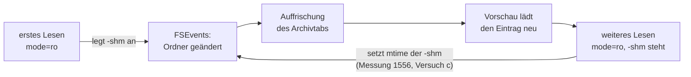

# Analyse: `-shm` neben einem `-wal` ohne `-shm` — Zusage korrigieren oder Anlegen verhindern?

**Date:** 2026-10-24 21:33
**Type:** Comparative (mit Messung)
**Status:** Complete
**Requested by:** orchestrator (Issue `261024-2112-mode-ro-legt-neben-einer-wal-datenbank-mit-wal-und-ohne-shm-eine-neue-shm-an.md`)

## Question

Liegt neben einer WAL-Datenbank ein `-wal`, aber kein `-shm`, legt die nur lesende Verbindung (`mode=ro`) eine neue `-shm` an. Der Modulkopf von `crates/krk-core/src/archiv/sqlite.rs` (`# Nur lesen`) und `HowTo.md` (Abschnitt „Was beim Lesen an der Datei geschieht“) sagen das Gegenteil zu. Soll die Zusage korrigiert werden, oder soll KRK das Anlegen verhindern? Wenn verhindern: auf welchem Weg, und was kostet das?

## Scope

- Gelesen: Issue 2112 und 2113, Entscheid `261023-1605-darf-krk-eine-lesemarke-in-die-shm-setzen-waehrend-ein-anderes-programm-schreibt.md` (Nutzer: Möglichkeit 1), `messungen/261023-1556-sqlite-nur-lesend-shm.txt`, `archiv/sqlite.rs` (Modulkopf, `oeffnen`, `nur_lesend_oeffnen`, `ruhende_wal_datenbank_ohne_wal`), `verzeichnis/sys.rs` (`Datenbank::oeffnen`, `sqlite_uri`), `HowTo.md` Z. 599–611.
- Gemessen am 261024 zwischen 21:20 und 21:33 auf diesem Gerät (Darwin 24.6.0) mit `/usr/lib/libsqlite3.dylib`, sourceid `2023-10-10 13:08:14 1b37c146…aapl` (3.43.2), über einen Wegwerf-Leser in C (`sqlite3_open_v2(uri, SQLITE_OPEN_READONLY | SQLITE_OPEN_URI)`, optional eine Pragma-Anweisung vor dem ersten Lesen, dann `select count(*), max(x) from t`). Jede Datenbank in einem eigenen Ordner unter dem Scratchpad. `wordstore.db` ist nicht berührt.
- Häufigkeit: eine Namenserhebung über `~/Library`, `~/Projects`, `~/Documents` und `~/Downloads`, die allein `stat` an `-wal` und `-shm` fragt und keine Datenbank öffnet. Ausgewertet sind die ersten 639 gefundenen `-wal`; danach wurde der Lauf abgebrochen. Das Ergebnis ist also eine Untergrenze.
- Baum: `main`, HEAD `efea977c` (2026-10-24 21:16), `git status -sb`: `main...origin/main [voraus 13]`. Zum Ende dieses Laufs standen nicht eingetragene Änderungen in `archiv/sqlite.rs`, `verzeichnis/sys.rs` und weiteren Dateien unter `crates/krk-core/`. Sie stammen nicht von diesem Bericht, offenbar arbeitet ein anderer Lauf parallel. Die Zeilenangaben unten beziehen sich auf den Stand beim Lesen. Geändert hat dieser Bericht nur sich selbst.

## Findings

### 1. Der Befund ist bestätigt, an der dylib

Vorlage: WAL-Datenbank mit drei Zeilen in der Hauptdatei und einer vierten, die allein im `-wal` steht (Schreiber mit `wal_autocheckpoint=0`, dann `kill -9`, danach `-shm` entfernt). Ordner vorher `x.db x.db-wal`.

| | Ergebnis |
|---|---|
| `?mode=ro` | liest **4** Zeilen. Ordner danach `x.db x.db-shm x.db-wal`, neue `-shm` mit 32768 Bytes. Hauptdatei und `-wal` nach Prüfsumme unverändert. |
| `?mode=ro`, leeres `-wal` (0 Bytes) | liest 3 Zeilen, **legt `-shm` ebenso an**. |

Der Issue-Befund gilt also auch für den Weg, den KRK bindet (die dylib), und nicht nur für das statisch gebaute `/usr/bin/sqlite3`. Ein leeres `-wal` genügt.

### 2. Der Fall ist häufig, und der Grund ist ein anderer als im Issue angenommen

Das Issue nennt als Ursachen die Kopie einer laufenden Datenbank und den Absturz des letzten Schreibers. Gemessen ist eine dritte Quelle, und die ist die häufigste: **Programme, die SQLite im Sperrmodus `EXCLUSIVE` betreiben.** Ein solcher Schreiber legt nach der SQLite-Dokumentation nie eine `-shm` an (Zitat unten). Gemessen mit `/usr/bin/sqlite3` und `pragma locking_mode=exclusive`: während er läuft, steht `x.db x.db-wal`, und nach seinem sauberen Ende steht dasselbe noch da.

Namenserhebung (Untergrenze, 639 `-wal` ausgewertet, der Lauf wurde danach abgebrochen): **46 `-wal` ohne `-shm` daneben**, also gut jedes vierzehnte. Darunter:

- alle sechs Firefox-Profildateien (`places.sqlite`, `cookies.sqlite`, `favicons.sqlite`, `webappsstore.sqlite`, `content-prefs.sqlite`, `tabnotes.sqlite`), je mit leerem `-wal`, dazu sieben IndexedDB-Dateien unter `storage/permanent/chrome/idb/`;
- **der Kopie-Fall, synchronisiert:** zwei Fotos-Mediatheken unter `Library/Mobile Documents/Dropbox/…/Fotos-Mediathek.photoslibrary` und `…/Fotos Library.photoslibrary`, mit zusammen zehn Datenbanken (`Library.apdb`, `Person.db`, `metaSchema.db` u. a.) mit `-wal` und ohne `-shm`;
- Dropbox (`DIPS`, `SharedStorage`, in sieben Partitionen; `DIPS-wal` bis 4 MB) und Docker Desktop (`SharedStorage`), also Electron- bzw. Chromium-Speicher;
- Safari (`ContentBlockerStatistics.db`, `BlockedBannerHighlights.db`), CallHistory (`CallHistory.storedata.backup`), sechs `ChunkStoreDatabase` von CloudKit bzw. `mstreamd`.

Bei den Fotos-Mediatheken würde Möglichkeit 1 die neuen `-shm` in einen synchronisierten Ordner schreiben. Dropbox bzw. iCloud würden sie dann auf andere Geräte verteilen (**Inferenz**).

Dass Firefox und Chromium im Sperrmodus `EXCLUSIVE` arbeiten, ist **Inferenz**: das Bild passt (kein `-shm`, beständiges `-wal`), geöffnet wurde aber keine dieser Dateien. Der Befund selbst, nämlich `-wal` ohne `-shm`, ist gemessen.

Für den Nutzer heißt das: wer mit KRK in `~/Library/Application Support/Firefox/Profiles/…` eine Datenbank betritt, solange Firefox geschlossen ist, findet danach neben jeder betretenen Datei eine neue `-shm`, die dort bleibt. Läuft Firefox, kommt heute „database is locked“ (Versuch X unten) und es entsteht nichts.

### 3. Die Kandidaten, je gemessen

Jeder Kandidat lief in einem frischen Ordner auf einer Kopie der Vorlage aus 1. „Datei neu“ heißt: neben der Datenbank steht danach eine Datei, die vorher nicht da war.

| # | Weg | Ergebnis | Datei neu | Zeilen |
|---|---|---|---|---|
| A | `mode=ro` (heute) | liest | **`-shm`** | 4, richtig |
| B | `mode=ro&immutable=1` | liest | keine | **3, die Zeile im `-wal` fehlt** |
| C | `mode=ro&readonly_shm=1` | `SQLITE_CANTOPEN` (14) | keine | — |
| D | `mode=ro&nolock=1` | `SQLITE_CANTOPEN` (14) | keine | — |
| E | `nolock=1` + `pragma locking_mode=exclusive` | `SQLITE_CANTOPEN` (14) | keine | — |
| F | `mode=ro` + `pragma locking_mode=exclusive` | `SQLITE_IOERR_LOCK` (3850) | keine | — |
| G | `mode=ro`, Ordner `chmod 555` | `SQLITE_CANTOPEN` (14) | keine | — |
| H | `mode=ro&vfs=unix-none` | liest | **`-shm`** | 4 |
| **I** | **`mode=ro&vfs=unix-none` + `pragma locking_mode=exclusive`** | **liest** | **keine** | **4, richtig** |
| I′ | wie I, Ordner `chmod 555` | liest | keine | 4 |
| I″ | wie I, leeres `-wal` | liest | keine | 3, richtig |
| J | `readonly_shm=1` + `exclusive` | `SQLITE_IOERR_LOCK` (3850) | keine | — |
| K | `mode=ro&vfs=unix-excl` | liest | **`-shm`** | 4 |
| K′ | `unix-excl` + `exclusive` | `SQLITE_IOERR_LOCK` (3850) | keine | — |

Wie die Ergebnisse zu lesen sind:

- **C (`readonly_shm`)** hilft nur, wenn eine `-shm` schon steht. Fehlt sie, gibt es nichts zu öffnen, und SQLite scheitert. Das deckt sich mit der Dokumentation: ein WAL-Lesen ohne Schreibrecht geht, wenn `-shm` und `-wal` schon da sind, wenn sie angelegt werden können, oder mit `immutable` (Zitat 1). G belegt dasselbe für einen schreibgeschützten Ordner.
- **D/E (`nolock=1`)** scheitert auch mit `exclusive`. **Inferenz** aus dem Quelltext von SQLite: `sqlite3PagerWalSupported` lehnt WAL bei `noLock` grundsätzlich ab.
- **F, J, K′:** Der Sperrmodus `exclusive` verlangt beim ersten WAL-Lesen eine Schreibsperre auf die Hauptdatei. An einem nur lesend geöffneten Deskriptor verweigert `fcntl` die (`SQLITE_IOERR_LOCK`). Das ist **Inferenz**; der Fehlercode ist gemessen.
- **I** ist der einzige gemessene Weg, der die Zeile im `-wal` liest und nichts anlegt. Er funktioniert, weil `unix-none` jede Sperre als gelungen meldet und `exclusive` den WAL-Index in den Speicher des Prozesses legt statt in eine `-shm` (Zitat 2). Er liest auch aus einem schreibgeschützten Ordner (I′), wo heute A und G scheitern.
- **B** legt nichts an, liest aber falsch. Das ist genau die Folge, die der Nutzer im Entscheid 1605 abgelehnt hat („veraltete Daten“).

### 4. Was passiert, wenn ein Schreiber dazukommt

Versuch 3 (a): erst lesen, dann schreibt ein normaler Schreiber Zeile 5, dann wird neu gelesen. Versuch 3 (b): Die Leseverbindung bleibt offen; währenddessen schreibt der Schreiber Zeile 5 und fährt `wal_checkpoint(TRUNCATE)`; dann zählt dieselbe Verbindung noch einmal. Versuch X: ein Schreiber im Sperrmodus `exclusive` läuft, der Leser kommt dazu.

| Weg | (a) neue Verbindung nach dem Schreiber | (b) offene Verbindung über Schreiben und Checkpoint | X: Schreiber im Modus `exclusive` läuft |
|---|---|---|---|
| A `mode=ro` | 5, richtig | 4 → **5**: der neue Stand wird gesehen. Der Checkpoint läuft, ohne zu warten (`0\|0\|0`). | `SQLITE_BUSY` „database is locked“, **keine Datei neu** |
| B `immutable` | 5 (dann steht `-shm`, und die Regel wählt `mode=ro`) | 3 → 3, veraltet | nicht gemessen (die heutige Regel wählt B hier nie, weil `-wal` steht) |
| I `unix-none`+`exclusive` | 5, richtig | 4 → **4**: veraltet, aber in sich stimmig. Kein Fehler. | **liest 4, nach einem weiteren Commit des Schreibers 5, keine Datei neu**: liest hinter der Sperre des anderen Programms |

Aus (b) und X für Weg I folgt:

- Weg I nimmt keine Sperre. Ein Schreiber, der **während** einer KRK-Anweisung einen Checkpoint fährt, kann Seiten überschreiben, die KRK gerade liest. Dann sind falsche Zeilen oder ein `SQLITE_CORRUPT` in KRKs Anzeige möglich (Zitat 3 für `immutable`, Zitat 4 für `unix-none`). Gemessen ist das nicht: (b) hat zwischen zwei Anweisungen geschrieben, und KRK zeigte dort nur den alten Stand. **Inferenz**, aber aus der Dokumentation zwingend.
- **An der Datenbank selbst kann Weg I nichts beschädigen.** Die Verbindung ist nur lesend, der Deskriptor `O_RDONLY`, und eine `-shm` gibt es nicht. Die Warnungen der Dokumentation vor Beschädigung betreffen Verbindungen, die schreiben. Auch das ist Inferenz; gemessen ist, dass Hauptdatei und `-wal` in jedem Lauf byte-gleich blieben.
- **Weg I kann die Sperre eines Programms im Modus `exclusive` vorher erkennen, ohne etwas zu sperren.** Gemessen mit einem zweiten Wegwerfprogramm, das allein `fcntl(F_GETLK)` auf den Sperrbereich von SQLite fragt (ab `0x40000000`, 512 Bytes). Ohne Schreiber antwortet es „frei“. Bei laufendem Schreiber im Modus `exclusive` antwortet es „gesperrt: schreib, pid=…, start=0x40000002 len=510“. Nach dessen Ende wieder „frei“. Ein ruhender normaler WAL-Schreiber zeigt „frei“, aber den bedient KRK ohnehin über `mode=ro`, weil neben ihm eine `-shm` steht. Mit dieser Vorfrage bleibt Weg I bei „die Datenbank wird gerade geschrieben“, wie heute mit A. Zwischen Frage und Öffnen bleibt ein Wettlauf. Er ist von derselben Art wie bei der heutigen Rückfallstufe `immutable=1`, die ebenfalls nicht sperrt.

### 5. Berührung mit dem Schleifen-Issue 2113

Das Anlegen einer `-shm` ist ein neuer Eintrag im Ordner der Datenbank, und genau diesen Ordner beobachtet der Archivtab (Issue 2113, Glied 2). Kette bei A, als **Inferenz** aus den Gliedern von 2113:



- **Möglichkeit 1 (Zusage korrigieren):** Das erste Lesen stößt die Schleife aus 2113 an, und von da an ist der Fall gleich dem mit stehender `-shm`. Neu ist das nicht, es ist dieselbe Schleife. Was 2113 beschließt, behebt sie auch hier.
- **Möglichkeit 2 (Weg I) und 3 (Meldung):** KRK fasst in diesem Fall keine Datei an, also löst KRK selbst keine Meldung aus. Für den Fall mit stehender `-shm` bleibt 2113 unverändert offen. Weg I für **alle** WAL-Datenbanken zu nehmen, um 2113 zu erledigen, ist keine Lösung: neben einem laufenden normalen Schreiber verlöre KRK dessen Sperren und den konsistenten Schnappschuss (3 (b) bei A gegen I). Das widerspräche dem Entscheid 1605.

### Zitate aus der SQLite-Dokumentation

1. `wal.html`, Abschnitt 5: „a WAL-mode database on read-only media, or a WAL-mode database that lacks write permission, can still be read as long as one or more of the following conditions are met: 1. The -shm and -wal files already exist and are readable. 2. There is write permission on the directory containing the database so that the -shm and -wal files can be created. 3. The database connection is opened using the immutable query parameter.“
2. `wal.html`, Abschnitt 8: „If EXCLUSIVE locking mode is set prior to the first WAL-mode database access, then SQLite never attempts to call any of the shared-memory methods and hence no shared-memory wal-index is ever created.“ Ebendort: „a process can interact with a WAL database without using shared memory if that process is guaranteed to be the only process accessing the database.“
3. `uri.html`, `immutable`: „it skips all file locking and change detection … If this query parameter … asserts that a database file is immutable and that file changes anyhow, then SQLite might return incorrect query results and/or SQLITE_CORRUPT errors.“
4. `vfs.html`, 3.1: „unix-none – all file locking operations are no-ops.“ und „The "unix-none" VFS in particular does no locking at all and will easily result in database corruption if used by two or more database connections at the same time.“
5. `uri.html`, `nolock`: „If two or more database connections try to interact with the same SQLite database and one or more of those connections has enabled "nolock", then database corruption can result.“
6. `wal.html`, Abschnitt 4: „if the last process to have the database open exits without cleanly shutting down the database connection, or if the SQLITE_FCNTL_PERSIST_WAL file control is used, then the WAL file might be retained on disk“.

## Implications

Die Zusage „KRK legt neben der Datenbank keine Datei an“ ist heute falsch, und zwar gerade für den häufigsten Fall: die Datenbanken von Firefox, Electron und einigen Apple-Diensten im eigenen `~/Library`. Ein Randfall ist das nicht. Ein Weg, der nichts anlegt und trotzdem den neuesten Stand liest, existiert (Weg I). Er erkauft das mit einer dritten Öffnungsart, die keine Sperre nimmt. Das trifft die Richtigkeit der Anzeige, nicht die der Datenbank.

## Die Möglichkeiten

**Möglichkeit 1 — Zusage korrigieren, `mode=ro` bleibt.**
- Daten: richtig, auch die Zeilen im `-wal`.
- Dateien: neben jeder so betretenen Datenbank entsteht eine `-shm` und bleibt stehen (bei Firefox sechs Stück im Profilordner). Dass sie einem Programm im Modus `exclusive` nicht schadet, ist **Inferenz** aus Zitat 2: dieses Programm fragt die `-shm` nie.
- Ein schreibgeschützter Ordner mit `-wal` ohne `-shm` bleibt eine Fehlermeldung (G). Ein laufendes Programm im Modus `exclusive` gibt weiter „wird gerade geschrieben“.
- Wortlaut (Modulkopf, `HowTo.md`, Entscheid 1605): „KRK verändert weder die Datenbank noch ihr `-wal`. Steht neben einer WAL-Datenbank ein `-wal` ohne `-shm`, legt SQLite beim Lesen eine `-shm` an; steht eine `-shm`, setzt es darin eine Lesemarke.“
- 2113: das erste Lesen stößt die Schleife an. Die Lösung von 2113 deckt den Fall mit.
- Aufwand: trivial (Prosa an drei Stellen und eine Probe, die die neue `-shm` erwartet).

**Möglichkeit 2 — Anlegen verhindern: WAL-Kopf, `-wal` steht, `-shm` fehlt → `vfs=unix-none` mit `locking_mode=exclusive`, nach einer Vorfrage mit `F_GETLK`.**
- Daten: richtig zum Zeitpunkt des Öffnens (I, I″). Ein Schreiber, der **während** einer KRK-Anweisung einen Checkpoint fährt, kann dort falsche Zeilen oder einen Lesefehler erzeugen (Inferenz, Zitate 3/4). Die Datenbank selbst bleibt unberührt.
- Dateien: keine (gemessen, auch im schreibgeschützten Ordner).
- Die Vorfrage `F_GETLK` erkennt ein laufendes Programm im Modus `exclusive` (gemessen) und meldet dann „wird gerade geschrieben“ wie heute. Ohne sie läse KRK hinter dessen Sperre (X).
- Gewinn nebenbei: der schreibgeschützte Ordner (I′), heute eine Fehlermeldung, wird lesbar.
- Wortlaut: die heutige Zusage bleibt wahr. Der Modulkopf nennt einen dritten Fall der Öffnungsregel. Die Regel wird mit der Wahl vor dem Öffnen (`-shm` da oder nicht) zu „drei Fälle, keine Kette“ statt „ein Fall“.
- 2113: in diesem Fall nicht betroffen. Für den Fall mit `-shm` bleibt 2113 offen.
- Aufwand: klein bis mittel. `sqlite_uri` bekommt eine dritte Form (`&vfs=unix-none`), `nur_lesend_oeffnen` das Pragma vor `SCHEMAPROBE`, `sys.rs` eine Sperrfrage über die schon vorhandene variadische `fcntl`-Deklaration (neue Konstante `F_GETLK` und `struct flock`, innerhalb der erlaubten `unsafe`-Datei). Dazu Proben für I, I′, I″ und für die Vorfrage.

**Möglichkeit 3 — Nicht betreten: in diesem Fall eine Meldung statt Lesen.**
- Daten: keine. Die Datenbanken von Firefox, Dropbox, Docker, Safari u. a. lassen sich mit KRK dann gar nicht durchsehen, auch nicht bei geschlossenem Programm.
- Dateien: keine.
- Wortlaut: die Zusage bleibt. `HowTo.md` nennt den Fall und den Handgriff (das Programm einmal öffnen und schließen hilft bei Programmen im Modus `exclusive` nicht, siehe Messung).
- 2113: nicht betroffen.
- Aufwand: klein (eine Vorfrage per `stat`, ein Text in drei Sprachtabellen, eine Probe).

`immutable=1` in diesem Fall steht nicht zur Wahl. Es liest gemessen falsch (3 statt 4 Zeilen), und genau diese Folge hat der Nutzer im Entscheid 1605 abgelehnt.

## Recommendation

**Möglichkeit 2.** Sie ist der einzige Weg, der beides hält, was der Nutzer bisher entschieden und zugesagt hat: den neuesten Stand (Entscheid 1605) und keine neue Datei (Zusage in Modulkopf und `HowTo.md`). Dazu macht sie einen heute scheiternden Fall lesbar. Der Preis ist umrissen: Nur ein Schreiber, der mitten in einer laufenden KRK-Anweisung einen Checkpoint fährt, kann eine falsche Anzeige erzeugen. Die Vorfrage `F_GETLK` hält die laufenden Programme im Modus `exclusive` heraus, und die Datenbank selbst kann nicht leiden. Die heutige Rückfallstufe `immutable=1` trägt bereits dasselbe Risiko ohne Sperre.

Möglichkeit 1 ist die richtige Wahl, wenn dem Nutzer eine schlanke Öffnungsregel mehr wert ist als die Zusage. Dann sollte er wissen, dass „neben einer Datenbank im eigenen `~/Library`“ der Normalfall ist und kein Randfall.

## Filed Issues

Keine. Der Befund steht schon in Issue 2112. Die Häufigkeit und die Nebenwirkung auf Programme im Modus `exclusive` gehören in die Entscheidung und nicht in einen eigenen Datensatz.

## Open Questions

- [ ] **Nutzerfrage (mit einer Nummer zu beantworten):** Neben vielen Datenbanken in `~/Library` (Firefox, Dropbox, Docker, Safari) liegt ein `-wal` ohne `-shm`. Liest KRK eine davon, legt es heute eine `-shm` an, obwohl es zusagt, nichts anzulegen. Was soll gelten?
  1. Die Zusage wird korrigiert. KRK darf in diesem Fall eine `-shm` anlegen und zeigt den neuesten Stand.
  2. KRK legt nichts an. In diesem Fall liest es ohne Sperre mit dem Index im Speicher (`unix-none` + `exclusive`) und zeigt den neuesten Stand; hält ein anderes Programm die Datenbank gesperrt, meldet es das. Schreibt ein anderes Programm genau während des Lesens, kann die Anzeige einmal falsch sein. *(Empfehlung)*
  3. KRK legt nichts an und betritt solche Datenbanken nicht, sondern meldet den Grund.
- [ ] Die Namenserhebung wurde nach 639 `-wal` abgebrochen. Die Zahl 46 ist eine Untergrenze.
- [ ] Bei Möglichkeit 2 ist ein Checkpoint während einer laufenden Anweisung nicht gemessen. Messbar wäre er mit einer großen Tabelle, die langsam gelesen wird, und einem Schreiber, der in der Zwischenzeit einen Checkpoint fährt. Das gehört in die Proben des Umsetzungsschritts.

## Sources

- `crates/krk-core/src/archiv/sqlite.rs`: Modulkopf Z. 35–84, `oeffnen` Z. 189–202, `nur_lesend_oeffnen` Z. 206–215, `ruhende_wal_datenbank_ohne_wal` Z. 221–227, `WARTEZEIT` Z. 156 (200 ms).
- `crates/krk-core/src/verzeichnis/sys.rs`: `SQLITE_CANTOPEN` Z. 1604–1606, `Datenbank::oeffnen` Z. 1806–1850, `sqlite_uri` Z. 2139–2177.
- `HowTo.md` Z. 599–611.
- `messungen/261023-1556-sqlite-nur-lesend-shm.txt` (Versuche b–d).
- Issues `261024-2112-…`, `261024-2113-…`; Entscheid `261023-1605-…`.
- sqlite.org: `wal.html` (Abschnitte 4, 5, 8), `uri.html` (`immutable`, `nolock`, `vfs`), `vfs.html` (3.1), abgerufen am 261024.

## Anhang: Messprotokoll (gekürzt, roh)

Skripte und Leser lagen unter `<scratchpad>/shm2/` (`werkzeug/leser.c`, `werkzeug/sperre.c`, `messen1.sh`, `messen2.sh`). Das Scratchpad ist flüchtig, deshalb stehen die Ausgaben hier.

```
Vorlage: x.db x.db-wal   -wal=4152 Bytes      (Hauptdatei 6ed19015…, -wal 2eaa97fb…)
A  ?mode=ro                               zeilen=4  nachher: x.db x.db-shm x.db-wal  (x.db, -wal Pruefsumme gleich)
B  ?mode=ro&immutable=1                   zeilen=3  nachher: x.db x.db-wal
C  ?mode=ro&readonly_shm=1                prepare: 14 unable to open database file
D  ?mode=ro&nolock=1                      prepare: 14 unable to open database file
E  nolock=1 + locking_mode=exclusive      prepare: 14 unable to open database file
F  mode=ro + locking_mode=exclusive       prepare: 3850 disk I/O error
G  mode=ro, Ordner 555                    prepare: 14 unable to open database file
H  ?mode=ro&vfs=unix-none                 zeilen=4  nachher: x.db x.db-shm x.db-wal
I  vfs=unix-none + locking_mode=exclusive zeilen=4  nachher: x.db x.db-wal
I' wie I, Ordner 555                      zeilen=4  nachher: x.db x.db-wal
I" wie I, leeres -wal                     zeilen=3  nachher: x.db x.db-wal
   A mit leerem -wal                      zeilen=3  nachher: x.db x.db-shm x.db-wal
J  readonly_shm=1 + exclusive             prepare: 3850 disk I/O error
K  ?mode=ro&vfs=unix-excl                 zeilen=4  nachher: x.db x.db-shm x.db-wal
K' unix-excl + exclusive                  prepare: 3850 disk I/O error

Schreiber kommt (3a) / Schreiber + checkpoint(TRUNCATE) bei offener Leseverbindung (3b):
A  3a: 4 -> 5        3b: 4 -> 5   Schreiber: 0|0|0
B  3a: 3 -> 5        3b: 3 -> 3
I  3a: 4 -> 5        3b: 4 -> 4   (kein Fehler)

X  Schreiber locking_mode=exclusive laeuft, Ordner: x.db x.db-wal
A  prepare: 5 database is locked (beide Male), keine Datei neu; nach Ende des Schreibers: x.db x.db-wal
I  zeilen=4, nach weiterem Commit zeilen=5, keine Datei neu

F_GETLK auf 0x40000000+512, Typ F_RDLCK:
ohne Schreiber: frei
Schreiber exklusiv: gesperrt: typ=schreib pid=63255 start=0x40000002 len=510
nach Ende: frei; Ordner: x.db x.db-wal
Schreiber normal (offen, ruhend): frei
```
