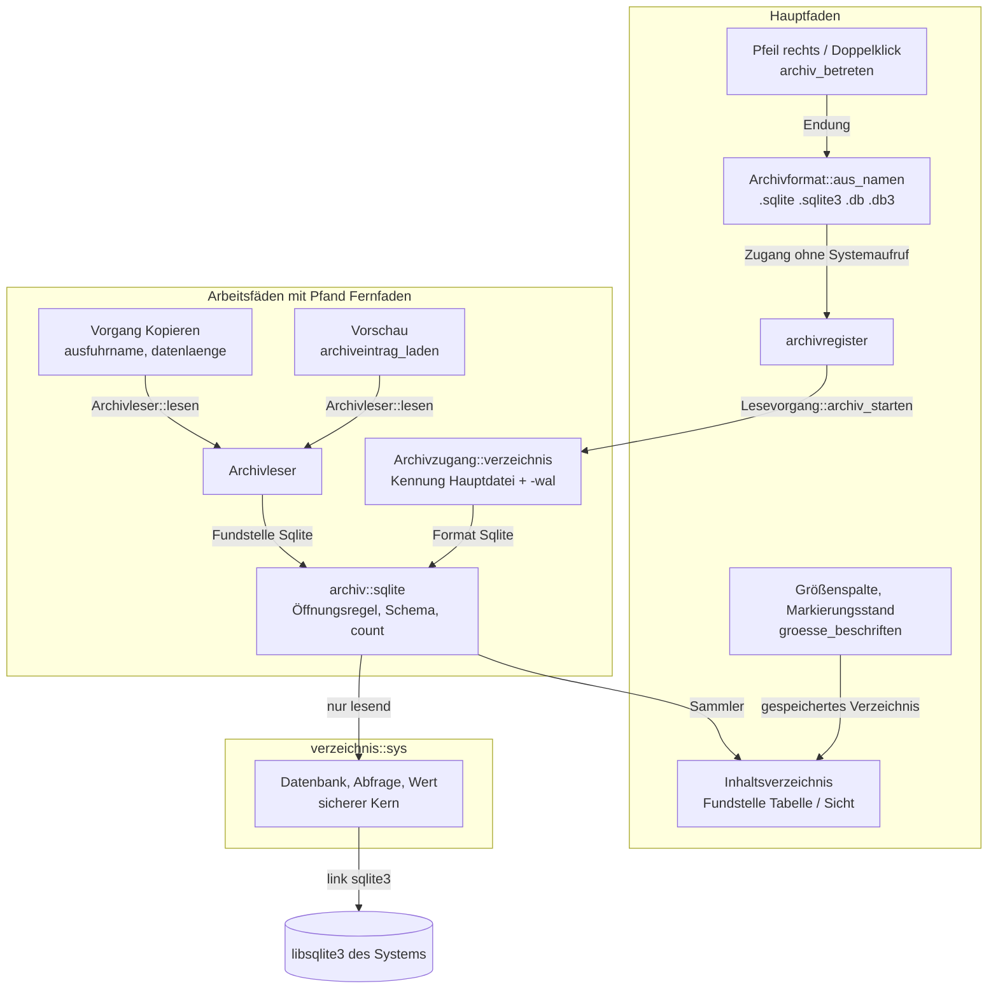
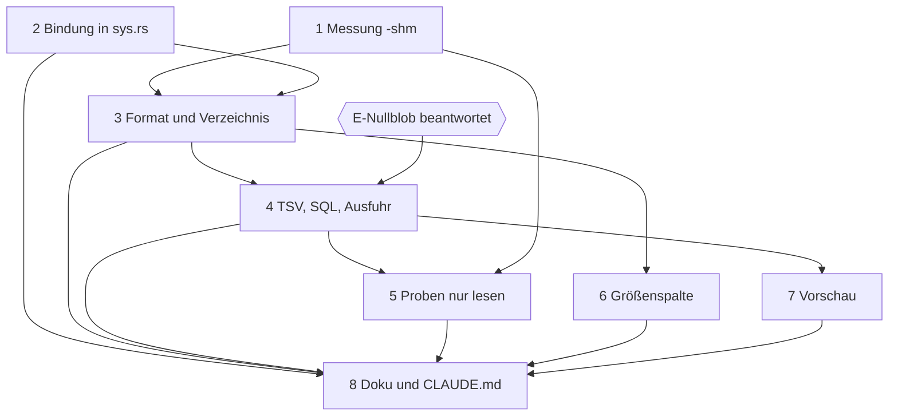
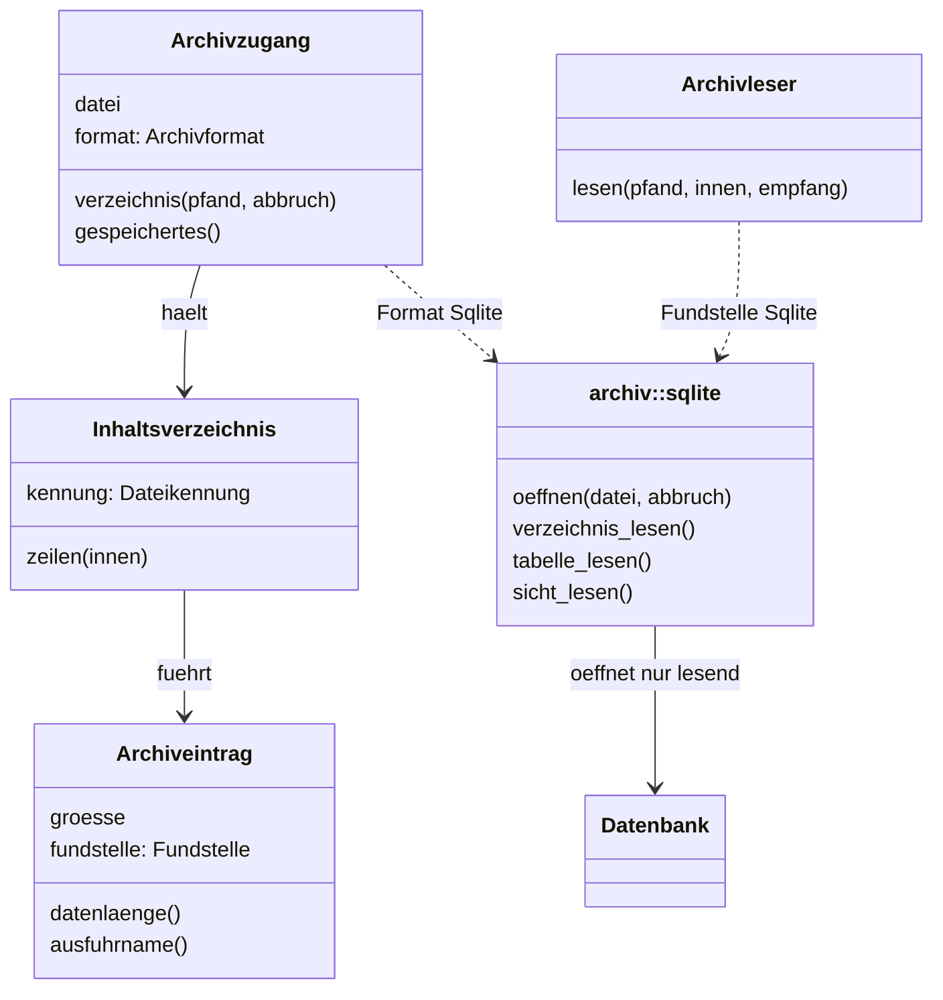

# Implementation Plan: SQLite-Datenbanken im Dateifenster betreten und ihre Tabellen in der Vorschau durchsehen

**Date:** 2026-10-23
**Spec:** keiner; geplant nach dem Auftrag (Narrativ `261023-1305-sqlite-datenbanken-im-dateifenster-und-in-der-vorschau-durchsehen.md` mit dem Wortlaut des Nutzers), dem Analysebericht `261023-1324-sqlite-datenbanken-durchsehen-machbarkeit-und-zuschnitt.md` und den sieben beantworteten Entscheiden des Pakets: `261023-1340-wie-bindet-krk-sqlite-an-ohne-die-c-freiheits-zusage-zu-brechen.md` (E-Bindung), `261023-1340-welche-dateien-gelten-als-sqlite-datenbank.md` (E-Endungen), `261023-1340-was-tut-kopieren-aus-einer-sqlite-datenbank.md` (E-Ausfuhr), `261023-1340-zeigt-krk-sichten-einer-sqlite-datenbank-oder-nur-ihren-sql-text.md` (E-Sichten), `261023-1340-was-zeigt-die-spalte-groesse-einer-tabelle.md` (E-Groesse), `261023-1340-schuldet-das-sqlite-paket-einen-abnahmelauf-gegen-die-zehn-zusagen.md` (E-Abnahme), `261023-1340-betritt-der-doppelklick-eine-sqlite-datenbank-und-oeffnet-return-sie-weiter-extern.md` (E-Doppelklick). Dazu der offene Entscheid dieses Plans, `261023-1507-wie-stehen-null-und-blob-in-der-tsv-einer-sqlite-tabelle.md` (E-Nullblob).
**Decidability:** Die tragende Frage lautet: „Ist das, was KRK aus einer SQLite-Datei zeigt und ausführt, ein Stand dieser Datei, gelesen ohne dass KRK an Hauptdatei oder `-wal` ein Byte schreibt?“ Sie ist entscheidbar, aber nicht an der Stelle, an der sie gestellt wird. **Die Endung entscheidet allein, ob der Einstieg versucht wird** (E-Endungen, Möglichkeit 2), und das ist am Namen auf dem Hauptfaden entscheidbar; ob die Datei eine Datenbank ist, kann der Name nicht sagen, und das beantwortet SQLite selbst auf dem Arbeitsfaden mit `SQLITE_NOTADB`. **Ob der Inhalt ein Stand ist**, entscheidet SQLite über seine eigenen Sperren, solange die Verbindung mit `SQLITE_OPEN_READONLY` geöffnet ist; im einen Fall, in dem nur `immutable=1` liest (WAL-Kopf und kein `-wal`, gemessen im Bericht, Abschnitt 3), ersetzt eine am Dateisystem entscheidbare Frage die Sperre, nämlich die Kennung von Hauptdatei und `-wal` vor und nach dem Lesen. **Ob KRK neben der Datei nichts schreibt**, ist für `-shm` aus keinem Quelltext und keiner Dokumentation sicher vorherzusagen; der Plan sagt es deshalb nicht voraus, sondern misst es in Schritt 1, und die Zusage im Modulkopf folgt der Messung. Die vierte Frage, „erreicht ein Zugriff auf die Datenbank den Hauptfaden?“, ist durch den Bau entschieden: jede gebundene Funktion ist allein über das Pfand `Fernfaden` erreichbar, weil jeder Rufer im Archivweg es schon verlangt.

## Directive

Pfeil rechts und Doppelklick auf eine SQLite-Datei betreten sie wie einen Ordner, das Dateifenster listet ihre Tabellen und Sichten, und die Auswahl einer Tabelle zeigt deren Inhalt in der Vorschau. Erreicht ist das Paket, wenn ein Nutzer so durch die Tabellen einer Datenbank wie `wordstore.db` blättern kann, ohne KRK zu verlassen. Die Directive steht im Narrativ und wird hier nicht wiederholt; die Antworten des Nutzers auf F1 bis F7 binden diesen Plan wörtlich („F1:1, F2: alle direkt, F3:TSV, F4:sql listen, F5:zeilenzahl, F6:ich checke selbst, F7:ja“).

## Current State

Gelesen am Stand `dc4ed474` (2026-10-23 12:58).

Der Archivweg des Pakets `261017-1029-zip-und-gz-wie-ordner-im-dateifenster` trägt fast alles, was eine Datenbank im Dateifenster braucht. `Archivformat::aus_namen` (`crates/krk-core/src/archiv/format.rs`) entscheidet am Namen, ohne Systemaufruf; `archiv_betreten` (`crates/krk-ui/src/appkit/tabelle.rs`) holt den Zugang aus `archivregister` und startet `Lesevorgang::archiv_starten` auf einem Faden aus `fern::faden`. `Archivzugang::verzeichnis` (`archiv/zugang.rs`) prüft die `Dateikennung` (Gerät, Inode, Größe, Änderungszeit), hält das `Inhaltsverzeichnis` im Zwischenspeicher und verzweigt über `match self.format` in den Leser je Format. `Archivleser::lesen` (`archiv/lesen.rs`) reicht die Daten eines Eintrags blockweise an einen Rückruf, der mit `ControlFlow::Break` abbricht; die Vorschau (`archiveintrag_laden` in `crates/krk-ui/src/vorschaumodell.rs`) und die Vorgangsmaschine (`operation/fern.rs`, `operation/archiv.rs`) lesen beide darüber. `Ortsart::Archiv { beschreibbar }` folgt aus `Archivformat::beschreibbar`, und `ort_passt` graut für ein nicht beschreibbares Archiv genau die schreibenden Befehle aus, während Kopieren zulässig bleibt.

Der CSV-Weg trägt die Darstellung. `trenntext::feld_kodieren` (`crates/krk-core/src/trenntext/feld.rs`) ist die eine Kodierregel, `trenntextvorschau::aufbereiten` (`crates/krk-ui/src/trenntextvorschau.rs`) richtet TSV-Text mit Kopfzeile aus, und `trenntext_aus_bytes` kürzt an `TEXTGRENZE` am letzten vollständigen Satz.

`crates/krk-core/src/verzeichnis/sys.rs` ist die eine Datei im Kern mit `#![allow(unsafe_code)]` und bindet zehn Schnittstellen in vierzehn Funktionen; dieselbe Zählung steht wortgleich in `crates/krk-core/src/lib.rs` und `crates/krk-core/src/verzeichnis/mod.rs`. Gehalten wird die Ausnahme von `genau_zwei_dateien_oeffnen_die_regel_deny_unsafe_code` (`crates/krk-core/tests/baum.rs`). Den Präzedenzfall einer von Hand gebundenen C-Schnittstelle mit `#[link]` geben FSEvents (`appkit/fsevents.rs`) und NetFS (`appkit/verbinden.rs`).

Die Stellen, die die C-Freiheits-Zusage mit der Wendung „Namen auf `-sys`“ führen, sind heute (erhoben mit dem Lauf aus `CLAUDE.md`): `CLAUDE.md`, `Cargo.toml` (mehrere Kommentare), `README.md`, `crates/krk-core/src/verzeichnis/sys.rs`, `crates/krk-ui/src/appkit/verbinden.rs`.

## Approach

**Eine Datenbank ist ein fünftes `Archivformat`, allein lesbar (Zuschnitt D1 des Berichts).** Der Plan verdoppelt keinen Teil des Archivwegs: Einstieg, Register, Pfand, Rückkehr, Auffrischung über den Ordner der Datei, Zulässigkeit und Fenstertitel bleiben, wie sie sind, und antworten für `Archivformat::Sqlite` aus denselben Regeln. Neu sind drei Dinge, und jedes steht an genau einer Stelle:

- **die Bindung**, ein sicherer Kern um `libsqlite3` in `verzeichnis/sys.rs` (E-Bindung, Möglichkeit 1), mit `#[link(name = "sqlite3")]` nach dem Muster von NetFS und ohne Kiste;
- **der Leser des Formats**, eine neue Datei `crates/krk-core/src/archiv/sqlite.rs`, die das Inhaltsverzeichnis aus `sqlite_master` baut und eine Tabelle als TSV, eine Sicht als ihren SQL-Text liefert, beides über `Archivleser::lesen`, also für Vorschau und Ausfuhr über denselben Weg;
- **die Öffnungsregel**, eine Funktion in `archiv/sqlite.rs`, die jeder Zugriff nimmt.

**Die Öffnungsregel hat einen Fall und keine Kette.** Geöffnet wird über eine URI `file:<pfad>?mode=ro` mit `SQLITE_OPEN_READONLY | SQLITE_OPEN_URI`. Scheitert das Öffnen oder das erste Lesen des Schemas mit `SQLITE_CANTOPEN`, trägt der Dateikopf in den Bytes 18 und 19 die WAL-Kennung (je `2`) und steht kein `<datei>-wal` daneben, wird dieselbe URI mit `&immutable=1` geöffnet; in jedem anderen Fall geht der Fehler an den Rufer. Die drei Bedingungen sind gemessen (Bericht, Abschnitt 3) und bilden zusammen eine Fallunterscheidung ohne Überlappung: entweder liest `mode=ro`, oder genau dieser eine Fall liest unveränderlich, oder es gibt eine Meldung. Den Schreiber, der zwischen der Frage nach `-wal` und dem Lesen beginnt, fängt die Kennung, die für dieses Format Hauptdatei und `-wal` umfasst.

**Die Spalte „Größe“ zeigt für eine Tabelle die Zeilenzahl (E-Groesse), und der Plan trennt dafür zwei Bedeutungen, die bisher eine waren.** `Archiveintrag::groesse` bleibt die Zahl der Größenspalte, also in einer Datenbank die Zeilen einer Tabelle; was die Vorgangsmaschine als Bytes braucht (Fortschritt, die ZIP64-Wahl beim Umbau), fragt sie künftig über `Archiveintrag::datenlaenge() -> Option<u64>`, das für Zip, tar und gz `Some(groesse)` und für Tabelle und Sicht `None` antwortet, weil die Länge der TSV vor der Ausfuhr nicht feststeht. `zipform::grosse_form_waehlen` nimmt schon heute `Option<u64>` und wählt bei `None` die ZIP64-Form. Eine Sicht zeigt `--` wie ein Ordner, denn sie wird nicht ausgeführt (E-Sichten) und hat keine Zeilenzahl.

**Kopieren führt aus (E-Ausfuhr).** Der Name am Ziel entsteht an einer Stelle, `Archiveintrag::ausfuhrname`: für eine Tabelle `<name>.tsv`, für eine Sicht `<name>.sql` (siehe `## Open Questions`), für jeden anderen Eintrag der Name, wie er steht. Die zwei Stellen, die heute den Zielnamen einer Archivquelle bilden (`Quelle::name` in `operation/fern.rs`, `archiveintrag_bauen` in `operation/archiv.rs`), rufen sie. Die Bytes sind dieselben, die die Vorschau zeigt, nur ungekürzt.

**Meldungen folgen dem Format, nicht dem Rufer.** `Text::ImArchivNichtVerfuegbar` und `Text::ArchivNurLesbar` sprechen von einem Archiv; welcher Text für welches Format gilt, beantworten zwei Funktionen an `Archivformat` ohne Auffangzweig, und `ort::nicht_verfuegbar_text` und jeder Melder von `ArchivNurLesbar` fragen sie.



Der Graph hat eine Richtung von oben nach unten: der Hauptfaden reicht allein Werte an die Arbeitsfäden, und nur `archiv::sqlite` spricht die Systemschicht an. Die einzige Kante vom Hauptfaden in ein Ergebnis der Arbeitsfäden ist das gespeicherte Verzeichnis, das `Archivzugang::gespeichertes` ohne Systemaufruf liefert.

## Entscheidungen dieses Plans

Die Entscheidungen hier binden allein diesen Plan; was darüber hinaus bindet, steht im Entscheid E-Nullblob.

- **P1. Ein Leser für Vorschau und Ausfuhr.** Die Daten einer Tabelle entstehen allein in `archiv::sqlite` und erreichen jeden Rufer über `Archivleser::lesen`. Ein zweiter Weg, etwa eine eigene Abfrage in der Vorschau, entsteht nicht.
- **P2. Die Form der TSV.** Erste Zeile die Spaltennamen, jede weitere eine Zeile der Tabelle in der Reihenfolge von `SELECT * FROM "<name>"` ohne `ORDER BY`; jedes Feld über `trenntext::feld_kodieren` mit dem Tabulator; Satzende `\n`. Ganzzahl und Kommazahl in der Textform, die SQLite für `sqlite3_column_text` liefert. Text, der kein UTF-8 ist, wird mit U+FFFD ersetzt. `NULL` und BLOB nach E-Nullblob (Empfehlung: leeres Feld und `x'…'`).
- **P3. Bezeichner.** Ein Tabellenname geht als Bezeichner in doppelten Anführungszeichen mit verdoppeltem `"` in die Abfrage und nie als Text aus der Datei; den SQL-Text einer Sicht liest eine Abfrage mit gebundenem Parameter (`sqlite3_bind_text`).
- **P4. Namen im Fenster.** Ein Tabellenname ist eine einzelne Komponente und kein Pfad. `Innenpfad::aus_einzelnamen` (neu, in `archiv/innenpfad.rs` neben der einen Namensregel) weist einen Namen mit `/` ab und reicht jeden anderen an `Innenpfad::aus_archivname`; was abgewiesen ist, zählt in `ausgelassen`. Ein eigener Namensweg an der Regel vorbei entsteht nicht.
- **P5. Was gelistet wird.** Jede Zeile von `sqlite_master` mit `type` gleich `table` oder `view`, auch die inneren Tabellen mit dem Vorsatz `sqlite_`. Indizes und Trigger nicht.
- **P6. Die Zeilenzahl.** `SELECT count(*) FROM "<name>"` je Tabelle beim Aufbau des Verzeichnisses (E-Groesse). Scheitert sie für eine Tabelle (etwa eine virtuelle Tabelle, deren Modul die Bibliothek nicht kennt), steht die Tabelle trotzdem da, mit unbekannter Zeilenzahl und `--` in der Spalte; der Fehler zeigt sich erst beim Lesen.
- **P7. Abbruch.** Ein Fortschrittsrückruf (`sqlite3_progress_handler`) fragt die Abbruchmarke des Rufers und bricht die laufende Anweisung ab; zwischen zwei Zeilen fragt der Leser sie selbst. `sqlite3_interrupt` von einem zweiten Faden wird nicht gebraucht, weil kein Griff die Datei eines Fadens verlässt.
- **P8. Sperre eines Schreibers.** `sqlite3_busy_timeout` mit einer kurzen festen Wartezeit (Konstante in `archiv/sqlite.rs`, Größenordnung 200 ms); danach `Verzeichnisfehler::Belegt` beziehungsweise der entsprechende Lesefehler, gemeldet als „wird gerade geschrieben“.
- **P9. Keine neue Kiste.** `Cargo.toml`, `crates/*/Cargo.toml` und `Cargo.lock` bleiben gegenüber `dc4ed474` unverändert.

## Implementation Steps

Gemeinsame Akzeptanz jedes Schritts, der Code ändert („Grundabnahme“):

- `make check` grün (Bau, Proben, Clippy, Formatierung, Dokumentation).
- `cargo tree --target aarch64-apple-darwin -e normal,build` und `cargo tree --target x86_64-apple-darwin -e normal,build` führen weder `cc` noch ein Paket mit einem Namen auf `-sys`.
- `git diff dc4ed474 -- Cargo.toml crates/*/Cargo.toml Cargo.lock` ist leer (P9).
- `grep -rn '^#!\[allow(unsafe_code)\]' crates xtask` nennt weiter allein `crates/krk-core/src/verzeichnis/sys.rs` und `crates/krk-ui/src/appkit/mod.rs`; `genau_zwei_dateien_oeffnen_die_regel_deny_unsafe_code` bleibt grün und unverändert.
- Jeder neue nutzersichtbare Text steht in `de.rs`, `fr.rs` und `en.rs` unter `crates/krk-core/src/sprache/tabelle/` und in der Liste `ALLE` seiner Aufzählung (`jede_alle_liste_fuehrt_genau_die_varianten_ihrer_aufzaehlung`); die zwei Nahtproben in `crates/krk-core/tests/baum.rs` bleiben grün.
- Jede neue Fallunterscheidung über `Archivformat`, `Fundstelle` oder `Verzeichnisfehler` steht ohne Auffangzweig.
- `der_archiveinstieg_stellt_auf_dem_hauptfaden_keinen_systemaufruf` und `ein_ordner_wird_weiter_ohne_den_dateizweig_betreten` (`crates/krk-ui/src/appkit/tabelle.rs`) bleiben grün und unverändert (E-Abnahme).
- Proben mit Datenbanken erzeugen ihre Dateien selbst, mit `/usr/bin/sqlite3` im Prüfordner der eigenen Kiste; keine Probe legt eine Datenbank als feste Datei in den Baum, und keine liest `wordstore.db`.
- Vorhandene Proben bleiben grün, ohne dass ihre Erwartungen geändert werden; eine Ausnahme nennt der Schritt ausdrücklich.

1. **Messen, was eine nur lesende Verbindung neben einer SQLite-Datei schreibt**
   - Executor: code-implementer
   - Files: neu `messungen/261023-<HHMM>-sqlite-nur-lesend-shm.txt` (Stempel beim Anlegen mit `date +%y%m%d-%H%M`)
   - Changes: Kein Code. Gemessen wird ausschließlich an Datenbanken, die das Skript selbst in einem frischen Ordner unter dem Scratchpad oder `$TMPDIR` anlegt, nie an `wordstore.db` und nie im Baum. Der Bericht trägt das Skript, die rohe Ausgabe und je Versuch eine Urteilszeile. Versuche: (a) `otool -L /usr/bin/sqlite3` und `sqlite3 --version`, damit belegt ist, dass das Kommandozeilenprogramm dieselbe `/usr/lib/libsqlite3.dylib` lädt, die Schritt 2 bindet; (b) WAL-Datenbank mit laufendem Schreiber, der mit `PRAGMA wal_autocheckpoint=0` eine Zeile übergeben hat und offen bleibt; ein Leser über `file:…?mode=ro` liest `count(*)`; vor und nach dem Leser je `shasum -a 256` und `stat -f '%i %z %m'` von Hauptdatei, `-wal` und `-shm`; (c) dieselbe Datenbank nach dem Ende des Schreibers, mit `-wal` und `-shm` daneben; (d) WAL-Datenbank ohne `-wal` und `-shm`: `mode=ro` scheitert, `immutable=1` liest, und es entsteht keine Datei daneben (Wiederholung des Berichts, Abschnitt 3); (e) Rollback-Datenbank mit `mode=ro`: es entsteht kein `-journal`; (f) ob das Schließen der nur lesenden Verbindung in (b) und (c) einen Checkpoint fährt oder `-wal` entfernt.
   - Akzeptanz: Der Bericht steht im Baum und schließt mit genau einer der zwei Zeilen `Urteil: -shm unverändert` oder `Urteil: -shm verändert`, dazu je eine Zeile für Hauptdatei und `-wal` (`unverändert`/`verändert`). Ändert der Leser die Hauptdatei oder `-wal`, endet der Plan hier (`## Where this work stops`). Ändert er allein `-shm`, ist das die Vorbedingung für eine Nutzerfrage vor Schritt 3 (`## Open Questions`).
   - Prüfkommando: `grep -E '^Urteil:' messungen/261023-*-sqlite-nur-lesend-shm.txt`
   - Freigabe: nein; schreibt nichts außerhalb des Berichts und eines Wegwerfordners.
   - Source: Bericht `261023-1324-sqlite-datenbanken-durchsehen-machbarkeit-und-zuschnitt.md`, Abschnitt 3 und `## Recommendations`.
   - Dependencies: none

2. **`libsqlite3` des Systems in `verzeichnis/sys.rs` binden, mit einem sicheren Kern**
   - Executor: code-implementer
   - Files: `crates/krk-core/src/verzeichnis/sys.rs`; `crates/krk-core/src/verzeichnis/mod.rs` (Modulkopf); `crates/krk-core/src/lib.rs` (Modulkopf); neu `crates/krk-core/tests/sqlite_bindung.rs`
   - Changes: Ein `unsafe extern "C"`-Block mit `#[link(name = "sqlite3")]` bindet `sqlite3_open_v2`, `sqlite3_close_v2`, `sqlite3_prepare_v2`, `sqlite3_step`, `sqlite3_finalize`, `sqlite3_bind_text`, `sqlite3_column_count`, `sqlite3_column_name`, `sqlite3_column_type`, `sqlite3_column_text`, `sqlite3_column_blob`, `sqlite3_column_bytes`, `sqlite3_errmsg`, `sqlite3_extended_errcode`, `sqlite3_system_errno`, `sqlite3_busy_timeout` und `sqlite3_progress_handler`; was davon die Umsetzung nicht braucht, fällt weg, und was sie zusätzlich braucht, nennt der Modulkopf. Nach außen gibt die Datei allein sichere Typen: `Datenbank` (öffnet über eine URI, schließt in `Drop`, trägt einen Verweis auf die Abbruchmarke für den Fortschrittsrückruf, ist weder `Send` noch `Sync`), `Abfrage` (bereitet vor, bindet einen Text, liefert Zeile für Zeile, finalisiert in `Drop`), `Wert` (`Null`, `Ganzzahl` und `Kommazahl` als Text der Bibliothek, `Text`, `Blob`) und `Sqlitefehler` (erweiterter Code, Wortlaut, Systemfehler). Dazu die reine Funktion `sqlite_uri`, die einen Pfad Byte für Byte in Prozentform bringt und die Abfrageparameter anhängt. Der Fortschrittsrückruf ist eine `extern "C"`-Funktion nach dem Muster von `statusrueckruf` in derselben Datei. Modulköpfe: in `sys.rs` die Zeile im Bild der Schnittstellen, der Satz zur Ausnahme (die Systemschicht bindet seitdem auch eine Bibliothek des Systems und ist weiter das einzige Modul des Kerns mit `allow(unsafe_code)`), die Untergrenze der gebundenen Funktionen gegen die SQLite-Fassung von macOS 15, und ein Satz zur C-Freiheits-Zusage mit der Wendung „Namen auf `-sys`“ (gebunden mit `#[link]` wie NetFS, kein Paket mit einem Namen auf `-sys`, kein `cc`, aber fremder C-Code im Prozess). Die Zählung der Schnittstellen und gebundenen Funktionen steht danach in `sys.rs`, `lib.rs` und `verzeichnis/mod.rs` wieder wortgleich und stimmt mit dem Block überein. Umsetzt E-Bindung.
   - Akzeptanz: Grundabnahme; dazu die Proben in `crates/krk-core/tests/sqlite_bindung.rs`:
     - `eine_datenbank_wird_nur_lesend_geoeffnet_und_liest_jede_wertart` (eine mit `/usr/bin/sqlite3` angelegte Tabelle mit `NULL`, Ganzzahl, Kommazahl, Umlauttext und BLOB);
     - `ein_schreibversuch_ueber_eine_nur_lesende_verbindung_scheitert` (`INSERT` ergibt einen Fehler mit `SQLITE_READONLY` als Grundcode);
     - `eine_gesetzte_abbruchmarke_bricht_eine_laufende_anweisung_ab` (`count(*)` über eine Tabelle mit rekursiv erzeugten Zeilen, Marke vor dem Schritt gesetzt, Ergebnis `SQLITE_INTERRUPT`);
     - `die_uri_traegt_jeden_pfad_unveraendert` (Pfade mit Leerzeichen, `%`, `?`, `#`, Umlaut und einem Byte, das kein UTF-8 ist, öffnen dieselbe Datei);
     - `eine_datei_die_keine_datenbank_ist_meldet_notadb`.
     `grep -c 'Namen auf `-sys`' crates/krk-core/src/verzeichnis/sys.rs` steigt gegenüber `dc4ed474` um eins.
   - Prüfkommando: `make check && cargo tree --target aarch64-apple-darwin -e normal,build | grep -cE '(^| )cc v|-sys v' ; cargo tree --target x86_64-apple-darwin -e normal,build | grep -cE '(^| )cc v|-sys v'` (beide Zählungen `0`)
   - Freigabe: bereits erteilt durch E-Bindung (strukturell: die Systemschicht bindet eine Bibliothek); keine weitere.
   - Source: `261023-1340-wie-bindet-krk-sqlite-an-ohne-die-c-freiheits-zusage-zu-brechen.md`
   - Dependencies: none

3. **`Archivformat::Sqlite` und das Inhaltsverzeichnis einer Datenbank**
   - Executor: code-implementer
   - Files: `crates/krk-core/src/archiv/format.rs`; neu `crates/krk-core/src/archiv/sqlite.rs`; `crates/krk-core/src/archiv/mod.rs`; `crates/krk-core/src/archiv/zugang.rs`; `crates/krk-core/src/archiv/verzeichnis.rs`; `crates/krk-core/src/archiv/innenpfad.rs`; `crates/krk-core/src/archiv/lesen.rs` (allein `liest_strom`, `verzeichnisgrund` und die Arme, die der Übersetzer für die neuen Werte verlangt); `crates/krk-core/src/archiv/umbau.rs` (`Schreibform::zu` antwortet `None`; Arme für die neuen Werte); `crates/krk-core/src/archiv/zipform.rs` (allein Arme, falls verlangt); `crates/krk-core/src/ort.rs` (`nicht_verfuegbar_text`); `crates/krk-core/src/operation/fern.rs` und `crates/krk-core/src/operation/archiv.rs` (allein die Melder von `ArchivNurLesbar` und `ImArchivNichtVerfuegbar`); `crates/krk-core/src/sprache/schluessel.rs` und die drei Tabellen; `crates/krk-ui/src/tabs.rs` (`archivformatname` antwortet `"sqlite"`, der Arm für `Verzeichnisfehler::Belegt`); neu `crates/krk-core/tests/archiv_sqlite.rs`; `crates/krk-core/tests/archiv.rs` (die Endungstafel um die vier Endungen ergänzt)
   - Changes: `Archivformat::Sqlite` mit `aus_namen` für `.sqlite`, `.sqlite3`, `.db`, `.db3` ohne Rücksicht auf Groß- und Kleinschreibung (E-Endungen, Möglichkeit 2) und `beschreibbar() == false`. Zwei Funktionen an `Archivformat`, je ohne Auffangzweig: welcher Text „hier nicht verfügbar“ und welcher „allein lesbar“ heißt; `ort::nicht_verfuegbar_text` und jeder Melder von `Text::ArchivNurLesbar` fragen sie. In `archiv/sqlite.rs`: die Öffnungsregel aus `## Approach` als einzige Öffnerin; der Aufbau des Verzeichnisses aus `sqlite_master` nach P4 bis P6 über den vorhandenen `Sammler`, Änderungszeit jedes Eintrags die der Datei; `Fundstelle::SqliteTabelle { zeilen: Option<u64> }` und `Fundstelle::SqliteSicht`; `Archiveintrag::groesse` einer Tabelle ist ihre Zeilenzahl oder 0, einer Sicht 0; `Inhaltsverzeichnis::zeilen(&Innenpfad) -> Option<u64>`. In `zugang.rs`: `Archivformat::Sqlite` im `match self.format`; die Kennung dieses Formats umfasst neben der Hauptdatei Gerät, Inode, Größe und Änderungszeit von `<datei>-wal`, falls es steht (ein neues Feld an `Dateikennung`, das für jedes andere Format leer bleibt, sodass `ersetzen` und jeder Vergleich der übrigen Formate unverändert antworten). `Verzeichnisfehler::Belegt` für `SQLITE_BUSY` und `SQLITE_LOCKED`; `SQLITE_NOTADB` wird `Verzeichnisfehler::Ungueltig` mit dem Tabellentext „keine SQLite-Datenbank“; ein Fehler mit Systemfehler wird `Lesen`. Der Modulkopf von `archiv/sqlite.rs` schreibt die Öffnungsregel, die Kennung über zwei Dateien und die Zusage „nur lesen“ in dem Wortlaut aus, den die Messung aus Schritt 1 trägt, und verweist auf den Bericht. Neue Texte (Namen sind Vorschläge): „keine SQLite-Datenbank“, „die Datenbank wird gerade geschrieben“, „Das geht in einer Datenbank nicht.“, „diese Datenbank ist allein lesbar“. Umsetzt E-Endungen, E-Doppelklick (über den vorhandenen Einstieg, ohne Änderung an `tabelle.rs`), E-Sichten (Listen), E-Groesse (Zählen).
   - Akzeptanz: Grundabnahme; dazu die Proben in `crates/krk-core/tests/archiv_sqlite.rs`:
     - `die_vier_endungen_ergeben_sqlite_und_keine_andere` (zusätzlich in der Tafel von `tests/archiv.rs`; `.db.gz` bleibt `Gz`);
     - `tabellen_und_sichten_stehen_an_der_wurzel_mit_zeilenzahl` (zwölf Tabellen, davon einige `STRICT` und `WITHOUT ROWID`, vier Sichten, Indizes und ein Trigger, nachgebaut nach dem Bericht, Abschnitt 1; Indizes und Trigger fehlen);
     - `ein_tabellenname_mit_schraegstrich_wird_ausgelassen_und_gezaehlt` (dazu `..` und ein leerer Name);
     - `eine_virtuelle_tabelle_ohne_modul_steht_mit_unbekannter_zeilenzahl` (wenn sich mit `/usr/bin/sqlite3` keine solche Datei bauen lässt, entfällt die Probe, und der Bericht des Schritts sagt warum);
     - `eine_ruhende_wal_datenbank_ohne_wal_datei_wird_unveraenderlich_gelesen`;
     - `eine_datei_mit_endung_db_die_keine_datenbank_ist_meldet_keine_sqlite_datenbank`;
     - `ein_gesperrter_schreiber_ergibt_belegt` (ein `/usr/bin/sqlite3` hält `BEGIN EXCLUSIVE` in einer Rollback-Datenbank);
     - `eine_neue_tabelle_hinter_wal_aendert_die_kennung` (Schreiber übergibt in `-wal` ohne Checkpoint; das zweite `verzeichnis` liest neu und listet die Tabelle);
     - `in_einer_datenbank_meldet_jeder_melder_den_text_der_datenbank` (`nicht_verfuegbar_text` und die Melder von „allein lesbar“ für `Sqlite` und, unverändert, für `Zip` und `Gz`).
     `im_archiv_sind_genau_diese_befehle_ausgegraut` (`crates/krk-ui/src/kommandos/zulaessigkeit.rs`) bleibt grün und unverändert.
   - Prüfkommando: `make check && cargo test -p krk-core --test archiv_sqlite --test archiv`
   - Freigabe: nein (strukturell, aber vom Zuschnitt D1 und E-Bindung getragen). Vorbedingung: hat Schritt 1 `-shm verändert` gemessen, ist die Nutzerfrage aus `## Open Questions` beantwortet.
   - Source: `261023-1340-welche-dateien-gelten-als-sqlite-datenbank.md`, `261023-1340-zeigt-krk-sichten-einer-sqlite-datenbank-oder-nur-ihren-sql-text.md`, `261023-1340-was-zeigt-die-spalte-groesse-einer-tabelle.md`, `261023-1340-betritt-der-doppelklick-eine-sqlite-datenbank-und-oeffnet-return-sie-weiter-extern.md`
   - Dependencies: 1, 2

4. **Eine Tabelle als TSV und eine Sicht als SQL-Text lesen, und Kopieren führt aus**
   - Executor: code-implementer
   - Files: `crates/krk-core/src/archiv/sqlite.rs`; `crates/krk-core/src/archiv/lesen.rs` (`Archivleser::lesen` und `verweis_lesen` für die neuen Fundstellen, Kennung vor und nach dem Lesen); `crates/krk-core/src/archiv/verzeichnis.rs` (`Archiveintrag::datenlaenge`, `Archiveintrag::ausfuhrname`); `crates/krk-core/src/operation/fern.rs` (`Quelle::name`, die Angaben einer Archivquelle); `crates/krk-core/src/operation/archiv.rs` (`archiveintrag_bauen`, `Zulieferung` mit `Option<u64>`, die Größen beim Bauen der Schritte); `crates/krk-core/src/archiv/umbau.rs` (die Länge einer `Zulieferung` an `zipform::grosse_form_waehlen`); `crates/krk-core/tests/archiv_sqlite.rs`; `crates/krk-core/tests/archiv_operation.rs`
   - Changes: Für `Fundstelle::SqliteTabelle` streamt `archiv::sqlite` die Zeilen nach P2 und P3 als TSV an den Rückruf von `Archivleser::lesen`, Zeile für Zeile, und hört bei `ControlFlow::Break` mit der Anweisung auf; für `Fundstelle::SqliteSicht` liefert es den Text der Spalte `sql` aus `sqlite_master`. Nach dem Lesen wird die Kennung erneut gefragt, und weicht sie ab, endet das Lesen mit `Lesefehler::VonAussenVeraendert`. `verweis_lesen` antwortet für beide `Fehlt`. `Archiveintrag::datenlaenge` und `ausfuhrname` nach `## Approach`. Jede Stelle unter `crates/krk-core/src/operation/` und `crates/krk-core/src/archiv/umbau.rs`, die `Archiveintrag::groesse` als Bytes liest, liest künftig `datenlaenge`; erhoben vor der Änderung mit `grep -n '\.groesse' crates/krk-core/src/operation/fern.rs crates/krk-core/src/operation/archiv.rs crates/krk-core/src/archiv/umbau.rs`, und der Bericht des Schritts nennt jede Stelle mit ihrer Einordnung (Bytes oder nicht), denn der Übersetzer findet keine davon. Umsetzt E-Ausfuhr, E-Sichten (Daten), P1 bis P3.
   - Akzeptanz: Grundabnahme; dazu die Proben
     - `eine_tabelle_kommt_als_tsv_mit_spaltennamen_und_jeder_zeile` (die Tabelle aus Schritt 2 samt Tabulator, `"` und Zeilenumbruch in einem Text; erwartet ist die Bytefolge nach P2 und E-Nullblob; zurückgelesen über `trenntext::indexieren` ergeben sich dieselben Zellen);
     - `ein_abbruch_im_rueckruf_beendet_die_anweisung` (eine Tabelle über der Lesegrenze; der Rückruf bricht nach dem ersten Block ab, das Ergebnis ist `Lesefehler::Abgebrochen`);
     - `eine_sicht_kommt_als_ihr_sql_text_und_wird_nicht_ausgefuehrt` (eine Sicht, deren Ausführung durch Division scheitern würde, liefert trotzdem ihren Text);
     - `ein_tabellenname_mit_anfuehrungszeichen_wird_als_bezeichner_gelesen`;
     - in `tests/archiv_operation.rs`: `kopieren_einer_tabelle_legt_name_tsv_mit_der_ganzen_tabelle_an` (Inhalt gleich dem gelesenen TSV, keine Kürzung), `kopieren_einer_sicht_legt_name_sql_an`, `kopieren_einer_tabelle_in_ein_zip_legt_einen_eintrag_name_tsv_an`, `verschieben_aus_einer_datenbank_meldet_den_text_der_datenbank_und_laesst_die_quelle_stehen`.
     `der_lokale_auftrag_ist_unveraendert` (`crates/krk-core/tests/fern_operation.rs`) bleibt grün und unverändert.
   - Prüfkommando: `make check && cargo test -p krk-core --test archiv_sqlite --test archiv_operation --test fern_operation`
   - Freigabe: nein. Vorbedingung: E-Nullblob ist beantwortet; die Probe zur Bytefolge folgt der Antwort.
   - Source: `261023-1340-was-tut-kopieren-aus-einer-sqlite-datenbank.md`, `261023-1340-zeigt-krk-sichten-einer-sqlite-datenbank-oder-nur-ihren-sql-text.md`, `261023-1507-wie-stehen-null-und-blob-in-der-tsv-einer-sqlite-tabelle.md`
   - Dependencies: 3

5. **Proben zur Zusage „nur lesen“ mit einem laufenden Schreiber**
   - Executor: code-implementer
   - Files: `crates/krk-core/tests/archiv_sqlite.rs`; `crates/krk-core/src/archiv/sqlite.rs` (allein der Modulkopf, wenn die Proben eine Lücke im Wortlaut zeigen)
   - Changes: Die Zusage aus dem Modulkopf von `archiv/sqlite.rs` wird so gehalten, wie Schritt 1 sie gemessen hat. Ein `/usr/bin/sqlite3` hält als Schreiber eine WAL-Datenbank offen, ohne Checkpoint, und eine zweite Probe dasselbe an einer Rollback-Datenbank nach dem Übergeben; während dessen laufen Verzeichnisaufbau, Lesen einer Tabelle, Lesen einer Sicht und Kopieren einer Tabelle über die Wege des Kerns.
   - Akzeptanz: Grundabnahme; dazu die Proben
     - `verzeichnis_lesen_und_kopieren_lassen_hauptdatei_und_wal_byte_fuer_byte_stehen` (SHA-256, Inode und Änderungszeit vor und nach, je Datei);
     - `neben_einer_rollback_datenbank_entsteht_keine_datei` (der Ordner führt vorher und nachher dieselben Namen);
     - für `-shm` die Probe, deren Erwartung der Wortlaut aus Schritt 1 sagt: `die_lesemarke_ist_die_einzige_aenderung_an_shm` bei `-shm verändert`, sonst `auch_shm_bleibt_byte_fuer_byte_stehen`.
     Fällt eine dieser Proben rot, ist das ein Halt und kein Anpassen der Erwartung (`## Where this work stops`).
   - Prüfkommando: `cargo test -p krk-core --test archiv_sqlite -- --test-threads=1 hauptdatei_und_wal neben_einer_rollback shm`
   - Freigabe: nein.
   - Source: Bericht `261023-1324-sqlite-datenbanken-durchsehen-machbarkeit-und-zuschnitt.md`, Abschnitt 3; Schritt 1.
   - Dependencies: 1, 4

6. **Das Dateifenster: Zeilen in der Größenspalte und im Markierungsstand**
   - Executor: code-implementer
   - Files: `crates/krk-ui/src/appkit/tabelle.rs` (`groesse_beschriften` und ihre zwei Rufer, die Zelle der Spalte `Groesse`); `crates/krk-core/src/sprache/schluessel.rs` und die drei Tabellen (ein `Zahlwort` für Zeilen, `Zahlwort::TrenntextZeilen` wiederverwendet, wenn es in allen drei Sprachen denselben Wortlaut trägt)
   - Changes: `groesse_beschriften` bekommt ihre Einheit aus dem Ort des Tabs: in einer Datenbank Zeilen, sonst Bytes wie bisher. Die Zelle einer Datenbankzeile fragt `Inhaltsverzeichnis::zeilen` am gespeicherten Verzeichnis des Zugangs (`Archivzugang::gespeichertes`, kein Systemaufruf) und zeigt die Zahl oder, für Sicht und unbekannte Zeilenzahl, `--` wie für einen Ordner. Der Markierungsstand summiert in einer Datenbank Zeilen und sagt Zeilen. Lokale, ferne und Archivtabs zeigen Byte für Byte, was sie vorher zeigten. Umsetzt E-Groesse (Anzeige).
   - Akzeptanz: Grundabnahme; dazu die Proben in `tabelle.rs`
     - `in_einer_datenbank_zeigt_die_groessenspalte_zeilen_und_fuer_eine_sicht_striche`;
     - `der_markierungsstand_einer_datenbank_zaehlt_zeilen`;
     - `die_groessenspalte_eines_zip_und_eines_ordners_bleibt_bei_bytes`;
     - eine Rumpfprobe nach dem Muster von `der_archiveinstieg_stellt_auf_dem_hauptfaden_keinen_systemaufruf`, die für den Rumpf der Größenzelle keinen Systemaufruf und keinen Aufruf von `Archivzugang::verzeichnis` zulässt.
   - Prüfkommando: `make check && cargo test -p krk-ui -- groessenspalte markierungsstand_einer_datenbank`
   - Freigabe: nein.
   - Source: `261023-1340-was-zeigt-die-spalte-groesse-einer-tabelle.md`
   - Dependencies: 3

7. **Die Vorschau zeigt eine Tabelle als Tabelle und eine Sicht als SQL**
   - Executor: code-implementer
   - Files: `crates/krk-ui/src/vorschaumodell.rs` (`archiveintrag_laden`, `Leseart`); `crates/krk-ui/src/trenntextvorschau.rs` (`aufbereiten`, Kopfzeile); `crates/krk-core/src/sprache/schluessel.rs` und die drei Tabellen
   - Changes: In einer Datenbank wählt `archiveintrag_laden` die Leseart am Format und an der Fundstelle des Eintrags im Verzeichnis des geöffneten `Archivleser`, nicht an `Leseart::von`: eine Tabelle als `Leseart::Trenntext(Tsv)`, eine Sicht als Text mit dem Dateityp von `<name>.sql`, damit die Hervorhebung SQL erkennt. `trenntextvorschau::aufbereiten` bekommt die Herkunft der Zeilen als Wert: eine Datei wie bisher, oder eine Tabelle mit ihrer Zeilenzahl aus dem Verzeichnis; für die Tabelle sagt die erste Zeile „Tabelle“, die gezeigten und die gesamten Zeilen und die Spalten. Die Kürzung an `TEXTGRENZE` am letzten vollständigen Satz bleibt der vorhandene Weg. `vorschaumodell::laden` für eine lokale Datei bleibt unverändert; eine `.db` im lokalen Ordner zeigt weiter ihre Metadaten. Umsetzt E-Sichten (Vorschau), P1.
   - Akzeptanz: Grundabnahme; dazu die Proben in `vorschaumodell.rs` und `trenntextvorschau.rs`
     - `eine_tabelle_erscheint_mit_kopfzeile_tabelle_und_ihren_zeilen` (genaue Erwartung des Textes für eine kleine Tabelle mit Umlauten);
     - `eine_grosse_tabelle_zeigt_die_gezeigten_und_die_gesamten_zeilen` (über der Lesegrenze);
     - `eine_sicht_erscheint_als_ihr_sql_text`;
     - `eine_lokale_db_datei_zeigt_weiter_ihre_metadaten`;
     - die vorhandenen Proben zu `Inhalt::Trenntext` einer CSV-Datei bleiben grün und unverändert.
     `git diff dc4ed474 -- crates/krk-ui/src/vorschaumodell.rs` zeigt keine Änderung im Rumpf von `laden` (E-Abnahme, L7).
   - Prüfkommando: `make check && cargo test -p krk-ui -- eine_tabelle_erscheint eine_grosse_tabelle eine_sicht_erscheint eine_lokale_db`
   - Freigabe: nein.
   - Source: `261023-1340-zeigt-krk-sichten-einer-sqlite-datenbank-oder-nur-ihren-sql-text.md`; Narrativ des Pakets
   - Dependencies: 4

8. **Anleitung, README, Regeldatei und `CLAUDE.md` nachziehen**
   - Executor: code-implementer
   - Files: `HowTo.md`; `README.md`; `.claude/rules/coding-was-man-nicht-sieht.md`; `CLAUDE.md`
   - CLAUDE.md: Der Absatz über die fremden Kisten und die C-Freiheits-Zusage unter „Projektstand“ ist die Stelle, die jede Sitzung liest, bevor sie eine Abhängigkeit hinzufügt oder die Zusage prüft, und er nennt schon NetFS als von Hand gebundenes System-Framework. Ohne einen Satz zu `libsqlite3` daneben sagt `CLAUDE.md` jeder Sitzung, dass außer den Frameworks kein fremder C-Code im Prozess läuft, und die Erhebung der Stellen mit „Namen auf `-sys`“ ginge an der neuen Bindung vorbei. Der Satz ist eine Bindungsaussage für jede Änderung am Bau, nicht Wissen über ein Modul.
   - Changes: `HowTo.md`: ein Abschnitt „SQLite-Datenbanken im Dateifenster“ neben „Archive im Dateifenster“ (welche Endungen, Pfeil rechts und Doppelklick betreten, `return` öffnet im Standardprogramm, Tabellen und Sichten, Zeilenzahl in der Größenspalte, Sichten zeigen ihren SQL-Text, Kopieren legt `<name>.tsv` oder `<name>.sql` an, nichts wird geschrieben, mit dem Wortlaut aus Schritt 1 zu `-shm`, eine `.db`, die keine Datenbank ist, meldet es). `README.md`: ein Abschnitt „SQLite: womit KRK sie liest“ nach „CSV und TSV“, mit der Bindung über `#[link(name = "sqlite3")]` und der Wendung „Namen auf `-sys`“. Regeldatei: ein Absatz, dass `Archiveintrag::groesse` in einer Datenbank Zeilen meint und jede Byte-Frage `datenlaenge` stellt, mit der Erhebung aus Schritt 4 und dem Hinweis, dass der Übersetzer eine neue Byte-Stelle nicht findet; im Absatz über `Ort` der Satz zu `beschreibbar` um die Datenbank ergänzt. `CLAUDE.md`: der eine Satz neben NetFS, mit „Namen auf `-sys`“.
   - Akzeptanz: Die Erhebung ``grep -rn --exclude-dir=fusion-workbench --include='*.md' --include='*.toml' --include='*.rs' 'Namen auf `-sys`' .`` nennt gegenüber `dc4ed474` zusätzlich genau diese Stellen: die neue Zeile in `crates/krk-core/src/verzeichnis/sys.rs` (aus Schritt 2), den neuen Abschnitt in `README.md` und den neuen Satz in `CLAUDE.md`; der Bericht des Schritts listet die Treffer vorher und nachher. `make check` grün (der Dokumentationslauf ist davon ein Teil). Die Zeile `**Language:** de` in `CLAUDE.md` steht unverändert.
   - Prüfkommando: ``git diff dc4ed474 --stat -- HowTo.md README.md CLAUDE.md .claude/rules/coding-was-man-nicht-sieht.md && grep -rn --exclude-dir=fusion-workbench --exclude-dir=target --include='*.md' --include='*.toml' --include='*.rs' 'Namen auf `-sys`' . | cut -d: -f1 | sort | uniq -c``
   - Freigabe: **ja**, für die Änderung an `CLAUDE.md` (normative Fläche jeder Sitzung).
   - Source: `261023-1340-wie-bindet-krk-sqlite-an-ohne-die-c-freiheits-zusage-zu-brechen.md`; `CLAUDE.md`, Absatz über die C-Freiheits-Zusage
   - Dependencies: 2, 3, 4, 5, 6, 7



Jede Kante ist eine Abhängigkeit, die ein Schritt in seiner Zeile `Dependencies` nennt, und jede genannte Abhängigkeit ist eine Kante; die Raute ist die Vorbedingung, die Schritt 4 unter `Freigabe` nennt. Die Fan-in-Kanten auf Schritt 8 sind gewollt: die Doku beschreibt den fertigen Stand.

## Where this work stops

- Fertig ist diese Arbeit, wenn die Schritte 1 bis 8 auf `done` stehen und für jeden die Akzeptanz seines Schritts gelesen ist.
- Misst Schritt 1, dass eine nur lesende Verbindung die Hauptdatei oder `-wal` verändert, endet die Arbeit nach Schritt 1, und der Plan geht mit dem Bericht an den Nutzer zurück, weil die Zusage „nur lesen“ dann mit Weg (a) nicht zu halten ist. (Bedingung wird beim Schließen annotiert: eingetreten oder nicht.)
- Misst Schritt 1, dass allein `-shm` sich ändert, beginnt Schritt 3 erst, wenn der Nutzer die Frage aus `## Open Questions` beantwortet hat. (Bedingung wird beim Schließen annotiert.)
- Schritt 4 beginnt erst, wenn `261023-1507-wie-stehen-null-und-blob-in-der-tsv-einer-sqlite-tabelle.md` beantwortet ist.
- Fällt eine Probe aus Schritt 5 rot, ist das ein Halt, und keine Erwartung dieser Proben wird angepasst, bevor der Nutzer den Befund gesehen hat.
- Kein Agent fährt einen Abnahmelauf gegen L1 bis L10 und keinen Durchgang am laufenden Bündel (E-Abnahme); die Prüfung am Bündel ist Nutzerarbeit und keine Vorbedingung dafür, dass dieser Plan auf `closed` geht. Ob das Paket erst nach dem Bericht des Nutzers auf `done` geht, fragt der Orchestrator an der Schlussfreigabe.
- `der_archiveinstieg_stellt_auf_dem_hauptfaden_keinen_systemaufruf` ist beim Schließen grün und gegenüber `dc4ed474` unverändert; daran hängt der Verzicht auf den Abnahmelauf.
- Beim Schließen führen beide `cargo tree`-Läufe der Grundabnahme weder `cc` noch ein Paket mit einem Namen auf `-sys`, und `git diff dc4ed474 -- Cargo.toml crates/*/Cargo.toml Cargo.lock` ist leer.
- Eine Auslieferung, ein Tag oder eine Versionszahl gehört nicht zu dieser Arbeit; dieser Plan setzt für keine eine Vorbedingung.

## Data Structures

In `crates/krk-core/src/verzeichnis/sys.rs` (Namen sind Vorschläge, die Umsetzung darf sie dem Baum angleichen):

```rust
pub struct Datenbank<'a> { /* *mut sqlite3, &'a AtomicBool */ }   // !Send, !Sync, schliesst in Drop
pub struct Abfrage<'d, 'a> { /* *mut sqlite3_stmt */ }           // finalisiert in Drop
pub enum Wert { Null, Ganzzahl(String), Kommazahl(String), Text(String), Blob(Vec<u8>) }
pub struct Sqlitefehler { pub code: i32, pub wortlaut: String, pub systemfehler: Option<i32> }
pub fn sqlite_uri(pfad: &Path, unveraenderlich: bool) -> CString;
```

In `crates/krk-core/src/archiv/`:

```rust
pub enum Archivformat { Zip, Tar, TarGz, Gz, Sqlite }
pub enum Fundstelle { Zip(usize), Tar { versatz: u64 }, GzGanz, Erschlossen,
                      SqliteTabelle { zeilen: Option<u64> }, SqliteSicht }
pub enum Verzeichnisfehler { /* wie bisher */ Belegt }
// Dateikennung: ein weiteres Feld fuer `-wal`, leer fuer jedes andere Format
impl Archiveintrag { pub fn datenlaenge(&self) -> Option<u64>; pub fn ausfuhrname(&self) -> Option<String>; }
impl Inhaltsverzeichnis { pub fn zeilen(&self, innen: &Innenpfad) -> Option<u64>; }
impl Innenpfad { pub fn aus_einzelnamen(name: &str) -> Option<Innenpfad>; }
```



## API Changes

Keine Endpunkte. Öffentliche Signaturen im Kern ändern sich allein additiv (neue Werte, neue Methoden), mit einer Ausnahme: der Größenparameter der privaten `Zulieferung` in `operation/archiv.rs` wird `Option<u64>`. Neue Kommandos, Kontextbefehle, Tastenbelegungen oder Ablagedateien gibt es nicht; `Kommando`, `Wirkungsbereich`, `Ortsbedarf`, `Ortsart` und `Kontextbefehl` bleiben unverändert.

## Testing Strategy

Die Proben stehen je Schritt in dessen Akzeptanz. Sie erzeugen jede Datenbank mit `/usr/bin/sqlite3` im Prüfordner ihrer Kiste (`crates/krk-core/tests/gemeinsam/mod.rs` für den Kern, `crates/krk-ui/src/pruefordner.rs` für die Oberfläche); einen vierten Prüfordner schreibt keine Probe. Die Rumpfproben, die den Hauptfaden halten, bleiben unverändert und bekommen in Schritt 6 eine Schwester für die Größenzelle.

**Prüfung am laufenden Bündel, Nutzerarbeit (E-Abnahme, „ich checke selbst“).** Kein Agent kann sie fahren, weil sie KRK im Vordergrund und Sichtprüfung verlangt. Die Liste aus dem Bericht, Abschnitt 8, ergänzt um die Entscheide:

- `wordstore.db` mit Pfeil rechts und mit Doppelklick betreten, Pfeil links zurück, die Auswahl steht auf der Datei; `return` auf der Datei öffnet das Standardprogramm.
- Durch die Tabellen blättern; die Größenspalte zeigt Zeilen, die vier Sichten zeigen `--`; die Vorschau zeigt Tabellen mit Kopfzeile und Sichten als SQL.
- Eine Tabelle in das andere Dateifenster kopieren; es entsteht `<name>.tsv`, und eine Tabellenkalkulation öffnet sie.
- Eine WAL-Datenbank eines laufenden Programms (etwa ein Verlauf eines Browsers in einer Kopie) betreten, während das Programm schreibt.
- Eine große Datenbank (über 1 GB) betreten und die Auswahl mitten im Lesen wechseln.
- Eine `.db`, die keine SQLite-Datei ist, betreten.
- Die Meldungen in Deutsch, Französisch und Englisch.

## Risks & Mitigations

| Risiko | Mitigation |
|---|---|
| Eine nur lesende Verbindung schreibt in `-shm` (vermutet) | Schritt 1 misst vorher; die Zusage folgt der Messung; Nutzerfrage, wenn `-shm` sich ändert |
| Die Zeilenzahl kostet je Tabelle eine Abtastung, und eine ständig geschriebene Datenbank löst bei jeder FSEvents-Meldung einen Neuaufbau mit allen `count(*)` aus | Kennung über Hauptdatei und `-wal` verhindert den Neuaufbau ohne Änderung; Abbruch über den Fortschrittsrückruf beim Verlassen; die Kosten an einer großen, beschriebenen Datei prüft der Nutzer am Bündel (offene Frage unten) |
| Eine Byte-Stelle der Vorgangsmaschine liest `groesse` und bekommt in einer Datenbank Zeilen | Erhebung aller Lesestellen in Schritt 4 mit Einordnung im Bericht; Absatz in der Regeldatei (Schritt 8); Probe zum Kopieren in ein Zip |
| Defekte oder böswillige Datei bringt `libsqlite3` im Prozess zum Absturz | SQLite des Systems ist breit gefuzzt; nur lesend und ohne Nachladen von Erweiterungen (`OMIT_LOAD_EXTENSION`, Bericht Abschnitt 3); angenommen mit E-Bindung |
| Unter einem Namen auf `.db` steht eine benannte Röhre, und SQLite öffnet sie am Pfad | `Archivzugang::verzeichnis` prüft schon vor dem Format am Deskriptor, dass eine gewöhnliche Datei dasteht; der Wechsel zwischen dieser Prüfung und dem Öffnen durch SQLite ist ein Wettlauf, kein gewöhnlicher Weg, und steht im Modulkopf |
| `.db`-Dateien, die keine SQLite-Dateien sind (`Thumbs.db`, Berkeley DB), melden beim Pfeil rechts statt nichts zu tun | gewählt mit E-Endungen, Möglichkeit 2; Meldung „keine SQLite-Datenbank“ |
| Eine gebundene Funktion fehlt in der SQLite-Fassung von macOS 15 | Schritt 2 nennt die Untergrenze jeder Funktion im Modulkopf; die gebundenen stammen aus Fassungen bis 3.12, macOS 15 trägt 3.43 (gemessen an diesem Gerät, Bericht Abschnitt 2) |
| Die Zählung der gebundenen Funktionen läuft an drei Prosastellen auseinander | Schritt 2 zieht `sys.rs`, `lib.rs` und `verzeichnis/mod.rs` gemeinsam nach; Akzeptanz liest sie gegen den Block |

## Open Questions

- [ ] **NULL und BLOB in der TSV.** Gehoben in den Entscheid `261023-1507-wie-stehen-null-und-blob-in-der-tsv-einer-sqlite-tabelle.md`; er bindet das Format jeder ausgeführten Tabelle. Empfehlung: Möglichkeit 1. Blockiert Schritt 4, nicht die Schritte 1 bis 3.
- [ ] **Nur wenn Schritt 1 `-shm verändert` misst:** Darf KRK bei laufendem WAL-Schreiber eine Lesemarke in `-shm` setzen? (1) Ja, und die Zusage lautet „KRK schreibt weder die Datenbank noch ihr `-wal`; liest es, während ein anderes Programm schreibt, setzt SQLite eine Lesemarke in die gemeinsame `-shm`“; Folge: richtige Daten. (2) Nein, immer `immutable=1`; Folge: bei laufendem Schreiber veraltete Daten (gemessen, Bericht Abschnitt 3: drei statt vier Zeilen). Empfehlung: (1). Die Frage stellt der Orchestrator dem Nutzer, bevor Schritt 3 beginnt; sie bindet allein diesen Plan.
- [ ] **Kopieren einer Sicht.** Der Plan legt `<name>.sql` mit dem SQL-Text an, den die Vorschau zeigt, weil derselbe Leser dieselben Bytes liefert. E-Ausfuhr spricht allein von Tabellen. Wer etwas anderes will (ausgrauen, oder doch ausführen), sagt es an der Planfreigabe; sonst gilt die Wahl des Plans.
- [ ] **Innere Tabellen.** `sqlite_sequence` und `sqlite_stat1` stehen wie jede Tabelle in der Liste (P5). Ein Ausblenden über die Regel versteckter Einträge wäre ein zweites Kriterium neben dem führenden Punkt; der Plan baut es nicht.
- [ ] **Kosten der Zeilenzahl an einer großen, ständig beschriebenen Datenbank.** Ungemessen; die Prüfung am Bündel zeigt, ob der Neuaufbau bei jeder Auffrischung spürbar ist. Ist er es, wäre eine Drosselung oder eine nachgelieferte Zahl ein eigenes Paket.
