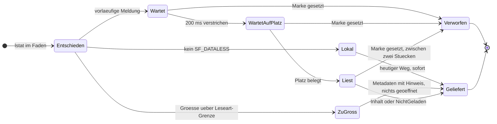
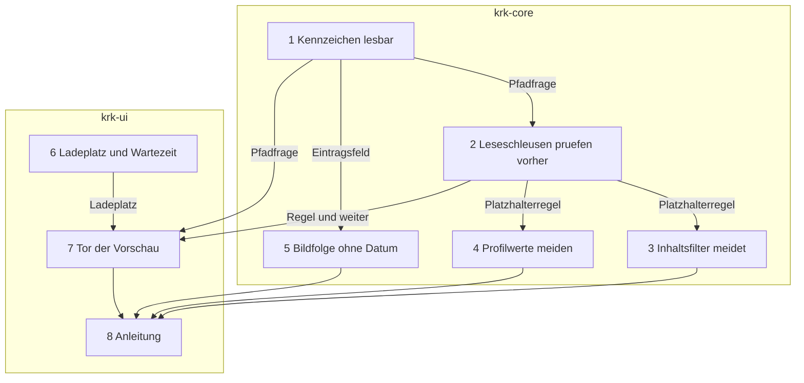

# Implementation Plan: Die Vorschau lädt Cloud-Dateien verzögert, einzeln und abbrechbar

**Date:** 2026-10-25
**Spec:** keiner; geplant nach dem Auftrag (Narrativ `261025-1435-vorschau-laedt-cloud-dateien-verzoegert-einzeln-und-abbrechbar.md` mit dem Wortlaut des Nutzers), dem Analysebericht `261025-1109-warum-die-navigation-auf-google-drive-zuweilen-langsam-ist.md` und den Defekten `261025-1109-bis-zur-grenze-lesen-oeffnet-die-datei-vor-der-groessenpruefung-und-holt-auf-einem-cloudlaufwerk-jede-zu-grosse-datei-herunter.md` und `261025-1110-die-vorschau-liest-platzhalterdateien-eines-cloudlaufwerks-schon-beim-bewegen-der-auswahl-und-ein-auswahlwechsel-bricht-das-herunterladen-nicht-ab.md`. Dazu die zwei offenen Entscheide dieses Plans, `261025-1444-was-heisst-abbrechen-fuer-einen-download-den-die-vorschau-schon-angestossen-hat.md` (E-Abbruch) und `261025-1444-welche-leser-duerfen-eine-platzhalterdatei-herunterladen.md` (E-Leser); der Plan baut nach der Empfehlung beider.
**Decidability:** Drei Fragen tragen den Plan. (1) „Löst das Öffnen dieser Datei einen Download aus?“ ist entscheidbar, und zwar am Kennzeichen `SF_DATALESS` (`sys/stat.h`, `0x40000000`, gelesen im SDK am 261025), das `getattrlistbulk(2)` mit `ATTR_CMN_FLAGS` schon liefert und `stat(2)` als `st_flags` (`std::os::darwin::fs::MetadataExt::st_flags`, stabil, ohne `unsafe`). Dass jedes Lesen eines so gekennzeichneten Eintrags materialisiert, ist `inference:` aus dem dokumentierten Verhalten von APFS-Platzhaltern und für Google Drive nicht nachgemessen; zwischen `stat` und `open` kann der Provider die Datei auslagern, und dieser Wettlauf bleibt offen und wird hingenommen. (2) „Hat die Auswahl 0,2 s auf dieser Datei geruht?“ ist entscheidbar, und zwar am Arbeitsfaden selbst: er wartet 0,2 s und fragt dabei die Abbruchmarke, die ein Auswahlwechsel setzt; der Hauptfaden braucht dafür keinen Zeitgeber. (3) „Ist ein laufender Download abgebrochen?“ ist **aus den Eingaben, die KRK hat, nicht zu beantworten und nicht herzustellen**: die SDK-Köpfe zeigen keinen Weg, auf dem ein fremdes Programm den Abruf eines File Providers beendet (E-Abbruch, Abschnitt Question). Der Plan wechselt deshalb den Mechanismus und beantwortet stattdessen zwei entscheidbare Fragen, die denselben Zweck tragen: „Beginnt KRK nach einem Auswahlwechsel noch einen Download?“ (nein, an der Marke entschieden) und „Laufen mehr als ein von der Vorschau ausgelöster Download zugleich?“ (nein, an einem Ladeplatz entschieden, den auch ein überholter Download bis zur Rückkehr seines Systemaufrufs hält). Was ein überholter Download dann noch kostet, begrenzt die Größengrenze.

## Directive

Auf einem Cloudlaufwerk soll das Bewegen der Auswahl flüssig bleiben, während die Vorschau eine nur in der Cloud liegende Datei weiter herunterlädt und zeigt. Die Directive steht im Narrativ und wird hier nicht wiederholt; die vier Vorgaben des Nutzers vom 261025 binden wörtlich: herunterladen, Größengrenze, ein Download zur Zeit mit Abbruch beim Weiterbewegen, Start erst nach 0,2 s.

## Current State

Gelesen am Stand `afa13e7c` (2026-10-25).

**Die Vorschau.** `Vorschaumodell::datei_anzeigen` (`crates/krk-ui/src/vorschaumodell.rs`) startet je Auswahl über `Ladevorgang::starten` einen Faden `krk-vorschau`, der `laden` ruft und genau eine erste Meldung über einen `sync_channel(1)` schickt. Ein neuer Auftrag lässt den alten `Ladevorgang` fallen; dessen `Abbruchmarke` wird dabei gesetzt, aber allein `nachliefern` (Bildfolge) fragt sie, `laden` nicht. `laden` erhebt `symlink_metadata` (lstat), prüft vor jedem anderen Zweig die Sonderdatei `secrets.txt`, beantwortet Ordner und Verknüpfungen über `zusammenfassen`, und verzweigt für eine Datei über `Leseart::von` in fünf Wege: Bild und PDF über `bis_zur_grenze_lesen(pfad, BILDGRENZE)` (64 MB), Text über `bis_zur_grenze_lesen(pfad, TEXTGRENZE)` (1 MB), JSON-Zeilen und Trenntext über `anlesen(pfad, TEXTGRENZE + 1)`, das jede Größe anliest. `Leseart::grenze` nennt je Weg die Grenze. Die Ansicht (`crates/krk-ui/src/appkit/vorschau.rs`) holt die Meldungen mit einem Zeitgeber im `LADETAKT` (1/60 s) ab und macht in `metadaten_text` aus `Metadaten` die sechs Zeilen.

**Die zwei Leseschleusen.** `bis_zur_grenze_lesen` und `anlesen` (`crates/krk-core/src/text/datei.rs`) öffnen über `verzeichnis::sys::ohne_warten_oeffnen`, fragen danach `fstat` am Deskriptor (Typ, dann Größe) und lesen über `take(…).read_to_end`. Die Größe wird also erst nach dem Öffnen geprüft (Defekt `261025-1109-…`). Rufer im Betriebscode: die Vorschau (sechs Stellen), `verzeichnis::inhalt::traegt_der_inhalt` (Inhaltsfilter), `leseprofil::bausteine::angelesener_text` (Profilwerte), `tresorweg::geheimnisse_lesen` und `editormodell` (beide `GEHEIMNISGRENZE`, vom Nutzer verlangt); dazu zwölf Rufe in `crates/krk-core/tests/text.rs`. Die Quelltextprobe in `crates/krk-ui/src/editormodell.rs` (Prüfmodul, Zeichenfolge `datei::bis_zur_grenze_lesen(pfad, GEHEIMNISGRENZE)`) liest den Wortlaut eines dieser Rufe.

**Das Kennzeichen.** `Schwungleser::oeffnen` (`crates/krk-core/src/verzeichnis/sys.rs`) fordert `ATTR_CMN_FLAGS` an, und `satz_zerlegen` wertet davon allein `UF_HIDDEN` aus; `RohEintrag` und `Eintrag` (`verzeichnis/eintrag.rs`) tragen kein Feld für `SF_DATALESS`. Die Probe `der_eintrag_bleibt_so_gross_wie_bisher` hält `size_of::<Eintrag>() == 88` und erklärt jedes weitere Feld zur sichtbaren Entscheidung (L3, L10). `grep -rni dataless crates` ergibt nichts.

**Die Hintergrundleser.** `Bildverzeichnis::gruppe_ordnen` (`crates/krk-core/src/leseprofil/bildfolge.rs`) ruft je `Fotoeintrag` den Datumsleser (`bild::aufnahmedatum`, öffnet über `ohne_warten_oeffnen`) und fällt ohne Datum auf `geaendert` zurück. Der Durchlauf des Inhaltsfilters (`verzeichnis/durchlauf.rs`) ruft `traegt_der_inhalt` im flachen Zweig für Einträge des Ordnermodells und im tiefen Zweig für `Kandidat`en aus dem `Schwungleser`, zählt `ZuGross` in `zu_gross`, und die Statuszeile nennt die Zahl (`Zahlwort::StatuszeileDateienZuGross`, `appkit/statuszeile.rs`, Wert aus `Filterstand` in `appkit/tabelle.rs`, gehalten in `tabs.rs`).

**Zusagen, die berührt werden.** L7 verlangt die Vorschau einer lokalen Datei in 100 ms im Perzentil (`crates/krk-bench/src/messen.rs`, Kennung `L7`); alle zehn Zusagen stehen seit dem 261017 ohne Abnahmelauf auf den Gegenständen der späteren Messrunde (`261017-0955-schuldet-das-sftp-paket-einen-abnahmelauf-gegen-die-zehn-zusagen.md`, Möglichkeit 2).

## Approach

**Eine Regel, nach dem, der liest** (E-Leser, Möglichkeit 1). Jede Datei fällt in genau eine von drei Klassen:

| Wer liest | Was mit einer Platzhalterdatei geschieht |
|---|---|
| die Vorschau der ausgewählten Datei, auch das Foto an der Stelle einer Bildfolge | lädt, wenn die Größe unter der Grenze ihrer Leseart liegt, nach 0,2 s Ruhe, über den einen Ladeplatz, abbrechbar bis zum Öffnen und zwischen zwei Lesestücken |
| ein Hintergrundleser: Aufnahmedatum der Bildfolge, Inhaltsfilter, Profilwerte einer Zusammenfassung | öffnet nicht und gilt als ungelesen |
| ein Weg, den der Nutzer ausdrücklich auf eine Datei richtet: Editor, Kopieren, Zippen, Entpacken, Teilen, Öffnen mit, `secrets.txt` | unverändert |

Eine lokale Datei, also jede ohne `SF_DATALESS`, nimmt in allen drei Klassen den heutigen Weg, **ohne Verzögerung**. Die Wartezeit gilt allein für Platzhalter, und der Grund ist gemessen und nicht Geschmack: L7 sagt 100 ms im Perzentil zu, und 200 ms Wartezeit vor jeder lokalen Vorschau bräche sie bei jedem Cursorschritt. Auf der lokalen Platte kostet ein Überspringen auch nichts, was eine Wartezeit sparen könnte; die Analyse empfiehlt aus demselben Grund keine allgemeine Verzögerung (`## Recommendations`, Punkt 5).

**Das Kennzeichen wird an den zwei Stellen gelesen, an denen die Angaben ohnehin entstehen.** Für einen Eintrag aus einem Verzeichnisleselauf trägt `RohEintrag` und `Eintrag` es aus `ATTR_CMN_FLAGS`, ohne Systemaufruf; daraus liest es die Bildfolge. Für einen Pfad fragt es der Lesende mit `stat`; so tun es die Leseschleusen und die Vorschau. Beides ist dasselbe Bit desselben Kerns, und eine Hilfsfunktion in `verzeichnis` deutet es an beiden Stellen. Eine neue Schnittstelle in `verzeichnis/sys.rs` entsteht nicht, die Zahl „elf“ im Modulkopf bleibt.

**Die Leseschleusen prüfen vor dem Öffnen** (Defekt `261025-1109-…`). `bis_zur_grenze_lesen` und `anlesen` stellen vor `ohne_warten_oeffnen` ein `stat(2)` auf den Pfad. Eine Größe über der Grenze ergibt `ZuGross`, ohne dass geöffnet wird; ein Platzhalter ergibt unter der Regel `Platzhalterregel::Meiden` das neue `Lesehindernis::Platzhalter`. Die Prüfung am Deskriptor bleibt danach unverändert stehen, denn sie beantwortet die andere Frage (Röhre, Gerät, Wachsen zwischen `fstat` und `read`), und ein `stat` auf eine benannte Röhre blockiert nicht, weil es nichts öffnet. Gelesen wird stückweise in `LESESTUECK` (1 MiB), und vor jedem Stück fragt die Schleuse `weiter`; sagt es nein, endet sie mit `Lesehindernis::Abgebrochen`. Platzhalterregel und `weiter` reisen als Argumente, wie die Grenze heute, und jeder Rufer wählt sie ausdrücklich, weil der Übersetzer ihn sonst anhält.

**Die Vorschau hat ein Tor zwischen dem Ordnerzweig und der Leseart.** In `laden` steht nach der Sonderdateifrage und nach dem Zweig für Ordner und Verknüpfungen, also vor jedem Öffnen einer Datei, eine Frage: ist die Datei ein Platzhalter? Wenn nein, geht `laden` den heutigen Weg. Wenn ja:

1. Liegt `roh.len()` über `Leseart::grenze` ihrer Leseart, antwortet `laden` mit den Metadaten und dem Hinweis `Cloudhinweis::ZuGross`, ohne zu öffnen. **Das ist die Größengrenze, und sie bekommt keine neue Zahl**: es sind die 64 MB für Bild und PDF und die 1 MB für alles andere, und für die zwei anlesenden Wege (JSON-Zeilen, Trenntext) gilt sie für einen Platzhalter an der Dateigröße statt an der Zahl gelesener Bytes, weil ein Provider, der ganze Dateien holt, für das Anlesen von 1 MB die ganze Datei lädt (`inference:`).
2. Sonst schickt der Faden eine vorläufige Meldung, die Metadaten mit `Cloudhinweis::Laedt`, damit die Ansicht sofort sagt, was sie ohne Download weiß.
3. Er wartet `CLOUDVERZOEGERUNG` (200 ms) und fragt dabei die Abbruchmarke. Gesetzt heißt: ein Auswahlwechsel kam, der Faden endet, geöffnet wurde nichts.
4. Er belegt den einen `Ladeplatz` des Modells und fragt beim Warten auf ihn ebenso die Marke.
5. Er liest über dieselben Schleusen wie heute, mit `Platzhalterregel::Laden` und mit `weiter` an der Marke. Gelingt es nicht, antwortet er mit `Cloudhinweis::NichtGeladen`; ist die Marke gesetzt, endet er ohne Meldung. Den Platz gibt er frei, wenn sein Lesen zurückgekehrt ist.



Alle Pfade enden in `Geliefert` oder `Verworfen`; der Zustand `Liest` hält den Ladeplatz, und nur aus ihm heraus läuft ein Download. Eine Kante zurück gibt es nicht. Aus `Verworfen` heraus, über `Liest` erreicht, gibt der Faden den Platz erst frei, wenn sein Systemaufruf zurückgekehrt ist; das ist die Eigenschaft, die E-Abbruch Möglichkeit 1 beschreibt.

**Was „abbrechen“ damit heißt, und was nicht** (E-Abbruch, Möglichkeit 1). Gesichert durch den Bau: ein Download, der noch nicht begonnen hat, beginnt nach einem Auswahlwechsel nicht mehr, und höchstens ein von der Vorschau ausgelöster Download läuft zugleich. Gelesen in den SDK-Köpfen am 261025: `NSFileCoordinator.h` sagt, `cancel` beende das Warten eines koordinierten Zugriffs; `NSFileProviderReplicatedExtension.h` sagt, das System breche den Abruf eines Providers ab, wenn der Nutzer ihn abbricht oder er stockt; `NSFileProviderManager.h` führt kein Abbrechen für einen Fremden. `inference:` ein schon laufender Abruf auf einem Provider, der ganze Dateien holt, läuft bis zum Ende weiter, und KRK verwirft nur das Ergebnis. `inference:` auf einem Provider, der stückweise holt, und auf einem Netzlaufwerk über NetFS endet der Abruf mit dem stückweisen Lesen wirklich am nächsten Stück. Ob Google Drive stückweise holt, ist ungemessen (`## Open Questions`).

**Erwogen und verworfen: die Faden-Richtlinie `setiopolicy_np` mit `IOPOL_MATERIALIZE_DATALESS_FILES_OFF`** (Empfehlung 1 der Analyse; Konstanten im SDK-Kopf `sys/resource.h` gelesen am 261025). Sie gilt für den ganzen Faden und verbietet dort auch das Aufzählen eines Platzhalterordners, das die Zusammenfassung und die Erhebung der Bildfolge auf demselben Faden brauchen; sie bräuchte die zwölfte Schnittstelle in `sys.rs`; und die Frage, die sie beantwortet, beantwortet das Kennzeichen je Datei ohne Bindung. Ihr Vorzug, auch unbekannte Leser zu decken, wiegt das nicht auf, weil die Platzhalterregel an den Schleusen jeden heutigen und künftigen Rufer zur Wahl zwingt.

**Was dieser Plan nicht anfasst.** Das Aufzählen eines Platzhalterordners (Befund B4 der Analyse) ist ein Netzumlauf für Metadaten und kein Download einer Datei; Dateiliste, Zusammenfassung und der tiefe Filterlauf zählen weiter auf, wie sie es tun. Die Kosten von `gleicher_ordner` auf dem Hauptfaden (B5) trägt der vorhandene Defekt `260826-1442_*_gleicher-ordner-ruft-canonicalize-je-gemeldetem-pfad-und-dateifenster-und-die-kosten-sind-ungemessen.md`.

## Implementation Steps

1. **Das Kennzeichen `SF_DATALESS` aus dem Leselauf und aus `stat` lesbar machen**
   - Executor: code-implementer
   - Files: `crates/krk-core/src/verzeichnis/sys.rs`; `crates/krk-core/src/verzeichnis/eintrag.rs`; `crates/krk-core/src/verzeichnis/mod.rs`; `crates/krk-core/src/verzeichnis/leser.rs`; die zwei Rufer von `Eintrag::mit_versteckt` in `crates/krk-ui/src/kommandos/kontextmenue.rs` und `crates/krk-ui/src/kommandos/operationen.rs`, falls die Signatur sich ändert
   - Changes: In `sys.rs` neben `UF_HIDDEN` die Konstante `SF_DATALESS` (`0x4000_0000`, aus `sys/stat.h`) und eine Deutung `kennzeichnet_platzhalter(kennzeichen: u32) -> bool`; `RohEintrag` bekommt `platzhalter: bool`, gesetzt in `satz_zerlegen` aus `kennzeichen`. `Eintrag` bekommt das öffentliche Feld `platzhalter: bool`, gefüllt allein auf dem Weg aus `RohEintrag`; jeder andere Bau (`neu`, Fernnamen, Archiveinträge, Proben) setzt `false`. In `verzeichnis/mod.rs` die eine Pfadfrage `pub fn ist_platzhalter(angaben: &std::fs::Metadata) -> bool` über `std::os::darwin::fs::MetadataExt::st_flags` und dieselbe Deutung, ohne `unsafe`. Der Modulkopf von `sys.rs` sagt, dass das Kennzeichen keine weitere Schnittstelle ist und die Zahl elf bleibt; der Doc-Kommentar von `Eintrag::platzhalter` sagt, dass das Feld in der Lücke der Ausrichtung liegt und die 88 Bytes hält (sichtbare Entscheidung im Sinne der Probe).
   - Akzeptanz: `der_eintrag_bleibt_so_gross_wie_bisher` bleibt bei 88 grün; eine neue Probe in `sys.rs` zerlegt einen künstlichen Satz mit gesetztem `SF_DATALESS` und erwartet `platzhalter == true`, ohne das Bit `false`; eine Probe in `verzeichnis` erwartet `ist_platzhalter` für eine frisch angelegte Datei im Prüfordner `false`. `genau_zwei_dateien_oeffnen_die_regel_deny_unsafe_code` bleibt grün.
   - Prüfkommando: `make check`
   - Dependencies: none

2. **Die zwei Leseschleusen prüfen Größe und Kennzeichen vor dem Öffnen und lesen stückweise**
   - Executor: code-implementer
   - Files: `crates/krk-core/src/text/datei.rs`; `crates/krk-core/src/verzeichnis/inhalt.rs`; `crates/krk-core/src/leseprofil/bausteine.rs`; `crates/krk-core/tests/text.rs`; `crates/krk-ui/src/vorschaumodell.rs` (nur die sechs Rufe); `crates/krk-ui/src/tresorweg.rs`; `crates/krk-ui/src/editormodell.rs` (der Ruf und die Quelltextprobe, die den Wortlaut des Rufs in `tresorweg.rs` erwartet)
   - Changes: Neu `pub enum Platzhalterregel { Laden, Meiden }` und `pub const LESESTUECK: u64 = 1024 * 1024`. `bis_zur_grenze_lesen(pfad, grenze, regel, weiter: &dyn Fn() -> bool)` und `anlesen(pfad, hoechstens, regel, weiter)`: zuerst `std::fs::metadata(pfad)`; ein Fehler dort ist dieselbe Antwort wie ein Fehler beim Öffnen (`Deskriptormangel` oder `Fehler`); unter `Meiden` ergibt ein Platzhalter `Lesehindernis::Platzhalter`; in `bis_zur_grenze_lesen` ergibt eine Größe über `grenze` `ZuGross`. Danach unverändert öffnen, `fstat`, Typ, Größe. Gelesen wird in einer Schleife zu höchstens `LESESTUECK` Bytes bis `grenze + 1` beziehungsweise `hoechstens`, vor jedem Stück `weiter()`; nein ergibt `Lesehindernis::Abgebrochen`. `Lesehindernis` bekommt die zwei Werte, je mit Doc-Kommentar. **Alle Rufer bleiben in ihrem heutigen Verhalten**: sie übergeben `Platzhalterregel::Laden` und `&|| true`; `traegt_der_inhalt` übersetzt `Platzhalter` und `Abgebrochen` in `Inhaltsbefund::Unentschieden` (unter `Laden` und `&|| true` unerreichbar; Schritt 3 ersetzt die erste Zeile), `tresorweg` übersetzt beide in den Text, den heute `Fehler` bekommt. Die Modulköpfe von `datei.rs` (Abschnitte zur Reihenfolge und zur Grenze), `inhalt.rs` (Bild und Abschnitt „Die Grenze reist als Argument“) und von `vorschaumodell.rs` (`# Gelesen wird ueber den Deskriptor …`) sagen die neue Reihenfolge: erst der Pfad nach Größe und Kennzeichen, dann der Deskriptor nach Typ und Größe.
   - Akzeptanz: Die Probe aus dem Defekt `261025-1109-…` steht in `crates/krk-core/tests/text.rs`: eine Datei über der Grenze ohne Leserecht (`chmod 000`) ergibt aus `bis_zur_grenze_lesen` `Err(ZuGross)` und nicht `Err(Fehler)`. Eine Datei über `LESESTUECK` ergibt aus beiden Schleusen `Err(Abgebrochen)`, wenn `weiter` nach dem ersten Stück nein sagt. Eine benannte Röhre ergibt weiter `KeineDatei` ohne zu warten (die vorhandenen Proben bleiben grün). Jede vorhandene Probe der Vorschau, des Editors, des Tresorwegs und des Filters bleibt grün.
   - Prüfkommando: `make check`
   - Source: Defekt `261025-1109-bis-zur-grenze-lesen-oeffnet-die-datei-vor-der-groessenpruefung-und-holt-auf-einem-cloudlaufwerk-jede-zu-grosse-datei-herunter.md`
   - Dependencies: 1

3. **Der Inhaltsfilter öffnet keine Platzhalterdatei und nennt ihre Zahl**
   - Executor: code-implementer
   - Files: `crates/krk-core/src/verzeichnis/inhalt.rs`; `crates/krk-core/src/verzeichnis/durchlauf.rs`; `crates/krk-ui/src/tabs.rs`; `crates/krk-ui/src/appkit/tabelle.rs`; `crates/krk-ui/src/appkit/statuszeile.rs`; `crates/krk-core/src/sprache/schluessel.rs`; `crates/krk-core/src/sprache/tabelle/de.rs`, `fr.rs`, `en.rs`
   - Changes: `traegt_der_inhalt` ruft mit `Platzhalterregel::Meiden`; `Inhaltsbefund` bekommt `NurInDerCloud`, und `Lesehindernis::Platzhalter` geht dorthin statt nach `Unentschieden`. `datei_entscheiden` zählt `NurInDerCloud` in einem zweiten Zähler `nur_in_der_cloud` neben `zu_gross` und antwortet `Some(false)`, aus demselben Grund wie bei `ZuGross` (die Zeile steht nicht, weil über sie nichts bekannt ist). Der Zähler reist wie `zu_gross` über den Tab (`tabs.rs`) in den `Filterstand` (`appkit/tabelle.rs`) und als eigener Satzteil in die Statuszeile (`appkit/statuszeile.rs`). Neuer Schlüssel `Zahlwort::StatuszeileDateienNurInDerCloud`, deutsch (`", eine Datei nur in der Cloud"`, `", {n} Dateien nur in der Cloud"`), französisch und englisch in je einer Zeile der drei Tabellen. Der Modulkopf von `inhalt.rs` bekommt den Zweig in sein Bild.
   - Akzeptanz: Eine Probe am Durchlauf mit einem eingespritzten Befund oder an `datei_entscheiden` zeigt, dass `NurInDerCloud` den Zähler hebt und `Some(false)` liefert; eine Probe an der Statuszeile zeigt den Satzteil für eins und für mehrere. `jede_alle_liste_fuehrt_genau_die_varianten_ihrer_aufzaehlung`, `kein_stringliteral_des_betriebscodes_traegt_einen_umlaut_ausser_in_der_sprachtabelle` und `keine_senke_der_oberflaeche_bekommt_ein_literal` bleiben grün. Ein echter Platzhalter steht in keiner Probe, weil sich `SF_DATALESS` ohne File-Provider-Domäne nicht setzen lässt; den Weg vom Kennzeichen zum Befund hält die Probe aus Schritt 1 an der Deutung.
   - Prüfkommando: `make check`
   - Source: Entscheid `261025-1444-welche-leser-duerfen-eine-platzhalterdatei-herunterladen.md`, Möglichkeit 1
   - Dependencies: 2

4. **Die Profilwerte einer Zusammenfassung lesen keine Platzhalterdatei**
   - Executor: code-implementer
   - Files: `crates/krk-core/src/leseprofil/bausteine.rs`
   - Changes: `angelesener_text` ruft `anlesen` mit `Platzhalterregel::Meiden`; ein Platzhalter ergibt `None`, also denselben fehlenden Wert wie eine unlesbare Datei. Der Doc-Kommentar von `angelesener_text` und der Modulkopf von `bausteine.rs` (Abschnitt über die Kosten eines Profils) sagen, dass ein Platzhalter nicht geöffnet wird und darum nicht zu den Öffnungen zählt.
   - Akzeptanz: Die Proben in `crates/krk-core/tests/` zu den Profilen bleiben grün; eine neue Probe ist nicht möglich (kein Platzhalter ohne Domäne), die Regel hält der Übersetzer über das Argument.
   - Prüfkommando: `make check`
   - Source: Entscheid `261025-1444-welche-leser-duerfen-eine-platzhalterdatei-herunterladen.md`, Möglichkeit 1
   - Dependencies: 2

5. **Die Bildfolge liest von einem Platzhalterfoto kein Aufnahmedatum**
   - Executor: code-implementer
   - Files: `crates/krk-core/src/leseprofil/bildfolge.rs`
   - Changes: `Fotoeintrag` bekommt `platzhalter: bool` aus `Eintrag::platzhalter` (Schritt 1) in `verzeichnis_erheben`. `gruppe_ordnen` ruft für einen Platzhalter den Datumsleser nicht und nimmt `Aufnahmezeit::aus_zeitpunkt(eintrag.geaendert)` mit `aus_bilddaten: false`, also den Rückfall, den es heute für ein Foto ohne lesbares Datum nimmt (C5.5 des Spec der Bildfolge); `weiter` fragt es vorher wie bisher. Der Modulkopf von `bildfolge.rs` sagt unter „Gruppen und Reihenfolge“, dass ein Foto, das nur in der Cloud liegt, nach seinem Änderungsdatum steht. Das Foto an der Stelle lädt weiter die Vorschau, also nach der Regel aus Schritt 7.
   - Akzeptanz: Eine Probe mit einem zählenden Datumsleser und einem `Bildverzeichnis`, dessen Fotoeintrag `platzhalter` trägt (über einen Prüfbau des Eintrags), zeigt, dass der Leser für dieses Foto nicht gerufen wird und das Foto nach `geaendert` eingeordnet ist; die vorhandenen Proben der Bildfolge bleiben grün.
   - Prüfkommando: `make check`
   - Source: Defekt `261025-1110-…`, zweiter Satz der Abnahme
   - Dependencies: 1

6. **Ein Ladeplatz und eine abbrechbare Wartezeit, ohne AppKit und ohne Vorschau**
   - Executor: code-implementer
   - Files: neu `crates/krk-ui/src/cloudladen.rs`; `crates/krk-ui/src/main.rs` (Modulzeile)
   - Changes: Das Modul hält `pub const CLOUDVERZOEGERUNG: Duration = Duration::from_millis(200)`, `pub struct Ladeplatz` (ein Platz, geteilt als `Arc`) mit `belegen(&self, weiter: &dyn Fn() -> bool) -> Option<Belegung>`, das wartet, bis der Platz frei ist oder `weiter` nein sagt, und `Belegung` als Wächter, der den Platz in `Drop` freigibt; dazu `abwarten(dauer, weiter) -> bool`, das die Dauer in Schritten von höchstens 10 ms schläft und bei nein sofort `false` liefert. Für Proben zählt der Platz, wie oft er belegt wurde und wie viele Belegungen höchstens zugleich bestanden. Der Modulkopf schreibt die Eigenschaft aus, die E-Abbruch Möglichkeit 1 beschreibt, und sagt, dass ein Wächter, dessen Faden in einem Systemaufruf steht, den Platz erst nach dessen Rückkehr freigibt. Kein `objc2`, kein `unsafe`.
   - Akzeptanz: Proben im Modul: zwei Fäden belegen nacheinander und nie zugleich (Höchstzahl 1); ein Faden, der auf einen belegten Platz wartet, endet binnen 20 ms nach `weiter` nein ohne Belegung; `abwarten` mit nein ab dem ersten Schritt kehrt binnen 20 ms mit `false` zurück, mit ja nach der Dauer mit `true`.
   - Prüfkommando: `make check`
   - Dependencies: none

7. **Die Vorschau lädt eine Platzhalterdatei nach 0,2 s, einzeln, unter der Grenze, und zeigt vorher einen Hinweis**
   - Executor: code-implementer
   - Files: `crates/krk-ui/src/vorschaumodell.rs`; `crates/krk-ui/src/appkit/vorschau.rs`; `crates/krk-core/src/sprache/schluessel.rs`; `crates/krk-core/src/sprache/tabelle/de.rs`, `fr.rs`, `en.rs`
   - Changes: (a) `Inhalt::Metadaten` bekommt `cloud: Option<Cloudhinweis>`, `enum Cloudhinweis { Laedt, ZuGross { grenze: u64 }, NichtGeladen }`; jede heutige Stelle setzt `None`. (b) `Vorschaumodell` hält einen `Arc<Ladeplatz>`, eine Wartezeit (Betrieb: `CLOUDVERZOEGERUNG`) und eine Platzhalterfrage `fn(&std::fs::Metadata) -> bool` (Betrieb: `krk_core::verzeichnis::ist_platzhalter`), alle drei für Proben setzbar wie `datumsleser`, und reicht sie in jeden `Ladevorgang::starten`, auch für `neu_laden_wo` und den `bildvorgang` der Bildfolge. (c) `laden` bekommt diese drei, die Abbruchmarke als `weiter` und einen Weg für die vorläufige Meldung; das Tor steht **zwischen dem Zweig für Ordner und Verknüpfungen und `match Leseart::von(pfad)`**, also nach der Frage nach `secrets.txt`, und läuft die fünf Schritte aus `## Approach`. Für jede Datei, auch eine lokale, rufen die Schleusen `Platzhalterregel::Laden` und `weiter` an der Marke. (d) `Geladen` bekommt `vorlaeufig: bool`; `Vorschaumodell::einziehen` setzt bei einer vorläufigen Meldung Inhalt und Pfad des Tabs und lässt den `Ladevorgang` samt Abbruchmarke stehen, sodass `laedt_noch` wahr bleibt, bis die endgültige Meldung kommt. (e) `metadaten_text` in `appkit/vorschau.rs` hängt für `Some(cloud)` eine Zeile an, die Größen über das vorhandene `groesse_text` formatiert. Neue Schlüssel `Text::VorschauCloudLaedt` („Liegt nur in der Cloud und wird für die Vorschau geladen.“), `Text::VorschauCloudZuGross` („Liegt nur in der Cloud und ist mit {groesse} größer als die {grenze}, die die Vorschau lädt.“), `Text::VorschauCloudNichtGeladen` („Liegt nur in der Cloud und ließ sich nicht laden.“), je in den drei Tabellen. (f) Die Modulköpfe: `vorschaumodell.rs` bekommt einen Abschnitt `# Eine Datei, die nur in der Cloud liegt` mit der Tabelle aus `## Approach`, dem Zustandsbild und der Begründung, warum eine lokale Datei nicht wartet (L7); der Abschnitt `# Der Arbeitsfaden` sagt, dass ein Faden für einen Platzhalter mehr als eine Meldung schicken kann; `appkit/vorschau.rs` braucht keinen neuen Eintrag im Untergrenzen-Abschnitt, weil keine Klasse hinzukommt.
   - Akzeptanz: Proben in `vorschaumodell.rs` mit einer Platzhalterfrage, die für Dateien mit dem Namensteil `wolke` ja sagt, einer Wartezeit von 50 ms und einem eigenen Ladeplatz: (1) zehn `datei_anzeigen` auf zehn solche Dateien im Abstand von 5 ms belegen den Platz für die ersten neun nie und für die zehnte genau einmal; (2) die Höchstzahl gleichzeitiger Belegungen bleibt 1, auch wenn eine Probe den Platz während zweier Auswahlwechsel selbst hält; (3) eine solche Datei über `TEXTGRENZE` mit Leseart Text ergibt `Cloudhinweis::ZuGross` ohne Belegung; (4) vor der endgültigen Meldung steht `Cloudhinweis::Laedt` im aktiven Tab und `laedt_noch` ist wahr; (5) eine lokale Datei belegt den Platz nie und erscheint ohne Wartezeit, und jede vorhandene Probe der Vorschau, besonders `eine_benannte_roehre_haelt_die_vorschau_nicht_an` und `laden_fragt_die_sonderdatei_vor_jedem_lesen`, bleibt grün. Die drei Nahtproben der Sprache bleiben grün.
   - Prüfkommando: `make check`
   - Source: Narrativ `261025-1435-…` (die vier Vorgaben); Defekt `261025-1110-…`; Entscheid `261025-1444-was-heisst-abbrechen-fuer-einen-download-den-die-vorschau-schon-angestossen-hat.md`, Möglichkeit 1
   - Dependencies: 1, 2, 6

8. **Die Anleitung sagt, was die Vorschau auf einem Cloudlaufwerk tut**
   - Executor: code-implementer
   - Files: `HowTo.md`
   - Changes: Im Abschnitt zur Vorschau drei Sätze für den Nutzer: eine Datei, die nur in der Cloud liegt, lädt die Vorschau, wenn die Auswahl 0,2 s auf ihr steht; sie lädt eine zur Zeit und bis zur Größe, die sie zeigen kann; Bildfolge, Inhaltsfilter und Ordnerzusammenfassung laden nichts herunter, und die Statuszeile des Filters nennt, wie viele Dateien nur in der Cloud liegen. Kein Satz verspricht, dass ein laufender Download beim Weiterbewegen aufhört.
   - Akzeptanz: `grep -n 'nur in der Cloud' HowTo.md` findet die Stelle; `make check` bleibt grün (die Anleitung reist im Releasepaket mit, und keine Probe liest ihren Wortlaut).
   - Prüfkommando: `make check`
   - Dependencies: 3, 4, 5, 7



Jede Kante ist eine Abhängigkeit aus den Schritten, und jede Abhängigkeit der Schritte ist eine Kante; Zyklen gibt es keine, und alle Kanten laufen vom Kern zur Oberfläche oder innerhalb einer Schicht abwärts.

## Where this work stops

- Die Schritte 1 bis 8 sind erledigt, und `make check` läuft auf dem letzten Stand grün.
- Der Defekt `261025-1109-…` ist geschlossen, sobald seine Abnahmeprobe aus Schritt 2 im Baum steht und grün ist.
- Der Defekt `261025-1110-…` ist geschlossen mit einer `Resolved:`-Zeile, die sagt, dass der Wunsch des Nutzers vom 261025 (Narrativ des Pakets) den ersten Satz seiner Abnahme ersetzt: die Vorschau liest eine Platzhalterdatei, und zwar nach Schritt 7; der zweite Satz (Bildfolge) ist mit Schritt 5 erfüllt.
- Wählt der Nutzer im Entscheid `261025-1444-welche-leser-duerfen-eine-platzhalterdatei-herunterladen.md` Möglichkeit 2 statt der Empfehlung, entfällt Schritt 4 vor seinem Bau oder wird zurückgenommen, und nichts sonst ändert sich. Steht der Entscheid beim Bau von Schritt 4 noch offen, baut der Plan nach Möglichkeit 1.
- Wählt der Nutzer im Entscheid `261025-1444-was-heisst-abbrechen-…` Möglichkeit 2 oder 3, ist das ein neues Arbeitspaket nach einer Messung und kein Schritt dieses Plans.
- Einen Abnahmelauf gegen die zehn Zusagen schuldet dieser Plan nicht: der lokale Weg der Vorschau ist unverändert, und alle zehn stehen seit dem 261017 auf den Gegenständen der späteren Messrunde (`261017-0955-…`, Möglichkeit 2).
- Ob das Ziel aus dem Narrativ auf Google Drive erreicht ist (schnelles Durchscrollen ohne Download, höchstens einer nach 0,2 s, keiner über der Grenze), prüft allein der Nutzer an seinem Laufwerk, weil sich `SF_DATALESS` ohne File-Provider-Domäne in keiner Probe herstellen lässt. Das Paket ist ohne diese Prüfung gebaut und nicht abgenommen.
- Eine Auslieferung gehört nicht zu diesem Plan; sie braucht einen eigenen Auftrag.

## Data Structures

```rust
// krk-core/src/verzeichnis/sys.rs
const SF_DATALESS: u32 = 0x4000_0000;
pub(crate) fn kennzeichnet_platzhalter(kennzeichen: u32) -> bool;
pub struct RohEintrag<'a> { /* … */ pub platzhalter: bool }

// krk-core/src/verzeichnis/eintrag.rs
pub struct Eintrag { /* … */ pub platzhalter: bool } // 88 Bytes bleiben

// krk-core/src/verzeichnis/mod.rs
pub fn ist_platzhalter(angaben: &std::fs::Metadata) -> bool;

// krk-core/src/text/datei.rs
pub enum Platzhalterregel { Laden, Meiden }
pub const LESESTUECK: u64 = 1024 * 1024;
pub enum Lesehindernis { ZuGross, KeineDatei, Deskriptormangel, Fehler, Platzhalter, Abgebrochen }

// krk-core/src/verzeichnis/inhalt.rs
pub enum Inhaltsbefund { Traegt, TraegtNicht, ZuGross, NurInDerCloud, Unentschieden }

// krk-core/src/leseprofil/bildfolge.rs
pub struct Fotoeintrag { name, schluessel, geaendert, platzhalter: bool }

// krk-ui/src/cloudladen.rs
pub const CLOUDVERZOEGERUNG: Duration;
pub struct Ladeplatz; pub struct Belegung<'a>;
pub fn abwarten(dauer: Duration, weiter: &dyn Fn() -> bool) -> bool;

// krk-ui/src/vorschaumodell.rs
pub enum Cloudhinweis { Laedt, ZuGross { grenze: u64 }, NichtGeladen }
Inhalt::Metadaten { metadaten, zaehlzeilen, cloud: Option<Cloudhinweis> }
struct Geladen { /* … */ vorlaeufig: bool }
```

Neue Sprachschlüssel: `Text::VorschauCloudLaedt`, `Text::VorschauCloudZuGross`, `Text::VorschauCloudNichtGeladen`, `Zahlwort::StatuszeileDateienNurInDerCloud`.

## API Changes

`bis_zur_grenze_lesen` und `anlesen` bekommen zwei Argumente, `regel` und `weiter`; jeder Rufer im Baum wird in Schritt 2 nachgezogen. `Eintrag` und `RohEintrag` bekommen je ein öffentliches Feld. Sonst ändert sich keine öffentliche Fläche außerhalb von `krk-ui`, das kein Bibliotheksziel hat.

## Testing Strategy

Ein echter Platzhalter steht in keiner Probe: `SF_DATALESS` setzt allein der Kern für ein Dateisystem mit File-Provider-Domäne, und `chflags` setzt es nicht. Die Proben halten deshalb drei Nähte getrennt fest: die Deutung des Bits an einem künstlichen Satz (Schritt 1), die Regel an den Schleusen über den Übersetzer und über die Proben zur Größe vor dem Öffnen (Schritt 2), und das Tor der Vorschau mit einer eingespritzten Platzhalterfrage, einer kurzen Wartezeit und einem zählenden Ladeplatz (Schritte 6 und 7). Die Zeitproben in Schritt 6 und 7 rechnen mit Spielraum (20 ms auf einen Schritt von 10 ms, 50 ms Wartezeit gegen 5 ms Abstand), weil der Defekt `261025-0010-die-zeitprobe-zum-abbruch-in-einer-500-mb-datei-scheitert-auch-ohne-aenderung-in-drei-von-fuenf-laeufen.md` zeigt, wie eng gezogene Zeitproben hier ausfallen. Die Wirkung auf Google Drive prüft der Nutzer (`## Where this work stops`).

## Risks & Mitigations

| Risk | Mitigation |
|---|---|
| Ein überholter Download auf einem Provider, der ganze Dateien holt, hält den Ladeplatz bis zu seinem Ende, und die nächste Vorschau wartet. | Die Grenze begrenzt ihn auf 64 MB; der Hinweis `Laedt` steht derweil da; das System bricht einen stockenden Abruf selbst ab (`NSFileProviderReplicatedExtension.h`, `inference:` dass das auch hier greift). |
| Der Provider lagert eine Datei zwischen `stat` und `open` aus, und ein Hintergrundleser lädt sie doch. | Hingenommen: ein Download je Wettlauf, kein Muster; im `**Decidability:**` benannt. |
| Eine Auffrischung meldet die Auswahl während eines Downloads erneut und verwirft das fast fertige Ergebnis. | Der neue Vorgang wartet auf den Platz, liest danach die inzwischen lokale Datei sofort; das Ergebnis kommt einmal. |
| Eine Bildfolge mit lokalen und Cloud-Fotos ordnet die Cloud-Fotos nach Änderungsdatum zwischen die anderen. | Dieselbe Regel wie für ein Foto ohne Bilddatum (C5.5); im Modulkopf von `bildfolge.rs` beschrieben. |
| Die Signaturänderung der Schleusen zieht viele Proben nach. | Mechanisch, alle in Schritt 2; die Quelltextprobe in `editormodell.rs` ist dort ausdrücklich genannt. |
| Ein Lesen in Stücken ist auf der lokalen Platte langsamer als `read_to_end`. | Ein Stück ist 1 MiB, eine Textdatei der Vorschau also höchstens zwei Aufrufe; ein Bild bis 64 MB 64 Aufrufe statt rund zwölf. Bleibt eine Probe zu L7 rot, ist das ein Grund zum Halt und kein Grund, das Stück zu vergrößern, ohne es zu sagen. |

## Open Questions

- [ ] **Größengrenze.** Der Plan schlägt vor, für eine Platzhalterdatei die Grenzen zu nehmen, die die Vorschau schon hat, an der Dateigröße gemessen: 64 MB für Bild und PDF, 1 MB für alles andere, einschließlich CSV, TSV und JSON-Zeilen, die lokal über 1 MB angelesen werden. Eine eigene, kleinere Zahl für die Cloud (etwa 16 MB für Bild und PDF) würde einen überholten Download kürzer halten und gewöhnliche Kamerafotos über 16 MB ausschließen. Wir empfehlen die vorhandenen Grenzen; eine Einstellung in `settings.toml` dafür empfehlen wir nicht.
- [ ] **Abbruch.** Entscheid `261025-1444-was-heisst-abbrechen-fuer-einen-download-den-die-vorschau-schon-angestossen-hat.md`: ein schon laufender Download lässt sich von KRK aus nicht nachweislich beenden; der Plan baut, dass keiner mehr beginnt und höchstens einer zugleich läuft. Offen, ob der Nutzer das als „abbrechen“ annimmt.
- [ ] **Welche Leser laden.** Entscheid `261025-1444-welche-leser-duerfen-eine-platzhalterdatei-herunterladen.md`: der Plan baut nach Möglichkeit 1 (allein die Vorschau der Auswahl lädt).
- [ ] **Messung an einem echten Platzhalter**, nur mit Zustimmung des Nutzers, weil sie einen Download auslöst: an einer Datei, die der Nutzer nennt, `ls -lO` vor und nach einem `open` ohne `read`, nach einem `read` von 1 MiB und nach dem Abbruch eines Lesens mitten in einer großen Datei. Sie beantwortet die offene Frage der Analyse (löst schon `open(2)` aus, holt Google Drive ganz oder stückweise) und entscheidet, ob das stückweise Lesen aus Schritt 2 auf Google Drive ein echter Abbruch ist. Der Bau hängt nicht an ihr.
