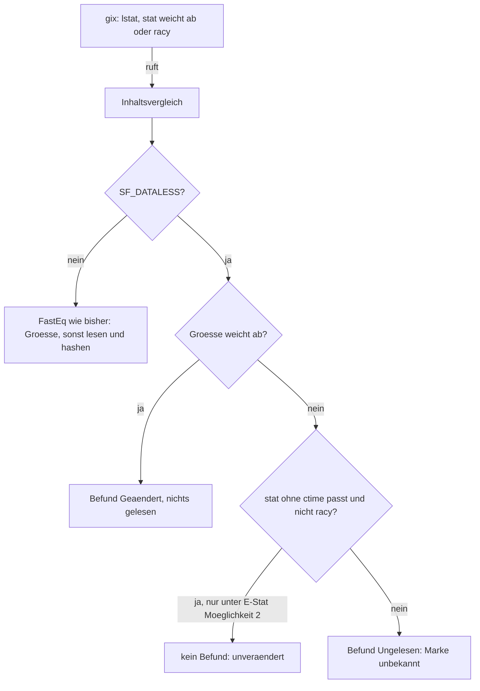
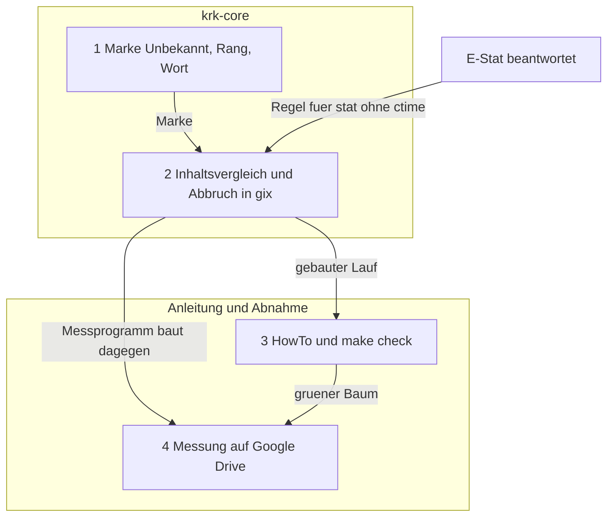

# Implementation Plan: Die Git-Markenspalte lädt keine Cloud-Dateien herunter

**Date:** 2026-10-26
**Spec:** keiner; geplant nach dem Auftrag im Narrativ `261026-1159-git-markenspalte-laedt-keine-cloud-dateien-herunter.md` und dem Defekt `261026-0608-die-markenspalte-des-git-bereichs-ist-ein-hintergrundleser-den-der-entscheid-zu-platzhalterdateien-nicht-nennt.md` mit seiner Messung vom 261026. Bindend: `261025-1444-welche-leser-duerfen-eine-platzhalterdatei-herunterladen.md` (Möglichkeit 1, beantwortet). Offen und für Schritt 2 vorausgesetzt: `261026-1208-zeigt-die-markenspalte-jede-ausgelagerte-datei-als-unbekannt-oder-nur-die-deren-stat-angaben-ausser-ctime-vom-index-abweichen.md` (E-Stat).
**Decidability:** Drei Fragen tragen den Plan. (1) „Würde `gix` den Inhalt dieser Datei lesen?“ ist entscheidbar, und zwar an genau einer Stelle: `compute_status` in `gix-status-0.34.1/src/index_as_worktree/function.rs` erreicht den Inhalt einer verfolgten Datei allein über `CompareBlobs::compare_blobs` und das `ReadData`, das es ihm reicht, und ruft das nur, wenn die stat-Angaben abweichen oder der Eintrag racy ist (gelesen am 261026). `Repository::index_worktree_status` (`gix-0.87.1/src/status/index_worktree.rs`) nimmt den Vergleich als Argument, während `Platform::into_iter` ihn fest auf `FastEq` setzt (`gix-0.87.1/src/status/iter/mod.rs`); der Plan wechselt deshalb vom Statusstrom auf diesen tieferen Weg. (2) „Ist diese Datei ausgelagert?“ ist entscheidbar am Kennzeichen `SF_DATALESS` aus `lstat`, über `krk_core::verzeichnis::ist_platzhalter`, das das vorige Paket gebaut hat; `lstat` lädt nichts herunter (bei der Messung vom 261026 hat `gix` alle 261 Dateien per `lstat` angesehen, und 259 blieben ausgelagert). (3) „Hat sich eine ausgelagerte Datei geändert?“ ist **ohne ihren Inhalt nicht entscheidbar**. Der Plan stellt stattdessen eine Frage, die aus den Eingaben entscheidbar ist: „Belegen die stat-Angaben eine Änderung, schließen sie eine aus, oder lassen sie die Frage offen?“ Belegt die Größe eine, heißt die Antwort „M“, und lassen sie die Frage offen, heißt sie „unbekannt“. Ob ctime dabei zählt, entscheidet E-Stat: gemessen am 261026-1208 an drei Dateien hebt das Auslagern allein ctime. Der Abbruch (4) ist entscheidbar, sobald das Kennzeichen `gix` selbst erreicht; das tut es heute nicht (`## Current State`).

## Directive

Die Markenspalte lädt in einem Repository auf einem Cloudlaufwerk keine ausgelagerte Datei herunter und zeigt für eine Datei, deren Stand sie nicht kennt, eine erkennbare Marke „unbekannt“. Die Directive steht im Narrativ und wird hier nicht wiederholt.

## Current State

Gelesen am Stand `b3c78eed` (2026-10-26).

**Der Markenlauf.** `Gitleser::marken` (`crates/krk-core/src/git/leser.rs`) baut `repo.status(Discard)` mit `UntrackedFiles::Files` und `Submodule::Given { ignore: All }` und liest `into_iter(muster)` Posten für Posten; `posten_deuten` macht aus jedem Posten höchstens eine `Marke`. Gerufen wird er allein aus `gitlauffaden` in `crates/krk-core/src/git/lauf.rs`, mit `&AtomicBool` aus einem `Arc`, das `Gitlauf::drop` setzt.

**Woher der Download kommt** (Quelltext von `gix` 0.87.1 und `gix-status` 0.34.1 im Cargo-Register, gelesen am 261026). `Platform::into_iter` startet den Faden `gix::status::index_worktree::producer`, der `index_worktree_status(…, FastEq, …)` ruft. `compute_status` stellt je verfolgtem Eintrag ein `lstat` und vergleicht mit `Stat::matches` und den Optionen aus `Repository::stat_options` (`core.trustCTime` ab Werk `true`). Weicht etwas ab, ruft es `FastEq::compare_blobs`; das liefert bei abweichender Größe „geändert“, ohne zu lesen, und sonst `HashEq`, das über `stream_worktree_file` die Datei öffnet und hasht. Das ist der Faden in `read_data::Stream::read_exact` aus der Messung.

**Welche stat-Angabe abweicht** (gemessen am 261026-1208, `stat -f` gegen `git ls-files --debug` an drei Dateien unter `crates/krk-ui/src/appkit/` der Wegwerfkopie, `koordinaten.rs`, `finder.rs`, `fsevents.rs`): allein `ctime`. `mtime` samt Nanosekunden, Größe, Gerät, Inode, `uid` und `gid` stimmen mit dem Index überein; die Kennzeichen stehen auf `0x40000060`. Mit `trust_ctime: true` erreicht damit jede ausgelagerte unveränderte Datei den Inhaltsvergleich.

**Der Abbruch greift heute nicht, solange `gix` hasht.** `marken` fragt `abbruch` allein in der eigenen Schleife, also nach jedem gelieferten Posten. `Iter::next` wartet in `recv_timeout(25 ms)` und fragt dabei `gix`s eigenes Kennzeichen, das `marken` nie setzt (`should_interrupt` bleibt `None`, `unwrap_or_default()` legt ein privates an). Kommt kein Posten, weil der Erzeuger in einem Download steht, kehrt `next` nicht zurück, und `abbruch` wird nie gelesen; so ist der Lauf der Messung über zehn Minuten stehen geblieben. Das Fallenlassen des Stroms (`parallel_iter_drop`) setzt das private Kennzeichen und hängt die Fäden ab, wartet also nicht, aber erreicht wird es aus demselben Grund nicht. `compute_stream_hash` in `HashEq` bekommt außerdem `&AtomicBool::default()` und ist innerhalb einer Datei nie unterbrechbar.

**Die Marke.** `Marke` (`crates/krk-core/src/git/mod.rs`) hat fünf Werte, `ALLE` mit `[Marke; 5]`, `buchstabe` und `rang` ohne Auffangzweig; die Probe `jede_marke_steht_genau_einmal_in_alle` (`crates/krk-core/tests/git.rs`) hält `ALLE`. `texte::zusammenfassung` und `texte::wort` (`crates/krk-core/src/git/texte.rs`) nennen je Marke ein `Zahlwort`, die drei Tabellen unter `crates/krk-core/src/sprache/tabelle/` tragen `Zahlwort::Marke…`. Die Zelle der Dateiliste zeigt `buchstabe()` (`crates/krk-ui/src/appkit/tabelle.rs`), ohne über die Werte zu verzweigen; `Ordnermodell::gitmarken_setzen` (`crates/krk-core/src/verzeichnis/modell.rs`) nimmt jede Marke gleich. `HowTo.md` nennt die fünf Buchstaben im Abschnitt zum Git-Bereich.

## Approach

**Eine Stelle, an der entschieden wird, und es ist die Stelle, an der `gix` sonst lesen würde.** `marken` geht nicht mehr über `Platform::into_iter`, sondern über die zwei öffentlichen Wege, aus denen jener sich zusammensetzt, in der Reihenfolge seines Zweigs ohne `parallel` (`gix-0.87.1/src/status/iter/mod.rs`): zuerst `Repository::tree_index_status` für das Vorgemerkte, dann `Repository::index_worktree_status` für Arbeitskopie und Unverfolgtes. Dem zweiten reicht KRK statt `FastEq` einen eigenen `Inhaltsvergleich`. Er fragt je Eintrag, den `gix` ihm übergibt, ob die Datei ausgelagert ist; wenn nein, ruft er `FastEq` und verhält sich Byte für Byte wie heute. Wenn ja, rührt er das `ReadData` nicht an und entscheidet aus den stat-Angaben allein:



Die Zweige sind disjunkt und vollständig: eine Datei ist ausgelagert oder nicht, und eine ausgelagerte endet in genau einem der drei Ausgänge. Die Größenregel ist die von `FastEq` (`u64::from(entry.stat.size) != groesse && (entry.id.is_empty_blob() || entry.stat.size != 0)`), also keine neue Annahme. Unter E-Stat Möglichkeit 1 fällt der mittlere Ausgang weg, und jede ausgelagerte Datei gleicher Größe wird „unbekannt“. Die Prüfung ohne ctime nimmt `gix`s eigene `Stat::matches` mit den Optionen des Repositorys und `trust_ctime: false`, dazu `Stat::is_racy` gegen `State::timestamp()`; eine zweite stat-Logik in KRK entsteht nicht.

**Das Kennzeichen ist das, das das vorige Paket gebaut hat.** `krk_core::verzeichnis::ist_platzhalter(&std::fs::Metadata)` deutet `st_flags`; der Vergleich holt die Angaben mit `std::fs::symlink_metadata` auf den Pfad, den er aus `entry.path(index)` und dem Arbeitsbaum bildet. Das ist ein zweites `lstat` je Eintrag, **und nur für Einträge, deren stat abweicht**; für einen unveränderten lokalen Baum ruft `gix` den Vergleich gar nicht. Für Proben reist die Platzhalterfrage als Argument (`&(dyn Fn(&Path, &Metadata) -> bool + Sync)`), wie die Vorschau sie im vorigen Paket bekommen hat; ein echter Platzhalter lässt sich in keiner Probe herstellen.

**Die neue Marke und ihr Rang folgen aus dem, was eine ungelesene Datei sein kann.** `Marke::Unbekannt` mit dem Buchstaben `?`. Eine Datei, die `gix` als verfolgt kennt, aber nicht gelesen hat, ist in der Arbeitskopie entweder unverändert oder geändert; Konflikt liest `gix` aus dem Index, Vorgemerktes aus Baum und Index, Neu und Umbenannt (ohne Umbenennungssuche zwischen Index und Arbeitskopie, wie heute) aus dem Verzeichnisdurchlauf, und keines davon hängt am Inhalt. Daraus folgt der Rang, ohne Geschmack: **`Unbekannt` steht unmittelbar unter `Geaendert`.** Ein bekannter Befund vom Rang „M“ oder höher stimmt für einen Ordner, gleich was die ungelesene Datei ist; ein bekannter darunter („S“, „N“) könnte von einem „M“ in der ungelesenen Datei überholt sein, und dann ist „?“ die richtige Auskunft. Dieselbe Regel gilt für eine einzelne Datei, die vorgemerkt ist und deren Arbeitskopie ungelesen bleibt. Damit ist auch beantwortet, was ein Ordner mit ausgelagerten Dateien zeigt: das Höchste unter den bekannten, wenn es „M“ oder darüber ist, sonst „?“, sobald eine Datei im Unterbaum „unbekannt“ ist. Eine geänderte Ausführbarkeit bei ungelesenem Inhalt ist eine bekannte Änderung und bleibt „M“.

| Rang | Marke | Buchstabe |
|---|---|---|
| 5 | Konflikt | K |
| 4 | Umbenannt | U |
| 3 | Geaendert | M |
| 2 | Unbekannt | ? |
| 1 | Vorgemerkt | S |
| 0 | Neu | N |

**Der Abbruch erreicht `gix` selbst.** `index_worktree_status` nimmt `should_interrupt: &AtomicBool`, und `marken` reicht sein `abbruch` unverändert hinein. `gix` fragt es vor jedem Eintrag in jedem Arbeitsfaden (`function.rs`, Schleife über `chunk_entries`) und im Verzeichnisdurchlauf; der Rückruf von `tree_index_status` antwortet `Break`, sobald es gesetzt ist. Nach der Rückkehr fragt `marken` es noch einmal und liefert `None`, weil ein unterbrochener Lauf eine halbe Liste wäre. Weil kein Faden mehr in einem Download steht, ist ein Abbruch nach höchstens einem Eintrag wirksam; das Hashen einer großen **lokalen** Datei bleibt innerhalb der Datei ununterbrochen, wie heute.

**Was dabei wegfällt und was stehen bleibt.** Es gibt keinen Strom mehr, also keinen Faden `producer` und kein `parallel_iter_drop`; die Arbeitsfäden von `in_parallel_if` bleiben, mit derselben Fadenzahl (`thread_limit: None`). Baum gegen Index läuft vor der Arbeitskopie statt daneben; das kostet die Zeit von `index_from_tree`, die der Schritt 5 an der Kopie misst. `EntryStatus::NeedsUpdate` erreicht KRK jetzt, weil der Filter von `Iter::maybe_keep_index_change` entfällt; er bleibt ohne Marke, und zurückgeschrieben wird weiter nichts (`Outcome::write_changes` gibt es auf diesem Weg gar nicht, `index_worktree_status` liefert ein anderes `Outcome`).

**Erwogen und verworfen.** (a) Ausschlussmuster `:(exclude)<pfad>` je ausgelagerter Datei im Statusstrom: KRK müsste die Platzhalter vorher selbst aufzählen, also jeden verfolgten Eintrag ein zweites Mal `lstat`en, und die Datei fiele auch aus dem Vorgemerkten heraus. (b) `core.trustctime=false` für das ganze Repository: E-Stat Möglichkeit 3, verworfen, weil es die Auskunft für lokale Dateien ohne Grund ändert und eine ausgelagerte Datei mit neuem mtime trotzdem gelesen würde. (c) Ein eigener Abgleich von Index und Arbeitskopie ohne `gix-status`: eine zweite Statuslogik neben der Kiste.

**Was dieser Plan nicht anfasst.** Der Verzeichnisdurchlauf liest `.gitignore`-Dateien des Arbeitsbaums (`WorktreeThenIdMappingIfNotSkipped` in `index_worktree_status`, nicht einstellbar), und das Aufzählen eines ausgelagerten Ordners ist ein Netzumlauf für Metadaten; ob eine ausgelagerte `.gitignore` dabei heruntergeladen wird, misst Schritt 5, gebaut wird dafür hier nichts (`## Where this work stops`). Dateien unter `.git` (Index, Packs) liest jeder Statuslauf, und dass sie lokal liegen, ist Voraussetzung jeder Auskunft; Schritt 5 zählt sie, sonst nichts.

## Implementation Steps

1. **`Marke::Unbekannt` im Kern, mit Buchstabe, Rang und Wort in drei Sprachen**
   - Executor: code-implementer
   - Files: `crates/krk-core/src/git/mod.rs`; `crates/krk-core/src/git/texte.rs`; `crates/krk-core/src/sprache/schluessel.rs`; `crates/krk-core/src/sprache/tabelle/de.rs`, `fr.rs`, `en.rs`; `crates/krk-core/tests/git.rs` (nur der Doc-Kommentar der Probe `jede_marke_steht_genau_einmal_in_alle`, falls er die Feldbreite nennt)
   - Changes: `Marke` bekommt als letzte Variante `Unbekannt` mit Doc-Kommentar („der Inhalt der Datei liegt nur in der Cloud und ist nicht gelesen; was ihre stat-Angaben zulassen, ist unverändert oder geändert“). `ALLE` wird `[Marke; 6]` mit `Unbekannt` am Ende, sodass die Zusammenfassung die Zahl zuletzt nennt. `buchstabe`: `Unbekannt => '?'`. `rang` nach der Tabelle in `## Approach`; der Doc-Kommentar von `rang` bekommt den Absatz, warum `Unbekannt` unmittelbar unter `Geaendert` steht (eine ungelesene verfolgte Datei ist unverändert oder geändert, also stimmt ein bekannter Befund ab „M“ immer und einer darunter nicht). Der Doc-Kommentar der Aufzählung nennt sechs Zustände statt fünf. Neuer Schlüssel `Zahlwort::MarkeUnbekannt` (in der Aufzählung und in ihrer Liste `ALLE` in `schluessel.rs`), deutsch `("{n} unbekannt", "{n} unbekannt")`, französisch `("{n} inconnu", "{n} inconnus")`, englisch `("{n} unknown", "{n} unknown")`; `texte::wort` bekommt die Zeile. Die Probe `jede_marke_traegt_ihren_eigenen_buchstaben` in `texte.rs` bekommt `(Marke::Unbekannt, '?')`. Neue Probe in `texte.rs`: die Rangfolge der sechs Werte ist streng und lautet K, U, M, ?, S, N; und `zusammenfassung` mit einem „unbekannt“-Eintrag nennt „1 unbekannt“ an letzter Stelle.
   - Akzeptanz: `cargo test -p krk-core --lib git::` grün, darin die zwei geänderten und die neue Probe; `cargo test -p krk-core --test git jede_marke_steht_genau_einmal_in_alle` grün; `cargo test -p krk-core --test baum` grün, besonders `jede_alle_liste_fuehrt_genau_die_varianten_ihrer_aufzaehlung`, `kein_stringliteral_des_betriebscodes_traegt_einen_umlaut_ausser_in_der_sprachtabelle` und `keine_senke_der_oberflaeche_bekommt_ein_literal`; `cargo clippy -p krk-core --all-targets` ohne Warnung. Rot außerhalb dieser Läufe ist ein Halt.
   - Prüfkommando: die vier Läufe der Akzeptanz, mit `export PATH="$HOME/.cargo/bin:$PATH"`
   - Dependencies: none

2. **Der Markenlauf liest keine ausgelagerte Datei und reicht den Abbruch an `gix` durch**
   - Executor: code-implementer
   - Files: `crates/krk-core/src/git/leser.rs`; `crates/krk-core/src/git/mod.rs` (nur Modulkopf, Abschnitt „Die Grenze der Stufe A“, der Satz über `NeedsUpdate`); `crates/krk-core/src/git/lauf.rs` (nur Modulkopf, Absatz „Was das haelt und was nicht“); `crates/krk-core/tests/git.rs`
   - Changes: (a) `marken(&self, ordner, abbruch)` ruft `marken_mit(ordner, abbruch, &|_, angaben| crate::verzeichnis::ist_platzhalter(angaben))`; neu `pub fn marken_mit(&self, ordner: &Path, abbruch: &AtomicBool, ist_platzhalter: &(dyn Fn(&Path, &std::fs::Metadata) -> bool + Sync)) -> Option<Vec<(String, Marke)>>` mit `#[must_use]` und einem Doc-Kommentar, der sagt, dass der Betrieb `marken` ruft und die Frage allein für Proben austauschbar ist. (b) Rumpf in der Reihenfolge des Zweigs ohne `parallel` von `Platform::into_iter`: `index_or_empty()`; `head_tree_id_or_empty()`; ein `gix::Pathspec` aus `Repository::pathspec` über dieselben `muster`; `tree_index_status(&baum, &index, Some(&mut pathspec), TrackRenames::AsConfigured, rueckruf)`, dessen Rückruf jede Änderung über `into_owned()` in das heutige `pfad_der_indexaenderung` und die Marken `Vorgemerkt`/`Umbenannt` gibt und bei gesetztem `abbruch` `Break` antwortet; dann `index_worktree_status(&index, muster, &mut sammler, vergleich, BuiltinSubmoduleStatus::new(self.repo.clone().into_sync(), Submodule::Given { ignore: Ignore::All, check_dirty: false }), &mut gix::progress::Discard, abbruch, Options { sorting: None, dirwalk_options: Some(self.repo.dirwalk_options()?.emit_untracked(EmissionMode::Matching)), rewrites: None, thread_limit: None })`. Jeder Fehler und ein danach gesetztes `abbruch` ergeben `None`. (c) `struct Inhaltsvergleich<'a>` mit dem Index (`&'a gix::index::State`), dem Arbeitsbaum, den stat-Optionen (`Repository::stat_options()` mit `trust_ctime` auf `false`) und der Platzhalterfrage; `impl CompareBlobs` mit `type Output = Befund`, `enum Befund { Geaendert, Ungelesen }`, nach dem Bild in `## Approach`. Ein Fehlschlag des eigenen `lstat` ergibt `Ungelesen`. Unter E-Stat Möglichkeit 1 entfällt der Ausgang „stat ohne ctime passt“. (d) `struct Sammler` implementiert `gix::status::plumbing::index_as_worktree_with_renames::VisitEntry` mit `ContentChange = Befund` und trägt über `eintragsname` und `eintragen` ein; die Arbeitskopie-Hälfte von `posten_deuten` deutet jetzt den Eintrag aus `gix-status`: `Conflict` K, `Change(Modification { content_change: Some(Befund::Ungelesen), executable_bit_changed: false, .. })` `Unbekannt`, jede andere `Change` M, `IntentToAdd` S, `NeedsUpdate` keine Marke; `DirectoryContents` und `Rewrite` wie heute. Die Fallunterscheidung bleibt ohne Auffangzweig. (e) Modulkopf von `leser.rs`: die Liste unter „Ab welcher `gix`-Fassung …“ nennt zusätzlich `Repository::index_worktree_status`, `Repository::tree_index_status`, `Repository::pathspec`, `Repository::stat_options`, `Repository::index_or_empty`, `Repository::head_tree_id_or_empty`, `Repository::dirwalk_options`, `BuiltinSubmoduleStatus::new`, `CompareBlobs`, `FastEq`, `Stat::matches`, `Stat::is_racy` und `State::timestamp`; neuer Abschnitt `# Eine Datei, die nur in der Cloud liegt` mit der Stelle in `compute_status`, dem Bild aus `## Approach`, der Messung vom 261026-1208 und dem verbleibenden Wettlauf (der Provider lagert zwischen dem `lstat` des Vergleichs und dem Öffnen aus, dann wird gelesen; hingenommen wie im vorigen Paket). Der Doc-Kommentar von `marken` ersetzt „`abbruch` ist die eine Ausnahme …“ durch die neue Reichweite (vor jedem Eintrag in `gix`, nicht mehr zwischen zwei Posten) und sagt, warum der Abbruch bis zum 261026 nicht griff. Der Absatz zu `NeedsUpdate` in `posten_deuten` und der Satz dazu im Kopf von `mod.rs` sagen, dass der Posten KRK jetzt erreicht und ohne Marke bleibt. `lauf.rs`: „beim naechsten Posten“ wird „vor dem naechsten Eintrag des Index“.
   - Akzeptanz: neue Proben in `crates/krk-core/tests/git.rs`, jede mit Gegenprobe voran; die Platzhalterfrage sagt ja für Dateinamen, die `wolke` enthalten, und `chmod 000` an der Datei macht jedes Lesen zum Fehlschlag, sodass ein `Some(…)` belegt, dass nichts gelesen wurde. Vor `git add` wird die mtime jeder solchen Datei um mindestens zwei Sekunden zurückgesetzt, damit der Eintrag nicht racy ist. (1) Nach dem Commit nur `chmod 000` (hebt ctime, lässt mtime und Größe): Gegenprobe `marken` liefert `None`, weil `gix` liest und scheitert; `marken_mit` liefert `Some`, unter E-Stat Möglichkeit 2 ohne Marke für `wolke.txt`, unter Möglichkeit 1 mit `Unbekannt`. (2) Inhalt gleicher Länge ersetzt, mtime neu, `chmod 000`: `marken_mit` liefert `Unbekannt`. (3) Inhalt anderer Länge, `chmod 000`: `marken_mit` liefert `Geaendert`. (4) Ordner `unter/` mit einer vorgemerkten Datei und einer Datei aus (2): der Ordner trägt `Unbekannt`; mit einer geänderten Datei statt der vorgemerkten trägt er `Geaendert`. (5) Abbruch mitten im Lauf: dreihundert Dateien, die nach dem Commit eine neue mtime bekommen, eine Platzhalterfrage, die beim ersten Ruf `abbruch` setzt und ihre Rufe zählt: `marken_mit` liefert `None`, und die Zahl der Rufe bleibt unter dreihundert; Gegenprobe mit einer Frage, die nichts setzt, liefert `Some` und dreihundert Rufe. Jede vorhandene Probe in `tests/git.rs` bleibt grün, besonders `ein_gesetztes_abbruchkennzeichen_bricht_den_markenlauf_ab`, `keine_statusabfrage_steht_ausserhalb_des_gitmoduls`, die Probe aller fünf bisherigen Marken und die Kindprobe `kind_liest_unter_abgesenkter_deskriptorgrenze`. `cargo clippy -p krk-core --all-targets` ohne Warnung, `RUSTDOCFLAGS="-D warnings" cargo doc -p krk-core --no-deps` ohne Warnung. Rot außerhalb von `krk-core` ist ein Halt.
   - Prüfkommando: `cargo test -p krk-core --test git`, `cargo test -p krk-core --lib git::`, dann die zwei Läufe aus der Akzeptanz
   - Source: Defekt `261026-0608-die-markenspalte-des-git-bereichs-ist-ein-hintergrundleser-den-der-entscheid-zu-platzhalterdateien-nicht-nennt.md`, Abnahme (b); Entscheid `261025-1444-welche-leser-duerfen-eine-platzhalterdatei-herunterladen.md`, Möglichkeit 1; Entscheid `261026-1208-zeigt-die-markenspalte-jede-ausgelagerte-datei-als-unbekannt-oder-nur-die-deren-stat-angaben-ausser-ctime-vom-index-abweichen.md`
   - Dependencies: 1; E-Stat beantwortet (steht er offen, beginnt der Schritt nicht und die Frage geht an den Nutzer)

3. **Die Anleitung nennt das Fragezeichen und sagt, was die Spalte auf einem Cloudlaufwerk tut**
   - Executor: code-implementer
   - Files: `HowTo.md`
   - Changes: Im Abschnitt zum Git-Bereich, beim Absatz über die Spalte „Marke“: die Aufzählung der Buchstaben bekommt „`?` unbekannt“. Danach zwei Sätze für den Nutzer: eine Datei, die nur in der Cloud liegt, lädt die Markenspalte nicht herunter; sie trägt `?`, wenn sich ohne ihren Inhalt nicht sagen lässt, ob sie geändert ist, und ein Ordner trägt `?`, wenn darunter so eine Datei liegt und nichts Gewichtigeres als „vorgemerkt“ oder „neu“ bekannt ist. Unter E-Stat Möglichkeit 2 ein dritter Satz: eine ausgelagerte Datei, an der seit dem letzten `git status` nichts geändert ist, trägt keine Marke.
   - Akzeptanz: `grep -n '`?`' HowTo.md` findet die Stelle im Git-Abschnitt; `make check` läuft auf diesem Stand grün (der erste Lauf des ganzen Baums nach den Schritten 1 und 2).
   - Prüfkommando: `make check`
   - Dependencies: 2

4. **Abnahmemessung an der Wegwerfkopie auf Google Drive, Ergebnis im Modulkopf und am Defekt**
   - Executor: code-implementer
   - Files: außerhalb des Baums `/private/tmp/claude-502/-Users-k1-Projects-productive-krk/30a8f18d-4756-46f5-a821-816b2ea70198/scratchpad/gitmessung/src/main.rs` und `…/scratchpad/evict.swift` (nur benutzt); im Baum `crates/krk-core/src/git/leser.rs` (nur der Abschnitt `# Eine Datei, die nur in der Cloud liegt`); der Defekt `261026-0608-die-markenspalte-des-git-bereichs-ist-ein-hintergrundleser-den-der-entscheid-zu-platzhalterdateien-nicht-nennt.md` im Paket der Cloud-Vorschau (neuer Abschnitt `## Messung nach dem Umbau` und `Resolved:`-Zeile)
   - Changes: Kopie `D="/Users/k1/Google Drive/Meine Ablage/shared/krk"`. (a) Das Messprogramm gibt zusätzlich je Buchstabe die Zahl der Marken und die Namen mit `?` und `M` aus und kennt `--abbruch-nach-ms <n>` (ein zweiter Faden setzt das Kennzeichen nach `n` ms); es baut gegen den Baum nach Schritt 2. (b) Ausgangsstand: jede ausgelagerte Datei außerhalb von `.git` lokal holen (`find "$D" -path "$D/.git" -prune -o -type f -flags +dataless -print0 | xargs -0 cat > /dev/null`), dann `git -C "$D" status` einmal, damit der Index aufgefrischt ist, solange alles lokal liegt. Zwei Dateien vorbereiten und nicht vormerken: in `crates/krk-core/src/git/texte.rs` ein Zeichen durch ein anderes gleicher Byte-Länge ersetzen, an `crates/krk-core/src/git/lauf.rs` eine Zeile anhängen. (c) Alle Dateien unter `crates/` und die `.gitignore` der Wurzel auslagern (`swift evict.swift …`), die Menge der ausgelagerten Pfade vorher in eine Datei schreiben (`find "$D/crates" "$D/.gitignore" -flags +dataless | sort`), dazu `find "$D/.git" -type f -flags +dataless | wc -l`. (d) Für jede ausgelagerte verfolgte Datei `stat -f '%Fm %z %i'` gegen `git ls-files --debug` halten und zählen, wie viele außer in ctime abweichen (erwartet: die zwei vorbereiteten). (e) Das Messprogramm auf `$D/crates/krk-core/src/git`, `$D/crates/krk-core/src`, `$D/crates` und `$D` fahren, jeden Lauf mit `timeout 120`, Dauer und Marken notieren; danach `--abbruch-nach-ms 1` auf `$D`. Dasselbe Programm auf `/Users/k1/Projects/productive/krk/crates/krk-core/src` des lokalen Baums, als Vergleichszahl zu den 12 bis 164 ms des Modulkopfs. (f) Die Menge der ausgelagerten Pfade nach allen Läufen gegen die vorher halten. (g) Ergebnis mit Datum, Zahlen und dem Satz, welche stat-Angabe abweicht, in den Abschnitt des Modulkopfs; denselben Befund als `## Messung nach dem Umbau` an den Defekt, darunter `---` und `Resolved: Schritte 1 und 2 des Plans 261026-1208-plan-git-markenspalte-laedt-keine-cloud-dateien-herunter.md; Abnahme (b) mit den Proben in crates/krk-core/tests/git.rs, Abnahme (a) mit der Messung nach dem Umbau.`
   - Akzeptanz: jeder Lauf aus (e) kehrt binnen `timeout 120` zurück, der auf `$D/crates/krk-core/src` binnen 10 s; der Abbruchlauf liefert `None` binnen 2 s; die Menge aus (f) ist unverändert für jede Datei unter `crates/`; `texte.rs` trägt `?`, `lauf.rs` trägt `M`, und unter E-Stat Möglichkeit 2 trägt keine weitere ausgelagerte Datei unter `crates/krk-core/src/git` eine Marke, unter Möglichkeit 1 trägt jede `?`. Nach den Schreibvorgängen aus (g): `cargo fmt --all --check` und `RUSTDOCFLAGS="-D warnings" cargo doc -p krk-core --no-deps` grün.
   - Prüfkommando: die Läufe aus (e) und (f), danach `cargo fmt --all --check` und `RUSTDOCFLAGS="-D warnings" cargo doc -p krk-core --no-deps`
   - Source: Defekt `261026-0608-…`, Abnahme (a); Narrativ `261026-1159-…` (Ziel: `marken` kehrt zurück, ohne herunterzuladen)
   - Dependencies: 2, 3



Jede Kante ist eine Abhängigkeit aus den Schritten, und jede Abhängigkeit ist eine Kante; Zyklen gibt es keine.

## Where this work stops

- Die Schritte 1 bis 4 sind erledigt; `make check` ist auf dem Stand nach Schritt 3 grün, `cargo fmt --all --check` und der Dokumentationslauf auf dem Stand nach Schritt 4.
- E-Stat ist beantwortet, bevor Schritt 2 gebaut wird, und Schritt 2 baut die gewählte Möglichkeit.
- In jedem Messlauf aus Schritt 4 bleibt die Menge der ausgelagerten Dateien unter `crates/` unverändert. Verliert eine davon ihr `dataless`, ist das Ziel nicht erreicht, und das Paket schließt nicht.
- Verliert in Schritt 4 die ausgelagerte `.gitignore` der Wurzel ihr `dataless`, steht ein neuer Defekt im `issues/` dieses Pakets (der Verzeichnisdurchlauf von `gix` liest Ausschlussdateien des Arbeitsbaums), und das Paket schließt trotzdem, weil der Auftrag die Markenspalte und den Inhaltsvergleich meint.
- Meldet Schritt 4 ausgelagerte Dateien unter `.git`, steht ihre Zahl im Modulkopf; gebaut wird dafür nichts.
- Zeigt Schritt 4 außer bei den zwei vorbereiteten Dateien eine Abweichung in einer anderen stat-Angabe als ctime, steht das im Modulkopf und am Entscheid E-Stat als `Also seen:`-Zeile, und unter Möglichkeit 2 ist das ein Grund, dem Nutzer E-Stat erneut vorzulegen, bevor das Paket schließt.
- Der Defekt `261026-0608-…` ist mit der `Resolved:`-Zeile aus Schritt 4 geschlossen.
- Einen Abnahmelauf gegen die zehn Zusagen schuldet der Plan nicht: der Markenlauf ist ein Hintergrundlauf, und alle zehn stehen seit dem 261017 auf den Gegenständen der späteren Messrunde.
- Ob die Spalte in KRK selbst `?` zeigt, sieht allein der Nutzer in der laufenden Anwendung; das Paket ist ohne diese Sicht gebaut und nicht abgenommen.
- Eine Auslieferung gehört nicht zu diesem Plan.

## Data Structures

```rust
// krk-core/src/git/mod.rs
pub enum Marke { Geaendert, Vorgemerkt, Neu, Konflikt, Umbenannt, Unbekannt }
pub const ALLE: [Marke; 6];
// rang: Konflikt 5, Umbenannt 4, Geaendert 3, Unbekannt 2, Vorgemerkt 1, Neu 0

// krk-core/src/git/leser.rs (privat)
enum Befund { Geaendert, Ungelesen }
struct Inhaltsvergleich<'a> {
    index: &'a gix::index::State,
    arbeitsbaum: &'a Path,
    stat: gix::index::entry::stat::Options, // trust_ctime: false
    ist_platzhalter: &'a (dyn Fn(&Path, &std::fs::Metadata) -> bool + Sync),
}
impl CompareBlobs for Inhaltsvergleich<'_> { type Output = Befund; }
struct Sammler<'p> { praefix: &'p [u8], gefunden: Vec<(String, Marke)> }
impl<'i> VisitEntry<'i> for Sammler<'_> { type ContentChange = Befund; type SubmoduleStatus = /* von BuiltinSubmoduleStatus */; }
```

Neuer Sprachschlüssel: `Zahlwort::MarkeUnbekannt`.

## API Changes

Neu `Gitleser::marken_mit` (öffentlich, weil die Proben in `crates/krk-core/tests/` liegen). `Gitleser::marken` behält seine Signatur, `lauf.rs` ruft unverändert. `Marke` bekommt eine Variante; jede Stelle, die über sie verzweigt, steht in `krk-core/src/git/` und hält den Bau an.

## Testing Strategy

Ein echter Platzhalter steht in keiner Probe, weil sich `SF_DATALESS` ohne File-Provider-Domäne nicht setzen lässt. Die Proben halten deshalb zwei Nähte getrennt: die Deutung des Kennzeichens hält die Probe des vorigen Pakets an `ist_platzhalter`; den Weg vom Kennzeichen zur Marke halten die Proben aus Schritt 2 mit eingespritzter Frage, und `chmod 000` macht dort jedes Lesen sichtbar, weil es scheitern würde. Die Abbruchprobe zählt Rufe statt Zeit zu messen, weil Zeitproben auf diesem Gerät unzuverlässig sind (`261025-0010-die-zeitprobe-zum-abbruch-in-einer-500-mb-datei-scheitert-auch-ohne-aenderung-in-drei-von-fuenf-laeufen.md`). Die Wirkung an einem echten Laufwerk misst Schritt 4. Testbinärdateien hängen auf diesem Gerät minutenlang in `_dyld_start`; die Schritte 1 und 2 fahren deshalb gezielte Läufe, und `make check` (rund eine Stunde) fährt einmal, in Schritt 3.

## Risks & Mitigations

| Risk | Mitigation |
|---|---|
| Der nachgebaute Ablauf weicht von `Platform::into_iter` ab, und eine Marke ändert sich für lokale Dateien. | Jede vorhandene Markenprobe in `tests/git.rs` bleibt grün; die Optionen sind aus `Repository::status` und `Platform::untracked_files` abgelesen und im Modulkopf mit Fundstelle genannt. |
| Baum gegen Index läuft jetzt vor statt neben der Arbeitskopie, und der Lauf wird langsamer. | Schritt 4 misst den lokalen Baum gegen die 12 bis 164 ms des Modulkopfs; der Lauf ist nebenläufig und kostet keine Bildzeit. |
| `gix` liefert nach einem Abbruch `Ok` mit halber Liste. | `marken_mit` fragt `abbruch` nach der Rückkehr und liefert dann `None`; die Probe (5) aus Schritt 2 hält es. |
| Der Provider lagert zwischen dem `lstat` des Vergleichs und dem Öffnen aus. | Hingenommen, ein Download je Wettlauf; im Modulkopf benannt, wie im vorigen Paket. |
| E-Stat Möglichkeit 2 stuft eine ausgelagerte Datei als unverändert ein, deren Inhalt sich ohne mtime, Größe und Inode geändert hat. | Dieselbe Lücke wie `git` mit `core.trustctime=false`, im Entscheid ausgeschrieben; Schritt 4 misst die stat-Angaben aller ausgelagerten Dateien nach. |
| Eine spätere `gix`-Fassung ändert `CompareBlobs` oder `index_worktree_status`. | Die Kiste ist auf `0.87` festgenagelt; die Liste im Modulkopf nennt jeden angesprochenen Weg. |

## Open Questions

- [ ] **E-Stat**, Entscheid `261026-1208-zeigt-die-markenspalte-jede-ausgelagerte-datei-als-unbekannt-oder-nur-die-deren-stat-angaben-ausser-ctime-vom-index-abweichen.md`: jede ausgelagerte Datei mit abweichendem stat als `?` (Möglichkeit 1, Wortlaut des Auftrags), oder nur die, deren stat ohne ctime abweicht (Möglichkeit 2, empfohlen). Schritt 2 wartet auf die Antwort.
- [ ] **Der Buchstabe.** Der Plan schlägt `?` vor. `git status --short` schreibt `??` für unverfolgte Dateien; KRK schreibt dafür `N`, also ist `?` in der Spalte frei und liest sich ohne Legende als „weiß nicht“. Eine andere Wahl ändert allein `buchstabe` und eine Probe.
