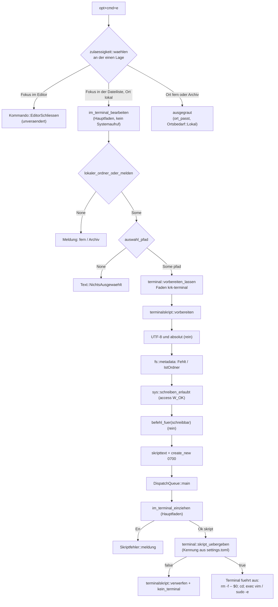

# Implementation Plan: Ein Tastenbefehl der Dateiliste öffnet die Datei unter dem Cursor im Terminal, mit vim oder mit sudo -e

**Date:** 2026-10-29 (überarbeitet am 261029 nach dem Nutzerentscheid „ein Befehl statt zwei“, vor der Freigabe)
**Spec:** none — planned from raw request (Narrativ `261029-0915-datei-im-terminal-mit-vim-und-sudo-e-oeffnen.md`, Absatz „Geändert am 261029“)
**Decidability:** Vier Fragen tragen den Plan. (1) Dürfen „Editor schließen“ und der neue Befehl `opt+cmd+e` teilen? Das ist am Wert entscheidbar: `Wirkungsbereich::Editor` steht auf `Seite::Editor`, `Wirkungsbereich::Dateifenster` auf `Seite::Ausserhalb`, `schliesst_aus` sagt ja, und `im_weg` lässt den zweiten Träger zu (`crates/krk-core/src/tasten/belegung.rs`, gelesen). (2) Ist der Eintrag unter dem Cursor eine vorhandene lokale Datei mit einem Pfad in UTF-8? Entscheidbar aus dem `Ort` des Tabs, dem Pfad und einem `fs::metadata` zum Zeitpunkt des Befehls. (3) Darf der Nutzer die Datei schreiben? Entscheidbar mit `access(2)` und `W_OK`, das Rechtebits, Eigentümer, Zugriffsliste und ein schreibgeschütztes Dateisystem zusammen beantwortet. Die Hülle dafür steht schon im Baum (`krk_core::verzeichnis::sys::schreiben_erlaubt`). Die Antwort gilt im Augenblick der Frage, und bis zum Start von vim oder sudo kann sie sich ändern. Das ist hingenommen (Risiken). (4) Führt die eingestellte Terminal-Anwendung eine übergebene `.command`-Datei aus? **Aus KRKs Eingaben nicht entscheidbar**: LaunchServices nennt die Dokumenttypen, die eine Anwendung anmeldet, aber nicht, was sie damit tut. Der Mechanismus fragt deshalb nicht vorab, sondern übergibt, und ob es läuft, zeigt das Terminal. Für `com.apple.Terminal` ist es an der `Info.plist` belegt (Rolle `Shell` für `com.apple.terminal.shell-script`). Für jede andere Anwendung gehört es zur Nutzerabnahme.

## Directive

In der Dateiliste öffnet `opt+cmd+e` die Datei unter dem Cursor im Terminal. Ist sie für den Nutzer schreibbar, läuft `vim -- <pfad>`, sonst `sudo -e -- <pfad>`. KRK wählt selbst, eine zweite Taste gibt es nicht, und `opt+shift+cmd+e` bleibt frei. Das Passwort fragt `sudo` selbst im Terminal. KRK hält, speichert und übergibt keins. Mit dem Fokus im Editor bleibt `opt+cmd+e` „Editor schließen“. An einem fernen Ort und in einem Archiv ist der Befehl ausgegraut. Der Wortlaut steht im Narrativ des Pakets und wird hier nicht wiederholt.

Drei Fragen an den Nutzer liegen als Entscheidungsdatensätze im Paket. Der Plan ist auf ihre Empfehlung gebaut, bei der dritten auf den Nutzerentscheid, wie er heute steht:

- `261029-0920-wie-kommt-ein-befehl-wie-vim-datei-in-die-eingestellte-terminal-anwendung.md`: `.command`-Datei (empfohlen) oder AppleScript.
- `261029-0921-welcher-menueeintrag-zeigt-opt-cmd-e-editor-schliessen-oder-mit-vim-bearbeiten.md`: welcher Menüeintrag das geteilte Kürzel zeigt.
- `261029-0957-geht-eine-nicht-schreibbare-datei-in-einem-beschreibbaren-ordner-an-sudo-e-oder-an-vim.md`: ob die Wahl außer der Datei auch den Ordner fragt. Der Grund ist, dass `sudo -e` in einem beschreibbaren Ordner immer ablehnt, auch bei der eigenen schreibgeschützten Datei. Der Plan baut auf Möglichkeit 1, die Regel des Nutzers ohne Zusatz. Möglichkeit 2 ändert allein die reine Wahlfunktion, ihre Proben und die Anleitung.

## Current State

Gelesen am 261029, je mit Fundstelle:

- **Belegung.** `resources/default-keymap.toml` ist die eine Quelle. `editor_schliessen` trägt `opt+cmd+e`, `terminal_oeffnen` trägt `ctrl+o`. Die Schreibweise der Zusatztasten ist erzwungen `[ctrl+][opt+][shift+][cmd+]` (`crates/krk-core/src/tasten/parser.rs`, Modulkopf).
- **Teilung.** `im_weg` lässt zwei Funktionen desselben Zustellers eine Kombination tragen, wenn der eine Bereich den anderen ausschließt oder verengt, und höchstens zwei. `Kommando::EditorSchliessen` trägt `Wirkungsbereich::Editor` (`Seite::Editor`). Der neue Befehl bekommt `Dateifenster` (`Seite::Ausserhalb`), wie `TerminalOeffnen`. Das ist ein Ausschluss, und `Nachschlag::Geteilt` nennt die zwei in der Reihenfolge der Datei. Welche ein Anschlag meint, entscheidet `zulaessigkeit::waehlen` an der einen `Lage`.
- **Menü.** `menuemodell::fruehere_behalten_das_kuerzel` nimmt dem später stehenden von zwei gleichen Kürzeln die Anzeige. Die Folge der Obermenüs ist `Funktionsbereich::ALLE` (`crates/krk-ui/src/belegungsmodell.rs`). „Dateioperationen“ steht dort vor „Editor“. `terminal_oeffnen` steht unter „Dateioperationen“, `editor_schliessen` unter „Editor“.
- **Schreibrecht.** `krk_core::verzeichnis::sys::schreiben_erlaubt(pfad) -> io::Result<bool>` (`crates/krk-core/src/verzeichnis/sys.rs`) ruft `access(2)` mit `W_OK`, folgt einer Verknüpfung, antwortet auf `EACCES`, `EPERM` und `EROFS` mit `Ok(false)` und gibt jeden anderen Fehlschlag als `Err` zurück. Einziger Rufer heute ist `archiv::umbau`. Der Doc-Kommentar sagt zu: „wird allein auf einem Arbeitsfaden gerufen“. `access(2)` prüft gegen die reale Kennung des Prozesses. KRK ist kein setuid-Programm, die reale ist also die wirksame Kennung, und die Antwort ist die für den Nutzer. Eine weitere Bindung, eine dritte `unsafe`-Datei oder `rustix`/`nix` braucht der Plan nicht. `krk-core` führt kein `libc`, und das bleibt so.
- **Hauptfaden.** Laut `.claude/rules/coding-was-man-nicht-sieht.md` ist ein lokaler `Ort` auch ein über NetFS eingehängter Ordner, denn `Ortsbedarf::Lokal` unterscheidet ihn nicht. Der lokale Löschweg fragt `canonicalize` auf dem Hauptfaden, und dass eine hängende Freigabe dort die Ereignisschleife anhält, ist ein offener Defekt (`261016-1956-der-loeschweg-fragt-canonicalize-und-den-papierkorb-auf-dem-hauptfaden-und-ein-haengendes-netzlaufwerk-haelt-die-ereignisschleife-an.md`). Neue Wege halten den Hauptfaden frei von Plattenfragen und belegen das mit einer Quelltextprobe (`der_duplikatweg_stellt_auf_dem_hauptfaden_keinen_systemaufruf`, `der_verbindungsweg_stellt_auf_dem_hauptfaden_nur_den_einen_stat`, beide `appkit/anwendung.rs`). `ctrl+o` fragt `fs::metadata` heute auf dem Hauptfaden (`operationen::ordner_fehlt`). Das ist derselbe Defekt an einer weiteren Stelle und als eigener Datensatz abgelegt (`261029-0958-ordner-im-terminal-oeffnen-fragt-metadata-auf-dem-hauptfaden-und-ein-haengendes-netzlaufwerk-haelt-die-ereignisschleife-an.md`). Er ist kein Vorbild für den neuen Weg.
- **Fadenweg.** `appkit/auswurf.rs` ist das Muster: Arbeit auf einem benannten Faden, Ergebnis über `DispatchQueue::main().exec_async` (`auf_dem_hauptfaden`) zurück, Einzug in einem Rumpf des Anwendungsdelegierten. `dispatch2::DispatchQueue` steht dort schon mit Untergrenzen-Eintrag.
- **Terminal-Weg.** `crates/krk-ui/src/appkit/terminal.rs`, `ordner_oeffnen(kennung, ordner)`: weist einen Pfad ohne UTF-8 ab, löst die Bündelkennung auf und ruft `openURLs:withApplicationAtURL:configuration:completionHandler:` mit leerem Rückruf. Die Probe der Kontextbefehle in `anwendung.rs` sucht `terminal::ordner_oeffnen(` im Rumpf von `im_finder_oeffnen`. **Der Name `ordner_oeffnen` bleibt deshalb stehen.**
- **Ausführung.** `Anwendungsdelegierter::kommando_ausfuehren_bei` endet auf einen Auffangzweig. Ein Kommando ohne eigenen Zweig dort tut nichts und besteht trotzdem jede Probe.
- **Auswahl.** `Tabelle::auswahl_pfad` liefert den Pfad der ausgewählten Zeile, ohne Auswahl oder an einem fernen Ort `None`.
- **Ortsbedarf.** `Kommando::ortsbedarf` verzweigt vollständig. `TerminalOeffnen` trägt `Ortsbedarf::Lokal`. Die Proben `an_einem_fernen_ort_sind_genau_diese_befehle_ausgegraut` und `im_archiv_sind_genau_diese_befehle_ausgegraut` (`kommandos/zulaessigkeit.rs`) führen die ausgegrauten Befehle mit Namen.
- **Pflichtstellen eines neuen Kommandos.** Der Übersetzer hält `Kommando::wirkungsbereich`, `Kommando::ortsbedarf`, `bereich_des_kommandos` und `kommandoname` in `de.rs`, `fr.rs` und `en.rs`. Eine Probe hält `Kommando::KENNUNGEN` und den Eintrag in der Belegungsdatei. Den Ausführungszweig hält nichts.
- **Passwort.** `das_passwort_wird_allein_an_netfs_und_ssh_preisgegeben` bleibt unverändert. Kein Schritt nennt `Passwort`, `preisgeben` oder `anmeldehilfe`.
- **Zeitzusagen.** Seit dem 261017 stehen alle zehn Zusagen auf den Gegenständen der späteren Messrunde (CLAUDE.md, „Maximen“). Ein Menüeintrag mehr schuldet keinen eigenen Abnahmelauf, und der Hauptfaden bekommt keine Plattenfrage dazu.

## Approach

Ein Befehl, eine Wahl und ein Weg. Die Wahl ist eine reine Funktion im Kern über einen Wahrheitswert. Die Frage nach dem Schreibrecht stellt die vorhandene Hülle `schreiben_erlaubt`, zusammen mit dem `metadata` und dem Anlegen des Skripts in einer Kernfunktion `terminalskript::vorbereiten`. Die läuft auf dem Faden `krk-terminal` und nie auf dem Hauptfaden. Ihr Ergebnis kommt über `DispatchQueue::main` zurück, und der Hauptfaden übergibt das Skript über dieselbe Hülle um `NSWorkspace`, über die `ctrl+o` den Ordner übergibt. Die Teilung von `opt+cmd+e` läuft über die bestehende Ausschlussregel, ohne eine Zeile an `im_weg`.



Der Skripttext, mit `<o>` und `<d>` als gequotetem Ordner und gequoteter Datei:

```sh
#!/bin/sh
rm -f -- "$0"
cd -- <o> || exit 1
exec vim -- <d>
```

Für eine nicht schreibbare Datei lautet die letzte Zeile `exec sudo -e -- <d>`. Gequotet wird mit einfachen Anführungszeichen, und ein `'` im Pfad wird zu `'\''`. Damit sind Leerzeichen, `"`, `$`, `` ` ``, `;`, `*`, ein Zeilenumbruch und ein führendes `-` (dafür das `--`) ohne Sonderfall abgedeckt.

**Entscheidungen dieses Plans.** Das sind keine Nutzerfragen, sondern Festlegungen mit Grund. Wer eine ändern will, ändert den Plan.

- **E1, ein Ordner unter dem Cursor wird gemeldet und nicht ausgegraut.** Die `Lage` der Zulässigkeit kennt den Typ der Auswahl nicht, und ihn hinzuzufügen hieße, für einen Befehl bei jedem Tastendruck das Modell zu fragen. F4 meldet auf einem Ordner ebenso. Geprüft wird mit **einem** `fs::metadata` (folgt Verknüpfungen), das zugleich „gibt es nicht mehr“ beantwortet. Ein `sudo -e` auf einem verschwundenen Pfad legte die Datei als root an, und das soll ein Tastendruck in KRK nicht auslösen.
- **E2, aufgeräumt wird vom Skript selbst.** `rm -f -- "$0"` ist die erste Handlung, und die Shell hält die geöffnete Datei weiter. KRK führt keine Liste offener Skripte. Führt die Anwendung das Skript nie aus, bleibt eine Datei mit `0700` im nutzereigenen `$TMPDIR` liegen. Scheitert schon die Übergabe, verwirft KRK das Skript sofort.
- **E3, Ort und Name.** `std::env::temp_dir()` ist auf macOS `$TMPDIR` unter `/var/folders/…/T/`, ein Ordner mit `0700`, der dem Nutzer gehört. Der Name ist `krk-terminal-<pid>-<nanosekunden>-<zähler>.command`, angelegt mit `create_new` und Modus `0o700`. `temp_dir()` steht an genau einer Stelle, `terminalskript::skriptverzeichnis`. Das Modul trägt kein `impl Drop` und kein `remove_dir_all`, damit die Zählprobe `genau_drei_pruefordner_fassungen_stehen_im_baum` es nicht für eine vierte Fassung hält.
- **E4, kein Systemaufruf auf dem Hauptfaden außer dem Verwerfen im Fehlerfall.** `metadata`, `access(2)` und das Schreiben des Skripts laufen auf dem Faden `krk-terminal`. Der Grund: die Datei kann auf einer eingehängten Freigabe liegen, und eine hängende Freigabe hielte sonst die Ereignisschleife an. Außerdem sagt `schreiben_erlaubt` den Arbeitsfaden zu. Die eine Ausnahme ist `terminalskript::verwerfen` nach einer gescheiterten Übergabe. Es entfernt eine Datei, die KRK selbst unter `$TMPDIR` angelegt hat. `$TMPDIR` liegt immer auf der Startplatte und nie auf einer Freigabe. Eine Quelltextprobe hält beides fest (Schritt 5).
- **E5, die Wahl ist rein und hat eine Eingabe.** `terminalskript::befehl_fuer(schreibbar: bool) -> Terminalbefehl` liefert `Vim` für `true` und `SudoBearbeiten` für `false`. Sie kennt kein Dateisystem. `vorbereiten` ist ihr einziger Rufer im Betriebscode, und eine Probe hält das fest. Ein `Err` aus `schreiben_erlaubt` ist kein Nein: er wird als `Skriptfehler::Pruefen` gemeldet, und es startet weder vim noch sudo. Wer aus einem unklaren Befund `sudo -e` macht, fragt nach einem Passwort, ohne dass das nötig war.
- **E6, kein neuer Name aus einer `objc2_`-Kiste.** `terminal.rs` bekommt einen privaten Rumpf `oeffnen_mit(kennung, pfad)`, den `ordner_oeffnen` (Name und Vertrag unverändert) und ein neues `skript_uebergeben(kennung, skript)` rufen. Dazu kommt `vorbereiten_lassen(datei, fertig)` mit `DispatchQueue` aus `dispatch2`. Steht `dispatch2` noch nicht im Untergrenzen-Abschnitt von `terminal.rs`, trägt der Bearbeiter es dort ein, im Wortlaut von `auswurf.rs`.
- **E7, Name und Kennung.** Der Befehl heißt `Kommando::ImTerminalBearbeiten` mit der Kennung `im_terminal_bearbeiten`. Die Namen in den drei Tabellen sind ein Vorschlag, den der Bearbeiter im Ton der Nachbarn fasst: „Im Terminal bearbeiten“, „Edit in Terminal“, „Modifier dans le Terminal“. Der Name sagt nicht, welches Programm läuft, denn das wählt KRK.

## Implementation Steps

1. **Kern: Wahl, Prüfung, Skript und ihre Meldungen**
   - Executor: code-implementer
   - Files: `crates/krk-core/src/terminalskript.rs` (neu), `crates/krk-core/src/lib.rs`, `crates/krk-core/src/verzeichnis/sys.rs` (allein Doc-Kommentar und Modulkopf), `crates/krk-core/src/sprache/schluessel.rs`, `crates/krk-core/src/sprache/tabelle/de.rs`, `crates/krk-core/src/sprache/tabelle/fr.rs`, `crates/krk-core/src/sprache/tabelle/en.rs`, `crates/krk-core/tests/terminalskript.rs` (neu)
   - Changes: Modul `terminalskript` mit Modulkopf: Zweck, die Regel aus E5, Skriptform, E2, E3, E4 (gerufen allein auf einem Arbeitsfaden), warum kein AppleScript (mit Verweis auf den Datensatz `261029-0920-…`) und die bekannte Grenze von `sudo -e` in einem beschreibbaren Ordner (mit Verweis auf `261029-0957-…`). Typen und Funktionen:
     - `pub enum Terminalbefehl { Vim, SudoBearbeiten }`.
     - `#[must_use] pub fn befehl_fuer(schreibbar: bool) -> Terminalbefehl`, rein.
     - `#[must_use] pub fn skripttext(befehl, datei: &Path) -> Result<String, Skriptfehler>`, rein: verlangt einen absoluten Pfad mit Elternordner und gültiges UTF-8 und gibt die vier Zeilen aus `## Approach` zurück.
     - `pub fn vorbereiten(verzeichnis: &Path, datei: &Path) -> Result<Vorbereitet, Skriptfehler>`. Reihenfolge: (a) die Pfadprüfung aus `skripttext` vor jedem Systemaufruf; (b) `fs::metadata(datei)`, ein Fehler wird `Fehlt`, ein Ordner `IstOrdner`; (c) `verzeichnis::sys::schreiben_erlaubt(datei)`, ein `Err` wird `Pruefen(io::Error)`; (d) `befehl_fuer`; (e) `skripttext`; (f) Schreiben mit `OpenOptions::create_new` und `OpenOptionsExt::mode(0o700)`. `pub struct Vorbereitet { pub skript: PathBuf, pub befehl: Terminalbefehl }`.
     - `pub fn skriptverzeichnis() -> PathBuf`, die eine Stelle mit `temp_dir()`.
     - `pub fn verwerfen(skript: &Path)`, Fehler still.
     - `pub enum Skriptfehler { KeinUtf8, NichtAbsolut, Fehlt, IstOrdner, Pruefen(io::Error), Schreiben(io::Error) }` mit `#[must_use] fn meldung(&self) -> String` aus der Sprachtabelle.

     In `sys.rs` den Doc-Kommentar von `schreiben_erlaubt` um den zweiten Rufer ergänzen und die Zeile `access(2) ──> schreiben_erlaubt ──> archiv::umbau` im Diagramm des Modulkopfs um `└─> terminalskript` erweitern. Keine Bindung kommt dazu, die Zählung „zehn Schnittstellen, vierzehn Funktionen“ bleibt gleich. Neue Schlüssel in `Text` (mit `Text::ALLE`) und Einträge in allen drei Tabellen: Datei fehlt, ist ein Ordner, Pfad ohne UTF-8, Schreibrecht nicht feststellbar (mit Grund), Skript nicht angelegt (mit Grund). Trägt ein vorhandener Schlüssel denselben Satz schon, nimmt der Bearbeiter ihn statt eines neuen. Literale außerhalb der Sprachtabelle tragen keine Umlaute.
   - Proben (`crates/krk-core/tests/terminalskript.rs`, Prüfordner aus `tests/gemeinsam`):
     - (a) `befehl_fuer(true) == Vim` und `befehl_fuer(false) == SudoBearbeiten`.
     - (b) Eine Datei mit `0o644` im Prüfordner ergibt `Vim`. Dieselbe mit `0o444` ergibt `SudoBearbeiten`: die Datei gehört dem Nutzer, aber das Modusbit fehlt, und genau das sieht `access(2)`. Eine Probe für einen fremden Eigentümer oder eine Zugriffsliste gibt es nicht, weil `cargo test` keine root-Datei anlegen kann. Das deckt die Nutzerabnahme (b).
     - (c) Für jeden der Namen `mit leerzeichen.txt`, `it's.txt`, `a"b.txt`, `$HOME.txt`, `` back`tick.txt ``, `semi;colon.txt`, `-fuehrend.txt`, `zeilen\numbruch.txt`, `Größe.txt` und für beide Modi (`0o644` und `0o444`): Datei anlegen, `vorbereiten` rufen, das Skript mit `std::process::Command::new("/bin/sh")` ausführen. Dabei `PATH=<prüfordner>/bin:/usr/bin:/bin` mit einem Ersatz-`vim` und einem Ersatz-`sudo`, die ihr Arbeitsverzeichnis und ihre Argumente durch NUL getrennt in eine Datei schreiben. Erwartet: `["--", <pfad>]` bzw. `["-e", "--", <pfad>]`, Arbeitsverzeichnis gleich dem Ordner der Datei (beide kanonisiert), Skriptdatei nach dem Lauf verschwunden.
     - (d) Rechte des Skripts sind `0o700`.
     - (e) Ein Ordner ergibt `IstOrdner`, ein fehlender Pfad `Fehlt`, und beide legen kein Skript an.
     - (f) `skripttext` mit einem Pfad aus `b"/tmp/krk-\xffkrumm"` ergibt `KeinUtf8`, ohne Dateisystem.
     - (g) Der Text beginnt mit `#!/bin/sh\n`, und `rm -f -- "$0"` steht vor `exec`.
     - (h) Eine Quelltextprobe: `befehl_fuer(` steht im Betriebscode von `krk-core/src` allein im Rumpf von `vorbereiten`, und `schreiben_erlaubt(` hat genau die zwei Rufer `archiv/umbau.rs` und `terminalskript.rs`.
   - Acceptance: `cargo test -p krk-core` grün, `cargo clippy --workspace --all-targets` ohne Warnung. `genau_zwei_dateien_oeffnen_die_regel_deny_unsafe_code` ist unverändert grün, und `terminalskript.rs` trägt kein `unsafe`.
   - Dependencies: none. Die Datensätze `261029-0920-…` und `261029-0957-…` müssen beantwortet sein, mit Möglichkeit 1 des ersten. Fällt der zweite auf Möglichkeit 2, bekommt `befehl_fuer` zwei Eingaben, und (a), (b) und (h) wachsen um den Ordner.

2. **Ein Kommando mit allen Pflichtstellen außer Belegungsdatei und Ausführung**
   - Executor: code-implementer
   - Files: `crates/krk-core/src/tasten/belegung.rs`, `crates/krk-core/src/sprache/tabelle/de.rs`, `crates/krk-core/src/sprache/tabelle/fr.rs`, `crates/krk-core/src/sprache/tabelle/en.rs`, `crates/krk-ui/src/belegungsmodell.rs`, `crates/krk-ui/src/kommandos/zulaessigkeit.rs`
   - Changes: Die Variante `Kommando::ImTerminalBearbeiten` steht unmittelbar nach `TerminalOeffnen`. Ihr Doc-Kommentar sagt, was sie tut, nennt den Nutzerentscheid vom 261029 („ein Befehl, KRK wählt“), sagt, dass KRK kein Passwort sieht, und dass `opt+cmd+e` mit `EditorSchliessen` per Ausschluss geteilt ist. `wirkungsbereich` → `Dateifenster`. `ortsbedarf` → `Lokal`, im Kommentar des Zweigs unter „das Terminal“ mitgenannt. `KENNUNGEN` um `"im_terminal_bearbeiten"` erweitern, die Feldlänge mit. `kommandoname` in den drei Tabellen (E7). `bereich_des_kommandos` → `Funktionsbereich::Dateioperationen`, neben `TerminalOeffnen`; bei Möglichkeit 2 des Menüdatensatzes → `Funktionsbereich::Editor`. In `zulaessigkeit.rs` den Befehl in `AUSGEGRAUT` von `an_einem_fernen_ort_sind_genau_diese_befehle_ausgegraut` und in `LOKALER_PFAD` von `im_archiv_sind_genau_diese_befehle_ausgegraut` aufnehmen und die Feldlängen nachziehen.
   - Acceptance: `cargo build --workspace` grün. `cargo test --workspace` hat **genau eine erwartete rote Probe**, `jede_kennung_der_kommandos_steht_in_der_auslieferungsbelegung` (`crates/krk-core/src/tasten/belegung.rs`), weil die Kennung erst mit Schritt 3 in der Belegungsdatei steht. Jede andere rote Probe ist ein Halt.
   - Dependencies: 1; Menüdatensatz `261029-0921-…` beantwortet.

3. **Belegungsdatei: ein Eintrag**
   - Executor: data-implementer
   - Files: `resources/default-keymap.toml`
   - Changes: Hinter `terminal_oeffnen` ein `[[funktion]]`-Eintrag mit `id = "im_terminal_bearbeiten"` und `tasten = ["opt+cmd+e"]`. Der Kommentar im Stil der Datei, in ASCII-Umschrift, nennt: den Nutzerentscheid vom 261029 mit dem Narrativ des Pakets (ein Befehl, KRK wählt nach dem Schreibrecht zwischen vim und sudo -e); die Teilung mit `editor_schliessen` als Ausschluss nach dem Entscheid `260926-2308_*_duerfen-zwei-funktionen-desselben-zustellers-eine-kombination-tragen-wenn-ihre-wirkungsbereiche-einander-ausschliessen.md`; den Preis im Menü nach dem beantworteten Menüdatensatz; dass sudo das Passwort selbst fragt. Am Kommentar von `editor_schliessen` kommt ein Absatz „Seit dem 261029 teilt opt+cmd+e …“ dazu: die Bedeutung im Editor ist unverändert, und bei Möglichkeit 1 steht die Anzeige im Menü beim neuen Befehl. Bei Möglichkeit 2 steht der Eintrag hinter `editor_schliessen` statt hinter `terminal_oeffnen`. `opt+shift+cmd+e` wird nicht belegt.
   - Acceptance: `cargo test --workspace` grün, `Belegung::auslieferung().konflikte()` leer (gehalten von den vorhandenen Proben).
   - Dependencies: 2.

4. **Proben der Teilung, der Wahl der Funktion und des Menüs**
   - Executor: code-implementer
   - Files: `crates/krk-core/tests/belegung.rs`, `crates/krk-ui/src/kommandos/zulaessigkeit.rs`, `crates/krk-ui/src/menuemodell.rs`
   - Changes:
     - (a) `crates/krk-core/tests/belegung.rs`, nach dem Muster von `die_auslieferung_teilt_delete_und_cmd_n_mit_den_eintragsbefehlen`: `opt+cmd+e` ergibt `Nachschlag::Geteilt` mit `im_terminal_bearbeiten` und `editor_schliessen` in Dateireihenfolge. `Kommando::ImTerminalBearbeiten.wirkungsbereich().schliesst_aus(Kommando::EditorSchliessen.wirkungsbereich())` ist wahr, `konflikte()` ist leer, und `opt+shift+cmd+e` ergibt keinen Treffer.
     - (b) `zulaessigkeit.rs`, nach dem Muster von `cmd_n_legt_vor_einer_eintragsdatei_an_und_holt_sonst_das_fenster`: über jede Lage wählt `waehlen` für `opt+cmd+e` mit dem Fokus im Dateifenster und lokalem Ort `ImTerminalBearbeiten`, mit dem Fokus im Editor (Textform) `EditorSchliessen` und an einem fernen Ort oder im Archiv mit dem Fokus im Dateifenster keinen.
     - (c) `menuemodell.rs`, nach dem Muster von `die_geteilten_tasten_der_eintragsbefehle_kosten_kein_kuerzel`: bei Möglichkeit 1 zeigt `im_terminal_bearbeiten` `opt+cmd+e` und `editor_schliessen` kein Kürzel. Bei Möglichkeit 2 ist es umgekehrt, und `der_bereich_editor_fuehrt_genau_die_befehle_des_editors` (`belegungsmodell.rs`) bekommt die Kennung.
   - Acceptance: `cargo test --workspace` grün.
   - Dependencies: 3.

5. **Fadenweg, Ausführungszweig und Übergabe an die Terminal-Anwendung**
   - Executor: code-implementer
   - Files: `crates/krk-ui/src/appkit/terminal.rs`, `crates/krk-ui/src/appkit/anwendung.rs`
   - Changes:
     - `terminal.rs` nach E6: ein privater Rumpf `oeffnen_mit(kennung, pfad) -> bool` mit der UTF-8-Abweisung und dem Ruf an `NSWorkspace`. `ordner_oeffnen` ruft ihn und bleibt in Name, Vertrag und Probe gleich. Neu `#[must_use] pub fn skript_uebergeben(kennung, skript: &Path) -> bool`, das ihn ebenso ruft.
     - Ebenfalls neu `pub fn vorbereiten_lassen(datei: PathBuf, fertig: impl FnOnce(Result<Vorbereitet, Skriptfehler>) + Send + 'static)` nach dem Muster von `auswurf::auswerfen` und `auf_dem_hauptfaden`. Es startet einen Faden mit dem Namen `krk-terminal` über `std::thread::Builder`, ruft darin `terminalskript::vorbereiten(&terminalskript::skriptverzeichnis(), &datei)` und reicht das Ergebnis über `DispatchQueue::main().exec_async` an `fertig`. Scheitert der Fadenstart, meldet `fertig` das als `Skriptfehler::Schreiben`. Der Modulkopf nennt unter „Zwei Wege stellen diese Frage“ den dritten Rufer und den Faden, und der Absatz über den leeren Rückruf gilt unverändert.
     - In `anwendung.rs` ein Zweig in `kommando_ausfuehren_bei`, auf einer Zeile: `Kommando::ImTerminalBearbeiten => self.im_terminal_bearbeiten()`. Der Rumpf von `im_terminal_bearbeiten` läuft auf dem Hauptfaden und stellt keinen Systemaufruf: `lokaler_ordner_oder_melden`, dann `auswahl_pfad` oder `Text::NichtsAusgewaehlt`, dann die Kennung aus `einstellungen.terminal`, dann `terminal::vorbereiten_lassen`. Der Rückruf führt nach dem Muster des Auswurfs auf `im_terminal_einziehen(seite, kennung, ergebnis)`. Dieser Rumpf meldet bei `Err` mit `antwort_zeigen(seite, &fehler.meldung())`. Bei `Ok` ruft er `terminal::skript_uebergeben`, und bei `false` folgen `terminalskript::verwerfen` und `operationen::kein_terminal`. `im_terminal_bearbeiten` liefert immer `true`, mit derselben Begründung wie bei `terminal_oeffnen`.
     - Zwei Quelltextproben im Prüfmodul von `anwendung.rs`, mit `rumpf`/`diese_datei`:
       - `der_terminalbefehl_reisst_nirgends_ab`, nach dem Muster von `der_auswurfweg_reisst_nirgends_ab`: der Zweig steht in `kommando_ausfuehren_bei` mit `im_terminal_bearbeiten`, dessen Rumpf enthält `terminal::vorbereiten_lassen(` und `im_terminal_einziehen`, und `im_terminal_einziehen` enthält `terminal::skript_uebergeben(`, `terminalskript::verwerfen(` und `.meldung()`.
       - `der_terminalbefehl_stellt_auf_dem_hauptfaden_keinen_systemaufruf`, nach dem Muster von `der_duplikatweg_stellt_auf_dem_hauptfaden_keinen_systemaufruf`: in den Rümpfen von `im_terminal_bearbeiten` und `im_terminal_einziehen` steht keine der Nadeln `fs::`, `metadata(`, `exists(`, `schreiben_erlaubt(`, `terminalskript::vorbereiten(` und `ordner_fehlt(`. Ihr Doc-Kommentar nennt `terminalskript::verwerfen` als die eine Ausnahme nach E4 und schreibt aus, was sie nicht sieht: einen Systemaufruf in einer tiefer gerufenen Funktion.
     - Kein `unsafe`, kein `Command::new` im Betriebscode, kein `Passwort`.
   - Acceptance: `make check` grün (alle fünf Abnahmekommandos, darunter `cargo doc` mit `-D warnings`). `grep -rn 'Command::new' crates/krk-core/src crates/krk-ui/src` zeigt keinen neuen Treffer im Betriebscode. `das_passwort_wird_allein_an_netfs_und_ssh_preisgegeben` und `jeder_frameworkimport_steht_namentlich_im_untergrenzen_abschnitt` sind grün.
   - Dependencies: 1, 4.

6. **Anleitung**
   - Executor: code-implementer
   - Files: `HowTo.md`
   - Changes: Ein Abschnitt „Eine Datei im Terminal bearbeiten“ neben der Beschreibung von `ctrl+o`, sonst unter „Die Tastaturbelegung“. Er sagt:
     - `opt+cmd+e` öffnet die Datei unter dem Cursor im Terminal. Darf der Nutzer sie schreiben, mit vim, sonst mit `sudo -e`. KRK fragt das beim Tastendruck, Rechte, Eigentümer und Zugriffsliste zusammen.
     - `sudo` fragt das Passwort im Terminal, und KRK sieht und speichert es nicht. Welchen Editor `sudo -e` startet, bestimmt sudo über `SUDO_EDITOR`, `VISUAL` oder `EDITOR` (ab Werk `vi`).
     - **Die bekannte Grenze:** eine Datei, die der Nutzer nicht schreiben darf, in einem Ordner, den er beschreiben darf, geht an `sudo -e`, und sudo weigert sich dort und sagt das im Terminal. Das betrifft eine root-Datei im eigenen Ordner und ebenso eine eigene, schreibgeschützte Datei. sudo weigert sich auch bei einer Verknüpfung.
     - Eine schreibbare Datei als root zu öffnen geht mit diesem Befehl nicht. Wer das will, tippt `sudo -e` selbst im Terminal (`ctrl+o`).
     - Auf einem Ordner meldet KRK in der Statuszeile. An einem fernen Ort und im Archiv ist der Befehl ausgegraut.
     - Der Weg führt über ein kurzes Skript, das sich beim Start selbst löscht. Mit Terminal.app geht das. Eine andere eingestellte Terminal-Anwendung muss Shell-Skripte (`.command`) ausführen.
     - Wer eine eigene `keymap.toml` führt, belegt den Befehl in der F1-Ansicht über „Zuweisen“ (`cmd+t`) und nicht über `cmd+r`.

     In der Tabelle unter „Editor und Vorschau“ bekommt die Zeile `opt+cmd+e` den Zusatz, dass die Taste in der Dateiliste die Datei im Terminal öffnet, und den Satz zum Menü: bei Möglichkeit 1 steht „Editor schließen“ dort ohne Kürzel und wirkt unverändert. Die zwei Aufzählungen „Ausgegraut sind dort …“ unter „Archive im Dateifenster“ und „Ordner auf einem Server“ um den Befehl ergänzen. Fällt `261029-0957-…` auf Möglichkeit 2, entfällt die Grenze im dritten Punkt und an ihre Stelle tritt die Regel dieser Möglichkeit. Die Anleitung nennt keine Zahl, die mit der nächsten Runde veraltet.
   - Acceptance: `make check` grün. `grep -n 'opt+cmd+e' HowTo.md` findet den Abschnitt. `grep -n 'opt+shift+cmd+e\|shift+opt+cmd' HowTo.md` findet nichts.
   - Dependencies: 5.

## Where this work stops

- Die drei Entscheidungsdatensätze des Pakets (`261029-0920-…`, `261029-0921-…`, `261029-0957-…`) stehen auf `answered` oder weiter.
- Die Schritte 1 bis 6 stehen auf `done`.
- `make check` läuft auf dem Stand nach Schritt 6 grün.
- Die Probe `das_passwort_wird_allein_an_netfs_und_ssh_preisgegeben` ist im Diff unverändert.
- `crates/krk-core/src/verzeichnis/sys.rs` bekommt im Diff keinen neuen `extern`-Block und keine neue Bindung.
- `resources/default-keymap.toml` trägt `opt+shift+cmd+e` nach Schritt 3 nicht.
- Die Nutzerabnahme ist als Nutzerarbeit vermerkt, und das Paket gilt erst nach ihr als abgenommen. Kein Agent kann sie fahren, weil sie KRK im Vordergrund und ein echtes Terminal braucht. Gefahren wird mit dem gebauten Bündel und `terminal = "com.apple.Terminal"`:
  - (a) `opt+cmd+e` auf einer eigenen Datei mit Leerzeichen und `'` im Namen öffnet ein Terminalfenster mit vim auf genau dieser Datei, und der Arbeitsordner ist ihr Ordner.
  - (b) `opt+cmd+e` auf einer Datei unter `/etc` öffnet `sudo -e`, die Passwortabfrage steht im Terminal, und nach dem Sichern ist die Datei geändert.
  - (c) `opt+cmd+e` auf einer eigenen Datei mit `chmod 444` im eigenen Ordner zeigt die Weigerung von sudo im Terminal (bei Möglichkeit 1 von `261029-0957-…`) bzw. öffnet vim (bei Möglichkeit 2).
  - (d) `opt+cmd+e` mit dem Fokus im Editor schließt den Editor wie bisher.
  - (e) Auf einem Ordner meldet die Statuszeile. An einem fernen Ort und in einem Zip ist der Menüeintrag ausgegraut.
  - (f) Nach dem Lauf liegt unter `$TMPDIR` keine `krk-terminal-*.command`.
  - (g) `opt+shift+cmd+e` löst in KRK nichts aus.
  - (h) Wenn der Nutzer will, dasselbe mit einer anderen Terminal-Anwendung, und das Ergebnis wird vermerkt.
- Ein Abnahmelauf gegen die zehn Zeitzusagen ist nicht geschuldet (`## Current State`, letzter Punkt): `(condition did not arise: kein gemessener Weg ändert sich außer einem Menüeintrag auf dem Startpfad, der Hauptfaden bekommt keine Plattenfrage dazu, und L4 steht bereits auf der späteren Messrunde)`.

## Data Structures

- `krk_core::terminalskript::Terminalbefehl { Vim, SudoBearbeiten }`
- `krk_core::terminalskript::Vorbereitet { skript: PathBuf, befehl: Terminalbefehl }`
- `krk_core::terminalskript::Skriptfehler { KeinUtf8, NichtAbsolut, Fehlt, IstOrdner, Pruefen(io::Error), Schreiben(io::Error) }`
- `krk_core::tasten::Kommando::ImTerminalBearbeiten`
- Neue Schlüssel in `krk_core::sprache::Text` für die Meldungen von `Skriptfehler`

## API Changes

- `krk_core::terminalskript::{befehl_fuer, skripttext, vorbereiten, skriptverzeichnis, verwerfen}` (neu)
- `krk_core::verzeichnis::sys::schreiben_erlaubt`: Signatur unverändert, ein zweiter Rufer
- `krk_ui::appkit::terminal::{skript_uebergeben, vorbereiten_lassen}` (neu); `ordner_oeffnen` unverändert, intern auf `oeffnen_mit` umgestellt
- `Anwendungsdelegierter::{im_terminal_bearbeiten, im_terminal_einziehen}` (neu, privat)

## Testing Strategy

- Wahl: rein über `befehl_fuer`, dazu `access(2)` an einer eigenen Datei mit und ohne Schreibbit (Schritt 1a, 1b).
- Skripttext und Quoting end-to-end unter `/bin/sh` mit Ersatzprogrammen, für beide Befehle (Schritt 1c). Damit ist ohne AppKit und ohne Terminal entschieden, ob der Pfad unverfälscht bei vim und sudo ankommt.
- Belegung: Teilung als Ausschluss, `opt+shift+cmd+e` unbelegt (Schritt 4a).
- Zulässigkeit: Wahl je Fokus und Ort über jede Lage, Ausgrauen fern und im Archiv (Schritte 2 und 4b).
- Menü: welcher Eintrag das Kürzel zeigt (Schritt 4c).
- Ausführung: Quelltextprobe gegen den Auffangzweig und gegen eine Plattenfrage auf dem Hauptfaden (Schritt 5).
- Sprachtabellen: die drei Tabellen hält der Übersetzer, `Text::ALLE` hält `jede_alle_liste_fuehrt_genau_die_varianten_ihrer_aufzaehlung`.
- Fremder Eigentümer, Zugriffsliste und echter Terminallauf gehören zur Nutzerabnahme unter `## Where this work stops`.

## Risks & Mitigations

| Risk | Mitigation |
|------|------------|
| `sudo -e` lehnt eine Datei in einem beschreibbaren Ordner ab, auch die eigene schreibgeschützte | Nutzerfrage `261029-0957-…`. Bei Möglichkeit 1 nennt die Anleitung die Grenze, und die Meldung von sudo steht im Terminal. |
| Das Schreibrecht ändert sich zwischen Prüfung und Start | Hingenommen. Im schlimmsten Fall öffnet vim die Datei schreibgeschützt oder sudo fragt unnötig, und beides sieht der Nutzer im Terminal. Ein Prüfen im Skript wäre eine zweite Regel neben der einen. |
| `access(2)` scheitert mit einem anderen Fehler als „nicht erlaubt“ | `Skriptfehler::Pruefen`, Meldung in der Statuszeile, kein Start (E5). |
| Eine hängende Freigabe hält die Ereignisschleife an | Alle Plattenfragen laufen auf `krk-terminal` (E4), gehalten von der Quelltextprobe in Schritt 5. Der Faden selbst wartet so lange wie die Freigabe, ohne die Oberfläche anzuhalten. |
| Eine andere Terminal-Anwendung als Terminal.app führt `.command` nicht aus | Nicht vorab entscheidbar (Decidability). Die Anleitung nennt die Bedingung, die Nutzerabnahme prüft sie in (h). |
| Ein neues Kommando ohne Ausführungszweig tut still nichts | Quelltextprobe in Schritt 5 |
| Ein Skript bleibt liegen | Selbstlöschung als erste Zeile, Verwerfen bei gescheiterter Übergabe. Ein Rest liegt im privaten `$TMPDIR` mit `0700`. |
| `sudo -e` auf einer gerade verschwundenen Datei legt sie als root an | `metadata` vor dem Anlegen meldet `Fehlt`. Ein Wettlauf zwischen Prüfung und Start bleibt und ist hingenommen. |
| Ein Pfad mit Sonderzeichen wird von der Shell zerlegt | Einfache Anführungszeichen, `'\''`, `--`, end-to-end geprüft in Schritt 1c |
| „Editor schließen“ verliert die Anzeige im Menü | Nutzerfrage im Menüdatensatz. Die Wirkung bleibt, und die Anleitung schreibt es hin. |

## Open Questions

- [ ] Weg in die Terminal-Anwendung: `261029-0920-wie-kommt-ein-befehl-wie-vim-datei-in-die-eingestellte-terminal-anwendung.md` (Empfehlung: `.command`-Datei). Blockiert die Schritte 1, 5 und 6.
- [ ] Anzeige des geteilten Kürzels im Menü: `261029-0921-welcher-menueeintrag-zeigt-opt-cmd-e-editor-schliessen-oder-mit-vim-bearbeiten.md` (Empfehlung: „Dateioperationen“, „Editor schließen“ ohne Kürzel). Blockiert die Schritte 2 bis 4 und 6.
- [ ] Fragt die Wahl auch den Ordner: `261029-0957-geht-eine-nicht-schreibbare-datei-in-einem-beschreibbaren-ordner-an-sudo-e-oder-an-vim.md`. Der Plan baut auf Möglichkeit 1, die Regel des Nutzers ohne Zusatz. Blockiert die Schritte 1 und 6.
- [ ] Nicht blockierend, nur für diesen Plan: Soll KRK vor der Übergabe prüfen, ob die eingestellte Anwendung `.command` als Dokumenttyp anmeldet? Der Plan sagt nein, weil die Anmeldung nicht sagt, ob ausgeführt wird. Wer es will, ergänzt es in einem eigenen Paket über `oeffnenmit::anwendungen_fuer`.
- [ ] Nicht blockierend: E1 (Ordner melden statt ausgrauen) ist eine Festlegung des Plans. Will der Nutzer das Ausgrauen, braucht `Lage` ein Feld für den Typ der Auswahl, und der Plan bekommt dafür einen Schritt.
