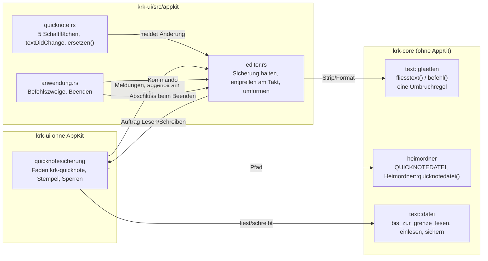
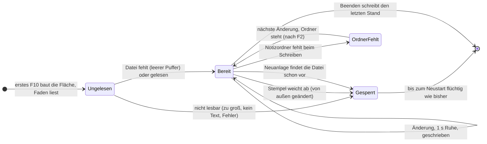

# Implementation Plan: Die Quicknote sichert sich als `scratch.txt` und trägt Strip und Format

**Date:** 2026-10-31
**Spec:** none — geplant aus dem Brief `261031-1024-quicknote-sichert-sich-als-scratch-txt-und-traegt-strip-und-format.md` (Directive und Beispiel des Nutzers wörtlich), Modus `autonomous`. Er überholt Teile des geschlossenen Spec `260926-2300_*_spec-f10-oeffnet-quicknote-mit-fluechtigem-puffer.md` im Arbeitspaket `260926-2246-f10-oeffnet-quicknote-mit-fluechtigem-puffer`; welche, steht unter „Was dieser Plan am Spec der Quicknote überholt“.
**Decidability:** Die tragende Frage ist für Strip und Format dieselbe: war ein Zeilenumbruch im eingefügten Text einer des Terminals oder ein gewollter? Aus dem Text allein ist sie **nicht** allgemein entscheidbar, denn die Breite des Terminals reist nicht mit. Der Plan ändert deshalb den Mechanismus von „erkennen“ zu „schätzen mit zwei Signalen und zurücknehmbar machen“: die Breite ist die längste Zeile der Eingabe, umgebrochen heißt, dass das erste Wort der Folgezeile nicht mehr in die Zeile gepasst hätte (mit einem Nachlass von einem Zehntel der Breite), **und** die Folgezeile ist eingerückt, wie es der Terminalumbruch des Chats tut. Jede Umformung ist eine Handlung, die `cmd+z` zurücknimmt, und das Beispiel des Nutzers ist als Probe die Abnahme. Die zweite Frage, ob `scratch.txt` seit dem letzten eigenen Schreiben von anderer Hand geändert wurde, ist über Zeitpunkt und Größe (`Stempel`) entscheidbar, bis auf das Fenster zwischen Vergleich und Schreiben, das auch der Editor (C4) hinnimmt.

## Directive

Nach dieser Arbeit landet jede Änderung am Inhalt der Quicknote ohne Zutun des Nutzers in `scratch.txt` im Notizordner (ab Werk `~/krkhome`), neben `notes.txt`, `tasks.txt`, `secrets.txt` und `appointments.md`, und nach einem Neustart steht der Inhalt beim ersten F10 wieder da. Die Quicknote trägt rechts neben „Leeren“, „Schließen“ und „Kopieren“ zwei weitere Schaltflächen: **Strip** macht aus einem aus dem Chat kopierten Shell-Befehl einen lauffähigen, **Format** macht aus terminal-umbrochenem Fließtext Absätze und Aufzählungspunkte auf je einer Zeile. Die Ziele 1 bis 3 des Briefs gelten wörtlich; sie werden hier nicht wiederholt.

## Current State

- **Die Quicknote** ist seit dem Arbeitspaket `260926-2246-…` eine eigene `NSTextView` über der Textfläche des Editors (`crates/krk-ui/src/appkit/quicknote.rs`), gebaut beim ersten F10 in `Editorbereich::quicknote` (`appkit/editor.rs`), mit eigenem Rückgängigverwalter über `undoManagerForTextView:` und einer Grenzprüfung in `textView:shouldChangeTextInRange:replacementString:` gegen `QUICKNOTEGRENZE` (`crates/krk-ui/src/quicknote.rs`). Ihr Puffer ist der Textspeicher der Fläche; **er geht heute nie auf die Platte**, und das sagen vier Stellen: die Modulköpfe beider `quicknote.rs`, der Absatz „Die Quicknote ist offen genau dann …“ in `.claude/rules/coding-was-man-nicht-sieht.md` und `HowTo.md` unter „Die Quicknote“.
- **Die drei Befehle** `QuicknoteUmschalten`, `QuicknoteKopieren`, `QuicknoteLeeren` (`crates/krk-core/src/tasten/belegung.rs`) stehen in `KENNUNGEN`, `wirkungsbereich` (die zwei letzten auf `Wirkungsbereich::Quicknote`), in der Ortsbedarf-Fallunterscheidung, in `bereich_des_kommandos` (`belegungsmodell.rs`, `Funktionsbereich::Editor`), im Menü „Editor“ (`menuemodell.rs`, `("quicknote_leeren", None)`), in `resources/default-keymap.toml` (`quicknote_leeren` mit `tasten = []`), in `UNBELEGT_AB_WERK` (`belegungsmodell.rs`), in den Zulässigkeitstafeln (`kommandos/zulaessigkeit.rs`) und je mit eigenem Zweig in `kommando_ausfuehren_bei` (`appkit/anwendung.rs`) samt der Namensliste der Probe dort. Das ist das Muster, dem die zwei neuen folgen.
- **Die Sonderdateien** (`Sonderdatei` in `crates/krk-core/src/heimordner/mod.rs`) sind ausdrücklich die *Eintragsdateien*: `Heimordner::sonderdatei` führt zu `Dateityp::Eintraege(…)`, zur Tabellenansicht, zu den Eintragsbefehlen und zur Vorschau mit Aufgabenkästchen, und `bereitstellen` legt jede aus `Sonderdatei::ALLE` bei F2 an.
- **Den Notizordner legt allein F2 an** (`heimordner::bereitstellen`, auf dem Hauptfaden), und nur dieses `mkdir(2)` entscheidet, ob die alten Zettel übernommen werden (Modulkopf von `bereitstellen.rs`). Ein zweiter Weg, der den Ordner anlegte, nähme der Übernahme ihren Anlass.
- **Schreiben:** `krk_core::text::datei::sichern` ist der Schreibweg des Editors und geht über `ablage::atomar`; die Probe `nur_benannte_dateien_erreichen_das_atomare_schreiben` (`crates/krk-core/tests/baum.rs`) führt `text/datei.rs` schon. Mit `Zeilenenden::WieGelesen` schreibt er den Stand Byte für Byte, ohne ein `\n` anzuhängen. `atomar::vorbereiten` überträgt die Rechte einer bestehenden Zieldatei vor dem Inhalt.
- **Lesen:** `datei::bis_zur_grenze_lesen` (ohne Warten an einer Röhre, mit Grenze) und `datei::einlesen` (UTF-8, gehaltene Form).
- **Änderung von außen:** `editormodell::Stempel` (`krk-ui/src/editormodell.rs`) mit `von_pfad` und Vergleich, Grundlage von C4 des Editors.
- **Arbeitsfäden des Editorbereichs** werden über **einen** Takt abgeholt (`ladenEinziehen:` → `Editorbereich::einziehen`, `takt_starten`, `takt_beenden`, `appkit/editor.rs`), heute für Lesen, Einfärben und PIN-Wechsel; der Modulkopf von `einziehen` verbietet einen zweiten Zeitgeber daneben.
- **Beenden:** `applicationWillTerminate:` (`appkit/anwendung.rs`, `wird_beendet`) schreibt den letzten Sitzungsstand synchron auf dem Hauptfaden.

## Approach

Ein Weg für die Sicherung, ein Kernmodul für die Umformungen, und die zwei neuen Befehle nach dem Muster von `quicknote_leeren`.

### Die Sicherung

### Was dieser Plan am Spec der Quicknote überholt

Die Directive vom 261031 ist das jüngere Wort des Nutzers und geht vor. Überholt sind:

- **Q2 „Der Puffer ist flüchtig“** samt den Kriterien „nach dem Neustart zeigt F10 eine leere Quicknote“ und „geht mit dem Beenden verloren“; neu: der Inhalt kommt nach dem Neustart wieder, und ein Absturz verliert höchstens die letzte Sekunde.
- **A5** („Beenden fragt nicht nach“, begründet mit „keine Persistenz“): die Nachfrage bleibt aus, jetzt weil gesichert wird.
- **Constraint „Kein Datum der Quicknote auf der Platte“** und **Out of Scope „Sichern in eine Datei … Wiederherstellung nach Absturz“**.
- **Die Zusage in `HowTo.md`** „Der Text liegt allein im Arbeitsspeicher“.

**Bestehen bleiben**, und die Proben dazu bleiben grün und unverändert: die Sitzung nennt die Quicknote nicht (`die_sitzung_nennt_die_quicknote_nicht`), `Datei::ALLE` wächst nicht, und der Suchlauf über `~/Library/Application Support/KRK/` findet kein Wort der Quicknote, denn `scratch.txt` liegt im Notizordner. Ebenso bleibt die Zusage „der Start baut nichts für die Quicknote vorab“ (L4): gelesen wird beim ersten F10.

### Entscheidungen

**E1: `scratch.txt` ist keine `Sonderdatei`.** Jeder Wert von `Sonderdatei` ist eine Eintragsdatei und führt über `Heimordner::sonderdatei` zur Tabelle, zu den Eintragsbefehlen, zur Vorschau mit Kästchen und zum Anlegen bei F2; eine fünfte Variante müsste an jeder dieser Stellen eine Ausnahme bekommen, die „ist gar keine Eintragsdatei“ sagt, also genau das Dickicht von Sonderfällen, das eine falsche Einordnung verrät. Stattdessen trägt `heimordner/mod.rs` neben der Aufzählung `pub const QUICKNOTEDATEI: &str = "scratch.txt"` und `Heimordner::quicknotedatei(&self) -> PathBuf` (geschriebene Form, `join`, kein Systemaufruf). „Bei den F2-Dateien“ heißt damit: im selben Ordner und im Code an derselben Stelle. Im Editor und in der Vorschau ist `scratch.txt` eine gewöhnliche Textdatei, F2 legt sie nicht an; sie entsteht beim ersten Sichern. Verworfen: `Sonderdatei::Quicknote` (siehe oben).

**E2: Den Notizordner legt weiter allein F2 an.** Fehlt er beim Schreiben (`ENOENT` am Ordner), schreibt die Sicherung nichts, meldet einmal „Die Quicknote wird nicht gesichert: der Notizordner {ort} fehlt. F2 legt ihn an.“ und versucht es bei der nächsten Änderung wieder; nach F2 sichert sie ohne weiteres Zutun. Ein eigenes Anlegen nähme der einmaligen Übernahme der alten Zettel ihren Anlass (`bereitstellen`, `mkdir(2)` entscheidet). Verworfen: `bereitstellen` aus der Sicherung rufen (zweiter Rufer eines Wegs, der auf dem Hauptfaden mit der Schreibsperre der Ablage läuft und den eine Probe auf seine Rufer hält). Gibt es keinen Heimordner (kein Benutzerverzeichnis), gilt dasselbe ohne Ortsangabe.

**E3: Gelesen wird beim ersten F10, auf dem Faden `krk-quicknote`, und vorher wird nichts geschrieben.** `Editorbereich::quicknote` baut die Fläche **nicht bearbeitbar** und gibt dem Faden den Auftrag „Lesen“; die Antwort setzt den Text über `setString:` und `removeAllActions` (kein Eintrag im Rückgängig, keine Vormerkung) und schaltet die Fläche bearbeitbar. Derselbe Faden bedient danach die Schreibaufträge, sodass „erst gelesen, dann geschrieben“ eine Eigenschaft der Reihenfolge ist und keine Prüfung. Bis die Antwort da ist, vormerkt die Fläche keine Änderung; ein Kopieren des leeren Puffers in dieser Spanne ist `Kopierausgang::Leer` und schreibt nichts. Gelesen wird mit `bis_zur_grenze_lesen(pfad, QUICKNOTEGRENZE, Platzhalterregel::Laden, &|| true)` und `einlesen`; eine fehlende Datei (`metadata` meldet `NotFound`, vor dem Lesen gefragt) ergibt einen leeren Puffer und „Datei fehlt“ als Ausgangsstempel. Der Ort wird beim Lesen festgelegt und gilt bis zum Ende des Prozesses (E8).

**E4: Wann gesichert wird.** (a) **Entprellt**: jede Änderung (`textDidChange:` am Delegierten der Fläche, also Tippen, Einfügen, Ziehen, Leeren, Strip, Format, Rückgängig) merkt einen Fälligkeitszeitpunkt eine Sekunde später vor und startet den **vorhandenen** Takt des Editorbereichs; `einziehen` gibt bei Fälligkeit einen Schreibauftrag mit dem ganzen Text. Kein zweiter Zeitgeber, aus dem Grund am Modulkopf von `einziehen`; der Takt endet wie bisher, wenn nichts mehr läuft, und läuft weiter, solange eine Sicherung fällig oder unterwegs ist. (b) **Sofort** beim Verlassen der Quicknote (`quicknote_verlassen`, alle Wege, auch ohne eigenen Befehl) und nach `nach_kopie_leeren`, das an `textDidChange:` vorbeischreibt und deshalb selbst vormerkt. (c) **Beim Beenden** in `wird_beendet`, vor dem Sitzungsstand: ein letzter Auftrag und ein Warten auf seine Antwort von höchstens zwei Sekunden (`recv_timeout`); ein hängender Notizordner hält das Beenden damit nicht länger auf. Der Faden fasst wartende Aufträge zusammen und schreibt nur den jüngsten. Verworfen: Schreiben je Anschlag (bis zu 16 MiB je Taste), allein beim Schließen (Absturz verlöre die ganze Sitzung).

**E5: Der Schreibweg ist `datei::sichern` mit `Dateiform { marke: false, zeilenenden: Zeilenenden::WieGelesen }`.** Damit geht der Puffer Byte für Byte über `ablage::atomar` auf die Platte, ohne angehängtes `\n` (die `sicherungsform` hängte bei jedem Rundlauf eines an), und `nur_benannte_dateien_erreichen_das_atomare_schreiben` bleibt unverändert grün, weil kein neuer Rufer von `atomar` entsteht. **Fehlt die Datei, legt die Sicherung sie zuerst exklusiv und mit den Rechten `0600` an** (`OpenOptions::create_new` mit `OpenOptionsExt::mode(0o600)`), dann sichert sie; `atomar` überträgt diese Rechte auf jede spätere Fassung. Grund: die Quicknote nimmt eingefügten Text auch aus `secrets.txt` an (E14), und eine `644`-Datei wäre für jedes Konto des Geräts lesbar. Scheitert das exklusive Anlegen an `EEXIST`, ist die Datei von anderer Hand entstanden, und es gilt E6. Einen Ordner legt dieser Weg nie an (E2).

**E6: Eine Änderung von außen sperrt das Sichern bis zum Neustart, und die Datei bleibt unberührt.** Der Faden hält den Stempel nach dem Lesen (erhoben **vor** dem Lesen, aus dem Grund an `Ladevorgang::starten`) und nach jedem eigenen Schreiben, oder „fehlt“. Vor jedem Schreiben vergleicht er; weicht der Stempel ab (eine zweite KRK-Instanz, der Editor von KRK, ein anderes Programm), schreibt er nicht und meldet einmal „scratch.txt wurde außerhalb der Quicknote geändert; die Quicknote sichert bis zum nächsten Start nicht mehr.“ Der Puffer bleibt, die Quicknote arbeitet flüchtig weiter, und wer den Text behalten will, kopiert ihn. Verworfen: überschreiben (Datenverlust an der zweiten Instanz), neu einlesen (verwürfe den Puffer), nachfragen (ein Blatt aus einem Hintergrundweg). Zwei Instanzen führen damit nicht zu einem stillen Verlust: die zuletzt gestartete liest, die zuerst schreibende gewinnt, die andere sperrt sich und sagt es.

**E7: Eine nicht lesbare `scratch.txt` sperrt ebenso.** Über `QUICKNOTEGRENZE`, kein Text (kein UTF-8), keine gewöhnliche Datei, Fehler, Deskriptormangel: die Quicknote öffnet leer und bearbeitbar, die Datei bleibt Byte für Byte, und die Statuszeile nennt den Grund („scratch.txt ließ sich nicht lesen ({grund}); die Quicknote sichert bis zum nächsten Start nicht.“). Der Grund kommt aus der vorhandenen `Lesehindernis`-Unterscheidung, vollständig und ohne Auffangzweig.

**E8: Der Ort gilt ab dem ersten Lesen für den ganzen Prozess.** „Ort wählen…“ während des Laufs wechselt den Notizordner für F2 sofort; die Quicknote sichert bis zum nächsten Start weiter in `scratch.txt` des alten Orts. Grund: ein Umzug mitten im Lauf müsste am neuen Ort eine vorhandene `scratch.txt` entweder überschreiben oder einlesen, und beides wäre eine Entscheidung über fremden Text ohne den Nutzer. `HowTo.md` sagt es.

**E9: Strip und Format sind ein Kernmodul, `krk_core::text::glaetten`, mit einer gemeinsamen Umbruchregel.** Rein, ohne AppKit, ohne Systemaufruf, ohne Kiste: `pub fn fliesstext(eingabe: &str) -> String` (Format) und `pub fn befehl(eingabe: &str) -> String` (Strip). Beide teilen die private Regel `umgebrochen`, und keine der zwei formuliert sie ein zweites Mal:

- Zeilenenden `\r\n` und `\r` gelten als `\n`; nachlaufender Leerraum jeder Zeile fällt.
- **Breite** `B` ist die längste Zeile der Eingabe in Zeichen (Unicode-Skalarwerte, Einrückung mitgezählt). Unter `MINDESTBREITE = 40` wird nichts verbunden.
- Zeile `z` ist **umgebrochen** zur Folgezeile `f`, wenn `f` nicht leer ist, `f` eingerückt ist (mindestens ein Leerzeichen; der Chat rückt jede Folgezeile ein, ein Text ohne Einrückung wird so nie verbunden, und ein schon geglätteter Text auch nicht, was beide Umformungen idempotent macht), und `länge(z) + 1 + länge(erstes Wort von f) > B − B/10`. Der Nachlass von einem Zehntel deckt die Abweichung des Umbruchs im Chat von der gemessenen längsten Zeile; ohne ihn bliebe im Beispiel die erste Zeile (161 von 168 Zeichen, Folgewort „weil“) unverbunden. Gemessen am Beispiel: jede zu verbindende Zeile hat 156 bis 168 Zeichen, die einzige nicht zu verbindende vor einer Folgezeile ohne Aufzählungszeichen hat 33.
- Verbunden wird mit genau einem Leerzeichen; die Einrückung der Folgezeile fällt. Ein Wort, das breiter ist als die Zeile und das der Chat mitten im Wort trennt (ein sehr langer Pfad), bekommt dabei ein Leerzeichen zu viel; das ist nicht entscheidbar und steht im Modulkopf und in `HowTo.md`.

Breite Zeichen (CJK, Emoji) zählen als eines; die Regel schätzt dann die Breite zu klein und verbindet eher seltener. Steht im Modulkopf.

**E10: Format im Einzelnen (reproduziert die erwartete Ausgabe des Nutzers Zeichen für Zeichen).** Eine Skizze dieser Regeln ist am 261031 gegen das Beispiel des Briefs gelaufen und ergab die erwartete Ausgabe exakt.

- Eine **Leerzeile** bleibt eine Leerzeile und beendet den laufenden Absatz oder Punkt.
- Ein **Aufzählungspunkt** ist eine Zeile, deren Text nach der Einrückung mit `- `, `* `, `• `, `<Ziffern>. ` oder `<Ziffern>) ` beginnt. Er beginnt immer eine eigene Zeile und wird ausgegeben als **ein Leerzeichen**, das Zeichen und sein Text (` - Jedes Framework …`), wie der Nutzer es angegeben hat. Ein tiefer eingerückter Punkt behält seinen Abstand zum flachsten Punkt des Textes zusätzlich (Ausgabeeinrückung `1 + einrückung − kleinste Punkteinrückung`).
- Jede **andere Zeile** wird ohne Einrückung ausgegeben, außer sie wird verbunden.
- **Verbunden** wird eine Folgezeile, die kein Punkt und keine Leerzeile ist, wenn `umgebrochen` gilt **und** ihre Einrückung mindestens die Textspalte des laufenden Eintrags erreicht: für einen Absatz dessen erste Zeile, für einen Punkt die Spalte hinter Zeichen und Leerzeichen (`  - ` → 4). So bleibt eine Zeile mit Einrückung 2 nach einem Punkt ein neuer Absatz, und die Fortsetzung eines Punkts mit Einrückung 4 wird angehängt.
- **Überschriften** brauchen keine eigene Regel: eine kurze Zeile ist nach `umgebrochen` nie umgebrochen, also beginnt die Zeile danach neu („Nicht auswählbar (8), und warum“ vor „Die Auswahl verwirft …“). Die im Brief genannte Lesart „kurze Zeile nach Leerzeile ohne Satzende“ ist damit eingeschlossen, ohne an Satzzeichen zu hängen; eine eigene Überschriftenregel daneben wäre der zweite Ort derselben Entscheidung.
- **Code-Zäune**: Zeilen von einer Zeile, deren Text mit drei Backticks beginnt, bis zur nächsten solchen, bleiben wörtlich, verlieren allein die Einrückung der öffnenden Zaunzeile und werden nie verbunden.
- Ein Schlussumbruch der Eingabe bleibt erhalten.

**E11: Strip im Einzelnen.** Ziel: ein Befehl, der im Terminal läuft, und kein Verlust von Inhalt, der für die Shell etwas bedeutet.

- Nachlaufender Leerraum fällt in jeder Zeile (er ist das Kopierartefakt des Chats, und ein Leerzeichen hinter einem `\` bricht die Fortsetzung). Leerzeilen am Anfang und am Ende fallen; die Ausgabe endet ohne `\n`, damit ein Einfügen ins Terminal nicht sofort ausführt.
- Die **Kopiereinrückung** fällt: die erste Zeile verliert ihren ganzen führenden Leerraum, jede weitere die kleinste Einrückung der nicht leeren Zeilen ab der zweiten. Mehr Einrückung bleibt (Inhalt eines Heredocs).
- Ein kleiner Zustandsautomat liest die Shell-Lage je Zeichen: `Normal`, in `'…'`, in `"…"` (mit `\`-Escape), in `$'…'` (mit `\`-Escape), Kommentar ab `#` am Wortanfang bis Zeilenende, und Heredocs: `<<WORT`, `<<-WORT`, `<<'WORT'`, `<<"WORT"` außerhalb von Anführungszeichen, mehrere je Zeile in ihrer Reihenfolge; `<<<` ist keiner.
- Endet eine Zeile **in einem offenen Anführungszeichen oder in einem Heredoc-Rumpf**, bleibt der Umbruch, wie er ist (er ist Inhalt). Ein Heredoc endet an der Zeile, die nach Abzug der Kopiereinrückung (bei `<<-` auch führender Tabulatoren) genau `WORT` ist.
- Endet eine Zeile in `Normal` auf ein unmaskiertes `\`, ist das eine **Fortsetzung**: `\` und Umbruch fallen, wie die Shell sie entfernt; stand auf einer der beiden Seiten Leerraum, steht dazwischen genau ein Leerzeichen, sonst keins (`foo\` + `bar` → `foobar`, wie die Shell es liest). Das ist die Form ohne `\`, die der Nutzer in seinen eigenen Anweisungen verlangt, und ändert die Bedeutung nicht.
- Sonst in `Normal`: gilt `umgebrochen` (E9), wird die Folgezeile mit einem Leerzeichen angehängt; sonst bleibt der Umbruch, und mehrere Befehle untereinander bleiben untereinander (ein Umbruch ist für die Shell ein `;`).
- **Was nicht entscheidbar ist und deshalb benannt wird:** zwei getrennte Befehle, deren erster fast die volle Breite einnimmt und deren zweiter eingerückt ist, werden verbunden. Das macht `cmd+z` rückgängig; `HowTo.md` sagt es.

**E12: Strip und Format wirken auf die Auswahl, sonst auf den ganzen Text, als eine zurücknehmbare Handlung.** Die Ersetzung geht über denselben Weg, den heute „Leeren“ nimmt (`breakUndoCoalescing`, `shouldChangeTextInRange:replacementString:`, `replaceCharactersInRange:withString:`, `didChangeText`), herausgehoben zu `Quicknote::ersetzen(bereich, text)`, und `leeren` ruft ihn mit dem ganzen Bereich und `""`; ein zweiter Ersetzungsweg entsteht nicht. Die Grenzprüfung des Delegierten gilt damit auch hier. Danach ist das Ergebnis ausgewählt. Ändert die Umformung nichts, bleibt der Puffer unberührt (kein leerer Rückgängigeintrag), und die Statuszeile sagt „Strip: nichts zu ändern.“ bzw. „Format: nichts zu ändern.“

**E13: Die zwei Schaltflächen sind auch Befehle, nach dem Muster von `quicknote_leeren`.** `Kommando::QuicknoteStrip` (`quicknote_strip`) und `Kommando::QuicknoteFormat` (`quicknote_format`), beide `Wirkungsbereich::Quicknote` (kein neuer Wert; `form_passt` antwortet schon), im Menü „Editor“ ohne Kürzel, in `resources/default-keymap.toml` mit `tasten = []`, in F1 belegbar. Die Schaltflächen stehen rechts neben den drei vorhandenen, deren Reihenfolge Entscheidung 2 des Plans der Quicknote festgelegt hat; ein Klick geht wie dort über `geklickt` (erst Fokus, dann Kommando). **Beschriftung:** die Namen des Nutzers, „Strip“ und „Format“, in allen drei Sprachen, wie „Quicknote“ ein Name ist und in jeder Sprache bleibt; der Nutzer hat beide als Namen fett gesetzt. Das weicht bewusst von A8 des alten Spec ab, das die englischen Wörter jener Directive ins Deutsche setzte. Die Menünamen beschreiben: de „Quicknote: Befehl glätten (Strip)“ und „Quicknote: Fließtext formatieren (Format)“, fr „Quicknote : lisser la commande (Strip)“ und „Quicknote : mettre en forme le texte (Format)“, en „Quicknote: Strip Command“ und „Quicknote: Format Text“. Ab Werk unbelegt, weil keine freie Kombination nahe an F10 eine Merkhilfe trüge; eine vorhandene `keymap.toml` bekommt die zwei ohnehin unbelegt.

**E14: Die Quicknote bleibt keine Geheimnisfläche, schreibt jetzt aber Klartext.** Text, den der Nutzer aus `secrets.txt` kopiert und in die Quicknote einfügt, steht danach in `scratch.txt` im Klartext. Das ist die Folge der Directive „immer automatisch persistieren“ und kein Weg, auf dem *Editorinhalt* KRK verlässt (die Regel um `haelt_geheimnisse` gilt dem Stand des `Editormodell`; Entscheidung 4 des Plans der Quicknote bleibt). Gegenmaßnahmen: Rechte `0600` (E5), und `HowTo.md` sagt ausdrücklich, dass Inhalt der Quicknote im Klartext in `scratch.txt` liegt und `Leeren` die Datei mit leert. Der Absatz in `.claude/rules/coding-was-man-nicht-sieht.md` über die Ausfuhrwege nennt den neuen Weg.

**E15: Kein Abnahmelauf gegen die zehn Zusagen geschuldet.** Kein gemessener Weg wird berührt: die Quicknote hängt an keinem Lesevorgang der Dateifenster, der Start baut nichts für sie, und Lesen und Schreiben laufen auf `krk-quicknote`. Auf dem Hauptfaden stellt die Sicherung keinen Systemaufruf bis auf das Warten beim Beenden (E4c), das neben dem synchronen Sitzungsschreiben steht. Alle zehn stehen ohnehin seit dem 261017 auf den Gegenständen der späteren Messrunde.

## Implementation Steps

Gemeinsame Akzeptanz jedes Schritts, der Code ändert („Grundabnahme“):

- `make check` grün (Bau, Proben, Clippy, Formatierung, Dokumentation); AppKit-Proben, die auf diesem Gerät ohne Fenster nicht laufen, mit `--skip appkit::` und im Bericht genannt.
- `git diff -- Cargo.toml crates/*/Cargo.toml Cargo.lock` ist leer (keine neue Kiste).
- Kein neues `unsafe` außerhalb von `crates/krk-core/src/verzeichnis/sys.rs` und `crates/krk-ui/src/appkit/`; `genau_zwei_dateien_oeffnen_die_regel_deny_unsafe_code` bleibt grün und unverändert.
- `grep -rn 'Command::new' crates/krk-core/src crates/krk-ui/src` nennt keine neue Stelle.
- Jeder neue nutzersichtbare Text steht in `de.rs`, `fr.rs` und `en.rs` und in der Liste `ALLE` seiner Aufzählung; die zwei Nahtproben in `crates/krk-core/tests/baum.rs` bleiben grün.
- `nur_benannte_dateien_erreichen_das_atomare_schreiben` bleibt grün und unverändert.
- Vorhandene Proben bleiben grün, ohne dass ihre Erwartungen geändert werden; eine Ausnahme nennt der Schritt ausdrücklich.

1. **Kernmodul `text::glaetten` mit Format, Strip und der einen Umbruchregel**
   - Executor: code-implementer
   - Files: neu `crates/krk-core/src/text/glaetten.rs`; `crates/krk-core/src/text/mod.rs` (Modul eintragen, Modulkopf); neu `crates/krk-core/tests/glaetten.rs`
   - Changes: `pub fn fliesstext(&str) -> String` nach E10, `pub fn befehl(&str) -> String` nach E11, die private Regel `umgebrochen` nach E9 mit den Konstanten `MINDESTBREITE` (40) und dem Nachlass von einem Zehntel, an einer Stelle. Der Modulkopf schreibt die Regeln und die zwei nicht entscheidbaren Fälle (Wort breiter als die Zeile; zwei fast volle getrennte Befehle) aus. Kein Systemaufruf, kein `std::fs`, keine Kiste. Bezeichner und Kommentare in Umschrift.
   - Akzeptanz: Grundabnahme; dazu in `crates/krk-core/tests/glaetten.rs`: `das_beispiel_des_nutzers_wird_zeichen_fuer_zeichen_zur_erwarteten_ausgabe` (Eingabe und erwartete Ausgabe aus dem Brief wörtlich als Rohzeichenketten, Vergleich mit `assert_eq!`); `format_ist_idempotent` (am Beispiel und an zwei weiteren Texten); `ein_text_ohne_einrueckung_wird_nicht_verbunden`; `unter_der_mindestbreite_wird_nichts_verbunden`; `ein_code_zaun_bleibt_woertlich`; `ein_tiefer_punkt_behaelt_seinen_abstand`; `strip_verbindet_einen_terminalumbruch_mit_einem_leerzeichen`; `strip_entfernt_backslash_fortsetzungen_ohne_die_bedeutung_zu_aendern` (mit und ohne Leerraum vor `\`, ein `\` mit nachlaufendem Leerzeichen); `strip_laesst_einen_heredoc_rumpf_samt_einrueckung_stehen` (`<<EOF`, `<<-EOF`, `<<'EOF'`, zwei Heredocs in einer Zeile, `<<<` ist keiner); `strip_laesst_einen_umbruch_in_anfuehrungszeichen_stehen` (`'…'`, `"…"`, `$'…'`); `strip_laesst_kurze_befehle_untereinander_stehen`; `strip_ist_idempotent`; `strip_endet_ohne_zeilenumbruch_und_ohne_nachlaufenden_leerraum`; `ein_kommentar_oeffnet_kein_anfuehrungszeichen`.
   - Prüfkommando: `export PATH="$HOME/.cargo/bin:$PATH" && cargo test -p krk-core --test glaetten`
   - Dependencies: none

2. **Der Name `scratch.txt` an der Stelle der F2-Dateien**
   - Executor: code-implementer
   - Files: `crates/krk-core/src/heimordner/mod.rs`; `crates/krk-core/tests/heimordner.rs`
   - Changes: `pub const QUICKNOTEDATEI: &str = "scratch.txt";` und `Heimordner::quicknotedatei(&self) -> PathBuf` (geschriebene Form, `join`, kein Systemaufruf) nach E1, mit Doc-Kommentar, warum keine `Sonderdatei` und wer allein schreibt (Schritt 3). Der Modulkopf nennt die Datei in seiner Aufzählung der Dateien im Ordner. `Sonderdatei` und `ALLE` bleiben unverändert.
   - Akzeptanz: Grundabnahme; dazu `die_quicknotedatei_ist_keine_eintragsdatei` (Name gleicht keinem `Sonderdatei::dateiname`, `sonderdatei` und `sonderdatei_genau` antworten für ihn `None`, der Pfad ist `geschrieben().join("scratch.txt")`); `ist_und_sonderdatei_stellen_keinen_systemaufruf` bleibt grün und unverändert.
   - Dependencies: none

3. **Die Sicherung ohne AppKit: Faden `krk-quicknote`, Stempel, Sperren**
   - Executor: code-implementer
   - Files: neu `crates/krk-ui/src/quicknotesicherung.rs`; `crates/krk-ui/src/main.rs` (Modul eintragen); `crates/krk-ui/src/quicknote.rs` (Modulkopf: Verweis auf die Sicherung statt „allein im Arbeitsspeicher“)
   - Changes: Ein Wert `Sicherung`, gestartet mit dem Pfad (`Option<PathBuf>`, `None` ohne Heimordner) und der Grenze; er startet den Faden `krk-quicknote` über `std::thread::Builder` und gibt ihm über einen Kanal Aufträge: `Lesen`, `Schreiben(String)`, `Abschliessen(SyncSender<()>)`. Der Faden fasst wartende `Schreiben` zum jüngsten zusammen. Antworten gehen über einen zweiten Kanal zurück, den der Editorbereich am Takt abholt (`fn einziehen(&self) -> Vec<Sicherungsmeldung>`, nicht blockierend). `Sicherungsmeldung` vollständig und ohne Auffangzweig: `Gelesen(String)`, `Fehlt`, `NichtGelesen(Lesehindernis | KeinText)`, `Gesichert`, `OrdnerFehlt`, `FremdGeaendert`, `Gescheitert(String)`. Zustände nach dem Diagramm oben; `Gesperrt` ist endgültig für den Prozess (E6, E7), `OrdnerFehlt` nicht (E2). Lesen nach E3 (`metadata` → `NotFound` → `Fehlt`; sonst Stempel, dann `bis_zur_grenze_lesen` mit `Platzhalterregel::Laden`, dann `einlesen`). Schreiben nach E5 und E6: Stempel vergleichen; fehlt die Datei und war sie beim letzten Wissen fehlend, exklusiv mit `0600` anlegen (`EEXIST` → `FremdGeaendert`, `ENOENT` → `OrdnerFehlt`), dann `datei::sichern(pfad, text, Dateiform { marke: false, zeilenenden: Zeilenenden::WieGelesen })`, dann neuen Stempel erheben; `ENOENT` beim Sichern → `OrdnerFehlt`. `pub fn abschliessen(&self, warten: Duration) -> bool` gibt `Abschliessen` und wartet mit `recv_timeout` (E4c). `#[must_use]` an jedem Rückgabewert, dessen Fallenlassen eine verlorene Sicherung verdeckte. Kein Ordner wird angelegt, kein `bereitstellen` gerufen. Wiederverwendet: `editormodell::Stempel`, `krk_core::text::datei`, `heimordner::QUICKNOTEDATEI` über den hereingereichten Pfad.
   - Akzeptanz: Grundabnahme; dazu Proben im Prüfmodul der Datei mit `crate::pruefordner` (keine vierte Prüfordner-Fassung): `eine_fehlende_datei_ergibt_einen_leeren_puffer_und_entsteht_beim_ersten_sichern_mit_0600`; `ein_gelesener_text_kommt_byte_fuer_byte_zurueck_ohne_angehaengten_umbruch` (Text ohne Schlussumbruch, mit Umlauten, Rundlauf über zwei `Sicherung`-Werte wie über einen Neustart); `vor_der_antwort_auf_das_lesen_wird_nichts_geschrieben` (Reihenfolge am Kanal); `wartende_auftraege_schreiben_nur_den_juengsten`; `ein_fehlender_ordner_schreibt_nichts_legt_nichts_an_und_sichert_sobald_er_steht`; `eine_aenderung_von_aussen_sperrt_und_laesst_die_datei_unberuehrt` (Datei nach dem Lesen von der Probe neu geschrieben, Inhalt danach unverändert der der Probe); `eine_datei_die_waehrend_der_fehlanzeige_entsteht_wird_nicht_ueberschrieben`; `eine_zu_grosse_oder_nicht_lesbare_datei_sperrt_und_bleibt_byte_fuer_byte`; `die_rechte_einer_vorhandenen_datei_bleiben` (`0640` vorher, `0640` nachher); `abschliessen_wartet_hoechstens_die_genannte_zeit`. Eine Quelltextprobe `scratch_txt_hat_genau_einen_schreiber` hält, dass `datei::sichern` mit dem Pfad der Quicknote und das exklusive Anlegen allein in `quicknotesicherung.rs` stehen und `quicknotedatei(` außerhalb des Kerns allein in `appkit/editor.rs` gerufen wird; was sie nicht sieht (einen Pfad, der anders gebaut wird), schreibt ihr Doc-Kommentar aus.
   - Dependencies: 2

4. **Texte in den drei Sprachtabellen**
   - Executor: code-implementer
   - Files: `crates/krk-core/src/sprache/schluessel.rs`; `crates/krk-core/src/sprache/tabelle/de.rs`, `fr.rs`, `en.rs`
   - Changes: `Text`-Schlüssel für die zwei Beschriftungen (`QuicknoteStrip` → „Strip“, `QuicknoteFormat` → „Format“, in allen drei gleich, E13), für „nichts zu ändern“ je Umformung, und für die Meldungen der Sicherung: Ordner fehlt (mit `{ort}`), kein Notizordner bekannt, von außen geändert, nicht gelesen (mit `{grund}`), nicht gesichert (mit `{fehler}`). Die Gründe von `Lesehindernis` nehmen vorhandene Schlüssel, wo es sie gibt; neue nur, wo keiner passt. Umlaute in `de.rs`, Wortlaut nach E2, E6, E7, E12. Die `ALLE`-Liste von `Text` wächst mit.
   - Akzeptanz: Grundabnahme; `jede_alle_liste_fuehrt_genau_die_varianten_ihrer_aufzaehlung` grün.
   - Dependencies: none

5. **Die Befehle `quicknote_strip` und `quicknote_format` im Kern und in den Modellen**
   - Executor: code-implementer
   - Files: `crates/krk-core/src/tasten/belegung.rs` (Aufzählung mit Doc-Kommentaren, `KENNUNGEN`, `wirkungsbereich` → `Wirkungsbereich::Quicknote`, Ortsbedarf-Zweig neben `QuicknoteLeeren`); `crates/krk-core/src/sprache/tabelle/de.rs`, `fr.rs`, `en.rs` (`kommandoname` nach E13); `crates/krk-ui/src/belegungsmodell.rs` (`bereich_des_kommandos` → `Funktionsbereich::Editor`, `UNBELEGT_AB_WERK` um beide, die Namensliste der Probe); `crates/krk-ui/src/menuemodell.rs` (Menü „Editor“ hinter `quicknote_leeren`, je `None`); `crates/krk-ui/src/kommandos/zulaessigkeit.rs` (die Tafel bei Zeile ~1021 und die Schleife bei ~2831 um beide); `crates/krk-core/tests/belegung.rs` (die drei Namenslisten bei ~201, ~1141, ~1199); `crates/krk-ui/src/appkit/anwendung.rs` (je ein eigener Zweig in `kommando_ausfuehren_bei`, der `Editorbereich::quicknote_umformen` aus Schritt 7 über `editorbefehl` ruft, und die Namensliste bei ~13853)
   - Changes: Nach E13 und dem Muster von `QuicknoteLeeren` an jeder Pflichtstelle; kein Auffangzweig. Damit der Zweig in `anwendung.rs` hier schon übersetzt, legt dieser Schritt `Editorbereich::quicknote_umformen(&self, art: Umformung) -> Editormeldung` als Signatur mit `Umformung { Strip, Format }` an und füllt ihn in Schritt 7.
   - Akzeptanz: Grundabnahme, mit **einer** benannten Ausnahme: rot sein dürfen allein die Proben in `crates/krk-core/tests/belegung.rs` und in den Prüfmodulen von `crates/krk-ui/src/belegungsmodell.rs` und `crates/krk-ui/src/menuemodell.rs`, die die Kennungen gegen `resources/default-keymap.toml` halten und die zwei neuen Kennungen dort noch nicht finden; Schritt 6 macht sie grün. Jede andere rote Probe ist ein Halt. `jede_variante_von_kommando_steht_genau_einmal_in_kennungen` und `waehrend_eines_blattes_kommen_genau_diese_vier_durch` sind grün.
   - Dependencies: 4

6. **Die Auslieferungsbelegung um zwei unbelegte Funktionen**
   - Executor: data-implementer
   - Files: `resources/default-keymap.toml`
   - Changes: Hinter `quicknote_leeren` zwei `[[funktion]]` mit `id = "quicknote_strip"` und `id = "quicknote_format"`, je `tasten = []` und einem Kommentar in Umschrift nach dem Muster von `quicknote_leeren`: ab Werk unbelegt, erreichbar über Schaltfläche und Menü, in F1 belegbar (E13).
   - Akzeptanz: `make check` grün ohne Ausnahme; die in Schritt 5 benannten roten Proben sind grün; `make tasten` und `make menue` führen beide Funktionen (`make menue` mit den Menünamen aus E13 unter „Editor“).
   - Dependencies: 5

7. **Die Quicknote trägt Strip und Format und sichert sich**
   - Executor: code-implementer
   - Files: `crates/krk-ui/src/appkit/quicknote.rs`; `crates/krk-ui/src/appkit/editor.rs`; `crates/krk-ui/src/appkit/anwendung.rs`
   - Changes:
     - `appkit/quicknote.rs`: zwei Schaltflächen rechts mit `Text::QuicknoteStrip`/`QuicknoteFormat` und den Selektoren `quicknoteStrip:`/`quicknoteFormat:`, je über `geklickt`; `textDidChange:` am Delegierten ruft einen Änderungsmelder, den der Editorbereich setzt (nach dem Muster von `grenzmelder_setzen`); `ersetzen(bereich, text)` nach E12, `leeren` darüber; `auswahl_oder_alles()` (UTF-16-Bereich und Text); `einsetzen_ohne_rueckgaengig(text)` für das Ergebnis des Lesens (`setString:` + `removeAllActions`); `bearbeitbar_setzen(bool)`; `nach_kopie_leeren` ruft den Änderungsmelder selbst (E4b). Modulkopf: „allein im Arbeitsspeicher“ ersetzt durch die Sicherung, „Die drei Schaltflächen“ zu fünf, Untergrenzen-Abschnitt um jede neu angesprochene Methode (`selectedRange`, `setSelectedRange:`, `textDidChange:`, ggf. weitere) mit ihrem macOS-Alter.
     - `appkit/editor.rs`: `Sicherung` in den ivars neben der Quicknote, gestartet in `Editorbereich::quicknote` beim Bau mit `heimgriff::lesen(&heim).map(|h| h.quicknotedatei())` und dem Auftrag `Lesen`, Fläche bis zur Antwort nicht bearbeitbar (E3); Fälligkeit (`Option<Instant>`) gesetzt vom Änderungsmelder, solange der Zustand `Bereit` oder `OrdnerFehlt` ist, und `takt_starten`; in `einziehen` ein vierter Teil `quicknote_sicherung_einziehen`: fällige Sicherung als `Schreiben(text)`, Meldungen abholen, `Gelesen`/`Fehlt` einsetzen und freigeben, jede Meldung der Sicherung höchstens einmal je Übergang an `meldung_melden`; die Bedingung „Fäden ruhen“ berücksichtigt fällige und unterwegs befindliche Sicherungen. `quicknote_verlassen` gibt eine fällige Sicherung sofort (E4b). `pub fn quicknote_abschliessen(&self)` für das Beenden. `quicknote_umformen(art)` füllen: Auswahl oder alles, `glaetten::befehl`/`glaetten::fliesstext`, unverändert → Meldung „nichts zu ändern“, sonst `ersetzen` und Auswahl über das Ergebnis. Neue `Editormeldung`-Werte für die Texte aus Schritt 4, vollständig in `meldung`.
     - `appkit/anwendung.rs`: in `wird_beendet` vor dem Sitzungsstand `editor.quicknote_abschliessen()` (Warten höchstens 2 s, E4c); die Zweige aus Schritt 5 bleiben.
   - Akzeptanz: Grundabnahme; dazu: `die_drei_aktionen_melden_ihre_kommandos` erweitert auf fünf und umbenannt in `die_aktionen_melden_ihre_kommandos` (benannte Änderung einer vorhandenen Probe); `die_quicknote_nennt_die_zwischenablage_nicht`, `die_sitzung_nennt_die_quicknote_nicht`, `das_kopieren_der_quicknote_schreibt_ueber_die_eine_huelle`, `jede_bearbeitbare_textflaeche_schaltet_die_automatiken_ab` und `jede_appkit_datei_mit_frameworkimport_traegt_den_untergrenzen_abschnitt` / `jeder_frameworkimport_steht_namentlich_im_untergrenzen_abschnitt` grün und unverändert; neue Quelltextprobe `die_quicknote_stellt_auf_dem_hauptfaden_keinen_systemaufruf` (in den Rümpfen von `quicknote`, `quicknote_sicherung_einziehen`, `quicknote_verlassen`, `quicknote_umformen` und den Methoden der Fläche steht kein `std::fs`, kein `datei::`, kein `Stempel::von_pfad`; die eine benannte Ausnahme ist das Warten in `quicknote_abschliessen`; was sie nicht sieht, schreibt ihr Doc-Kommentar aus); AppKit-Proben an einer Fläche (Muster `an_einer_flaeche`): `strip_und_format_sind_eine_zuruecknehmbare_handlung`, `eine_umformung_ohne_aenderung_legt_keinen_rueckgaengigeintrag_an`, `eine_umformung_wirkt_auf_die_auswahl_sonst_auf_alles`, `das_eingelesene_steht_ohne_rueckgaengig_und_ohne_vormerkung`, `vor_dem_einlesen_ist_die_flaeche_nicht_bearbeitbar`.
   - Dependencies: 1, 3, 5

8. **`HowTo.md`, Modulköpfe und die Regeldatei nachziehen**
   - Executor: code-implementer
   - Files: `HowTo.md` (Abschnitt „Die Quicknote“); `.claude/rules/coding-was-man-nicht-sieht.md` (Absatz „Die Quicknote ist offen genau dann …“ und Absatz „Jeder Weg, auf dem Editorinhalt KRK verlässt …“); `README.md` nur, falls eine Stelle dort die Flüchtigkeit zusagt (heute nennt Zeile ~213 allein die Belegung)
   - CLAUDE.md: nicht berührt; die Regeldatei ist der Ort der Kopplungen, und `CLAUDE.md` nennt die Quicknote nur in der Rundentabelle, die bei der Runde 23 endet.
   - Changes: `HowTo.md`: der Absatz „Der Text liegt allein im Arbeitsspeicher“ wird ersetzt durch: der Inhalt steht in `scratch.txt` im Notizordner, gesichert eine Sekunde nach der letzten Änderung, beim Schließen und beim Beenden, und ist nach dem Neustart beim ersten `f10` wieder da; im **Klartext** und mit Rechten nur für das eigene Konto, auch was aus `secrets.txt` eingefügt wurde; „Leeren“ und „Kopieren“ leeren auch die Datei; ohne Notizordner sichert die Quicknote nicht, bis F2 ihn anlegt; nach einer Änderung von außen (zweite Instanz, Editor, anderes Programm) und bei einer nicht lesbaren Datei sichert sie bis zum nächsten Start nicht und sagt es; „Ort wählen…“ wirkt für die Quicknote erst nach dem Neustart. Neu „Strip“ und „Format“ mit je einem kurzen Vorher-Nachher-Beispiel, der Regel „Auswahl, sonst alles“, `cmd+z`, den Menünamen, „ab Werk ohne Taste, in F1 belegbar“, und den zwei Fällen, die Strip nicht entscheiden kann (E9, E11). Die Liste der Schaltflächen wird fünf. Die Betriebsregel und ihre Wendung „die alte … löschen“ werden nicht berührt. Regeldatei: der Quicknote-Absatz sagt statt „geht nie auf die Platte“, wer allein schreibt (`quicknotesicherung.rs`), wann gelesen wird, dass `Sonderdatei` sie nicht führt (E1) und welche Proben die Zusagen halten; der Ausfuhr-Absatz nennt `scratch.txt` als Klartextweg neben und nicht unter der Regel um `haelt_geheimnisse` (E14). Kein Zahlwert, der veraltet; Verweise in Sternform.
   - Akzeptanz: `make check` grün; `grep -n 'allein im Arbeitsspeicher' HowTo.md crates/krk-ui/src/quicknote.rs crates/krk-ui/src/appkit/quicknote.rs .claude/rules/coding-was-man-nicht-sieht.md` gibt keine Zeile aus, die die Quicknote meint; `grep -c 'scratch.txt' HowTo.md` ist mindestens 1; ``grep -rnE --exclude-dir=fusion-workbench --exclude-dir=target '[Dd]ie alte.{0,24}löschen' .`` nennt dieselben Stellen wie vor dem Schritt.
   - Dependencies: 6, 7

## Where this work stops

- Die Arbeit ist fertig, wenn alle acht Schritte ihre Akzeptanz erfüllen und `make check` am Ende von Schritt 8 grün ist, ohne Ausnahme.
- Die Arbeit ist fertig, wenn `das_beispiel_des_nutzers_wird_zeichen_fuer_zeichen_zur_erwarteten_ausgabe` die Eingabe und die erwartete Ausgabe des Briefs wörtlich trägt und grün ist.
- Die Arbeit ist fertig, wenn `git diff` gegen den Stand vor Schritt 1 keine Zeile in `Cargo.toml`, `crates/*/Cargo.toml` oder `Cargo.lock` zeigt.
- Die Arbeit ist fertig, wenn `Sonderdatei::ALLE` und `Datei::ALLE` unverändert sind.
- Die Arbeit stoppt, wenn Schritt 7 zeigt, dass `textDidChange:` an der Quicknote-Fläche nicht für jede Änderung ankommt (etwa beim Rückgängig), und die Sicherung deshalb einen Weg verfehlte: dann wird die Vormerkung an `shouldChangeTextInRange:` gehängt, und geht auch das nicht, endet der Plan mit einem Defekt in `$OUT_ISSUE` statt mit einer zweiten Vormerkstelle je Weg (Bedingung nicht eingetreten: wird beim Bau beantwortet).
- Die Arbeit stoppt, wenn die Umformungen das Beispiel nur mit einer zweiten, eigens für Überschriften gebauten Regel reproduzieren: dann ist E9 falsch, und der Planer wird wieder gefragt (Bedingung am 261031 an der Skizze nicht eingetreten).
- Vor einer Auslieferung, die diese Arbeit trägt, muss gelten: der Nutzer hat am Bündel die Abnahme gefahren oder ausdrücklich darauf verzichtet; die Abnahme am Bündel ist Nutzerarbeit (KRK im Vordergrund) und Bedingung keines Schritts. Sie umfasst: Text tippen, KRK beenden, neu starten, F10 zeigt den Text; `scratch.txt` steht im Notizordner mit `-rw-------`; Strip an einem eingefügten umbrochenen Befehl, dann Kopieren, im Terminal einfügen, er läuft; Format am Beispiel des Briefs; `cmd+z` nach beiden.
- Kein Abnahmelauf gegen die zehn Zusagen ist Vorbedingung irgendeines Akts dieser Arbeit (E15).

## Data Structures

- `krk_core::heimordner::QUICKNOTEDATEI: &str`, `Heimordner::quicknotedatei(&self) -> PathBuf`.
- `krk_core::text::glaetten::{fliesstext, befehl}`; privat `umgebrochen`, `MINDESTBREITE`, der Shell-Zustand (`Normal`, `Einfach`, `Doppelt`, `Ansi`, `Heredoc { ende, tabulatoren }`).
- `krk-ui/src/quicknotesicherung.rs`: `Sicherung`, `Auftrag { Lesen, Schreiben(String), Abschliessen(SyncSender<()>) }`, `Sicherungsmeldung` (E3 bis E7), interner Zustand `Ungelesen | Bereit { stempel: Option<Stempel> } | OrdnerFehlt | Gesperrt`.
- `appkit/editor.rs`: `Umformung { Strip, Format }`; neue `Editormeldung`-Werte.
- `Kommando::QuicknoteStrip`, `Kommando::QuicknoteFormat`; Kennungen `quicknote_strip`, `quicknote_format`.

## API Changes

- Neue öffentliche Kernfunktionen: `text::glaetten::fliesstext`, `text::glaetten::befehl`, `Heimordner::quicknotedatei`.
- `Quicknote::leeren` geht über das neue `Quicknote::ersetzen`; Verhalten unverändert.
- Neue Selektoren `quicknoteStrip:`, `quicknoteFormat:`, Delegiertenmethode `textDidChange:` an `Quicknote`.
- Keine Änderung an `session.toml`, `bookmarks.toml`, `Datei::ALLE`, `Sonderdatei`.

## Testing Strategy

Die Abnahme von Ziel 3 ist eine Kernprobe ohne AppKit (Schritt 1) mit dem Beispiel des Nutzers wörtlich; Idempotenz, Mindestbreite und Einrückungsschutz halten die Fälle, in denen die Schätzung danebenliegen könnte, in einer Richtung, die nichts verbindet. Die Sicherung wird ohne AppKit an echten Dateien im Prüfordner der Kiste geprüft (Schritt 3), auch über zwei `Sicherung`-Werte als Ersatz für einen Neustart, und mit einer Probe für die zweite Instanz (Änderung von außen). AppKit-Proben an einer Fläche halten die Rückgängig-Eigenschaften (Schritt 7); Quelltextproben halten die Lage der Systemaufrufe und den einen Schreiber. Was allein das laufende Bündel zeigt (Neustart, Terminal, Rechte im Finder), steht unter „Where this work stops“ als Nutzerabnahme.

## Risks & Mitigations

| Risk | Mitigation |
|------|------------|
| Format oder Strip verbindet zwei gewollte Zeilen | Einrückungsschutz, Mindestbreite, Nachlass gemessen am Beispiel; jede Umformung ist eine `cmd+z`-Handlung; Auswahl begrenzt die Wirkung; `HowTo.md` nennt die Fälle |
| Strip ändert die Bedeutung eines Befehls | Shell-Zustand schützt Anführungszeichen, Heredocs, Kommentare; `\`-Fortsetzung wird nach Shell-Regel entfernt; Proben je Fall |
| Zwei Instanzen überschreiben einander | Stempelvergleich vor jedem Schreiben, exklusives Anlegen; die zweite sperrt sich und meldet (E6) |
| Ein Schreiben vor dem Einlesen leert `scratch.txt` | Ein Faden, Lesen als erster Auftrag, Fläche bis zur Antwort nicht bearbeitbar, keine Vormerkung davor (E3); Probe `vor_der_antwort_auf_das_lesen_wird_nichts_geschrieben` |
| Hängender Notizordner (Netz) friert die Oberfläche | Lesen und Schreiben auf `krk-quicknote`; Warten allein beim Beenden, höchstens 2 s |
| Die Quicknote legt `~/krkhome` an und nimmt der Zettelübernahme ihren Anlass | Kein Ordner wird angelegt (E2), Probe `ein_fehlender_ordner_schreibt_nichts_legt_nichts_an_…` |
| Ein eingefügtes Geheimnis liegt im Klartext auf der Platte | `0600`, ausdrücklicher Satz in `HowTo.md`, Eintrag in der Regeldatei (E14) |
| Bis zu einer Sekunde Text geht bei einem Absturz verloren | Hingenommen; vorher ging alles verloren |
| Der Takt läuft länger | Nur solange eine Sicherung fällig oder unterwegs ist; derselbe eine Zeitgeber |

## Open Questions

- [ ] Keine Frage hält einen Schritt auf. Im Modus `autonomous` sind alle Wahlen oben entschieden; am ehesten umkehren möchte der Nutzer vielleicht E13 (Namen „Strip“/„Format“ auch in fr), E8 (Ort erst nach dem Neustart), E6 (Sperre statt Nachfrage nach einer Änderung von außen) und die eine Sekunde aus E4. Jede ist eine Zeile oder eine Konstante. Ein Entscheidungsdatensatz ist nicht angelegt: jede Wahl bindet allein diese Datei und diese Fläche.
