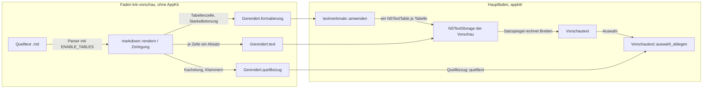
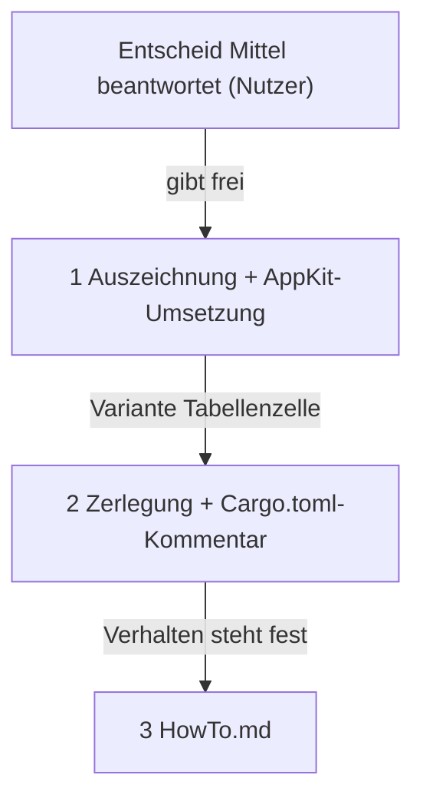

# Implementation Plan: Die Markdown-Vorschau richtet Tabellenspalten aus

**Date:** 2026-10-31
**Spec:** none — planned from raw request (Paketdatensatz `261031-1645-markdown-vorschau-richtet-tabellenspalten-aus.md`, `## Directive`)
**Decidability:** Die tragende Frage lautet: an welcher waagerechten Stelle beginnt jede Zelle, damit ihre Spalte steht, bei jeder Breite der Vorschau? Aus Zeichenzahlen ist das nicht entscheidbar: die Vorschau setzt Proportionalschrift, Umbrüche hängen an der Breite der Fläche, und diese Breite kennt die Zerlegung auf dem Faden `krk-vorschau` nicht. Der Plan wechselt deshalb das Mittel. Die Zerlegung beantwortet nur, was sie aus der Quelle sicher weiß: welche Zelle in welche Zeile und Spalte gehört und wie die Spalte laut Trennzeile ausgerichtet ist. Die Breiten rechnet der Satzspiegel von AppKit (`NSTextTable`), denn er hat Schriftmaße und Flächenbreite als Eingabe. Beide Teilfragen sind damit aus den Eingaben ihres Mechanismus entscheidbar.

## Directive

Der Nutzer, wörtlich (261031): „der makrdown viewer kann tabellen nicht korrekt rendern, finde eine lösung, so dass die spalten richtig aliniert sind.“ Erreicht ist das Ziel laut Paketdatensatz, wenn die Zellen jeder Spalte einer Markdown-Tabelle in der gerenderten Vorschau untereinanderstehen, gleich wie lang ihr Inhalt ist.

**Zwei Stellen entscheidet der Nutzer vor dem ersten Schritt:**

1. **Das Mittel**, also echte Texttabelle, Raster aus fester Schrift oder Tabulatoren: `261031-1720-mit-welchem-mittel-richtet-die-vorschau-eine-markdown-tabelle-aus.md`, Empfehlung Möglichkeit 1 (`NSTextTable`). Die Antwort überholt die Tabellenhälfte des Umfangsentscheids der Runde 6 und begrenzt die Reichweite des CSV-Entscheids E17. **Dieser Plan ist allein für Möglichkeit 1 geschrieben.** Fällt die Wahl anders, ist er neu zu planen und nicht abzuwandeln.
2. **Der Abnahmelauf gegen die zehn Zusagen:** `261031-1720-schuldet-das-tabellenpaket-einen-abnahmelauf-gegen-die-zehn-zusagen.md`, Empfehlung Möglichkeit 2 (verzichten). Er hält keinen Bauschritt an, nur das Schließen.

Daneben stehen drei kleinere Fragen, die nur dieser Plan braucht, unter `## Open Questions`. Für jede ist eine Vorgabe eingetragen, die gilt, wenn der Nutzer nichts anderes sagt.

## Current State

**Warum die Spalten heute nicht stehen, mit Beleg:**

- `pulldown-cmark` ist mit `default-features = false` und **ohne** `Options::ENABLE_TABLES` eingebunden. Das war Absicht: der Nutzerentscheid vom 260812-1105 wollte Tabellen als „Quelltextraster“ (`Cargo.toml`, Absatz „Das Merkmal fuer Tabellen bleibt aus“ unmittelbar über `pulldown-cmark = { version = "0.13", default-features = false }`). `Lesart::optionen` liefert für `Lesart::Markdown` deshalb `Options::empty()` (`crates/krk-ui/src/markdown.rs`, `impl Lesart`, `fn optionen`).
- Ohne das Merkmal sind die Zeilen einer Tabelle ein gewöhnlicher Absatz mit weichen Umbrüchen. `rendern` schreibt sie wörtlich: der Zweig `Event::SoftBreak | Event::HardBreak => zerlegung.schreiben("\n", …)` in `fn rendern` trägt den Kommentar „Die Zeile, an der das Quelltextraster einer Tabelle haengt“. Die Probe `eine_tabelle_bleibt_ein_quelltextraster` (Prüfmodul von `markdown.rs`) hält den wörtlichen Text fest.
- Gesetzt wird dieser Text proportional. `grundmerkmale` in `crates/krk-ui/src/appkit/textmerkmale.rs` gibt für `(Ansicht::Format, Darstellungsart::Markdown)` `(false, grundlage + LESEZUSCHLAG)` zurück, `grundschrift` macht daraus `NSFont::systemFontOfSize`. In dieser Schrift ist ein Leerzeichen schmaler als ein Buchstabe, und die `|` sauber aufgefüllter Zeilen stehen trotzdem schräg. Die Ursache ist also zweiteilig: die Tabelle wird nicht als Tabelle erkannt, und ihr Ersatz, das Raster, setzt eine feste Schrift voraus, die die Vorschau nicht hat.

**Was die Lösung vorfindet und wiederverwendet:**

- `markdown::rendern` ist ein Durchgang über `pulldown_cmark::OffsetIter` mit einer totalen Fallunterscheidung `behandlung(&Tag)`; Unbekanntes geht über `Behandlung::Woertlich`. Jedes Element trägt eine `Inhaltsart` (`Bloecke` deckt Lücken, `Zeichen` verwirft sie als Auszeichnung). Die Kachelung des `Quellbezug` deckt Quelle und Text lückenlos (Modulkopf, „Der Quellbezug“), und die Klammerregel lässt eine berührte Auszeichnung ganz mitfahren (`Quellbezug::klammern_schliessen`, `klammer_der_raender`).
- `Formatierung` und `Auszeichnung` aus `crates/krk-ui/src/hervorhebung.rs` sind der eine Typ für Editor und Vorschau. `textmerkmale::anwenden` ist die eine Umsetzung in Merkmale, mit einer vollständigen `match` über `Auszeichnung`. Absatzmerkmale baut sie über `grundabsatz` (Tabstopps), Einzüge über `einzugsmerkmal` mit `LISTENEINZUG` und `EINZUGSGRENZE`.
- Die Vorschaufläche ist `Vorschautext` (`crates/krk-ui/src/appkit/vorschau.rs`), eine `NSTextView`, aufgebaut über `initWithFrame:`. `textmerkmale` und `Nummernspalte` greifen auf ihren `layoutManager` zu. Kopiert wird über `Vorschautext::auswahl_ablegen` → `Quellbezug::quelltext`.
- `objc2-app-kit 0.3.2` steht mit seinen Vorgabemerkmalen im Baum (`crates/krk-ui/Cargo.toml`), und die tragen `NSTextTable` (`NSTextTable`, `NSTextTableBlock`, `NSTextBlock`, `setTextBlocks:` an `NSMutableParagraphStyle`). Eine neue Kiste ist nicht nötig. Am SDK gelesen (`AppKit.framework/Headers/NSTextTable.h`): die drei Klassen, `initWithTable:startingRow:rowSpan:startingColumn:columnSpan:`, `setNumberOfColumns:`, `setLayoutAlgorithm:`, `setCollapsesBorders:`, `setWidth:type:forLayer:` und `setBorderColor:` tragen `macos(10.0)`. Die Varianten mit `rectEdge:` tragen `macos(27.0)` und sind **nicht** zu verwenden. Die Varianten mit `edge:` stehen seit 10.0 und tragen `API_TO_BE_DEPRECATED`; `objc2` markiert sie nicht als veraltet.

**Wie die Kiste eine Tabelle meldet, mit `pulldown-cmark 0.13.4` gemessen** (eigene Probe in der Kratzablage, `Options::ENABLE_TABLES`; die Zeilen geben Ereignis und Quellbereich wieder):

- `Start(Table([Left, Right]))` deckt die ganze Tabelle. Darin folgen `TableHead` mit den Zellen der Kopfzeile, ohne eigenes `TableRow`, dann je Zeile `TableRow` mit seinen `TableCell`s.
- Der Bereich eines `TableRow` und des `TableHead` schließt die `|` und den Zeilenumbruch ein (`"| 1 |  |\n"`). Der Bereich einer `TableCell` schließt die `|` aus und den Leerraum innen ein (`" A "`).
- Die Trennzeile `|:--|--:|` meldet die Kiste nicht. Sie liegt als Lücke zwischen dem Ende von `TableHead` und dem ersten `TableRow`.
- Eine leere Zelle kommt als `Start/End(TableCell)` ohne `Text`. Einer zu kurzen Zeile hängt die Kiste leere Zellen mit leerem Bereich an. Eine zu lange Zeile schneidet sie auf die Spaltenzahl des Kopfes, und die überzähligen Zellen bleiben ungemeldet in der Quelle stehen.
- `\|` in einer Zelle kommt als zwei `Text`-Stücke heraus, der Rückstrich liegt als Lücke dazwischen. `**f**` in einer Zelle wird ein gewöhnliches `Strong`.
- Auch in einem Listenpunkt wird eine Tabelle erkannt: `Start(Table)` steht dann innerhalb von `Item`.

## Approach

Ein Weg, zwei Hälften, und die Naht ist die vorhandene: `Formatierung` aus `hervorhebung.rs`.

- **Der Kern rechnet die Struktur und nichts von der Gestalt.** Mit `ENABLE_TABLES` schreibt `markdown::rendern` jede Zelle als eigenen Absatz in Zeilenfolge: Inhalt, dann genau ein `\n`. Die Zelle trägt eine neue Auszeichnung `Auszeichnung::Tabellenzelle` mit Tabelle, Zeile, Spalte, Spaltenzahl, Ausrichtung und Einrücktiefe. Pipes, Trennzeile und Rückstriche sind Auszeichnungszeichen. Sie fallen aus der Anzeige, bleiben aber in der Kachelung, so wie `**` und `# ` heute. Die Kopfzeile bekommt ihre Fettschrift über die vorhandene `Auszeichnung::StarkeBetonung` und keine zweite Fettregel.
- **AppKit rechnet die Gestalt.** `textmerkmale::anwenden` setzt für `Tabellenzelle` einen Absatzstil auf dem `grundabsatz` mit `textBlocks = [NSTextTableBlock]` und `alignment`. Je Tabelle gibt es genau ein `NSTextTable`, im Durchgang von `anwenden` in einer Zuordnung von Tabellennummer auf Objekt gehalten, wie die Farben in derselben Funktion. Die Breiten rechnet der automatische Satzalgorithmus, und eine lange Zelle bricht innerhalb ihrer Spalte um.
- **Kopieren bekommt keine neue Regel.** Der Text einer Zelle ist wörtlicher Quelltext (`Abschnittsart::Woertlich`). Die Zellenden sind erzeugte Zeichen, die Pipes und die Trennzeile verdeckte Quelle. Welche Bytes eine Auswahl liefert, folgt aus der Klammerregel, so wie sie steht. Was dabei herauskommt, ist gemessen und steht unter `## Open Questions`, Frage 1.



## Implementation Steps

1. **Die Auszeichnung der Tabellenzelle und ihre Umsetzung in AppKit**
   - Executor: code-implementer
   - Files: `crates/krk-ui/src/hervorhebung.rs`, `crates/krk-ui/src/appkit/textmerkmale.rs`
   - Changes:
     - In `hervorhebung.rs` kommt eine Variante `Auszeichnung::Tabellenzelle { tabelle: usize, zeile: usize, spalte: usize, spalten: usize, ausrichtung: Spaltenausrichtung, tiefe: u8 }` hinzu, mit Doc-Kommentar nach dem Muster von `Listenzeile`: ganzer Absatz, nicht ein Stück darin, und sie entsteht allein in `crate::markdown`. Dazu kommt `pub enum Spaltenausrichtung { Ohne, Links, Mitte, Rechts }`. `Ohne` steht für eine Trennzeile ohne Doppelpunkt; der Name sagt, dass die Quelle nichts vorgibt.
     - In `textmerkmale::anwenden` kommt der Zweig für `Tabellenzelle` hinzu. Er baut den Absatzstil auf `grundabsatz(&grundschrift(ansicht, art))`, wie `einzugsmerkmal` es tut, damit die Tabulatoren nicht auf die 28 Punkt des Systems zurückfallen. Er setzt `setTextBlocks` mit einem `NSTextTableBlock` (`initWithTable:startingRow:rowSpan:startingColumn:columnSpan:`, Spannen 1) und `setAlignment` nach der Ausrichtung: `Ohne` wird `Natural`, `Links` wird `Left`, `Mitte` wird `Center`, `Rechts` wird `Right`.
     - Je `tabelle` gibt es ein `NSTextTable`, gehalten in einer `HashMap<usize, Retained<NSTextTable>>` für die Dauer des Rufs, nach dem Muster der Farbzuordnung weiter unten in derselben Funktion. Gesetzt werden `setNumberOfColumns(spalten)`, `setLayoutAlgorithm(AutomaticLayoutAlgorithm)` und `setCollapsesBorders(true)`.
     - Jede Zelle bekommt eine dünne Rahmenlinie und einen Innenabstand über `setWidth_type_forLayer` (die Fassung für alle Kanten, `macos(10.0)`) und `setBorderColor` mit `NSColor::separatorColor()`. Die Farbe ist dynamisch und folgt dem Wechsel auf Dunkel ohne Neusetzen. Das ist die Lehre aus dem Defekt `260812-1701_*_ein-gerendertes-markdown-behaelt-nach-dem-wechsel-auf-dunkel-die-verweisfarbe-der-hellen-tafel.md`. Die Werte (Vorgabe 0,5 pt Linie, 3 pt Abstand) stehen als benannte Konstanten mit Begründung da.
     - Ist `tiefe > 0` (Tabelle in Liste oder Zitat), bekommt die Tabelle links einen Rand von `LISTENEINZUG * tiefe.clamp(1, EINZUGSGRENZE)` über `setWidth_type_forLayer_edge(…, Margin, NSRectEdge::MinX)`, die Fassung mit `edge:`. Dass das SDK sie als `API_TO_BE_DEPRECATED` führt und ihr Nachfolger erst ab macOS 27 steht, gehört in den Kommentar.
     - Im Kopfkommentar von `anwenden` kommt zum Absatz „Überschneidungen gleichen Merkmalsnamens“ ein Satz hinzu: `Tabellenzelle` setzt `NSParagraphStyleAttributeName` und ersetzt damit eine äußere `Listenzeile`, und genau deshalb trägt die Zelle ihre Tiefe selbst.
     - Der Untergrenzen-Abschnitt im Modulkopf wird ergänzt: jede neu hereingeholte Klasse, Methode und Konstante mit Header-Zeile, je am SDK gelesen. Das sind `NSTextTable`, `NSTextTableBlock`, `NSTextBlock`, `NSTextBlockValueType`, `NSTextBlockLayer`, `NSTextTableLayoutAlgorithm`, `NSTextAlignment`, `NSRectEdge`, `setTextBlocks:`, `setAlignment:`, `separatorColor` (macOS 10.14) und die Leser der Probe.
     - Eine Probe im Prüfmodul von `textmerkmale.rs`, nach dem Bauweg der vorhandenen Proben. Eine Formatierung mit zwei Zellen derselben Tabelle und einer Zelle einer zweiten Tabelle ergibt zwei Absätze, deren `textBlocks` auf dasselbe `NSTextTable` zeigen, und einen dritten mit einem anderen. Abgefragt werden `startingRow` und `startingColumn`, `numberOfColumns` und für `Rechts` die Ausrichtung `Right`.
   - Acceptance:
     - Der Arbeitsbaum übersetzt, und `cargo test --workspace -- --skip appkit::` ist grün. `Tabellenzelle` erzeugt noch niemand, also ändert sich keine vorhandene Probe.
     - `cargo test -p krk-core --test baum` ist grün, ausdrücklich mit `jede_appkit_datei_mit_frameworkimport_traegt_den_untergrenzen_abschnitt` und `jeder_frameworkimport_steht_namentlich_im_untergrenzen_abschnitt`, ebenso `genau_zwei_dateien_oeffnen_die_regel_deny_unsafe_code`.
     - `cargo clippy --workspace --all-targets` ohne Warnung, `cargo fmt --all --check` sauber, `RUSTDOCFLAGS="-D warnings" cargo doc --workspace --no-deps` grün.
     - Die neue Probe unter `appkit::` kann hier nicht laufen. Der Bericht sagt das und nennt sie mit Namen für `make check` auf dem Gerät des Nutzers.
   - Prüfkommando: `export PATH="$HOME/.cargo/bin:$PATH"; cargo test --workspace -- --skip appkit:: && cargo test -p krk-core --test baum && cargo clippy --workspace --all-targets && cargo fmt --all --check && RUSTDOCFLAGS="-D warnings" cargo doc --workspace --no-deps`
   - Dependencies: none

2. **Die Zerlegung erkennt Tabellen und schreibt jede Zelle als Absatz**
   - Executor: code-implementer
   - Files: `crates/krk-ui/src/markdown.rs`, `Cargo.toml` (allein der Kommentar über `pulldown-cmark`)
   - Changes:
     - `Lesart::optionen`: `Markdown` liefert `Options::ENABLE_TABLES`, `Eintragsdatei` liefert `ENABLE_TABLES | ENABLE_TASKLISTS`. Das gilt unter der Vorgabe zu Frage 2 unter `## Open Questions`; fällt die Antwort anders, bleibt `Eintragsdatei` bei `ENABLE_TASKLISTS`.
     - `behandlung` bekommt Zweige für `Tag::Table(ausrichtungen)`, `Tag::TableHead`, `Tag::TableRow` und `Tag::TableCell`. Die Tabelle trennt sich wie ein Absatz mit `ABSATZABSTAND` von ihren Nachbarn und vergibt eine laufende Tabellennummer. Sie merkt sich die Ausrichtungen und die Spaltenzahl `ausrichtungen.len()`. Kopf und Zeile zählen die Zeile, die Zelle zählt die Spalte. Alle vier öffnen mit `Inhaltsart::Zeichen`, denn ihre Lücken sind Auszeichnungszeichen: Pipes, Trennzeile und der Rückstrich vor `\|`.
     - **Eine Zelle schreibt ihr Ende selbst und nicht über den Wunsch `trennung`.** Der Wunsch füllt auf, statt anzuhängen. Zwei Zellenden hintereinander würden darin zu einem, und eine leere Zelle verschwände mitsamt ihrer Spalte. Beim Schließen schreibt die Zelle also immer genau ein `\n`, auch als letzte Zelle der Datei. Ihre `Tabellenzelle`-Auszeichnung deckt Inhalt und `\n` und ist damit nie leer. Ein Bereich der Länge null könnte in AppKit kein Absatzmerkmal tragen.
     - Die Zellen der Kopfzeile bekommen zusätzlich `StarkeBetonung` über ihren Inhalt ohne das `\n`. Die Sortierung in `Zerlegung::abschliessen` (außen vor innen) stellt die Zelle vor die Betonung.
     - Ein Element, das kein Zeichen geliefert hat und dessen Quellbereich nur Leerraum trägt, gibt beim Schließen nichts wörtlich heraus (dritter Satz der Deckung im Modulkopf). Das ist dieselbe Frage, die `klammer_der_raender` schon stellt („Leerraum ist keine Auszeichnung“), und kein Tabellenfall. Es trifft die leere Zelle `|  |`; ob es sonst ein Element trifft, das die Kiste heute meldet, ist nicht geprüft (`inference:` nein, weil ein Absatz oder eine Überschrift ohne Zeichen keinen Quellbereich aus reinem Leerraum hat). Die vorhandenen Proben müssen unverändert grün bleiben, sonst stoppt der Schritt. Der Modulkopf schreibt den erweiterten Satz aus.
     - `tiefe` der Zelle ist `Zerlegung::tiefe()` beim Öffnen der Tabelle.
     - Der Modulkopf wird nachgezogen. Der Absatz „Eine Tabelle faellt nicht unter die Auffangregel …“ und die Zeile „weicher/harter Umbruch“ im Schaubild werden ersetzt durch einen Abschnitt `# Tabellen`: Zelle als Absatz, warum das Zellende kein Wunsch ist, was die Kachelung dazu sagt und welche Bytes eine Auswahl liefert. Der Kommentar am Zweig `Event::SoftBreak | Event::HardBreak` verliert seinen Satz zum Quelltextraster.
     - In der Wurzel-`Cargo.toml` wird der Absatz „Das Merkmal fuer Tabellen bleibt aus …“ ersetzt durch die Begründung, warum `ENABLE_TABLES` jetzt eingeschaltet ist. Er verweist auf `261031-1720-mit-welchem-mittel-richtet-die-vorschau-eine-markdown-tabelle-aus.md`. Die Kiste und ihre Merkmalszeile bleiben, wie sie sind (`ENABLE_TABLES` ist eine Laufzeitoption und kein Cargo-Merkmal). Dazu kommt eine fünfte Zahl mit Datum: `markdown::rendern` über eine Datei von rund 1 MB, die allein aus einer Tabelle besteht (vier Spalten, kurze Zellen), im Profil `release`, drei Läufe, kopflos gemessen wie die vier vorhandenen. Gemessen wird mit einer Probe, die nicht eingecheckt wird, oder mit `#[ignore]`. Welches von beiden, steht im Bericht.
   - Proben im Prüfmodul von `markdown.rs` (laufen hier, sie liegen nicht unter `appkit::`):
     - `eine_tabelle_bleibt_ein_quelltextraster` fällt und wird durch `eine_tabelle_steht_zelle_fuer_zelle_in_zeilenfolge` ersetzt. `"| A | Bb |\n|:--|--:|\n| 1 |  |\n"` ergibt den Text `"A\nBb\n1\n\n"` und vier `Tabellenzelle`-Stellen mit (Zeile, Spalte) = (0,0), (0,1), (1,0), (1,1), alle mit derselben Tabellennummer und `spalten` 2.
     - `die_trennzeile_gibt_jeder_spalte_ihre_ausrichtung`: `:--`, `:-:`, `--:` und `---` werden `Links`, `Mitte`, `Rechts` und `Ohne`.
     - `die_kopfzeile_traegt_starke_betonung_und_die_zeilen_nicht`.
     - `eine_leere_zelle_behaelt_ihren_absatz` (auch als letzte Zelle der Datei), `eine_kurze_zeile_bekommt_leere_zellen` und `eine_lange_zeile_zeigt_so_viele_zellen_wie_der_kopf`.
     - `ein_maskierter_strich_steht_in_seiner_zelle` (`x \| y` zeigt `x | y`) und `eine_betonung_in_einer_zelle_bleibt_eine_betonung`.
     - `eine_tabelle_im_listenpunkt_traegt_die_tiefe_des_punktes` und `zwei_tabellen_tragen_verschiedene_nummern`.
     - `eine_tabelle_ohne_aeussere_striche_ist_eine_tabelle` (`a | b\n--|--\n1 | 2`).
     - `ein_absatz_nach_einer_tabelle_steht_hinter_einer_leerzeile`.
     - Die Kachelungsprobe `die_kachelung_deckt_quelle_und_text_lueckenlos` bekommt Tabellenbeispiele in ihren Satz: die Fälle oben, Umlaute und ein Emoji in einer Zelle.
     - Drei Proben über `Quellbezug::quelltext`, die die gemessene Wirkung der Klammerregel festhalten (Frage 1 unter `## Open Questions`). Ein Wort in einer Zelle liefert die ganze Quellzeile dieser Zeile, mit Pipes und Umbruch. Eine Auswahl über Kopf und erste Zeile liefert Kopfzeile, Trennzeile und erste Zeile. Die Auswahl über alles liefert die Datei vollständig (C2.8 der Runde 14).
     - `eine_unvollstaendige_tabelle_bleibt_ein_absatz`: eine Kopfzeile ohne gültige Trennzeile bleibt der wörtliche Absatz von heute.
   - Acceptance:
     - `cargo test --workspace -- --skip appkit::` ist grün, mit den Proben oben unter ihren Namen.
     - `cargo clippy --workspace --all-targets`, `cargo fmt --all --check` und `RUSTDOCFLAGS="-D warnings" cargo doc --workspace --no-deps` sind grün.
     - `grep -n 'Quelltextraster' crates/krk-ui/src/markdown.rs Cargo.toml` findet keine Stelle mehr, die den Stand vor diesem Schritt als geltend beschreibt.
     - Der Bericht nennt die drei gemessenen Zeiten für 1 MB Tabelle neben den 19 bis 30 ms aus der Wurzel-`Cargo.toml`. Liegt eine davon über 100 ms, stoppt der Schritt vor dem Commit und meldet. Das wäre ein Befund gegen L7 und keiner, den dieser Schritt beheben darf.
     - Rot wird in diesem Schritt allein, was diese Datei selbst ersetzt. Wird eine Probe außerhalb von `markdown.rs` rot, stoppt der Schritt und meldet sie, statt sie anzupassen.
   - Prüfkommando: `export PATH="$HOME/.cargo/bin:$PATH"; cargo test --workspace -- --skip appkit:: && cargo clippy --workspace --all-targets && cargo fmt --all --check && RUSTDOCFLAGS="-D warnings" cargo doc --workspace --no-deps`
   - Dependencies: 1 (die Variante `Auszeichnung::Tabellenzelle` und `Spaltenausrichtung`)

3. **Die Anleitung sagt, wie die Vorschau eine Markdown-Tabelle zeigt**
   - Executor: code-implementer
   - Files: `HowTo.md`
   - Changes: Ein kurzer Absatz im Abschnitt `## Editor und Vorschau`, bei den Absätzen zu den Dateiarten der Vorschau. Er sagt drei Dinge. Eine Markdown-Tabelle erscheint mit ausgerichteten Spalten, Kopfzeile fett und Ausrichtung laut Trennzeile. Eine lange Zelle bricht in ihrer Spalte um, wenn die Vorschau schmal ist. Kopiert wird der Quelltext, und eine Auswahl in einer Zelle liefert die ganze Zeile der Tabelle; dieser letzte Satz folgt der Antwort auf Frage 1. Dazu ein Halbsatz zur Abgrenzung von der CSV-Vorschau (ausgerichteter Text in fester Schrift, rollt waagerecht).
   - Acceptance: Der Absatz steht da und widerspricht keinem anderen Satz der Datei. Mindestens zu prüfen sind der Absatz zu `.jsonl` und `### CSV- und TSV-Dateien` → `#### In der Vorschau`. `cargo test --workspace -- --skip appkit::` bleibt grün; `xtask/src/veroeffentlichung.rs` bindet `HowTo.md` mit `include_str!` ein, also übersetzt `xtask` die Datei bei jedem Lauf mit.
   - Prüfkommando: `export PATH="$HOME/.cargo/bin:$PATH"; cargo test --workspace -- --skip appkit::`
   - Dependencies: 2



## Where this work stops

- Bevor Schritt 1 beginnt, hat der Nutzer `261031-1720-mit-welchem-mittel-richtet-die-vorschau-eine-markdown-tabelle-aus.md` beantwortet, und zwar mit Möglichkeit 1. Eine andere Wahl stoppt die Arbeit vor Schritt 1, der Plan wird neu geplant.
- Die Schritte 1, 2 und 3 stehen auf `done`, und ihre Prüfkommandos sind in dieser Umgebung grün durchgelaufen.
- `make check` ist auf dem Gerät des Nutzers grün durchgelaufen, mit den Proben unter `appkit::` aus Schritt 1. Bis dahin gilt die AppKit-Hälfte als gebaut und nicht als geprüft.
- Der Nutzer hat die Abnahmedateien aus `## Testing Strategy` am Bündel angesehen, und für jede ist mit ja oder nein festgehalten: die Spalten stehen, die Ausrichtung folgt der Trennzeile, eine lange Zelle bricht bei 160 Punkten Vorschaubreite in ihrer Spalte um, und ein Kopieren aus der Tabelle legt Quelltext ab.
- Der Nutzer hat die große Abnahmedatei (1 MB Tabelle) in der Vorschau geöffnet. Hängt die Vorschau sichtbar, endet dieses Paket ohne Abhilfe, und die Frage nach einer Grenze für die Tabellengröße wird ein eigener Entscheidungsdatensatz. Eine Ausweichregel wird nicht nebenbei gebaut. (Ob die Bedingung eingetreten ist, sagt erst der Lauf; tritt sie nicht ein, wird hier die Kurzform `(condition did not arise: one clause)` vermerkt.)
- `261031-1720-schuldet-das-tabellenpaket-einen-abnahmelauf-gegen-die-zehn-zusagen.md` ist beantwortet, bevor das Paket schließt.
- Nach dem Commit von Schritt 2 trägt `260812-1851_*_welchen-umfang-von-markdown-rendert-die-vorschau-mit-verschachtelten-listen.md` die Zeile `Superseded by:` mit dem Entscheid zum Mittel und dem Hinweis, dass nur die Tabellenhälfte ersetzt ist. Der Entscheid zum Mittel steht auf `implemented` mit dem Commit von Schritt 2. Beides tut, wer die Übergänge sendet (der Orchestrator), und kein Ausführer.
- Die Beobachtung bei 160 Punkten ist im Abschluss des Pakets festgehalten und nennt `260812-1000_*_braucht-die-vorschau-mit-gerendertem-markdown-mehr-mindestbreite.md`, dessen Auslöser genau ein solcher Blick am laufenden Bündel ist. An der Mindestbreite ändert dieses Paket nichts.
- Eine Auslieferung, ein Tag oder eine neue Version gehört nicht zu diesem Paket. Sie geschieht nur auf ausdrücklichen Auftrag des Nutzers.

## Data Structures

```rust
// crates/krk-ui/src/hervorhebung.rs
pub enum Auszeichnung {
    // … die fünf vorhandenen Werte …
    Tabellenzelle {
        tabelle: usize,      // laufende Nummer der Tabelle im Dokument
        zeile: usize,        // 0 = Kopfzeile
        spalte: usize,
        spalten: usize,      // Zahl der Spalten laut Trennzeile
        ausrichtung: Spaltenausrichtung,
        tiefe: u8,           // Einrücktiefe der umgebenden Liste oder des Zitats, 0 = keine
    },
}

pub enum Spaltenausrichtung { Ohne, Links, Mitte, Rechts }
```

Der Bereich einer `Tabellenzelle` deckt den Inhalt der Zelle und ihr abschließendes `\n` und ist damit nie leer.

## API Changes

Keine öffentliche Schnittstelle außerhalb von `krk-ui`. Innerhalb der Kiste wachsen `Auszeichnung` um einen Wert und `Lesart::optionen` um ein Merkmal. Die vollständige `match` in `textmerkmale::anwenden` hält den Bau an der einen Stelle an, die nachzuziehen ist. Neue nutzersichtbare Texte entstehen nicht, also kommt kein Schlüssel in die Sprachtabellen. Der Inhalt einer Zelle ist Dateiinhalt und kein Text von KRK.

## Testing Strategy

- **Ohne AppKit, hier lauffähig:** die Proben aus Schritt 2 in `crate::markdown::tests`, also Text, Auszeichnungen, Kachelung und Quellbezug, dazu die Baumproben in `crates/krk-core/tests/baum.rs`. Befehl: `cargo test --workspace -- --skip appkit::`.
- **Mit AppKit, nur auf dem Gerät des Nutzers:** die Probe aus Schritt 1 in `appkit::textmerkmale::tests`, gefahren mit `make check`.
- **Am Bündel, Nutzerarbeit:** zwei Abnahmedateien, die der Nutzer anlegt oder sich von einem Agenten in `~/Downloads/` schreiben lässt, nicht in den Baum:
  - `tabellen-abnahme.md`, mit diesen Fällen: eine Tabelle mit aufgefüllten und eine mit nicht aufgefüllten Zeilen; eine mit `:---`, `:---:` und `---:`; eine mit einer Zelle von über 200 Zeichen; eine mit `**fett**`, `` `code` `` und einem Verweis in Zellen; eine mit leeren Zellen und einer zu kurzen Zeile; eine in einem Listenpunkt; eine ohne äußere Striche. Angesehen wird bei breiter Vorschau und bei 160 Punkten (Trennlinie ganz nach rechts gezogen), in Hell und in Dunkel. Dann ein Wort in einer Zelle markieren, `cmd+c`, in einen Texteditor einfügen: erwartet ist die Quellzeile.
  - `tabellen-gross.md`: eine Tabelle von rund 1 MB, vier Spalten, kurze Zellen. Erwartet ist, dass die Vorschau sie zeigt, ohne sichtbar zu hängen (siehe `## Where this work stops`).

## Risks & Mitigations

| Risk | Mitigation |
|------|------------|
| Die automatische Breitenrechnung von `NSTextTable` ist bei einer großen Tabelle langsam und hält den Hauptfaden an (`speculation:`, nicht gemessen) | Die große Abnahmedatei prüft genau das. Tritt es ein, gibt es eigens einen Entscheid über eine Größengrenze und keine stille Ausweichregel (`## Where this work stops`). |
| Die Vorschaufläche läuft nicht in TextKit 1, und `NSTextTable` wird nicht gezeichnet (`inference:` sie läuft darin, weil `textmerkmale` den `layoutManager` anfasst) | Der Blick am Bündel zeigt es sofort. Wenn nicht, wird die Fläche in `Vorschautext::neu` ausdrücklich über `initWithFrame:textContainer:` mit einem `NSLayoutManager` gebaut; das ist ein eigener Schritt nach Rückfrage. |
| Bei 160 Punkten ist eine Tabelle mit drei oder mehr Spalten so schmal, dass ein langes Wort über die Zelle hinausragt (`speculation:`) | Am Bündel ansehen, Befund an `260812-1000_*_braucht-die-vorschau-mit-gerendertem-markdown-mehr-mindestbreite.md` geben. Die Mindestbreite bleibt in diesem Paket unverändert. |
| `ENABLE_TABLES` deutet bestehende Dateien um: ein Absatz, dem eine gültige Trennzeile folgt, wird zur Tabelle | So meint es GFM, und so zeigen es die gängigen Betrachter. Die Probe `eine_unvollstaendige_tabelle_bleibt_ein_absatz` hält die Grenze fest. |
| `setWidth:type:forLayer:edge:` (linker Rand einer eingerückten Tabelle) trägt im SDK 27 `API_TO_BE_DEPRECATED`, der Nachfolger steht erst ab macOS 27 | Der Kommentar nennt es, und genutzt wird die Fassung allein für `tiefe > 0`. Wird sie wirklich als veraltet markiert, sagt der Übersetzer es. |
| Betonung in einer Kopfzelle ersetzt deren Fettschrift statt sie zu ergänzen | Das ist die bekannte Grenze, die der Kommentar in `textmerkmale::anwenden` unter „Was diese Reihenfolge nicht kann, ist zusammenlegen“ beschreibt (`260812-1805_*_der-ueberschneidungssatz-in-textmerkmale-anwenden-gilt-seit-markdown-rs-nicht-mehr.md`). Sie ist nicht neu, und dieses Paket behebt sie nicht. |
| Der Wunschmechanismus der Abstände verschluckt ein leeres Zellende | Das Zellende wird unmittelbar geschrieben (Schritt 2), und die Probe `eine_leere_zelle_behaelt_ihren_absatz` hält es fest. |

## Open Questions

- [ ] **Frage 1, was eine Auswahl in einer Tabelle kopiert.** Unverändert angewandt, ergibt die Klammerregel aus `260819-2216_*_welche-auszeichnungszeichen-fahren-an-den-raendern-der-auswahl-mit.md` (Möglichkeit 2, „eine berührte Auszeichnung fährt ganz mit“) dieses Verhalten, gemessen an den Quellbereichen der Kiste. Kopf und Zeile tragen ihre `|` am Rand, also eine Klammer. Zelle und Tabelle tragen am Rand nur Leerraum, also keine. Ein einzelnes markiertes Wort in einer Zelle liefert damit **die ganze Zeile** der Tabelle samt Strichen. Eine Auswahl über Kopf und Zeilen liefert die Trennzeile mit, weil sie zwischen ihnen liegt. Das Ergebnis lässt sich also wieder als Tabelle einfügen. **Vorgabe:** so lassen, denn es kommt keine neue Regel dazu. Will der Nutzer, dass ein Wort in einer Zelle nur dieses Wort liefert, braucht es eine Ausnahme von der Klammerregel für Tabellenzeilen. Das wäre ein eigener Entscheid und nicht Teil dieses Plans.
- [ ] **Frage 2, Tabellen auch in `notes.txt`, `tasks.txt` und `appointments.md` im Heimordner** (`Lesart::Eintragsdatei`)? **Vorgabe:** ja, eine Tabelle sieht dort aus wie in jeder `.md`, und die Lesart bleibt „Grundumfang plus Kästchen“. Der Editor und seine Eintragstabellen lesen diese Dateien nicht über `pulldown-cmark` und bleiben unberührt.
- [ ] **Frage 3, die Gestalt der Tabelle.** **Vorgabe:** dünne Linien um jede Zelle (0,5 pt, `separatorColor`), 3 pt Innenabstand, Kopfzeile fett, kein Hintergrund. Einwände gegen die Gestalt erledigen sich durch Ändern der Konstanten aus Schritt 1 und brauchen keinen neuen Plan.

## Reconciliation Log

**261101, state-auditor.** Zustand bleibt `in_progress`. Alle drei Schritte sind im Baum: `NSTextTable` in `crates/krk-ui/src/markdown.rs` und `crates/krk-ui/src/appkit/textmerkmale.rs` (`83ee19dc`, `fe3303c1`), Größengrenze `75850c88`, Anleitung `33032c7b`, Befunde der Schlussprüfung `194c643a`. Der Plan bleibt offen, weil das Paket auf `paused` steht und nach seiner Pausennotiz noch die Abnahme je Prüfdatei, die Beobachtung bei 160 pt und die übrigen Haltebedingungen ausstehen. Die Bedingung, auf die die Pause wartet, ein grünes `make check` durch das Paket `261101-1320-appkit-proben-laufen-auf-dem-hauptfaden`, ist seit `e7e09416` erfüllt; das Paket kann wieder aufgenommen werden.
