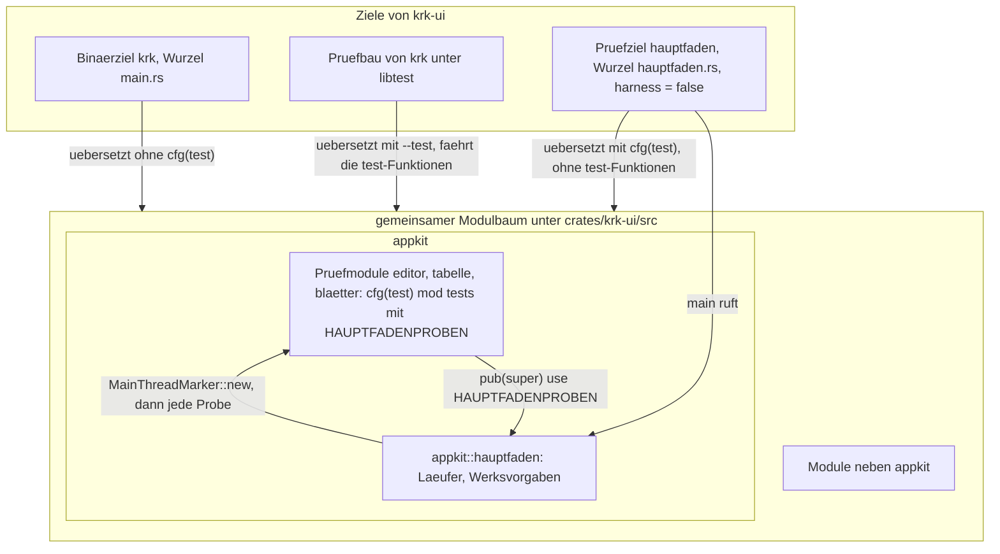
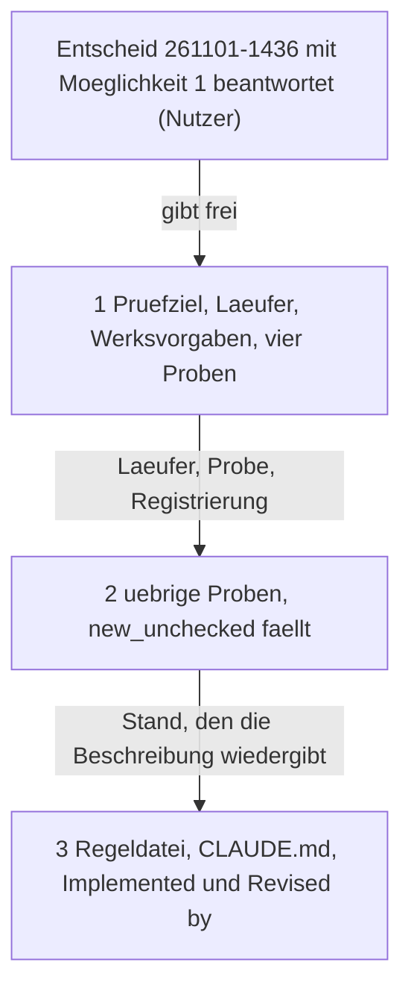

# Implementation Plan: Die AppKit-Proben laufen auf dem Hauptfaden

**Date:** 2026-11-01
**Spec:** none — planned from raw request (Paketdatensatz `261101-1320-appkit-proben-laufen-auf-dem-hauptfaden.md`, `## Directive`)
**Decidability:** Die tragende Frage lautet: Läuft jede Probe, die eine AppKit-Ansicht oder einen `MainThreadMarker` braucht, auf dem Hauptfaden, ohne dass sie ihn behauptet? Unter `libtest` ist die Frage nicht entscheidbar. Der Rahmen legt jede Probe auf einen eigenen Faden, und `MainThreadMarker::new_unchecked` setzt die Antwort voraus, statt sie zu prüfen. Der Plan wechselt deshalb das Mittel: ein Prüfziel ohne Harness hält sein `main` selbst und fragt `MainThreadMarker::new()`, das die Frage zur Laufzeit beantwortet. Gemessen ist: ein solches Ziel läuft auf dem Faden `main`, übersetzt mit `cfg(test)` und wird von `cargo test` mitgefahren (260810 und 261101, siehe `## Current State`). Die zweite Frage lautet: Sieht eine frische `NSTextView` im Prüflauf die Werkseinstellung der Textautomatiken, gleich was der Nutzer global eingestellt hat? Sie ist durch Rücklesen entscheidbar, und Schritt 1 misst sie, bevor eine Probe läuft.

## Directive

Der Nutzer, wörtlich (261101): „2. Erst ein neues Paket ‚AppKit-Proben auf den Hauptfaden' anlegen und die Frage 260810-1044 wieder aufnehmen. Das Tabellenpaket bleibt bis dahin offen.“ Erreicht ist das Ziel laut Paketdatensatz, wenn `make check` auf dem Mac des Nutzers grün durchläuft, mit den Proben unter `appkit::`, und keine dieser Proben den Hauptfaden mehr nur behauptet.

**Eine Stelle entscheidet der Nutzer vor dem ersten Schritt.** Die Frage 260810-1044 ist zurückgestellt und damit abgeschlossen; sie kehrt nicht in einen offenen Zustand zurück. Sie ist deshalb als neuer Datensatz aufgenommen, der sie zitiert: `261101-1436-wie-kommen-die-appkit-proben-auf-den-hauptfaden.md`. Unsere Empfehlung ist dort Möglichkeit 1, ein zweiter Kistenkopf als Prüfziel ohne Harness. **Dieser Plan ist allein für Möglichkeit 1 geschrieben.** Fällt die Wahl anders, ist er neu zu planen und nicht abzuwandeln.

## Current State

**Der Abbruch.** 25 Proben in `appkit::editor::tests::` brechen mit `NSInternalInconsistencyException` ab („-[_NSViewGeometryInWindowConcreteObservation invalidate] must be called on main thread only“). Der Weg führt über `Eintragsansicht::bauen` (`crates/krk-ui/src/appkit/eintragsansicht.rs`, `setDocumentView` und `spalten_einrichten` → `setHeaderView:`) in `NSScrollView tile`. `die_flaeche_der_quicknote_ist_reiner_text_mit_eigenem_verwalter` hängt. Die Belege liegen unter `/private/tmp/claude-501/-Users-kai-Projects-productive-F08-KRK-krk/0d876e38-8be9-4836-8bba-c89e56b51c4e/scratchpad/exlog/` (`loop.out`, `bisect.log`). Dieselbe Binärdatei, mit `vtool` auf SDK 15 umgeschrieben, läuft grün; mit SDK 26.0 bricht sie ab. Erster schlechter Commit ist `d356ca61`. AppKit setzt die Fadenbindung also nach dem gelinkten SDK durch, und die Behauptung, die 260810 „heute nicht auffiel“, fällt jetzt auf.

**Wo der Hauptfaden behauptet wird.** Im Code von `crates/krk-ui/src` steht `MainThreadMarker::new_unchecked` an fünf Stellen, alle in Prüfmodulen. Erhoben mit `grep -rn 'new_unchecked()' crates/krk-ui/src`; die übrigen Treffer von `grep -rn new_unchecked` sind Doc-Kommentare. Die Stellen sind:

- `appkit/editor.rs`, `an_einer_flaeche` (der eine Ort mit Sperre, der eine AppKit-Ansicht baut).
- `appkit/editor.rs`, `verwalter_ohne_fenster` (ein `NSUndoManager` ohne Fenster).
- `appkit/tabelle.rs`, in `der_aufstieg_haelt_die_tabliste_nicht_geliehen` und in `gelesene_quelle`.
- `appkit/blaetter/mod.rs`, in `ein_blatt_ohne_ungefaehrlichen_ausgang_fliegt_auf` (der Marker wird weitergereicht und nie eingelöst).

**Die betroffenen Proben, Stand `4b25d3c5`.** Erhoben über die `#[test]`-Funktionen, deren Rumpf eine der fünf Stellen oder einen ihrer Helfer ruft. Die Liste ist eine Momentaufnahme. Vollständig ist die Menge, wenn `an_einer_flaeche`, `verwalter_ohne_fenster` und jedes `new_unchecked()` aus dem Baum sind und der Bau übersetzt: jeder übersehene Rufer ist dann ein Übersetzungsfehler.

- Über `an_einer_flaeche` in `appkit/editor.rs`: `die_abgeschalteten_stehen_an_der_gebauten_flaeche_auf_aus`, `der_zelleneditor_schaltet_die_automatiken_bei_jedem_beginn_wieder_ab`, `die_gegenstandslosen_stehen_unberuehrt_und_ihr_traeger_steht_aus`, `die_gebaute_flaeche_steht_auf_textkit_1`, `jede_zweite_tuer_und_ihre_erste_legen_einander_um`, `die_erste_tuer_kann_default_weder_herstellen_noch_anzeigen`, `die_sammeltuer_ist_eine_sicht_auf_dieselben_bits`, `der_vorgabewert_der_schreibwerkzeuge_ueberlaesst_dem_system_die_wahl`, `die_flaeche_der_quicknote_ist_reiner_text_mit_eigenem_verwalter`, `beim_tausch_ist_die_neue_flaeche_sichtbar_bevor_der_ersthelfer_uebergeht`, `die_tabelle_zeigt_die_zeilen_des_standes`, `textflaeche_und_tabelle_finden_denselben_verwalter`, `die_laufende_zelle_wird_vor_dem_ersten_zeichen_erkannt_und_ein_fremdes_feld_nicht`, `eine_endende_zelle_wird_geprueft_einmal_festgeschrieben_und_zeigt_die_ableitung`, `esc_verwirft_die_aufgabenzelle_und_laesst_den_stand`, `das_ankreuzfeld_ruft_abhaken_mit_seiner_zeile_und_zeigt_danach_die_ableitung`, `der_klick_ins_ankreuzfeld_holt_den_fokus_in_die_tabelle`, `nach_dem_neuladen_ist_eine_zeile_gewaehlt`, `ein_doppelklick_unter_die_zeilen_legt_an_und_die_kopfzeile_nicht`, `den_eigenen_feldeditor_bekommen_allein_die_felder_der_eintragstabelle`, `cmd_z_in_der_zelle_endet_am_anfang_der_zelle_und_laesst_den_umbau`, `umkehren_und_eine_eingetroffene_datei_lassen_keine_offene_zelle_stehen`, `die_notiztabelle_leitet_zwei_zeilen_mit_thema_und_mehrzeiligem_text_ab`, `die_termintabelle_loescht_aendert_und_legt_an_der_stelle_der_zeile_an`, `eine_csv_oeffnet_als_tabelle_mit_spalten_aus_der_datei`, `der_kopf_zeigt_buchstabe_und_text_der_ersten_zeile_und_die_erste_zeile_bleibt_zeile`, `nur_die_trenntextform_rollt_waagerecht`, `messung_der_csv_tabelle_an_16_mib` (`#[ignore]`), `messung_der_breitesten_tabelle` (`#[ignore]`), `ein_klick_auf_den_kopf_waehlt_die_spalte_und_auf_die_nummer_die_zeile`, `cmd_c_legt_den_bereich_als_tsv_ab`, `die_uebrigen_arten_behalten_ihre_zeilenauswahl`, `eine_neue_csv_beginnt_mit_anfangsbreiten_und_bei_a1`, `die_pfeile_bewegen_die_auswahl_und_return_oeffnet_ihre_zelle`.
- Über `verwalter_ohne_fenster` in `appkit/editor.rs`: `ein_geleerter_stapel_traegt_keine_rueckgaengig_handlung_mehr`, `ein_geleerter_stapel_traegt_auch_eine_offene_gruppe_nicht_mehr`, `ein_geleerter_stapel_ueberlebt_auch_die_ereignisgruppierung`, `eine_anmeldung_nach_dem_leeren_steht_im_stapel`, `der_verwalter_gibt_den_block_auf_allen_vier_wegen_frei`, `eine_anmeldung_waehrend_eines_rueckgaengig_landet_im_wiederherstellungsstapel`.
- In `appkit/tabelle.rs`, unmittelbar oder über `gelesene_quelle`: `der_aufstieg_haelt_die_tabliste_nicht_geliehen`, `aufwaerts_an_der_wurzel_des_archivs_waehlt_die_archivdatei`, `ein_archiv_im_archiv_und_ein_archiv_am_fernen_ort_melden_statt_einzusteigen`, `eine_verknuepfung_auf_ein_archiv_wird_ueber_den_namen_ihres_ziels_betreten`, `in_einer_datenbank_zeigt_die_groessenspalte_zeilen_und_fuer_eine_sicht_striche`, `die_ersatzangaben_einer_tabelle_nennen_zeilen_und_einer_sicht_keine_groesse`, `der_markierungsstand_einer_datenbank_zaehlt_zeilen`, `die_groessenspalte_eines_zip_und_eines_ordners_bleibt_bei_bytes`.
- In `appkit/blaetter/mod.rs`: `ein_blatt_ohne_ungefaehrlichen_ausgang_fliegt_auf` (`#[should_panic]`).

**Was am 261101 gemessen ist** (Kratzablage dieser Sitzung, `cargo 1.97.1`, Ausgabe 2024, macOS 26.6.2):

- Ein `[[test]]` mit `harness = false` übersetzt mit `cfg(test)` und läuft auf dem Faden `main`. Die Nachprüfung vom 260810-1139 im zurückgestellten Datensatz nahm an, `cfg(test)` falle dort weg. Die Annahme ist widerlegt.
- In einem solchen Ziel streicht der Übersetzer jede `#[test]`-Funktion, weil `--test` fehlt. Ihre Helfer liegen dort brach und warnen als `dead_code` und `unused_imports`.
- Eine zweite Kistenwurzel `src/hauptfaden.rs` mit eigener `mod`-Liste läuft ohne Warnung von Cargo. Eine zweite Wurzel auf derselben Datei `src/main.rs` lässt Cargo dagegen „found to be present in multiple build targets“ melden; diese Bauform scheidet deshalb aus.
- Ein Prüfbau von `krk-ui` dauert rund 10 s, das Binärziel daneben 5 s, beide parallel (`cargo test -p krk-ui --no-run --timings`, Kiste allein neu übersetzt, M2 Max).
- Global stehen auf diesem Gerät `NSAutomaticQuoteSubstitutionEnabled`, `NSAutomaticDashSubstitutionEnabled` und `NSAutomaticSpellingCorrectionEnabled` auf 0 (Befund der Diagnose). Deshalb scheitern `die_abgeschalteten_stehen_an_der_gebauten_flaeche_auf_aus` an `assert_ne!(merkmal(&frische, &name), aus, …)` und `die_sammeltuer_ist_eine_sicht_auf_dieselben_bits` an `assert_ne!(unsere_maske, werkswert, …)`. Beide setzen voraus, dass eine frische `NSTextView` die Werkseinstellung trägt.

**Was der Plan wiederverwendet und was er nicht anfassen darf:**

- Die Prüfmodule stehen als `#[cfg(test)]` in Spalte 0, unmittelbar gefolgt von `mod tests {`. **An genau dieser Zeile schneiden die Quelltextproben Betriebscode von Prüfcode**: `betriebscode` in `crates/krk-core/tests/gemeinsam/mod.rs` (Umlautprobe, Senkenprobe und weitere in `baum.rs`) sowie eigene Schnitte in `vorschaumodell.rs`, `tabs.rs`, `editormodell.rs`, `markdown.rs`, `appkit/textmerkmale.rs`, `appkit/vorschau.rs`, `appkit/tabelle.rs` (`vor_dem_pruefmodul`, schneidet am ersten `#[cfg(test)]`), `appkit/quicknote.rs`, `appkit/editor.rs` und `appkit/anwendung.rs`. Kein Schritt ändert diese Zeile oder rückt Prüfcode davor.
- `crate::quellbaum` (`quelldateien`, `codezeilen`, `aufrufstellen`) ist die eine Lesart des Quellbaums in `krk-ui`; die neuen Zählproben nehmen sie.
- `zwischenablage::proben::probenablage` trägt die Prozesskennung im Namen und eine Sperre; sie bleibt, wie sie ist.
- `NSUserDefaults` bindet `objc2-foundation 0.3.2` mit `volatileDomainForName`, `removeVolatileDomainForName`, `setVolatileDomain_forName` (`unsafe fn`) und `NSArgumentDomain`. `appkit/menue.rs` spricht `NSUserDefaults` schon an.
- `#![allow(unsafe_code)]` steht in `crates/krk-ui/src/appkit/mod.rs` und gilt für jedes Untermodul. Neues `unsafe` entsteht allein unter `appkit/`.

## Approach

`krk-ui` bekommt neben dem Binärziel `krk` ein Prüfziel `hauptfaden` mit eigener Kistenwurzel `src/hauptfaden.rs` und `harness = false`. Die Wurzel führt dieselbe `mod`-Liste wie `main.rs` und übersetzt dieselben Dateien ein drittes Mal, mit `cfg(test)`. Ihr `main` ruft einen Läufer unter `appkit/`.

Die Proben bleiben, wo sie stehen: in den Prüfmodulen ihrer Dateien, mit Zugriff auf alles Private. Eine Probe, die AppKit baut, ist dort kein `#[test]` mehr. Sie wird eine Funktion `fn(MainThreadMarker)` und steht in einer Liste `HAUPTFADENPROBEN` ihres Prüfmoduls. Eine Zeile unmittelbar vor `#[cfg(test)]\nmod tests {` reicht die Liste an `appkit` weiter. Der Läufer sammelt die Listen, prüft den Hauptfaden mit `MainThreadMarker::new()`, legt die Werksvorgaben fest und fährt die Proben nacheinander. Er gibt Zeilen in der Form von `libtest` aus und beachtet Auswahl, `--exact`, `--skip`, `--ignored`, `--include-ignored` und `--list`.

**Das Fehlen einer Registrierung ist laut.** Im Bau von `libtest` ist eine Probenfunktion, die in keiner Liste steht, toter Code, und `make lint` fährt mit `-D warnings`. Eine Probe, die wieder `new_unchecked` nimmt, macht eine Zählprobe rot. Eine Abweichung der `mod`-Liste der zweiten Wurzel macht eine zweite Zählprobe rot.

**Die Werksvorgaben setzt der Läufer, und er setzt sie im Prozess und nicht auf der Platte.** Wir empfehlen und planen: Der Läufer legt die drei gemessenen Schlüssel im flüchtigen Argumentbereich (`NSArgumentDomain`) auf `YES` und liest sie über `standardUserDefaults` zurück, bevor eine Probe läuft. Der Argumentbereich steht in der Suchreihe vor dem globalen Bereich. Er gilt allein für den laufenden Prozess, und nichts davon wird geschrieben. Die Systemeinstellungen des Nutzers bleiben unberührt, und die Proben messen auf jedem Gerät gegen denselben Zeugen.

Verworfen haben wir zwei Alternativen. Die erste ist ein Vergleich gegen die gelesene Vorgabe: Er machte beide Proben auf diesem Gerät gegenstandslos, denn ein Zeuge, der schon aus steht, belegt nichts über KRKs Abschaltung. Die zweite ist ein Setzen der Vorgabe in der Domäne des Prüfprogramms: `setObject:forKey:` schriebe eine Datei unter `~/Library/Preferences/`. Greift der Argumentbereich zur Laufzeit nicht, ist der benannte Rückfall ein Neustart des Läufers mit den Paaren `-<Schlüssel> YES` in der Befehlszeile. Aus diesen Paaren baut `NSUserDefaults` seinen Argumentbereich nach Apples Dokumentation selbst.



Der Zyklus zwischen `pruefmodule` und `laeufer` ist gewollt und auf zwei Kanten begrenzt: die Prüfmodule reichen ihre Liste herauf, und der Läufer ruft die Funktionen darin. Eine Abhängigkeit des Betriebscodes entsteht dabei nicht, denn beide Seiten stehen unter `cfg(test)`.

## Implementation Steps

1. **Prüfziel, Läufer und Werksvorgaben, mit vier Proben als Durchstich**
   - Executor: code-implementer
   - Files: `crates/krk-ui/Cargo.toml`, `crates/krk-ui/src/hauptfaden.rs` (neu), `crates/krk-ui/src/appkit/mod.rs`, `crates/krk-ui/src/appkit/hauptfaden.rs` (neu), `crates/krk-ui/src/appkit/editor.rs`
   - Changes:
     - `Cargo.toml`: `[[test]] name = "hauptfaden"`, `path = "src/hauptfaden.rs"`, `harness = false`. Der Kommentar darüber sagt: `libtest` gibt den Hauptfaden nicht her; ein Ziel ohne Harness hält sein `main` selbst, übersetzt mit `cfg(test)` und wird von `cargo test` mitgefahren. Er verweist auf `261101-1436-wie-kommen-die-appkit-proben-auf-den-hauptfaden.md`.
     - `src/hauptfaden.rs`: `#![deny(unsafe_code)]` als erste Zeile, wie jede Kistenwurzel. Dazu `#![allow(dead_code, unused_imports)]` mit Begründung im Modulkopf: in diesem Bau fehlen alle `#[test]`-Funktionen, also liegen ihre Helfer brach, und die zwei anderen Bauten derselben Dateien warnen weiter. Meldet der gemessene Bau eine weitere Lint, die allein aus dem Streichen der `#[test]`-Funktionen folgt (etwa `unused_macros`), kommt sie dazu und wird im Bericht genannt. Auf Vorrat kommt keine dazu. Die `mod`-Zeilen samt ihren Attributzeilen stehen in derselben Reihenfolge wie in `main.rs`, `#[cfg(test)]` vor `fernprobe`, `pruefordner` und `quellbaum` eingeschlossen. `main` ruft `appkit::hauptfaden::laufen(std::env::args().skip(1))` und macht aus dem Ausgang einen `ExitCode`. Die Wurzel nennt keine `objc2`-Kiste.
     - `appkit/mod.rs`: `#[cfg(test)]` und darunter `pub(crate) mod hauptfaden;`, damit die Wurzel den Läufer erreicht.
     - `appkit/hauptfaden.rs`, im Modulkopf mit dem Abschnitt `# Ab welchem macOS die angesprochenen Klassen stehen` für jeden hereingeholten Namen. `betriebscode` in `crates/krk-core/tests/gemeinsam/mod.rs` liest diese Datei bis auf ihr eigenes Prüfmodul als Betriebscode, denn die Deklaration in `mod.rs` schneidet nicht. Ihre Literale tragen deshalb die Umschrift, und keines geht an eine Senke aus `SENKEN`. Die Datei enthält:
       - `pub(crate) struct Probe { name, ignoriert: Option<&'static str>, lauf: fn(MainThreadMarker) }`. Der Name ist der Pfad, unter dem die Probe in der Reihe von `libtest` stand, etwa `appkit::editor::tests::beim_tausch_…`. Wer nach dem alten Namen filtert, findet sie also wieder.
       - `fn alle()`, das die Listen der Prüfmodule aneinanderhängt, in diesem Schritt allein `super::editor::HAUPTFADENPROBEN`.
       - Eine reine Auswertung der Befehlszeile, wie `cargo test` sie an ein Ziel ohne Harness reicht. Freie Wörter wählen als Teiltext, mit `--exact` als ganzer Name. Dazu kommen `--skip <muster>` und `--skip=<muster>`, `--ignored`, `--include-ignored` und `--list`. Jede andere Marke wird übergangen. Die Marken, die einen Wert in einem eigenen Wort tragen (`--test-threads`, `--format`, `--color`, `--logfile`, `--shuffle-seed`, `-Z`), stehen in einer benannten Tafel und nehmen das Folgewort mit.
       - `laufen` liefert einen prüfbaren Ausgang und kein `ExitCode`, das keinen Vergleich trägt. Der Ablauf hat drei Teile. Erstens: `MainThreadMarker::new()`; gibt es `None`, fährt `laufen` keine Probe und meldet den Grund. Zweitens: die Werksvorgaben festlegen und zurücklesen; weicht ein Wert ab, fährt `laufen` keine Probe und meldet Schlüssel und gelesenen Wert. Drittens: die gewählten Proben nacheinander fahren, je in `std::panic::catch_unwind` mit `AssertUnwindSafe`. Ausgegeben wird `running N tests`, je Probe `test <name> ... ok | FAILED | ignored` und eine Schlusszeile `test result: …` wie bei `libtest`; ein Fehlschlag setzt den Ausgang auf rot.
       - Eine Frist je Probe als benannte Konstante, gehalten von einem Wachfaden. Überschreitet eine Probe sie, schreibt der Wachfaden ihren Namen auf die Standardfehlerausgabe und beendet den Prozess mit 101. Ein Hängen auf dem Hauptfaden wird so ein benannter Fehlschlag, und `make check` steht nicht still. Für Proben, die über `--ignored` laufen, gilt die Frist nicht.
       - `WERKSVORGABEN`: `NSAutomaticQuoteSubstitutionEnabled`, `NSAutomaticDashSubstitutionEnabled` und `NSAutomaticSpellingCorrectionEnabled`, je auf `YES`, je mit einem Satz zum Grund. Festgelegt werden sie im flüchtigen Argumentbereich: vorhandenen Bereich lesen, ergänzen, entfernen und neu setzen, denn `setVolatileDomain:forName:` wirft, wenn der Name schon steht. Der Kommentar sagt, dass nichts auf die Platte geht und die Einstellungen des Nutzers unberührt bleiben.
       - Ein Prüfmodul `#[cfg(test)]` mit `mod tests {` in Spalte 0, für `libtest`. Es enthält die Tafel der Befehlszeile; `der_laeufer_verweigert_ausserhalb_des_hauptfadens` (ruft `laufen` auf dem Faden von `libtest` und erwartet den Ausgang „nicht auf dem Hauptfaden“ ohne gefahrene Probe); `die_hauptfadenproben_tragen_eindeutige_namen_unter_appkit`; `die_zweite_kistenwurzel_fuehrt_die_mod_zeilen_von_main`. Die letzte vergleicht über `crate::quellbaum` die `mod`-Zeilen samt vorangehender Attributzeile in `main.rs` und `hauptfaden.rs`. Diese drei Proben halten `laufen` und `alle` im Bau von `libtest` lebendig, ohne eine Erlaubnis für toten Code.
     - `appkit/editor.rs`: Vier Proben ziehen um. Es sind die erste abbrechende, `beim_tausch_ist_die_neue_flaeche_sichtbar_bevor_der_ersthelfer_uebergeht`, die hängende, `die_flaeche_der_quicknote_ist_reiner_text_mit_eigenem_verwalter`, und die zwei Proben der Werksvorgaben, `die_abgeschalteten_stehen_an_der_gebauten_flaeche_auf_aus` und `die_sammeltuer_ist_eine_sicht_auf_dieselben_bits`. Jede verliert `#[test]`, nimmt `mtm: MainThreadMarker` als Parameter, und ihr Rumpf steht ohne die Hülle `an_einer_flaeche`. Ihre Doc-Kommentare behalten, was sie messen, und sagen den Faden nicht mehr als Behauptung. Im Prüfmodul steht `pub(crate) const HAUPTFADENPROBEN: &[crate::appkit::hauptfaden::Probe]` mit den vier. Unmittelbar vor `#[cfg(test)]\nmod tests {` stehen die zwei Zeilen `#[cfg(test)]` und `pub(super) use tests::HAUPTFADENPROBEN;`. `an_einer_flaeche` bleibt in diesem Schritt für die übrigen Rufer stehen.
   - Acceptance:
     - `cargo test -p krk-ui --test hauptfaden` ist grün und nennt die vier Proben unter ihren alten Pfadnamen mit `ok`. Ein Lauf mit `-- die_sammeltuer` fährt allein diese eine, und `-- --list` listet vier.
     - Der Bericht nennt die zurückgelesenen Werte der drei Schlüssel. Er nennt die Ausgabe von `defaults read -g NSAutomaticQuoteSubstitutionEnabled` (und der zwei anderen) vor und nach dem Lauf, und beide sind gleich.
     - `die_flaeche_der_quicknote_ist_reiner_text_mit_eigenem_verwalter` endet innerhalb der Frist.
     - `cargo test -p krk-ui --bin krk -- --list` führt keine der vier mehr. `cargo test -p krk-ui --bin krk -- --skip appkit::editor::tests::` ist grün. Der Abbruch der übrigen Editorproben unter `libtest` besteht vor diesem Schritt und ist der erwartete Rest bis Schritt 2. Jede andere rote Probe ist ein Halt.
     - `cargo test -p krk-core --test baum` ist grün, ausdrücklich mit `genau_zwei_dateien_oeffnen_die_regel_deny_unsafe_code`, `jede_appkit_datei_mit_frameworkimport_traegt_den_untergrenzen_abschnitt`, `jeder_frameworkimport_steht_namentlich_im_untergrenzen_abschnitt`, `kein_stringliteral_des_betriebscodes_traegt_einen_umlaut_ausser_in_der_sprachtabelle` und `keine_senke_der_oberflaeche_bekommt_ein_literal`.
     - `make lint`, `make fmt-check` und `make doc` sind grün.
     - Halt ohne Abhilfe: Liefert `MainThreadMarker::new()` im Prüfziel `None`, stoppt der Schritt. Bricht eine der beiden ersten Proben auf dem Hauptfaden ab oder überschreitet sie die Frist, stoppt er ebenso. In beiden Fällen wird ein Defekt unter `$OUT_ISSUE` mit dem Mitschnitt angelegt.
     - Rückfall: Lesen die Werksvorgaben nach dem Festlegen zur Laufzeit nicht zurück, baut der Schritt den Neustart mit `-<Schlüssel> YES` in der Befehlszeile. Der Auswerter übergeht diese Paare, und der Bericht sagt, welcher Weg trägt. Trägt keiner, stoppt der Schritt. Er schreibt die zwei Proben nicht auf einen anderen Zeugen um.
   - Prüfkommando: `export PATH="$HOME/.cargo/bin:$PATH"; defaults read -g NSAutomaticQuoteSubstitutionEnabled; cargo test -p krk-ui --test hauptfaden && cargo test -p krk-ui --test hauptfaden -- --list && cargo test -p krk-ui --bin krk -- --skip appkit::editor::tests:: && cargo test -p krk-core --test baum && make lint fmt-check doc; defaults read -g NSAutomaticQuoteSubstitutionEnabled`
   - Dependencies: none (der Entscheid `261101-1436-wie-kommen-die-appkit-proben-auf-den-hauptfaden.md` ist mit Möglichkeit 1 beantwortet)

2. **Die übrigen Proben ziehen um, und keine behauptet den Hauptfaden mehr**
   - Executor: code-implementer
   - Files: `crates/krk-ui/src/appkit/editor.rs`, `crates/krk-ui/src/appkit/tabelle.rs`, `crates/krk-ui/src/appkit/blaetter/mod.rs`, `crates/krk-ui/src/appkit/hauptfaden.rs`, `crates/krk-ui/src/appkit/eintragsansicht.rs` (allein Doc-Kommentare), `crates/krk-ui/src/appkit/textmerkmale.rs` (allein Doc-Kommentare), `crates/krk-ui/src/appkit/zwischenablage.rs` (allein Doc-Kommentare)
   - Changes:
     - Jede übrige Probe aus der Liste unter `## Current State` zieht um wie in Schritt 1: ohne `#[test]`, mit `mtm` als Parameter, eingetragen in die Liste ihres Prüfmoduls. Die zwei `#[ignore]`-Proben tragen ihren Grund in `ignoriert` und laufen allein mit `--ignored` oder `--include-ignored`.
     - `an_einer_flaeche` und ihre Sperre fallen. Der Läufer fährt auf einem Faden, also gibt es nichts zu serialisieren. `verwalter_ohne_fenster` nimmt `mtm` und baut `NSUndoManager::new(mtm)`. `gelesene_quelle` in `tabelle.rs` nimmt `mtm`, und die beiden `new_unchecked()` dort fallen.
     - `ein_blatt_ohne_ungefaehrlichen_ausgang_fliegt_auf` wird eine Probe ohne `#[should_panic]`. Sie fängt den Abbruch von `Blatt::mit_schaltflaechen` selbst mit `catch_unwind` und prüft, dass seine Meldung „traegt keine Schaltflaeche, die alles liegen laesst“ enthält. Liefert der Aufruf ohne Abbruch, ist das der Fehlschlag. Ihr Doc-Kommentar sagt, dass die Zusicherung vor dem ersten Aufruf an AppKit steht und dass die Probe den Marker jetzt auf dem echten Hauptfaden bekommt.
     - `tabelle.rs` und `blaetter/mod.rs` bekommen je die Liste `HAUPTFADENPROBEN` im Prüfmodul und die zwei Zeilen `#[cfg(test)]` und `pub(super) use tests::HAUPTFADENPROBEN;` unmittelbar vor `#[cfg(test)]\nmod tests {`. `pub(super)` reicht in beiden Dateien bis `appkit`, wo der Läufer steht. `alle()` hängt alle drei Listen an.
     - Neue Zählprobe im Prüfmodul von `appkit/hauptfaden.rs`: `kein_pruefcode_in_krk_ui_behauptet_den_hauptfaden`. Keine Codezeile (`crate::quellbaum::codezeilen`) einer Datei unter `krk-ui/src` enthält `new_unchecked`. Die Nadel wird mit `concat!` gebaut, damit die Probe sich nicht selbst findet. Der Doc-Kommentar sagt, was sie nicht sieht: einen Marker, den eine Probe auf anderem Weg erfindet, etwa über `transmute`.
     - Die Doc-Kommentare, die die Notlüge beschreiben, beschreiben den neuen Stand. Das betrifft `an_einer_flaeche` samt `# Der Ausweg ist gemessen und noch nicht gebaut`, „Warum das `new_unchecked` hier traegt“ an `verwalter_ohne_fenster`, die SAFETY-Kommentare in `tabelle.rs`, den Satz in `tabelle.rs` um `MainThreadMarker::new_unchecked behauptet ihn nur gegenueber Rust`, den Verweis auf `an_einer_flaeche` in `eintragsansicht.rs` und die Stelle in `textmerkmale.rs`. In `zwischenablage.rs` fällt der Halbsatz „dieselbe Form, mit der `super::editor` seine AppKit-Proben serialisiert“. Was eine Probe misst, bleibt in ihrem Kommentar stehen, denn diese Messungen tragen `260810-0748`, `260810-0750`, `260810-0746` und `260810-0512`.
   - Acceptance:
     - Der Bau übersetzt ohne `an_einer_flaeche`, ohne `verwalter_ohne_fenster` mit `new_unchecked` und ohne jedes `new_unchecked()` unter `crates/krk-ui/src`. Damit ist die Menge der umgezogenen Proben vollständig.
     - `cargo test -p krk-ui --test hauptfaden -- --list` listet jede Probe der Liste unter `## Current State` unter ihrem alten Pfadnamen, die zwei Messproben als `ignored`. `cargo test -p krk-ui --bin krk -- --list` führt keine davon.
     - `kein_pruefcode_in_krk_ui_behauptet_den_hauptfaden` ist grün und wird rot, wenn man probehalber ein `new_unchecked()` in ein Prüfmodul schreibt. Der Bericht sagt, dass das so geprüft und wieder zurückgenommen ist.
     - `make check` ist auf diesem Gerät zweimal hintereinander grün. `defaults read -g` zeigt für die drei Schlüssel danach dieselben Werte wie davor.
     - `nspasteboard_steht_nicht_im_betrachter_und_copy_cut_und_paste_stehen_an_genannten_stellen` (`appkit/betrachter.rs`) und jede Zählprobe in `crates/krk-core/tests/baum.rs` sind in diesem Lauf grün, ohne dass ihre Erwartung geändert ist. Verlangt eine davon eine Änderung ihrer Erwartung, stoppt der Schritt und meldet sie.
   - Prüfkommando: `export PATH="$HOME/.cargo/bin:$PATH"; defaults read -g NSAutomaticQuoteSubstitutionEnabled; make check && make check; defaults read -g NSAutomaticQuoteSubstitutionEnabled; cargo test -p krk-ui --test hauptfaden -- --list`
   - Dependencies: 1 (Läufer, `Probe`, Werksvorgaben und das Muster der Registrierung)

3. **Die Beschreibung des Baums folgt dem Prüfziel**
   - Executor: code-implementer
   - Files: `.claude/rules/coding-was-man-nicht-sieht.md`, `CLAUDE.md`, der Entscheidungsdatensatz `261101-1436-wie-kommen-die-appkit-proben-auf-den-hauptfaden.md` im Entscheidungsspeicher dieses Pakets (allein die Zeile `Implemented:`), der Defekt `260810-1001_*_die-neuen-proben-behaupten-den-hauptfaden-den-libtest-ihnen-nicht-gibt.md` im Defektspeicher der Runde 2 (allein eine Zeile `Revised by:`; der Ort ergibt sich aus `find fusion-workbench -name '260810-1001_*'`)
   - CLAUDE.md: Der Absatz über `#![deny(unsafe_code)]` sagt, die Erhebung mit `grep -rn '^#!\[deny(unsafe_code)\]' crates/*/src/*.rs xtask/src/*.rs` liefere „je Zeile ein Mitglied“. Mit der zweiten Kistenwurzel liefert `krk-ui` zwei Zeilen. Jede Sitzung, die die Mitglieder so zählt und gegen `members` hält, zählte danach falsch. Das ist eine Aussage über eine Erhebung, die jede Sitzung fahren kann, und gehört deshalb dorthin, wo sie steht.
   - Changes:
     - `.claude/rules/coding-was-man-nicht-sieht.md`, der Absatz „`krk-ui` hat kein Bibliotheksziel, nur ein Binärziel.“: Der erste Satz bleibt wahr und bleibt stehen. Der Rest wird ersetzt. Die Proben, die AppKit bauen, laufen im Prüfziel `hauptfaden` auf dem Hauptfaden, mit eigener Kistenwurzel `src/hauptfaden.rs`. Der Absatz zitiert `261101-1436-wie-kommen-die-appkit-proben-auf-den-hauptfaden.md` statt `260810-1044` als offene Lage. Er schreibt die verborgenen Kopplungen aus:
       - Eine solche Probe ist kein `#[test]`, sondern `fn(MainThreadMarker)` in `HAUPTFADENPROBEN` ihres Prüfmoduls. Eine nicht eingetragene macht `make lint` rot.
       - Die Weiterreichung `pub(super) use tests::HAUPTFADENPROBEN;` steht unmittelbar vor `#[cfg(test)]\nmod tests {`, und diese Zeile selbst bleibt unverändert, weil die Quelltextproben an ihr schneiden.
       - Ein neues `mod` in `main.rs` gehört auch in `hauptfaden.rs`, und `die_zweite_kistenwurzel_fuehrt_die_mod_zeilen_von_main` wird sonst rot.
       - Der Läufer legt die drei Werksvorgaben im flüchtigen Argumentbereich fest, also sehen die Proben die Werkseinstellung, gleich was der Nutzer eingestellt hat, und auf die Platte geht nichts.
       - `cargo test <name>` erreicht den Läufer mit denselben Wörtern. Jede Probe hat eine Frist.
       - `#![allow(dead_code, unused_imports)]` steht allein in der zweiten Wurzel, und der Absatz sagt warum.
       Der erste Absatz über `Proben` mit `libtest`-Faden und Rückgängigstapel (die Wendung „einer der zwei Wege des Defekts zum Rückgängigstapel im Absatz darüber“) wird darauf geprüft, ob er den behaupteten Faden noch als Lage nennt, und gegebenenfalls nachgezogen.
     - `CLAUDE.md`, Absatz über `#![deny(unsafe_code)]`: „je Zeile ein Mitglied“ wird „je Zeile eine Kistenwurzel; `krk-ui` trägt zwei, `main.rs` und die Wurzel des Prüfziels `hauptfaden`“. Sonst ändert sich in `CLAUDE.md` nichts.
     - Am Ende des Entscheidungsdatensatzes `261101-1436-…`: `Implemented:` mit den geänderten Dateien und Überschriften aus den Schritten 1 bis 3, ohne Commit-Kennung. Den Übergang sendet der Orchestrator.
     - Am Ende des Defekts `260810-1001_*_die-neuen-proben-behaupten-den-hauptfaden-den-libtest-ihnen-nicht-gibt.md`: eine Zeile `Revised by: 261101-1436-wie-kommen-die-appkit-proben-auf-den-hauptfaden.md — die Proben laufen im Prüfziel hauptfaden auf dem Hauptfaden; Weg 1 ist nicht mehr die Lage`. Der Text darüber bleibt unberührt, und kein Zustand ändert sich. In `260810-1044_*_ziehen-die-vier-instanzproben-in-ein-pruefziel-ohne-libtest-harness-um.md` wird nichts geschrieben; der Datensatz ist abgeschlossen.
   - Acceptance:
     - `grep -n 'new_unchecked' .claude/rules/coding-was-man-nicht-sieht.md CLAUDE.md` findet keine Stelle mehr, die die Behauptung als heutige Lage beschreibt.
     - `grep -rn '^#!\[deny(unsafe_code)\]' crates/*/src/*.rs xtask/src/*.rs` liefert für `krk-ui` genau die zwei Zeilen, die `CLAUDE.md` jetzt nennt.
     - `cargo test --workspace` ist grün. Am 261101 liest keine Probe `CLAUDE.md` oder die Regeldatei ein (`grep -rn 'CLAUDE.md' crates xtask` findet allein Doc-Kommentare); der Lauf belegt, dass das so bleibt.
   - Prüfkommando: `export PATH="$HOME/.cargo/bin:$PATH"; grep -rn '^#!\[deny(unsafe_code)\]' crates/*/src/*.rs xtask/src/*.rs; grep -n 'new_unchecked' .claude/rules/coding-was-man-nicht-sieht.md CLAUDE.md; cargo test --workspace`
   - Dependencies: 2 (der Stand, den die Beschreibung wiedergibt)



## Where this work stops

- Bevor Schritt 1 beginnt, hat der Nutzer `261101-1436-wie-kommen-die-appkit-proben-auf-den-hauptfaden.md` mit Möglichkeit 1 beantwortet. Eine andere Wahl stoppt die Arbeit vor Schritt 1, und das Paket wird neu geplant.
- Die Schritte 1, 2 und 3 stehen auf `done`, und ihre Prüfkommandos sind auf diesem Gerät grün durchgelaufen.
- `make check` ist auf dem Mac des Nutzers (macOS 26.6.2, SDK 27.0) zweimal hintereinander grün durchgelaufen. Die Ausgabe des Prüfziels `hauptfaden` nennt dabei jede Probe der Liste unter `## Current State`.
- `kein_pruefcode_in_krk_ui_behauptet_den_hauptfaden` ist grün.
- Die drei globalen Einstellungen des Nutzers stehen nach dem Lauf auf denselben Werten wie davor, gelesen mit `defaults read -g`.
- Kein Schritt hat Code geändert, der ohne `cfg(test)` übersetzt wird. Das Binärziel `krk` ist unberührt, also schuldet dieses Paket keinen Abnahmelauf gegen die zehn Zusagen aus C8. Zeigt der Diff eine Änderung außerhalb von `[[test]]`, der Wurzel `hauptfaden.rs` und den Zeilen unter oder unmittelbar vor `#[cfg(test)]`, stoppt die Arbeit, und die Abnahmefrage wird ein eigener Entscheidungsdatensatz.
- Bricht eine umgezogene Probe auf dem Hauptfaden ab, hängt sie über die Frist oder schlägt sie aus einem anderen Grund als den Werksvorgaben fehl, endet das Paket ohne Abhilfe. Die Probe wird ein eigener Defekt und kehrt nicht unter `libtest` zurück. (Ob die Bedingung eintritt, sagt erst der Lauf; tritt sie nicht ein, wird hier `(condition did not arise: one clause)` vermerkt.)
- Tragen weder der Argumentbereich zur Laufzeit noch der Neustart mit Befehlszeilenpaaren die Werksvorgaben, endet das Paket ohne Abhilfe. Die zwei Proben werden nicht auf einen anderen Zeugen umgeschrieben; das wäre eine Frage an den Nutzer. (Ob die Bedingung eintritt, sagt erst Schritt 1; tritt sie nicht ein, wird hier `(condition did not arise: one clause)` vermerkt.)
- Das Tabellenpaket `261031-1645-markdown-vorschau-richtet-tabellenspalten-aus` wird erst nach dem grünen `make check` dieses Pakets geschlossen. So hat der Nutzer es am 261101 gesagt.
- Den Übergang des Entscheids `261101-1436-…` auf `answered` und `implemented` sendet der Orchestrator, kein Ausführer. In `260810-1044_*_ziehen-die-vier-instanzproben-in-ein-pruefziel-ohne-libtest-harness-um.md` wird nichts geschrieben.
- Eine Auslieferung, ein Tag oder eine neue Version gehört nicht zu diesem Paket.

## Data Structures

Alle im Prüfmodul `appkit::hauptfaden`, übersetzt allein unter `cfg(test)`:

```rust
pub(crate) struct Probe {
    pub(crate) name: &'static str,             // alter Pfadname unter libtest
    pub(crate) ignoriert: Option<&'static str>, // Grund aus dem frueheren #[ignore]
    pub(crate) lauf: fn(MainThreadMarker),
}

struct Auswahl { filter: Vec<String>, genau: bool, auslassen: Vec<String>,
                 ignorierte: Ignorierte, nur_auflisten: bool }
enum Ignorierte { Auslassen, Allein, Dazu }

enum Ausgang { Gruen { gefahren: usize }, Rot { gefahren: usize, gescheitert: usize },
               NichtAufDemHauptfaden, VorgabeHaeltNicht { schluessel: &'static str } }
```

Die Formen sind Vorschläge für die Lesbarkeit; verbindlich ist, dass `Ausgang` vergleichbar ist und `laufen` vor der ersten Probe abbricht, wenn eine der zwei Vorbedingungen fehlt.

## API Changes

Keine an KRK. Neu ist allein das Prüfziel `hauptfaden` in `crates/krk-ui/Cargo.toml`, das `cargo test` mitfährt.

## Testing Strategy

- Der Läufer selbst ist unter `libtest` geprüft: Auswertung der Befehlszeile als Tafel, die Weigerung ohne Hauptfaden, eindeutige Namen, die gleiche `mod`-Liste beider Wurzeln. Dazu kommt ab Schritt 2 die Zählprobe gegen `new_unchecked`.
- Die umgezogenen Proben prüfen, was sie vorher prüften, jetzt auf dem Faden, den Apple für `NSView` zusagt.
- Abgenommen wird mit zwei Läufen von `make check` hintereinander auf dem Gerät des Nutzers. Zwei Läufe statt einem, weil Proben dieses Baums schon zwischen Läufen gekippt sind (`261025-0010-die-zeitprobe-zum-abbruch-in-einer-500-mb-datei-scheitert-auch-ohne-aenderung-in-drei-von-fuenf-laeufen.md`).
- Die Unberührtheit der Systemeinstellungen ist mit `defaults read -g` vor und nach dem Lauf belegt.

## Risks & Mitigations

| Risk | Mitigation |
|------|------------|
| Eine Probe hängt auf dem echten Hauptfaden, etwa weil sie auf die Hauptschlange wartet, die niemand abarbeitet | Frist je Probe mit Wachfaden; die zwei verdächtigsten Proben fahren schon im Durchstich von Schritt 1 |
| Der Argumentbereich lässt sich zur Laufzeit nicht setzen, oder AppKit liest die Automatiken an ihm vorbei | Rücklesen vor der ersten Probe; benannter Rückfall über Befehlszeilenpaare; sonst Halt |
| Die zweite Wurzel weicht in ihrer `mod`-Liste von `main.rs` ab | Zählprobe `die_zweite_kistenwurzel_fuehrt_die_mod_zeilen_von_main`; ein fehlendes Modul, das ein anderes braucht, ist außerdem ein Übersetzungsfehler |
| Eine neue AppKit-Probe wird wieder als `#[test]` geschrieben | Ohne Marker erreicht sie AppKit nur über `new_unchecked`, und die Zählprobe aus Schritt 2 wird rot |
| Ein Schnitt einer Quelltextprobe liest die Weiterreichung vor dem Prüfmodul als Betriebscode | Die Zeile trägt kein Literal, keinen Umlaut und keinen Aufruf; jede Zählprobe muss in Schritt 2 unverändert grün sein, sonst Halt |
| Der dritte Übersetzungslauf verlängert `make check` | Gemessen rund 10 s auf dem M2 Max; als Preis im Entscheid genannt |
| Werkzeuge, die die Ausgabe von `libtest` maschinell lesen (`--format json`), verstehen den Läufer nicht | Im Projekt nicht in Gebrauch; der Läufer übergeht die Marke |

## Open Questions

- [ ] Wie kommen die AppKit-Proben auf den Hauptfaden: `261101-1436-wie-kommen-die-appkit-proben-auf-den-hauptfaden.md`. Wir empfehlen Möglichkeit 1. Dieser Plan setzt sie voraus.
- [ ] Laufen die zwei Messproben (`messung_der_csv_tabelle_an_16_mib`, `messung_der_breitesten_tabelle`) wie bisher nur auf ausdrücklichen Wunsch? Vorgabe: ja, über `--ignored` wie unter `libtest`.
- [ ] Der Doc-Kommentar in `tabelle.rs` begründet das Fehlen dreier Proben für die laufende Bearbeitung damit, dass `NSWindow` außerhalb des Hauptfadens wirft. Auf dem Hauptfaden fällt dieser Grund. Ob solche Proben jetzt kommen, gehört nicht in dieses Paket. Vorgabe: Schritt 2 korrigiert den Satz, und neue Proben baut niemand nebenbei.
