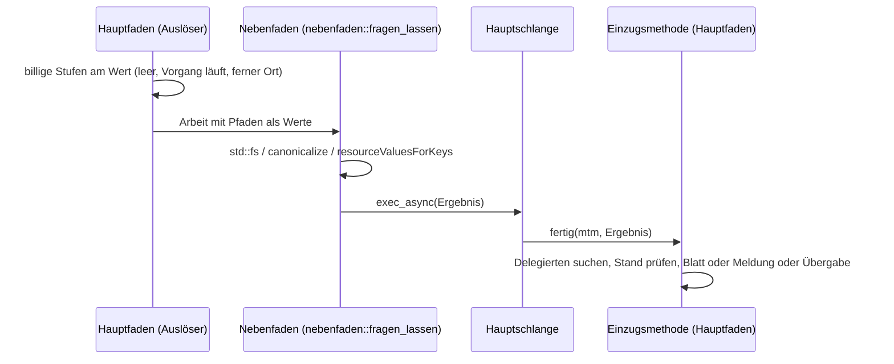
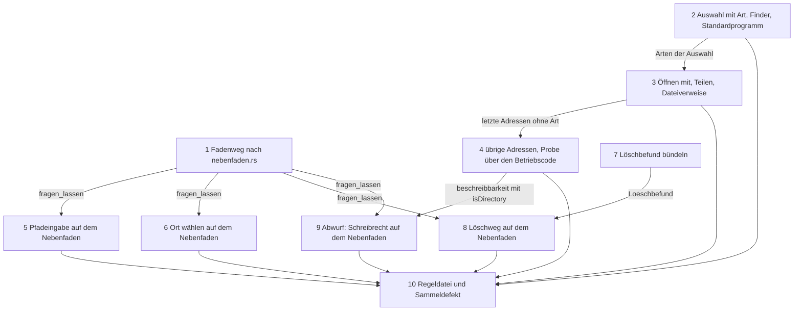

# Implementation Plan: Menü- und Tastenwege fragen das Dateisystem nicht mehr auf dem Hauptfaden

**Date:** 2026-11-02
**Spec:** none — planned from raw request (Directive des Pakets `261102-1304-dateisystemfragen-vom-hauptfaden-nehmen.md`, Grundlage `261030-1259-weitere-menue-und-tastenwege-fragen-das-dateisystem-auf-dem-hauptfaden.md`)
**Decidability:** Die tragende Frage lautet: Stellt einer der Wege aus `261030-1259-…` auf dem Hauptfaden eine Frage an das Dateisystem? Für KRKs eigene Fragen ist das aus dem Quelltext entscheidbar. Gemeint sind `std::fs`, `canonicalize`, `resourceValuesForKeys:`, Abfragen an `NSFileManager` und `fileURLWithPath:` ohne `isDirectory:`. Die Quelltextproben lesen dafür benannte Rümpfe und, für die Dateiadressen, den ganzen Betriebscode von `krk-ui`. Was das System innerhalb einer Übergabe tut (`openURL:`, `URLsForApplicationsToOpenURL:`, `writeObjects:`, `NSSharingServicePicker`, `activateFileViewerSelectingURLs:`), lässt sich aus KRKs Eingaben nicht entscheiden. Deshalb wechselt für diesen Teil der Mechanismus: Die Zusage wird auf KRKs eigene Fragen zugeschnitten (`261102-1312-was-heisst-fragt-das-dateisystem-auf-dem-hauptfaden-bei-einer-uebergabe-an-das-system.md`, Empfehlung Möglichkeit 1). Ob danach noch etwas hängt, entscheidet ein Lauf des Nutzers an einer hängenden Freigabe und keine Vorhersage. Die Proben lesen Rümpfe und keinen Aufrufbaum. Eine tiefer gerufene Funktion halten weiterhin ihr Doc-Kommentar und diese Proben nur so weit, wie sie die Namen der gerufenen Funktionen als Nadeln führen.

## Directive

Siehe `## Directive` im Narrativ des Pakets. Ziel: Keiner der Wege, die der Sammeldefekt nennt, fragt auf dem Hauptfaden das Dateisystem. Ein hängendes Netzlaufwerk hält die Ereignisschleife damit nicht mehr an, und Quelltextproben halten das fest, wie es bei `ctrl+o` und „Im Finder öffnen“ schon geschieht.

## Current State

Gelesen am Stand `998c6f37`. Seit `8278e685` hat kein Commit `appkit/finder.rs`, `appkit/standardprogramm.rs` oder `kommandos/pfadeingabe.rs` berührt. Die Zeilennummern des Defekts sind in `anwendung.rs` gewandert. Jede Stelle einzeln:

| Punkt | Stelle (heute) | Weg | Faden | Befund |
|---|---|---|---|---|
| 1 | `appkit/finder.rs:93` `aufdecken` | „Im Finder anzeigen“, Rufer `anwendung.rs` `im_finder_anzeigen` | Haupt | `fileURLWithPath:` ohne `isDirectory:`. Der Doc-Kommentar „fragt das Dateisystem nicht“ ist falsch (`838273ae` hat das Gegenteil festgestellt). |
| 2 | `appkit/standardprogramm.rs:108` `oeffnen` | Taste „Mit Standardprogramm öffnen“ und Doppelklick, Rufer `tabelle.rs` `mit_standardprogramm_oeffnen` (`:2793`) | Haupt | wie 1, mit demselben falschen Doc-Kommentar |
| 3a | `appkit/oeffnenmit.rs:159` `anwendungen_fuer` | Bau des Kontextmenüs, `tabelle.rs` `eigene_kontexteintraege_anfuegen` (`:2393`) | Haupt | `fileURLWithPath:`; danach `URLsForApplicationsToOpenURL:` (Übergabe, Rest nach `261102-1312-…`) |
| 3b | `appkit/oeffnenmit.rs:219`, `:224` `oeffnen_mit` | Klick auf eine Anwendung in „Öffnen mit“, `anwendung.rs` `mit_anwendung_oeffnen` | Haupt | `fileURLWithPath:` für die Einträge und für das Programmbündel (ein Ordner) |
| 3c | `appkit/teilen.rs:383` `auswaehler_bauen` | Teilen, `anwendung.rs` (`teilen::anbieten`, um `:5683`) | Haupt | `fileURLWithPath:`; Quelle sind entweder betroffene Einträge oder die angezeigte Datei von Vorschau oder Editor |
| 3d | `appkit/zwischenablage.rs:503` | `cmd+c`/`cmd+x` im Dateifenster, `tabelle.rs` `dateiverweise_ablegen` | Haupt | `fileURLWithPath:`; der Doc-Kommentar nennt den `stat(2)` richtig |
| 3e | `appkit/papierkorb.rs:143` `in_den_papierkorb` | Räumen in den Papierkorb | **Arbeitsfaden** der Operationsmaschine (`operation::starten`, `anwendung.rs:10682`) | nicht auf dem Hauptfaden; bleibt als benannte Ausnahme |
| 3f | `appkit/papierkorb.rs:200` `fuehrt_einen_papierkorb` | allein der Löschweg (`anwendung.rs:8053`) | Haupt | `fileURLWithPath:` und `URLForDirectory:…appropriateForURL:` fragen beide die Platte |
| 3g | `appkit/abwurf.rs:228` `beschreibbarkeit` | Abwurf aus fremden Anwendungen, `tabelle.rs` `abwurf_pruefen` (`:5127`), je Zeigerbewegung | Haupt | `fileURLWithPath:`, danach `resourceValuesForKeys:` (`NSURLIsWritableKey`) |
| 3h | `appkit/volumes.rs:287` `liegt_auf_netzlaufwerk` | allein der Löschweg (`anwendung.rs` `loeschgruende`) | Haupt | `fileURLWithPath:`, danach `resourceValuesForKeys:` |
| 4 | `kommandos/pfadeingabe.rs:101` (`metadata`), `:125` (`read_dir`) | `shift+cmd+g` und „Zur Zwischenablage springen“, `tabelle.rs` `pfad_anspringen` (`:3613`) und `lokalen_pfad_anspringen` (`:3630`) | Haupt | bestätigt |
| 5 | `appkit/anwendung.rs:6386` `ort_uebernehmen` | „Ort wählen…“ | Haupt | zwei `canonicalize`: `Heimordner::aufgeloest_erneuern` (`krk-core/src/heimordner/mod.rs:275`) und der Ablageordner (`:6387`) |
| 6 | `appkit/anwendung.rs:8050` `lokaler_papierkorbbefund`, `:8239` `loeschgruende` | Löschen | Haupt | bestätigt, dazu `liegt_auf_netzlaufwerk`, `arbeitsbaum::beruehrt_einen_arbeitsbaum` und `umfang::zaehlen` vor dem Blatt |
| 7 | `kommandos/pfadeingabe.rs:195` `gleicher_ordner` | allein `pruefen_gegen` (privat) | Haupt | Der Defekt nennt `auffrischung.rs` als Rufer. Das stimmt nicht: `auffrischung.rs:687` hat ein eigenes, gleichnamiges `gleicher_ordner`. Die zitierte Stelle gehört zu Punkt 4. |

Was die Suche zusätzlich ergab:

- `appkit/blaetter/ortwahl.rs:112` baut die Startadresse des Dialogs „Ort wählen…“ mit `fileURLWithPath:` auf dem Hauptfaden. Das ist derselbe Weg wie Punkt 5.
- Das `canonicalize` in `auffrischung.rs:687` läuft auf dem Hauptfaden: Der Rückruf von FSEvents kommt über `DispatchQueue::main()` (`appkit/fsevents.rs:332`), dazu kommt `vorgang_beenden`. Offen ist das schon als `260826-1442_*_gleicher-ordner-ruft-canonicalize-je-gemeldetem-pfad-und-dateifenster-und-die-kosten-sind-ungemessen.md`; dort steht seit diesem Plan ein `Also seen:`-Vermerk. Dieses Paket behebt es nicht (`## Where this work stops`).

Vorbild: `terminal.rs` mit `ordner_pruefen_lassen` und `vorbereiten_lassen` über den privaten Fadenweg `auf_dem_faden`. Das ist ein Faden mit Namen und ein Halter, damit `fertig` auch bei gescheitertem Start genau einmal ankommt. Der Rückweg läuft über `DispatchQueue::main().exec_async`, und `fertig(MainThreadMarker, T)` sucht den Delegierten über `Anwendungsdelegierter::delegierter(mtm)`. Die Quelltextproben `ctrl_o_…` und `im_finder_oeffnen_stellt_auf_dem_hauptfaden_keinen_systemaufruf` (`anwendung.rs` um `:16147`) lesen Rümpfe mit `rumpf(&diese_datei(), name)` und prüfen Nadeln. Neben `terminal.rs` gibt es weitere Fadenwege (`auswurf.rs`, `verbinden.rs`, die Modelle). Dieser Plan führt keinen weiteren ein, sondern macht den aus `terminal.rs` allgemein.

## Approach

Ein Mechanismus für jeden Weg, in zwei Formen derselben Regel:

1. **Die Art des Pfades ist schon bekannt.** Die Dateiadresse entsteht über `fileURLWithPath:isDirectory:`, die Art kommt aus dem Ordnermodell (`Eintrag::ist_ordner`) oder aus dem Wert, der schon in der Hand ist (ein Ordner, ein Programmbündel). Eine einzige Probe über den ganzen Betriebscode von `krk-ui` hält, dass `NSURL::fileURLWithPath(` ohne `_isDirectory` nirgends mehr steht. Die eine benannte Ausnahme ist `in_den_papierkorb` auf dem Arbeitsfaden. Diese eine Regel ersetzt neun Einzelbefunde.
2. **Eine echte Frage an die Platte.** Sie geht über den Fadenweg aus `terminal.rs`. Der wird dafür in ein eigenes Modul `appkit/nebenfaden.rs` gehoben und bekommt den Fadennamen als Angabe. Die Antwort kommt über die Hauptschlange an eine Einzugsmethode. Auf eine Rumpfprobe nach dem Vorbild von `ctrl+o` kommen je Weg drei Prüfungen: keine Nadel im Rumpf des Auslösers und der Einzugsmethode, der Fadenweg im Auslöser, die Wirkung in der Einzugsmethode.

Der Löschweg (Punkt 6) gehört in dieses Paket, und zwar aus drei Gründen:
(a) Die Directive verlangt „keiner der Wege, die `261030-1259` nennt“, und Punkt 6 ist einer davon.
(b) Zwei Stellen aus Punkt 3, `papierkorb.rs:200` und `volumes.rs:287`, werden allein vom Löschweg gerufen; ohne ihn bliebe Punkt 3 offen.
(c) Es ist derselbe Mechanismus: Frage auf dem Nebenfaden, Blatt im Rückweg.
Er schließt damit auch `261016-1956-…`. Die Stufentafel `loeschwarnung::vor_der_rueckfrage` bleibt der einzige Entscheider. Sie wird im Rückweg mit dem dann gültigen `vorgang_laeuft` ausgewertet.

Für Antworten auf einen veralteten Stand gilt eine Regel, keine Sonderfälle je Weg: Die Einzugsmethode wendet das Ergebnis gegen den Wert an, der mit der Frage gereist ist (Ordner, Gegenstand, Seite), und nicht gegen das, was gerade sichtbar ist. Wo das Ergebnis vom heutigen Stand abhängt, prüft sie ihn neu. Das sind die Stufentafel beim Löschen und der Fall `NurAuswahl` der Pfadeingabe.

## Implementation Steps

1. **Den Fadenweg aus `terminal.rs` in `appkit/nebenfaden.rs` heben**
   - Executor: code-implementer
   - Files: `crates/krk-ui/src/appkit/nebenfaden.rs` (neu), `crates/krk-ui/src/appkit/terminal.rs`, `crates/krk-ui/src/appkit/mod.rs`
   - Changes: `auf_dem_faden`, `nehmen` und `auf_dem_hauptfaden` ziehen um. Daraus wird `pub(crate) fn fragen_lassen<T: Send + 'static>(fadenname: &'static str, arbeit, startfehler, fertig)`, Verhalten unverändert. `vorbereiten_lassen` und `ordner_pruefen_lassen` rufen es mit `"krk-terminal"`. Das neue Modul trägt den Abschnitt `# Ab welchem macOS die angesprochenen Klassen stehen` (`MainThreadMarker`, `DispatchQueue`), weil es Namen aus `objc2_foundation` hereinholt. Der Abschnitt „Der Faden `krk-terminal`“ im Modulkopf von `terminal.rs` verweist auf das neue Modul. Ein `mod` kommt allein in `appkit/mod.rs` dazu, nicht in `main.rs`; `hauptfaden.rs` bleibt deshalb unberührt.
   - Acceptance: `make check` grün; `kein_fadenstart_im_baum_wirft_seinen_rueckgabewert_weg`, `jede_appkit_datei_mit_frameworkimport_traegt_den_untergrenzen_abschnitt`, `ctrl_o_stellt_auf_dem_hauptfaden_keinen_systemaufruf` und `im_finder_oeffnen_stellt_auf_dem_hauptfaden_keinen_systemaufruf` grün und unverändert.
   - Prüfkommando: `make check`
   - Dependencies: none

2. **Die Auswahl trägt je Pfad die Art; „Im Finder anzeigen“ und das Standardprogramm bauen ihre Adressen mit `isDirectory:` (Punkte 1, 2)**
   - Executor: code-implementer
   - Files: `crates/krk-ui/src/kommandos/operationen.rs`, `crates/krk-ui/src/kommandos/loeschwarnung.rs` (Probenbau von `Auswahl`), `crates/krk-ui/src/appkit/finder.rs`, `crates/krk-ui/src/appkit/standardprogramm.rs`, `crates/krk-ui/src/appkit/tabelle.rs`, `crates/krk-ui/src/appkit/anwendung.rs`
   - Changes: `Auswahl` bekommt neben `pfade` je Pfad die Angabe, ob er ein Ordner ist. Gefüllt wird sie allein in `betroffene` aus `Eintrag::ist_ordner`; eine Methode `adressen()` liefert `(&Path, bool)`. Die Länge beider Listen hält der eine Bauort, und eine Probe in `operationen.rs` prüft sie. Eine Verknüpfung zählt, wie im Modell, nicht als Ordner. `finder::aufdecken` und `standardprogramm::oeffnen` nehmen die Art und rufen `NSURL::fileURLWithPath_isDirectory`. `mit_standardprogramm_oeffnen` reicht die Arten weiter, beim Doppelklick die Art der angeklickten Zeile. Die falschen Sätze „`fileURLWithPath:` fragt das Dateisystem nicht“ in beiden Modulen werden berichtigt, die Untergrenzen-Abschnitte nennen `fileURLWithPath:isDirectory:` (seit macOS 10.5). Verhalten und Meldungen bleiben, wie sie sind.
   - Acceptance: `make check` grün; in `finder.rs` und `standardprogramm.rs` steht kein `fileURLWithPath(` mehr ohne `_isDirectory`.
   - Prüfkommando: `make check`
   - Dependencies: none

3. **„Öffnen mit“, Teilen und die Dateiverweise bauen ihre Adressen mit `isDirectory:` (Punkte 3a bis 3d)**
   - Executor: code-implementer
   - Files: `crates/krk-ui/src/appkit/oeffnenmit.rs`, `crates/krk-ui/src/appkit/teilen.rs`, `crates/krk-ui/src/appkit/zwischenablage.rs`, `crates/krk-ui/src/kommandos/kontextmenue.rs`, `crates/krk-ui/src/appkit/tabelle.rs`, `crates/krk-ui/src/appkit/anwendung.rs`
   - Changes: `anwendungen_fuer` nimmt die Art des einen Bezugseintrags (`kontextmenue::oeffnungsbezug` liefert sie aus der Auswahl mit). `oeffnen_mit` nimmt die Arten der Einträge und baut das Programmbündel mit `isDirectory: true`. `teilen::anbieten` und `auswaehler_bauen` nehmen die Arten. Für `Quelle::AngezeigteDatei` kommt die Art aus dem Wert, den Vorschau oder Editor halten: Der Editor hält immer eine Datei. Ob die Vorschau einen Ordner zeigt, sagt ihr Modell. `inference:` `vorschaumodell` führt das schon; findet der Ausführer keinen solchen Wert, meldet er das als Defekt und schreibt nicht `false` hinein. `dateiverweise_auf_ablage_schreiben` und `dateiverweise_schreiben` nehmen die Arten; ihr Doc-Kommentar zum `stat(2)` wird auf den neuen Stand gebracht. Die Glättung mit `to_string_lossy` bleibt, wo sie steht (`zwischenablage.rs`, `finder.rs`); sie gehört nicht zu diesem Paket.
   - Acceptance: `make check` grün; in den drei Modulen steht kein `fileURLWithPath(` mehr ohne `_isDirectory`; die Proben der Probenablage in `zwischenablage.rs` sind grün.
   - Prüfkommando: `make check`
   - Dependencies: 2

4. **Die übrigen Adressen mit bekannter Art und die Probe über den ganzen Betriebscode (Punkte 3f bis 3h, `ortwahl.rs`)**
   - Executor: code-implementer
   - Files: `crates/krk-ui/src/appkit/abwurf.rs`, `crates/krk-ui/src/appkit/volumes.rs`, `crates/krk-ui/src/appkit/papierkorb.rs`, `crates/krk-ui/src/appkit/blaetter/ortwahl.rs`, `crates/krk-core/tests/baum.rs`
   - Changes: `beschreibbarkeit`, `liegt_auf_netzlaufwerk` und `fuehrt_einen_papierkorb` bekommen einen Ordner herein und nehmen `isDirectory: true`, ebenso die Startadresse in `ortwahl::zeigen`. `in_den_papierkorb` bleibt bei `fileURLWithPath:`. Es läuft auf dem Arbeitsfaden, und sein Doc-Kommentar sagt das. Neue Probe `kein_betriebscode_der_oberflaeche_baut_eine_dateiadresse_ohne_isdirectory` in `baum.rs` über `betriebscode_der_oberflaeche()`: Kein `fileURLWithPath(` außer `fileURLWithPath_isDirectory(`, ausgenommen genau der Rumpf von `in_den_papierkorb`, den die Probe mit Namen führt. Die Fragen über `resourceValuesForKeys:` und `URLForDirectory:` laufen nach diesem Schritt weiter auf dem Hauptfaden; das ändern die Schritte 8 und 9.
   - Acceptance: `make check` grün; die neue Probe ist gegen den Stand vor Schritt 2 rot (der Ausführer prüft das an einer zurückgesetzten Kopie einer der Stellen und nennt das Ergebnis).
   - Prüfkommando: `make check` und `PATH="$HOME/.cargo/bin:$PATH" cargo test -p krk-core --test baum kein_betriebscode_der_oberflaeche_baut_eine_dateiadresse_ohne_isdirectory`
   - Dependencies: 3

5. **Die Pfadeingabe prüft auf dem Nebenfaden (Punkte 4 und 7)**
   - Executor: code-implementer
   - Files: `crates/krk-ui/src/appkit/tabelle.rs`, `crates/krk-ui/src/kommandos/pfadeingabe.rs` (allein der Modulkopf)
   - Changes: `pfad_anspringen` und `lokalen_pfad_anspringen` stellen `pfadeingabe::pruefen` und `pruefen_fuer_archivtab` über eine Hülle `*_lassen` außerhalb ihrer Rümpfe auf `nebenfaden::fragen_lassen` (Fadenname `krk-plattenfrage`). Mit der Frage reisen die Seite und der Ort, gegen den geprüft wurde. Die Einzugsmethode sucht über den Delegierten die Quelle der Seite und ruft `ergebnis_anwenden`. Zeigt der Tab inzwischen einen anderen Ort, wird `NurAuswahl { name }` als `Wechseln { ordner: <Ort der Frage>, auswahl: Some(name) }` angewandt, denn `NurAuswahl` heißt, dass die Datei in genau diesem Ordner liegt. Scheitert der Fadenstart, wird das als `Ergebnis::Meldung` mit dem Satz `Text::PfadGibtEsNicht` und dem Fehler gemeldet. Die Prüflogik in `pfadeingabe.rs` bleibt, wie sie ist; der Modulkopf sagt, auf welchem Faden sie läuft. Neue Rumpfprobe `die_pfadeingabe_stellt_auf_dem_hauptfaden_keinen_systemaufruf` in den Proben von `tabelle.rs`: Die Rümpfe von `pfad_anspringen`, `lokalen_pfad_anspringen` und der Einzugsmethode enthalten weder `fs::`, `metadata(`, `read_dir(`, `canonicalize(` noch `pfadeingabe::pruefen`; der Auslöser enthält die Hülle, die Hülle enthält `nebenfaden::fragen_lassen(`.
   - Acceptance: `make check` grün; die neue Probe ist gegen den alten Rumpf rot; die vorhandenen Proben in `pfadeingabe.rs` sind unverändert grün.
   - Prüfkommando: `make check` und `PATH="$HOME/.cargo/bin:$PATH" cargo test -p krk-ui -- die_pfadeingabe_stellt_auf_dem_hauptfaden_keinen_systemaufruf`
   - Dependencies: 1

6. **„Ort wählen…“ löst auf dem Nebenfaden auf (Punkt 5)**
   - Executor: code-implementer
   - Files: `crates/krk-ui/src/appkit/anwendung.rs`
   - Changes: `ort_uebernehmen` führt Schritt 1 und Schritt 2 am Wert aus, wie bisher. Schritt 3, also `Heimordner::aufgeloest_erneuern` und `canonicalize` des Ablageordners, geht über `nebenfaden::fragen_lassen`. Die Einzugsmethode `ort_einziehen` wiederholt Schritt 1 (am Wert, billig, weil der Editor in der Lücke eine Datei geöffnet haben kann) und führt danach die Schritte 3.2 bis 6 aus. Die Tafel aus `260926-1506_*_plan-home-menue-und-einstellbarer-ort.md` bleibt der einzige Entscheider über Ausgang und Wechsel. Scheitert der Fadenstart, gilt `aufgeloest()` als `None`, denselben Weg wie heute bei einem gescheiterten `canonicalize`. Der Doc-Kommentar mit den nummerierten Schritten nennt den Faden. Neue Rumpfprobe `ort_waehlen_stellt_auf_dem_hauptfaden_keinen_systemaufruf`: In `ort_uebernehmen` und `ort_einziehen` stehen weder `canonicalize(`, `aufgeloest_erneuern(` noch `fs::`, im Auslöser steht der Fadenweg. Das Schreiben in `settings.toml` unter der Sperre bleibt auf dem Hauptfaden: Der Ablageordner ist die Ablage dieses Geräts, und das ist kein Weg aus dem Sammeldefekt.
   - Acceptance: `make check` grün; die neue Probe ist gegen den alten Rumpf rot.
   - Prüfkommando: `make check` und `PATH="$HOME/.cargo/bin:$PATH" cargo test -p krk-ui -- ort_waehlen_stellt_auf_dem_hauptfaden_keinen_systemaufruf`
   - Dependencies: 1

7. **Die Plattentatsachen des lokalen Löschwegs in einen Wert bündeln (Vorbereitung zu Punkt 6, ohne Fadenwechsel)**
   - Executor: code-implementer
   - Files: `crates/krk-ui/src/appkit/anwendung.rs`
   - Changes: Eine Funktion `lokaler_loeschbefund(ordner, &Auswahl) -> Loeschbefund` erhebt alle Fragen an die Platte des lokalen Wegs in einem Zug. Das sind der aufgelöste Ordner, der Papierkorbbefund, das aufgelöste Benutzerverzeichnis, das Netzlaufwerk, der Arbeitsbaum und der Umfang; daraus entstehen die Warngründe. `Loeschbefund` ist ein gewöhnlicher Rust-Wert und `Send`. `loeschtexte` und die endgültige Fassung nehmen ihn statt selbst zu fragen, `lokaler_papierkorbbefund` und `loeschgruende` gehen darin auf. Der Befund wird weiter erst erhoben, wenn die billigen Stufen durch sind, und weiter auf dem Hauptfaden; das ändert Schritt 8. Der Probenhelfer `texte` (`anwendung.rs` um `:15383`) zieht nach. Kein Wortlaut und keine Stufe ändern sich.
   - Acceptance: `make check` grün; die Proben des fernen und des Archivzweigs (`anwendung.rs` um `:17594` bis `:17811`) sind unverändert grün.
   - Prüfkommando: `make check`
   - Dependencies: none

8. **Der Löschweg fragt auf dem Nebenfaden (Punkt 6, `261016-1956-…`)**
   - Executor: code-implementer
   - Files: `crates/krk-ui/src/appkit/anwendung.rs`, `crates/krk-core/src/sprache/schluessel.rs`, `crates/krk-core/src/sprache/tabelle/de.rs`, `crates/krk-core/src/sprache/tabelle/fr.rs`, `crates/krk-core/src/sprache/tabelle/en.rs`, der Defekt `261016-1956-der-loeschweg-fragt-canonicalize-und-den-papierkorb-auf-dem-hauptfaden-und-ein-haengendes-netzlaufwerk-haelt-die-ereignisschleife-an.md`
   - Changes: Für einen lokalen Gegenstand, dessen billige Stufen (`vorgang_laeuft`, leer) durch sind, stellt `loeschen_nach_rueckfrage` `lokaler_loeschbefund` über `nebenfaden::fragen_lassen` (Fadenname `krk-plattenfrage`). Mit der Frage reisen Gegenstand, Seite und Schaltflächenbeschriftung. Die Einzugsmethode `loeschbefund_einziehen` fragt `vorgang_laeuft` neu, wertet `loeschwarnung::vor_der_rueckfrage` mit dem Befund aus und zeigt das Blatt mit dem gereisten Gegenstand. Fern- und Archivzweig bleiben ohne Faden, wie sie sind. Solange eine lokale Frage läuft, startet ein weiterer Löschbefehl keine zweite. Er meldet in der Statuszeile einen neuen Satz, Schlüssel etwa `Text::LoeschpruefungLaeuftNoch`, eingetragen in allen drei Tabellen, mit Umlaut im deutschen Wortlaut. Die Sperre ist ein Feld des Delegierten, das die Einzugsmethode löst. Scheitert der Fadenstart, gilt der Befund als unentschieden (Papierkorb `Unentschieden`, Warngründe `Unentscheidbar`). Das führt auf die vorhandene endgültige Rückfrage mit `Endgueltiggrund::PapierkorbUngewiss`, ohne neuen Wortlaut. Der Doc-Kommentar von `loeschen_nach_rueckfrage` verliert den Satz, der den offenen Defekt zitiert. Neue Rumpfprobe `der_loeschweg_stellt_auf_dem_hauptfaden_keinen_systemaufruf`: In den Rümpfen von `loeschen_nach_rueckfrage`, `loeschbefund_einziehen`, `loeschblatt_zeigen` und den beiden Textfunktionen steht weder `canonicalize(`, `fuehrt_einen_papierkorb(`, `liegt_auf_netzlaufwerk(`, `beruehrt_einen_arbeitsbaum(`, `umfang::zaehlen(`, `lokaler_loeschbefund(` noch `fs::`; im Auslöser steht der Fadenweg, in der Einzugsmethode `vor_der_rueckfrage(`. Zuletzt hängt der Ausführer an `261016-1956-…` die Zeile `Resolved:` an und fährt danach `make check`.
   - Acceptance: `make check` grün nach dem Schreiben der Zeile `Resolved:`; die neue Probe ist gegen den Rumpf aus Schritt 7 rot; die Proben der Sprachtabelle und `kein_stringliteral_des_betriebscodes_traegt_einen_umlaut_ausser_in_der_sprachtabelle` sind grün.
   - Prüfkommando: `make check` und `PATH="$HOME/.cargo/bin:$PATH" cargo test -p krk-ui -- der_loeschweg_stellt_auf_dem_hauptfaden_keinen_systemaufruf`
   - Dependencies: 1, 7

9. **Der Abwurf fragt das Schreibrecht auf dem Nebenfaden (Punkt 3g)**
   - Executor: code-implementer
   - Files: `crates/krk-ui/src/appkit/tabelle.rs`, `crates/krk-ui/src/appkit/abwurf.rs`
   - Changes: `abwurf_pruefen` ruft `beschreibbarkeit` nicht mehr selbst. Die Quelle hält je Ziehvorgang einen Merker `(Zielordner, Option<Schreibrecht>)`. Fehlt die Antwort für den Ordner unter dem Zeiger, startet der Merker einmal je Ordner eine Frage über `nebenfaden::fragen_lassen` (Fadenname `krk-plattenfrage`) und urteilt bis zur Antwort mit `Schreibrecht::Unbekannt`. Das „lässt durch“ ist schon entschieden (`260818-1633_*_gilt-ein-unentscheidbares-schreibrecht-beim-abwurf-als-erlaubnis-oder-als-abweisung.md`). Die nächste Zeigerbewegung urteilt mit der Antwort. Gelöscht wird der Merker, wenn der Zug die Tabelle verlässt oder endet. Damit bleibt die Zusage „ein frischer `NSURL` je Messung“ aus dem Modulkopf von `abwurf.rs` erhalten, gemessen einmal je Ordner und Zug statt je Bewegung; der Modulkopf sagt das. `beschreibbarkeit` läuft auf dem Nebenfaden (Foundation, kein AppKit). Neue Rumpfprobe `der_abwurf_stellt_auf_dem_hauptfaden_keinen_systemaufruf`: Der Rumpf von `abwurf_pruefen` und der Einzugsmethode enthält weder `beschreibbarkeit(` noch `fs::` oder `resourceValuesForKeys`; der Fadenweg steht in der Hülle.
   - Acceptance: `make check` grün; die vorhandenen Proben zu `beschreibbarkeit` in `abwurf.rs` (um `:362` bis `:427`) sind grün; die neue Probe ist gegen den alten Rumpf rot.
   - Prüfkommando: `make check` und `PATH="$HOME/.cargo/bin:$PATH" cargo test -p krk-ui -- der_abwurf_stellt_auf_dem_hauptfaden_keinen_systemaufruf`
   - Dependencies: 1, 4

10. **Regeldatei und Sammeldefekt nachziehen**
    - Executor: code-implementer
    - Files: `.claude/rules/coding-was-man-nicht-sieht.md`, der Sammeldefekt `261030-1259-weitere-menue-und-tastenwege-fragen-das-dateisystem-auf-dem-hauptfaden.md`
    - Changes: Ein Absatz in der Regeldatei: Dateiadressen entstehen allein über `fileURLWithPath:isDirectory:`, mit der einen Ausnahme und der Probe aus Schritt 4. Fragen an die Platte auf einem Hauptfadenweg gehen über `appkit/nebenfaden.rs`, und die vier Rumpfproben (Schritte 5, 6, 8, 9) führen das neben `ctrl+o` und „Im Finder öffnen“ fort. Die Übergaben an das System sind ein benannter Rest, Verweis auf `261102-1312-…`. Keine Zahl der Proben. An den Sammeldefekt wird die Zeile `Resolved:` angehängt, je Punkt mit dem Schritt. Darin steht auch, dass Punkt 7 die Stelle in `pfadeingabe.rs` meint und dass der gleichnamige Nachbar in `auffrischung.rs` unter `260826-1442_*_…` offen bleibt. `make check` fährt danach.
    - Acceptance: `make check` grün nach beiden Schreibvorgängen; `grep -rn 'fileURLWithPath:` fragt das Dateisystem nicht' crates` findet nichts.
    - Prüfkommando: `make check`
    - Dependencies: 2, 3, 4, 5, 6, 8, 9

## Where this work stops

- Jeder der zehn Schritte ist erledigt und sein `make check` grün.
- In den Rümpfen der Auslöser und Einzugsmethoden der Wege aus den Punkten 4, 5, 6 und 3g steht keine Frage an die Platte, und je eine Rumpfprobe hält das.
- Im Betriebscode von `krk-ui` steht `fileURLWithPath(` ohne `_isDirectory` allein in `in_den_papierkorb`, und die Probe aus Schritt 4 hält das.
- An `261030-1259-…` und `261016-1956-…` steht je eine Zeile `Resolved:`.
- Das `canonicalize` in `auffrischung.rs` gehört nicht zu diesem Paket; es bleibt unter `260826-1442_*_…` offen.
- Die Übergaben an das System bleiben auf dem Hauptfaden, solange `261102-1312-…` nicht anders beantwortet ist. Wird dort Möglichkeit 2 oder 3 gewählt, ist das ein eigenes Paket und kein Schritt dieses Plans.
- Gegen die zehn Zusagen wird nicht gemessen, solange `261102-1313-…` nicht mit Möglichkeit 1 beantwortet ist (`condition did not arise` bis zur Antwort).
- Ein Lauf an einer hängenden Freigabe ist Nutzerarbeit und keine Bedingung für das Schließen der Schritte.
- Das Paket liefert nicht aus; kein Schritt fährt `./release.sh` oder setzt einen Tag.

## Data Structures

- `operationen::Auswahl`: neben `pfade` je Pfad die Angabe Ordner ja oder nein, gefüllt allein in `betroffene`; `adressen() -> impl Iterator<Item = (&Path, bool)>`.
- `Loeschbefund` (in `anwendung.rs`, `Send`): aufgelöster Ordner, `Erlaubnisbefund`, Warngründe; ersetzt die getrennten Fragen von `lokaler_papierkorbbefund` und `loeschgruende`.
- Merker des Abwurfs in den Ivars der Quelle: Zielordner und `Option<Schreibrecht>`, je Ziehvorgang.
- Feld des Delegierten: Löschfrage läuft, ja oder nein.

## API Changes

- `appkit::nebenfaden::fragen_lassen(fadenname, arbeit, startfehler, fertig)`, `pub(crate)`.
- `finder::aufdecken`, `standardprogramm::oeffnen`, `oeffnenmit::anwendungen_fuer`, `oeffnenmit::oeffnen_mit`, `teilen::anbieten`, `zwischenablage::dateiverweise_schreiben` und `dateiverweise_auf_ablage_schreiben` nehmen je Pfad die Art.
- Neuer Sprachschlüssel für „Löschprüfung läuft noch“ in `de`, `fr` und `en`.

## Testing Strategy

- Vier Rumpfproben nach dem Muster `ctrl_o_stellt_auf_dem_hauptfaden_keinen_systemaufruf` (Schritte 5, 6, 8, 9). Jede wird gegen den alten Rumpf einmal rot gesehen, bevor der neue Rumpf steht.
- Eine Probe über den ganzen Betriebscode von `krk-ui` gegen `fileURLWithPath(` ohne `_isDirectory` (Schritt 4).
- Eine Probe zur Längeninvariante von `Auswahl` (Schritt 2).
- Keine neue AppKit-Probe ist nötig: Die neuen Proben lesen Quelltext und laufen unter `libtest`. Braucht ein Ausführer doch eine, gehört sie in eine Liste `HAUPTFADENPROBEN` des Prüfziels `hauptfaden`.
- Was keine Probe sieht: das Verhalten an einer hängenden Freigabe. Ein Lauf durch den Nutzer, etwa eine eingehängte SMB-Freigabe mit danach getrenntem Server, prüft je Weg, ob die Ereignisschleife weiterläuft. Er gehört zur Antwort auf `261102-1312-…` und nicht zum Schließen dieses Plans.

## Risks & Mitigations

| Risk | Mitigation |
|------|------------|
| Eine Antwort kommt auf einen veralteten Stand an (Tab gewechselt, zweiter Tastendruck). | Die Einzugsmethode wendet gegen den gereisten Wert an. Was vom heutigen Stand abhängt, wird neu gefragt (Stufentafel, `NurAuswahl`). Beim Löschen sperrt ein Feld die zweite Frage. |
| Während der Lücke urteilt der Abwurf mit `Unbekannt` und lässt über einem schreibgeschützten Ordner kurz durch. | Das ist die schon entschiedene Bedeutung von `Unbekannt`; ein Abwurf in der Lücke steht danach mit Grund in der Abschlussliste. Steht im Modulkopf. |
| Das Löschblatt erscheint um einen Fadenstart später. | `inference:` lokal unter einer Millisekunde; gemessen wird es nicht (`261102-1313-…`). |
| Eine Rumpfprobe sieht eine tiefer gerufene Frage nicht. | Die Nadeln führen die Namen der gerufenen Fragefunktionen (`lokaler_loeschbefund(`, `beschreibbarkeit(`, `pfadeingabe::pruefen`). Der Rest steht im Doc-Kommentar der Probe, wie bei `ctrl+o`. |
| Die Art „Ordner“ ist für eine Verknüpfung auf einen Ordner falsch. | `isDirectory:` setzt allein den Schrägstrich am Ende der Adresse. Eine Verknüpfung ohne ihn ist die Adresse der Verknüpfung, wie im Ordnermodell. Das System löst sie selbst auf. |
| Die Doc-Kommentare über `define_class!` in `tabelle.rs` stehen an der Rekursionsgrenze der Makroausdehnung. | Neue Prosa in `tabelle.rs` kommt nicht in den Doc-Kommentar von `Namensfeld` (Regeldatei, Abschnitt Prüfziel `hauptfaden`). |

## Open Questions

- [ ] Reicht die Zusage bis zu KRKs eigenen Fragen oder auch in die Übergaben an das System? `261102-1312-was-heisst-fragt-das-dateisystem-auf-dem-hauptfaden-bei-einer-uebergabe-an-das-system.md`. Der Plan baut auf Möglichkeit 1; kein Schritt hängt an der Antwort.
- [ ] Schuldet das Paket einen Abnahmelauf gegen die zehn Zusagen? `261102-1313-schuldet-das-hauptfadenpaket-einen-abnahmelauf-gegen-die-zehn-zusagen.md`.
- [ ] Schritt 9 lässt einen Abwurf über einem schreibgeschützten Ordner für die Dauer einer Frage durch, statt den Zeiger sofort abzuweisen. Das folgt aus `260818-1633_*_…`. Wer es anders will, sagt es am Plan-Gate; dann bleibt der Abwurf aus dem Paket, und Punkt 3g bleibt offen.
