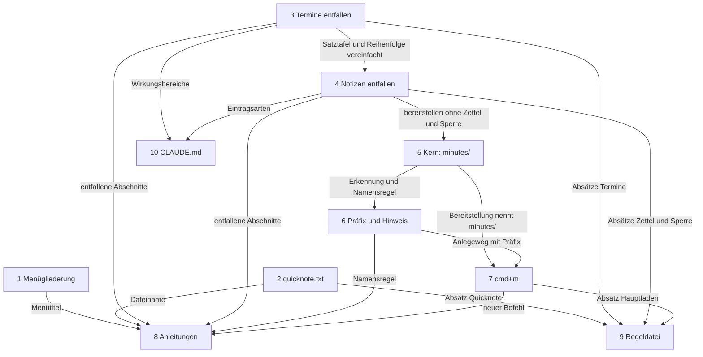
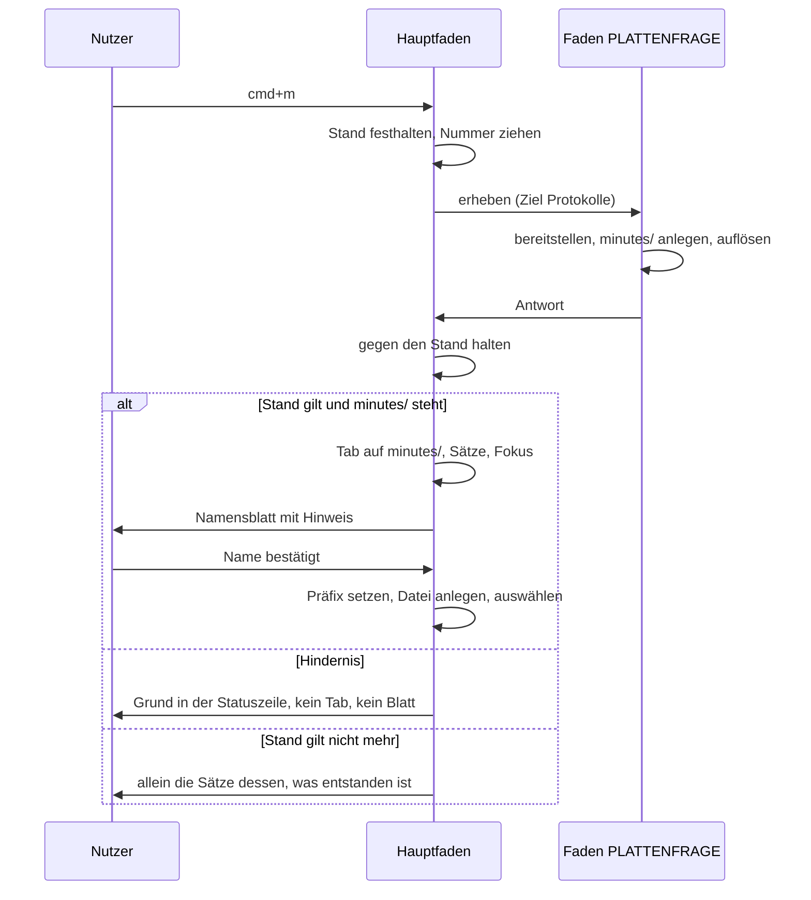

# Implementation Plan: Menü „Navigation“, Notizordner mit drei Dateien und `minutes/`

**Date:** 2026-11-11
**Spec:** `261111-0809-spec-menue-navigation-und-notizordner-mit-minutes.md`, vom Nutzer am 261111 abgenommen. Der Punkt unter `## User Decisions Pending` ist beantwortet, wörtlich: „die bestehende Taste bleibt, also Ctrl+Cmd+N, Cmd+Shift+N bleibt Ordner anlegen.“ Das Entfernen im Umfang von C3 ist ausdrücklich bestätigt, C4.10 gilt.
**Decidability:** Zwei Fragen tragen den Plan. Die erste: liegt der Ordner, in dem „Leere Datei anlegen“ anlegt, unmittelbar in `minutes/` des eingestellten Notizordners? Aus dem Pfadtext ist sie für die zwei Formen entscheidbar, die `Heimordner` hält (geschrieben und aufgelöst), und für eine dritte Schreibweise desselben Ordners nicht. Der Mechanismus stellt deshalb genau die entscheidbare Frage, einen Textvergleich gegen zwei Formen ohne Systemaufruf, wie die Erkennung des Notizordners selbst; unter einer dritten Schreibweise entsteht die Datei ohne Präfix, die sichere Seite des Irrtums. Die zweite: minimiert `cmd+m` das Fenster, bevor KRK die Taste sieht? Aus dem Quelltext ist entscheidbar, dass der Ereignisabgriff jeden Tastendruck vor der Menüleiste bekommt und dass kein Menüeintrag `performMiniaturize:` trägt; was macOS am laufenden Bündel tut, entscheidet der Quelltext nicht. Der Plan baut dafür keinen Ersatzmechanismus, sondern führt die Beobachtung als Nutzerpunkt unter `## Where this work stops`.

## Directive

Umgesetzt wird die Spezifikation, wie sie steht: ein Menü „Navigation“ und drei kürzere Menütitel (C1), `quicknote.txt` statt `scratch.txt` (C2), das Ende der Notiz- und Terminfunktionen (C3), der Unterordner `minutes/` mit Datum und Uhrzeit vor dem Dateinamen (C4) und der Befehl „Protokoll anlegen“ auf `cmd+m` (C5). Die Kriterien stehen in der Spezifikation und werden hier nicht wiederholt; jeder Schritt nennt die, die er trägt.

## Current State

- **Eine Gliederung, drei Abnehmer.** `Funktionsbereich` (`crates/krk-ui/src/belegungsmodell.rs`) ordnet jede Funktion einem Bereich zu, `bereich_des_kommandos` vollständig und ohne Auffangzweig. Hauptmenü (`menuemodell.rs`), Belegungsansicht und Markdown-Ausgabe (`belegungsausgabe.rs`) lesen `Funktionsbereich::ALLE` und `Funktionsbereich::name`. Innerhalb eines Bereichs gilt die Reihenfolge von `resources/default-keymap.toml`. Die Titel stehen als `Text::Funktionsbereich…` in den drei Sprachtabellen.
- **Die zwölf Befehle aus C1.4 stehen in der Belegungsdatei schon in der verlangten Folge.** Elf stehen im Block „C2: Navigation in der Liste“ hintereinander, `zwischenablage_springen` weiter unten im Block „C10“. Zwischen beiden steht kein Befehl, der nach „Navigation“ ginge, also ergibt die Dateireihenfolge innerhalb des neuen Bereichs die Folge aus C1.4, ohne dass ein Block wandert (nachgezählt am 261111 über die Zeilen `id =` der Datei).
- **Die Quicknote** sichert über `crates/krk-ui/src/quicknotesicherung.rs` auf dem Faden `krk-quicknote`; den Pfad baut allein `Heimordner::quicknotedatei` aus `heimordner::QUICKNOTEDATEI` (`"scratch.txt"`). Das Lesen ist der erste Auftrag des Fadens, beim ersten `f10`.
- **Die Vorlage für eine Umbenennung ohne Überschreiben** steht in `crates/krk-core/src/heimordner/bereitstellen.rs`: `ohne_ersetzen_umbenennen` legt erst einen harten Verweis an, der an einem vorhandenen Ziel scheitert, und nimmt dann den alten Namen weg. Sie ist privat und trägt mit `AlteGeheimnisse` einen Namen, der allein `secrets.txt` meint.
- **Notizen und Termine** hängen an `Sonderdatei::{Notizen, Termine}` (`heimordner/mod.rs`), an `Eintragsart`, `Zeilen` (`appkit/eintragsansicht.rs`) und `Editorform` (`kommandos/zulaessigkeit.rs`) mit je einem gleichnamigen Wert, an `Kommando::TermineRichtungUmkehren` mit `Wirkungsbereich::Termine`, an `Wirkungsbereich::Reihenfolge` und am Modul `eintraege::termine`. Jede dieser Fallunterscheidungen ist vollständig, der Übersetzer nennt die Stellen.
- **`secrets.txt` ruht auf der Notizform.** `eintraege/geheimnisse.rs` liest mit `Notizen::lesen` und rechnet über `notizen::{angehaengt, themenzeile, textzeilen, loeschen, verschieben}`; die Geheimnistabelle antwortet mit den Sätzen der Notiztabelle (`Satzfamilie::N` in `appkit/editor.rs`).
- **Die Zettelübernahme** (`note-1.txt`, `note-2.txt`) hängt an `Sonderdatei::Notizen`: `bereitstellen` liest die Zettel, schreibt sie in `notes.txt` und vermerkt es in `reported.toml` (`Merker::zettel_uebernommen`). Allein dafür nimmt F2 am Vorgabeort die Schreibsperre der Ablage (`Anwendungsdelegierter::notizordner_erheben`).
- **Eine eigene `keymap.toml` mit unbekannter Kennung wird als Ganzes verworfen** (`Belegung::bauen`). So hat der Nutzer es am 260817 für `endgueltig_loeschen` entschieden (`260817-0536_*_was-geschieht-mit-einer-gespeicherten-keymap-die-die-entfallene-funktion-fuehrt.md`), mit dem Zusatz, eine spätere Runde dürfe neu fragen; die Probe `eine_keymap_mit_der_zurueckgezogenen_kennung_wird_als_ganzes_verworfen` hält es. C3.10 verlangt für die zweite zurückgezogene Kennung das Gegenteil.
- **F2** läuft seit `31b2a7c5` in drei Teilen: `notizordner_oeffnen` (Hauptfaden, ohne Plattenfrage), `notizordner_erheben` (Faden `PLATTENFRAGE`), `notizordner_einziehen` (Hauptfaden, gegen `Notizordnerstand`). Die reine Entscheidung steht in `notizordnerausgang`, gehalten von der Tafel `f2_entscheidet_je_stand_und_hindernis`.
- **„Leere Datei anlegen“** geht über `Anwendungsdelegierter::anlegen` (Blatt aus `blaetter/namenseingabe.rs`) nach `anlegen_ausfuehren`. Das Namensblatt hat bereits eine Gestalt mit einer Zeile unter dem Feld (`Vorlage::grund`), gebaut für das Duplizieren.
- **Jeder Tastendruck** läuft durch den lokalen Ereignisabgriff (`appkit/ereignisse.rs`); alle Menüeinträge tragen den einen Selektor `KRK_KOMMANDO`. `performMiniaturize:` und `setWindowsMenu` stehen an keiner Stelle unter `crates/krk-ui/src` (durchsucht am 261111). `cmd+m` nennt keine Tastenliste der Auslieferungsbelegung.

## Approach

Die Arbeit läuft in zehn Schritten, jeder für sich übersetzbar und mit grünem `make check`. Zuerst die zwei unabhängigen Änderungen (Menü, Quicknote), dann das Entfernen in zwei Zügen (Termine, danach Notizen), dann `minutes/` vom Kern zur Oberfläche, zuletzt die Texte für den Nutzer und für die Sitzungen.

### Entscheidungen des Plans

**E1: Ein neuer Wert `Funktionsbereich::Navigation`, keine Umbenennung der Bezeichner.** Er steht in der Aufzählung und in `ALLE` unmittelbar hinter `Dateilisting`. Die drei kürzeren Titel sind Änderungen der Tabellenwerte in `de.rs`, `en.rs` und `fr.rs`; die Bezeichner `Dateilisting`, `Dateioperationen` und `LeisteUndFokus` bleiben, wie `Textbefehle` blieb, als der Bereich „Bearbeiten“ wurde, und ihr Doc-Kommentar sagt es. Damit beantwortet der Plan den ersten Punkt unter `## Open for Planner`: Menüleiste, Belegungsansicht und Markdown-Ausgabe kommen weiter aus der einen Quelle, und nachzuziehen sind die Liste `ALLE`, `name`, `bereich_des_kommandos`, der Schlüssel in `Text` samt `Text::ALLE` und die drei Tabellen.

**E2: Kein Block der Belegungsdatei wandert.** Die Folge aus C1.4 ergibt sich aus der Dateireihenfolge (siehe `## Current State`). Neu ist eine Probe, die die zwölf Kennungen in dieser Folge festhält; bisher hielt nichts die Reihenfolge innerhalb eines Bereichs.

**E3: `scratch.txt` wird auf dem Faden `krk-quicknote` umbenannt, unmittelbar vor dem ersten Lesen, über die vorhandene Funktion.** `ohne_ersetzen_umbenennen` wird öffentlich und bekommt mit `Umbenennung` einen Namen, der beide Nutzer deckt; die vier Sätze dazu (`Text::HeimGeheimnisse…`) werden zu neutralen Schlüsseln und tragen ihre Dateinamen schon heute als Platzhalter. Eine Prüfung vor dem Verweis gibt es nicht, also auch kein Fenster zwischen Prüfung und Umbenennung (C2.4). Die Ausgänge:

| Ausgang | Was die Quicknote zeigt | Was auf der Platte steht |
|---|---|---|
| keine `scratch.txt` | `quicknote.txt` oder leer | unverändert |
| umbenannt | den Inhalt, jetzt unter `quicknote.txt` | dieselbe Inode, alter Name weg (C2.2) |
| beide stehen | `quicknote.txt` | beide unverändert (C2.3) |
| alter Name lässt sich nicht entfernen | `quicknote.txt` | beide Namen, eine Inode |
| Verweis gescheitert | den Inhalt von `scratch.txt` | `scratch.txt` unverändert; `quicknote.txt` entsteht mit dem ersten Sichern exklusiv |

Der letzte Fall ist ein Notizordner auf einem Dateisystem ohne harte Verweise. Ohne ihn öffnete die Quicknote dort leer, obwohl ihr Text daneben liegt. Jeder Ausgang außer dem ersten meldet sich einmal in der Statuszeile.

**E4: Was von den Notizen stehen bleibt (zweite Klausel unter `## Stops when`).** Die Tabelle und das Dateiformat von `secrets.txt` brauchen keine `notes.txt`, wohl aber die Form eines Eintrags aus Themenzeile und Text. Stehen bleiben deshalb im Kern `Notizen`, `Notiz`, `Block`, die Zerlegung, `ist_themenzeile`, `Neustand`, `Richtung`, `Abweisung` und aus dem Modul `notizen` die Funktionen, die `geheimnisse.rs` ruft. Es fallen `Sonderdatei::Notizen`, `Sonderdatei::Termine`, das Modul `termine`, `Tag`, `Termindatum`, `termindatum` und aus `notizen` jede Funktion, die danach keinen Rufer im Betriebscode mehr hat. In der Oberfläche bleibt die Satzfamilie der Geheimnistabelle; sie spricht danach von einem „Eintrag“ statt von einer „Notiz“ (englisch „entry“, französisch „entrée“), weil C3.11 keine Meldung mehr duldet, die von einer Notiztabelle spricht, und die Befehle im Menü „Home“ dasselbe Wort schon führen. Das Feld „Notizen:“ der Geheimnisse bleibt.

**E5: `Wirkungsbereich::Termine` und `Wirkungsbereich::Reihenfolge` fallen beide.** Der erste hat mit seinem einen Befehl keinen Träger mehr. Der zweite unterschied sich von `Eintraege` allein durch das Nein in der Termintabelle (`form_passt`); ohne sie antworten beide in jeder Form gleich, und ein Wert, der nichts unterscheidet, wäre eine Fallunterscheidung ohne Fall. „Eintrag nach oben“ und „Eintrag nach unten“ tragen danach `Eintraege`. Die Naht zwischen Stelle und Zeile in `eintragsansicht.rs` bleibt als die zwei Funktionen `stelle_der_zeile` und `zeile_der_stelle` stehen, jetzt als Gleichheit für jede Art; ihr Doc-Kommentar hält den Zweck fest, eine spätere Ordnung allein dort einzuhängen.

**E6: Eine eigene `keymap.toml` mit der entfallenen Kennung lädt über eine Liste geduldeter zurückgezogener Kennungen (C3.10).** `Belegung::bauen` übergeht beim Bau einer Nutzerbelegung einen Eintrag, dessen Kennung in `ZURUECKGEZOGENE_KENNUNGEN` steht, ohne Meldung; die Liste führt `termine_richtung_umkehren`. Jede andere unbekannte Kennung wird weiter abgewiesen, `endgueltig_loeschen` eingeschlossen, dessen Probe unverändert bleibt. Die Auslieferungsbelegung selbst duldet nichts. Wie weit die Liste künftig reicht, ist eine Nutzerfrage und steht in `261111-0852-gilt-die-duldung-einer-zurueckgezogenen-kennung-in-der-eigenen-keymap-fuer-jede-kuenftige-und-rueckwirkend.md`; der eine Eintrag ist jeder ihrer Antworten gemeinsam.

**E7: Der Merker `zettel_uebernommen` bleibt als Feld in `reported.toml` stehen und wird nicht mehr gesetzt.** `merker::vermerken` schreibt die ganze Struktur zurück; fiele das Feld, löschte der nächste Start einen gesetzten Merker, und eine ältere Fassung von KRK übernähme die Zettel in ein neu angelegtes `~/krkhome` ein zweites Mal. `zettel_vermerken` fällt. Mit der Übernahme fällt auch der Grund für die Schreibsperre der Ablage in `notizordner_erheben`: `bereitstellen` berührt die Ablage nicht mehr, nimmt keinen `Zugang` und keinen Ablageordner, und der benannte Rest „F2 hält am Vorgabeort die Sperre“ entfällt.

**E8: `minutes/` entsteht in `bereitstellen`, erkannt wird es am Pfadtext.** `heimordner::PROTOKOLLORDNER` ist der Name, `Heimordner::protokollordner` der Pfad in der geschriebenen Form, `Heimordner::ist_protokollordner` der Vergleich gegen `<geschrieben>/minutes` und `<aufgelöst>/minutes`, ohne Systemaufruf. Der Ausgang des Anlegens ist ein Feld der `Bereitstellung` vom Typ `Result<(), Hindernis>` und kein neues Hindernis der Funktion: F2 öffnet den Notizordner auch dann, wenn `minutes` eine gewöhnliche Datei ist, und nennt den Grund mit den vorhandenen Sätzen; `cmd+m` liest dasselbe Feld als Hindernis (C5.8).

**E9: Die Namensregel ist eine reine Funktion im Kern.** `heimordner::protokollname(name, zeit)` setzt `JJMMTT-HHMM-` davor und hängt `.md` an, außer der Name endet ohne Rücksicht auf Groß- und Kleinschreibung schon darauf (C4.4, C4.5). Die Uhr liest der Rufer beim Bestätigen über `sys::ortszeit(SystemTime::now())`; lässt sich die Ortszeit nicht bestimmen, legt KRK nichts an und sagt es mit dem vorhandenen Satz „Das heutige Datum ließ sich nicht bestimmen.“ Gerufen wird die Funktion an genau einer Stelle, in `anlegen_ausfuehren` für `Anlegeart::Datei` in einem lokalen Ordner, den `ist_protokollordner` erkennt; „Ordner anlegen“, Umbenennen, Stapelumbenennen, Duplizieren, Kopieren und Verschieben erreichen sie nicht (C4.7), und eine Quelltextprobe hält den einen Rufer.

**E10: Der Hinweis aus C4.10 nimmt die vorhandene Zeile des Namensblatts.** `Vorlage::grund` ist die Zeile unter dem Feld, die eine Eingabe nie unbestätigbar macht. Der Wortlaut ist ein Eintrag der Sprachtabelle: deutsch „Datum, Uhrzeit und .md werden ergänzt: JJMMTT-HHMM-<Name>.md“, englisch „Date, time and .md are added: YYMMDD-HHMM-<name>.md“, französisch „La date, l’heure et .md sont ajoutées : AAMMJJ-HHMM-<nom>.md“.

**E11: `cmd+m` ist F2 mit einem anderen Ziel und kein zweiter Weg.** Ein Wert `Notizordnerziel { Wurzel, Protokolle }` reist mit dem Befehl durch dieselben drei Funktionen; `Plattenbefehl::Notizordner` und die Nummernfolge `Notizordnerbefehle` gelten für beide, sodass ein späterer der zwei Befehle den früheren überholt. `notizordnerausgang` bekommt das Ziel und entscheidet weiter rein. Mit dem Ziel `Protokolle` stellt `notizordner_einziehen` den Tab auf `minutes/` (vorhandenen wählen, sonst öffnen), setzt die Sätze und den Fokus und öffnet dann das Namensblatt über denselben Rumpf wie „Leere Datei anlegen“.

Das Blatt geht auf, sobald der Tab gesetzt ist, und wartet nicht auf das Ende des Lesevorgangs: der Ordner, in dem angelegt wird, ist der Wert des Tabs und nicht sein gelesener Bestand. Scheitert das Lesen von `minutes/`, steht das Blatt trotzdem, und das Anlegen meldet den Grund des Systems wie in jedem anderen Ordner. Hängt die Platte nach dem gelungenen Anlegen von `minutes/`, hängt das Bestätigen; dieser Rest ist älter als der Plan und steht im Defekt `261111-0852-anlegen-und-umbenennen-im-lokalen-ordner-stellen-ihren-systemaufruf-auf-dem-hauptfaden.md`.

**E12: Die Wortlaute.** Der Befehl heißt „Protokoll anlegen“, „New Minutes File“ und „Créer un compte rendu“, das Menü in allen drei Sprachen „Navigation“; beides steht so in der Spezifikation. `opt+shift+n` bleibt ab Werk frei, und ein Kommentar am Eintrag `datei_anlegen` der Belegungsdatei sagt es samt der Nutzerantwort vom 261111, dass `ctrl+cmd+n` bleibt.

**E13: `resources/default-keymap.toml` und `resources/default-settings.toml` gehen mit ihrem Quelltext an `code-implementer`.** Beide Dateien sind über `include_str!` Teil des Programms. Ein Kommando ohne Eintrag in der Belegungsdatei macht `jede_kennung_der_kommandos_steht_in_der_auslieferungsbelegung` rot, ein Eintrag ohne Kommando bricht beim ersten Zugriff auf die Auslieferung ab; es gibt für das Hinzufügen und das Entfernen eines Befehls also keine Reihenfolge zweier getrennter Schritte, die dazwischen grün wäre. Der Plan `261031-1034-plan-quicknote-sichert-sich-als-scratch-txt-und-traegt-strip-und-format.md` hat die Datei an `data-implementer` gegeben und dafür eine benannte rote Probe zwischen zwei Schritten hingenommen. Dieser Plan weicht davon ab, weil der Auftrag verlangt, dass jeder Schritt für sich grün ist und einzeln eingetragen werden kann; die Routingtafel des Orchestrators nennt für `.toml` die Verzeichnisse von Ontologie, Manifesten und Schemata, und keine der zwei Dateien liegt dort.

**E14: Kein Abnahmelauf als Planschritt.** Berührt ist allein der Start (L4) durch ein zusätzliches Obermenü. Ob das einen Lauf schuldet, ist eine Nutzerfrage und steht in `261111-0852-schuldet-das-menue-und-minutes-paket-einen-abnahmelauf-gegen-die-zehn-zusagen.md`; kein Schritt hängt an der Antwort.

## Implementation Steps

Für jeden Schritt gilt als Grundabnahme: `make check` läuft grün durch (die fünf Kommandos aus `CLAUDE.md`, `## Bauen und prüfen`), gefahren nach der letzten Änderung des Schritts. Die Zeile „Prüfung“ nennt, was darüber hinaus am Baum nachzusehen ist. Eine neue Probe, die eine AppKit-Ansicht baut, ist eine `hauptfadenprobe!` in der Liste ihres Prüfmoduls und kein `#[test]`.

1. **Menügliederung: „Navigation“ und drei kürzere Titel**
   - Executor: code-implementer
   - Files: `crates/krk-ui/src/belegungsmodell.rs`; `crates/krk-core/src/sprache/schluessel.rs`; `crates/krk-core/src/sprache/tabelle/de.rs`, `fr.rs`, `en.rs`, `mod.rs` (Glossarzeilen der Menütitel); `crates/krk-ui/src/menuemodell.rs` und `crates/krk-ui/src/belegungsausgabe.rs` (Proben); `crates/krk-ui/src/appkit/belegungsansicht.rs` (Kommentar zur Zahl der Bereiche); `resources/default-keymap.toml` (allein Kommentare: der Absatz über die Reihenfolge der Blöcke und die zwei Stellen, die ein Menü beim alten Titel nennen)
   - Kriterien: C1.1 bis C1.8
   - Changes: `Funktionsbereich::Navigation` hinter `Dateilisting` in Aufzählung und `ALLE`, mit `Text::FunktionsbereichNavigation` in allen drei Tabellen („Navigation“). In `bereich_des_kommandos` gehen `AuswahlHoch`, `AuswahlRunter`, `SeiteHoch`, `SeiteRunter`, `Listenanfang`, `Listenende`, `Oeffnen`, `OrdnerAufwaerts`, `OrdnerDerDatei`, `OrdnerAngleichen`, `Pfadeingabe` und `ZwischenablageSpringen` nach `Navigation`; `FilterEinfuegen` bleibt unter `Dateilisting`. Die Tabellenwerte der drei vorhandenen Schlüssel ändern sich nach C1.1 und C1.2 („Leiste“, „Dateioperation“, „Dateiliste“; „Bar“, „File Operation“, „File List“; „Barre“, „Opération sur les fichiers“, „Liste de fichiers“). Die Doc-Kommentare der drei Varianten sagen, dass Bezeichner und Titel auseinandergehen (E1). Proben: `der_ordnersprung_steht_unter_dateilisting` und `das_ordnerangleichen_steht_unter_dateilisting` prüfen danach `Navigation` und heißen entsprechend; neu `der_bereich_navigation_fuehrt_genau_diese_befehle_in_dieser_folge` (zwölf Kennungen in der Folge aus C1.4, je mit dem Kürzel, das der Menüeintrag zeigt) und eine Probe, dass der Bereich `Dateilisting` mit `markierung_umschalten` beginnt und keine der zwölf führt (C1.5); eine Probe je Sprache hält die vier Titel über `Sprache::text`.
   - Prüfung: `die_obermenues_folgen_der_gliederung`, `jede_funktion_der_belegung_steht_genau_einmal_im_menue` (C1.7), `keine_zwei_eintraege_tragen_dieselbe_kombination` und `jede_alle_liste_fuehrt_genau_die_varianten_ihrer_aufzaehlung` bleiben grün; `grep -rn 'Leiste und Fokus\|Dateilisting"\|Dateioperationen"' crates/krk-core/src/sprache/tabelle` liefert keinen Tabellenwert mehr. `make menue` und `make tasten` zeigen die Gliederung am gebauten Bündel; kann die Sitzung das Bündel nicht starten, bleibt die Ansicht Nutzerpunkt.
   - Dependencies: none

2. **Die Quicknote sichert als `quicknote.txt` und übernimmt eine `scratch.txt`**
   - Executor: code-implementer
   - Files: `crates/krk-core/src/heimordner/mod.rs`; `crates/krk-core/src/heimordner/bereitstellen.rs`; `crates/krk-core/src/sprache/schluessel.rs` und die drei Tabellen (Umbenennung der vier Schlüssel `HeimGeheimnisse…`); `crates/krk-ui/src/quicknotesicherung.rs`; `crates/krk-ui/src/appkit/editor.rs`; `crates/krk-ui/src/appkit/quicknote.rs` und `crates/krk-ui/src/quicknote.rs` (Kommentare); `crates/krk-core/tests/heimordner.rs`
   - Kriterien: C2.1 bis C2.6
   - Changes: `QUICKNOTEDATEI` wird `"quicknote.txt"`, daneben `ALTE_QUICKNOTEDATEI` (`"scratch.txt"`) und `Heimordner::alte_quicknotedatei`. `ohne_ersetzen_umbenennen` wird `pub` und aus `heimordner` herausgereicht; `AlteGeheimnisse` heißt `Umbenennung`, das Feld der `Bereitstellung` und die vier Textschlüssel folgen (E3). `Sicherung::starten` nimmt den alten Pfad dazu; der Faden ruft vor dem ersten Lesen die Umbenennung und liest danach nach der Tafel aus E3. Eine neue Variante von `Sicherungsmeldung` trägt den Ausgang, kommt einmal und geht über den vorhandenen Meldeweg der Quicknote in die Statuszeile; sie sperrt nichts. Im Fall „Verweis gescheitert“ gilt `quicknote.txt` als fehlend, sodass das erste Sichern sie exklusiv anlegt. Die Zählprobe `scratch_txt_hat_genau_einen_schreiber` heißt danach nach `quicknote.txt` und hält zusätzlich, dass `alte_quicknotedatei(` allein in `appkit/editor.rs` gerufen wird.
   - Prüfung: neue Proben im Prüfmodul von `quicknotesicherung.rs` je Zeile der Tafel aus E3, darunter „beide stehen: `scratch.txt` Byte für Byte unverändert“ (C2.3) und „eine `quicknote.txt` wird nie ersetzt“ (C2.4); eine Quelltextprobe hält, dass der Rumpf von `ohne_ersetzen_umbenennen` weder `fs::rename` noch eine Existenzprüfung vor `hard_link` nennt. `die_quicknote_stellt_auf_dem_hauptfaden_keinen_systemaufruf` und `vor_dem_einlesen_ist_die_flaeche_nicht_bearbeitbar` bleiben grün. `grep -rn 'scratch' crates --include='*.rs'` nennt den Namen allein an der Konstante, in Kommentaren zur Übernahme und in Proben.
   - Dependencies: none

3. **Termine entfallen**
   - Executor: code-implementer
   - Files: `crates/krk-core/src/tasten/belegung.rs`; `crates/krk-core/src/heimordner/mod.rs`, `eintraege.rs`, `bereitstellen.rs`; `crates/krk-core/src/sprache/schluessel.rs` und die drei Tabellen; `resources/default-keymap.toml`; `crates/krk-ui/src/belegungsmodell.rs`, `menuemodell.rs`, `vorschaumodell.rs`, `markdown.rs`, `hervorhebung.rs`; `crates/krk-ui/src/kommandos/zulaessigkeit.rs`, `fokus.rs`; `crates/krk-ui/src/appkit/editor.rs`, `eintragsansicht.rs`, `anwendung.rs`, `ereignisse.rs`; `crates/krk-core/tests/belegung.rs`, `crates/krk-core/tests/heimordner.rs`
   - Kriterien: C3.2, C3.4, C3.10; für `appointments.md` C3.3, C3.5, C3.6 und C3.11
   - Changes: Es fallen `Kommando::TermineRichtungUmkehren` samt Zeile in `KENNUNGEN`, Ausführungszweig und Name in den drei Tabellen, `Wirkungsbereich::Termine` und `Wirkungsbereich::Reihenfolge` (E5; `EintragHoch` und `EintragRunter` tragen `Eintraege`), `Sonderdatei::Termine`, `Eintragsart::Termine`, `Zeilen::Termine`, `Editorform::Termine`, das Modul `eintraege::termine`, `Tag`, `Termindatum`, `termindatum`, `Abweisung::KopfzeileImTermintext`, die Terminspalten, der Richtungspfeil, die Farbe des heutigen Tags und die Umordnung in `vorschaumodell::vorschautext`. Aus der Sprachtabelle fällt jeder Schlüssel, der danach keinen Leser hat; `Text::EintragHeuteUnbestimmt` bleibt mit seinen drei Wortlauten stehen, weil Schritt 6 ihn braucht. Der Übersetzer nennt die Stellen der vollständigen Fallunterscheidungen; die Listen ohne Übersetzer sind `KENNUNGEN` (Länge), `Sonderdatei::ALLE`, `Text::ALLE` und die Liste der Kommandonamen im Prüfmodul von `anwendung.rs`. In der Belegungsdatei fällt der Eintrag `termine_richtung_umkehren`, die zwei Zahlen im Kopf sinken je um eins, und der Kommentar an `sortierung_name` verliert den Verweis auf das geteilte `cmd+1`. Neu ist `ZURUECKGEZOGENE_KENNUNGEN` mit dem Zweig in `Belegung::bauen` (E6), mit Doc-Kommentar, der die Regel, den Unterschied zu `endgueltig_loeschen` und den Entscheidungsdatensatz nennt. Die Naht aus Stelle und Zeile bleibt als Gleichheit (E5).
   - Prüfung: neue Kernprobe „eine `keymap.toml` mit `termine_richtung_umkehren` lädt ohne Ersetzung, die übrigen Zuweisungen gelten, und das Sichern schreibt die Kennung nicht zurück“ (C3.10); `eine_keymap_mit_der_zurueckgezogenen_kennung_wird_als_ganzes_verworfen` bleibt unverändert grün. Die Menüprobe zu `cmd+1` hält danach, dass „Nach Name sortieren“ das Kürzel zeigt (C3.4). Eine Probe hält, dass `Heimordner::sonderdatei` für `<notizordner>/appointments.md` `None` antwortet und `bereitstellen` die Datei weder anlegt noch anfasst (C3.5, C3.6). `grep -rn 'Termin' crates/krk-core/src/sprache/tabelle/de.rs` liefert allein Treffer mit „Terminal“. `die_zwei_zahlen_im_kopf_der_auslieferungsbelegung_stimmen_noch` bleibt grün.
   - Dependencies: none

4. **Notizen und die Zettelübernahme entfallen**
   - Executor: code-implementer
   - Files: `crates/krk-core/src/heimordner/mod.rs`, `eintraege.rs`, `bereitstellen.rs`; `crates/krk-core/src/ablage/merker.rs`; `crates/krk-core/src/sprache/schluessel.rs` und die drei Tabellen; `resources/default-keymap.toml` (Kommentare im Block „Einträge im Editor“); `crates/krk-ui/src/appkit/editor.rs`, `eintragsansicht.rs`, `anwendung.rs`; `crates/krk-ui/src/kommandos/zulaessigkeit.rs`; `crates/krk-ui/src/vorschaumodell.rs`, `markdown.rs`, `hervorhebung.rs`, `editormodell.rs`; `crates/krk-core/tests/heimordner.rs`, `crates/krk-core/tests/ablage.rs`
   - Kriterien: C3.1, C3.3, C3.5 bis C3.9, C3.11
   - Changes: Es fallen `Sonderdatei::Notizen`, `Eintragsart::Notizen`, `Zeilen::Notizen` mit `Notizzeile` und den Spalten „Thema“ und „Notiz“, `Editorform::Notizen`, die Kästchen der Vorschau für `notes.txt`, die Übernahme der alten Zettel (`ALTE_ZETTEL`, `AlterZettel`, `Zettelbefund`, `Uebernahme`, `Uebernahmeausgang`, `Zettelmerker`, `zettel_lesen` und ihre Sätze `HeimZettel…` und `HeimMerker…`), `merker::zettel_vermerken`, der Parameter `Zugang` und der Ablageordner von `bereitstellen`, in `notizordner_erheben` der Durchgang unter der Sperre samt `sperrsatz` und `Text::HeimOhneSperreAngelegt`, und `Anwendungsdelegierter::ablageordner`, sofern kein Rufer bleibt (E7). `Merker::zettel_uebernommen` bleibt als Feld mit einem Doc-Kommentar, der E7 nennt. Aus dem Modul `notizen` fällt, was `geheimnisse.rs` nicht ruft und im Betriebscode keinen Rufer mehr hat; der Rest bleibt unter seinem Namen, und die Modulköpfe von `heimordner/mod.rs` und `eintraege.rs` sagen, dass die Notizform die Form der Geheimnisse ist (E4). Die Satzfamilie `N` in `Antwort::text` wird zur Familie der Geheimnisse; ihre Schlüssel heißen `EintragGeheimnis…`, und ihre Wortlaute sprechen in allen drei Sprachen vom Eintrag statt von der Notiz.
   - Prüfung: die Proben der Geheimnisse in `crates/krk-core/tests/heimordner.rs` und in den Prüfmodulen von `editor.rs`, `eintragsansicht.rs`, `editormodell.rs` und `tresorweg.rs` bleiben ohne Änderung ihrer Erwartung an Format und Tabelle grün, darunter die, die einen Eintrag im früheren Format als Geheimnis mit leeren Feldern liest (C3.9). Neue Proben: `bereitstellen` in einem leeren Ordner legt genau `tasks.txt` und `secrets.txt` an (C3.5); vorhandene `notes.txt` und `appointments.md` bleiben Byte für Byte (C3.6); ein neu angelegter Vorgabeort mit `note-1.txt` im Ablageordner übernimmt nichts, lässt den Zettel unverändert und meldet nichts dazu (C3.7); eine `reported.toml` mit `zettel_uebernommen = true` behält den Wert über `merker::vermerken` hinweg. `der_start_erreicht_weder_das_anlegen_noch_das_aufloesen` und `f2_stellt_auf_dem_hauptfaden_keinen_systemaufruf` bleiben grün. `grep -rnE 'Notiztabelle|Termintabelle|Zettel' crates/krk-core/src/sprache/tabelle` liefert nichts; `grep -rn 'Notiz' crates/krk-core/src/sprache/tabelle/de.rs` liefert allein „Notizordner“ und das Feld „Notizen“ der Geheimnisse (C3.11).
   - Dependencies: 3

5. **Kern: `minutes/` anlegen, erkennen und benennen**
   - Executor: code-implementer
   - Files: `crates/krk-core/src/heimordner/mod.rs`, `bereitstellen.rs`; neu `crates/krk-core/src/heimordner/protokoll.rs`; `crates/krk-core/tests/heimordner.rs`
   - Kriterien: C4.1; die Kernhälfte von C4.2, C4.4, C4.5 und C4.6
   - Changes: `PROTOKOLLORDNER`, `Heimordner::protokollordner`, `Heimordner::ist_protokollordner` und `protokollname` nach E8 und E9. `bereitstellen` legt nach den Dateien `minutes/` an, wenn es fehlt; ein vorhandener Ordner bleibt unberührt, und der Ausgang steht im neuen Feld `protokollordner` der `Bereitstellung`. `Bereitstellung::meldungen` nennt ein gescheitertes Anlegen über `Hindernis::meldung` mit dem Pfad von `minutes/`; ein gelungenes Anlegen bekommt keinen eigenen Satz.
   - Prüfung: Proben für C4.1 (fehlender Notizordner, vorhandener Notizordner ohne `minutes/`, vorhandenes `minutes/` mit Inhalt bleibt Byte für Byte, eine gewöhnliche Datei namens `minutes` ergibt `KeinOrdner` im Feld und lässt `bereitstellen` gelingen); eine Tafel für `protokollname` mit den Beispielen aus C4.2, C4.4 (`besprechung.md`, `Besprechung.MD`) und C4.5 (`liste.txt`) und mit einstelligen Werten für Monat, Tag, Stunde und Minute; eine Tafel für `ist_protokollordner` (geschriebene Form, aufgelöste Form, Unterordner von `minutes/`, `minutes` außerhalb des Notizordners, der Notizordner selbst). `ist_und_sonderdatei_stellen_keinen_systemaufruf` nimmt `ist_protokollordner` in seine Liste auf.
   - Dependencies: 4

6. **Oberfläche: Präfix beim Anlegen und Hinweis im Namensblatt**
   - Executor: code-implementer
   - Files: `crates/krk-ui/src/appkit/anwendung.rs`; `crates/krk-ui/src/appkit/blaetter/namenseingabe.rs`; `crates/krk-ui/src/kommandos/operationen.rs`; `crates/krk-core/src/sprache/schluessel.rs` und die drei Tabellen
   - Kriterien: C4.2 bis C4.10 (C4.3 für Taste und Menüeintrag; der Weg über `cmd+m` folgt in Schritt 7)
   - Changes: `anlegen` wird zu einem Rumpf, der Seite und Art als Werte nimmt, damit Schritt 7 ihn ruft. Erkennt `heimgriff::lage(…)` den Ordner des Tabs über `ist_protokollordner` und ist die Art `Datei`, zeigt das Blatt die Zeile aus E10 über `Vorlage::grund`; `namenseingabe` bekommt dafür einen Eingang, der die Namensprüfung von `zeigen` mit einer Zeile verbindet. Welcher Name entsteht, entscheidet eine reine Funktion in `kommandos/operationen.rs` aus Art, Erkennung, getipptem Namen und Ortszeit; `anlegen_ausfuehren` ruft sie im Zweig `Dateiort::Lokal`, legt unter dem Ergebnis an, wählt es aus und meldet es. Ohne Ortszeit wird nichts angelegt, und die Statuszeile nennt den Grund; der Schlüssel `EintragHeuteUnbestimmt` heißt danach `DatumUnbestimmt`. Der Text des Hinweises kommt als `Text::ProtokollnameHinweis` in alle drei Tabellen.
   - Prüfung: eine Tafel der reinen Funktion (Datei in `minutes/` mit Präfix; Ordner in `minutes/` unverändert; Datei in jedem anderen Ordner unverändert; ohne Ortszeit die Abweisung); eine Quelltextprobe, dass `protokollname(` im Betriebscode von `krk-ui` genau einen Rufer hat (C4.7); eine Probe, dass der vergebene Name mit dem entstehenden Namen gemeldet wird und nichts überschreibt (C4.8, über `operation::datei_anlegen` in einem Prüfordner); eine `hauptfadenprobe!`, dass das Blatt in `minutes/` die Zeile trägt und in einem anderen Ordner nicht (C4.10). Die zwei Nahtproben in `crates/krk-core/tests/baum.rs` bleiben grün.
   - Dependencies: 5

7. **Der Befehl „Protokoll anlegen“ auf `cmd+m`**
   - Executor: code-implementer
   - Files: `crates/krk-core/src/tasten/belegung.rs`; `crates/krk-core/src/sprache/tabelle/de.rs`, `fr.rs`, `en.rs`; `resources/default-keymap.toml`; `crates/krk-ui/src/belegungsmodell.rs`, `menuemodell.rs`; `crates/krk-ui/src/appkit/anwendung.rs`; `crates/krk-ui/src/kommandos/zulaessigkeit.rs` (Tafeln, soweit sie Kommandos aufzählen); `crates/krk-core/tests/belegung.rs`
   - Kriterien: C5.1 bis C5.10, C4.3 für den Weg über `cmd+m`
   - Changes: `Kommando::ProtokollAnlegen` mit der Kennung `protokoll_anlegen`, `Wirkungsbereich::Ueberall`, dem Ortsbedarf von `Kommando::Notizordner`, `Funktionsbereich::Home` und den drei Namen aus E12. In der Belegungsdatei steht der Eintrag mit `tasten = ["cmd+m"]` unmittelbar hinter `notizzettel` und vor `ort_waehlen`; die zwei Zahlen im Kopf steigen je um eins; der Kommentar am Eintrag nennt die Nutzerwahl der Taste und den Satz für Nutzer mit eigener `keymap.toml`, und der Kommentar an `datei_anlegen` vermerkt `opt+shift+n` als frei (E12). In `anwendung.rs` reist `Notizordnerziel` nach E11 durch `notizordner_oeffnen`, `notizordner_erheben` und `notizordner_einziehen`; `notizordnerausgang` nimmt das Ziel und den Ausgang von `minutes/` auf. Mit dem Ziel `Protokolle` und geltendem Stand: Tab wählen oder öffnen, Sätze, Fokus, dann der Rumpf aus Schritt 6 mit `Anlegeart::Datei`. Ein Hindernis an `minutes/` zeigt seinen Grund und öffnet weder Tab noch Blatt. Der Ausführungszweig in `kommando_ausfuehren_bei` ist Pflicht und wird von keinem Übersetzer verlangt.
   - Prüfung: die Tafel `f2_entscheidet_je_stand_und_hindernis` deckt beide Ziele, darunter „Ziel Protokolle, `minutes/` nicht anlegbar: Hindernis zeigen“ und „Ziel Protokolle, Stand gilt nicht mehr: allein die Sätze“ (C5.8). `der_start_erreicht_weder_das_anlegen_noch_das_aufloesen` führt den neuen Rufer mit Namen; `f2_stellt_auf_dem_hauptfaden_keinen_systemaufruf` liest auch die Rümpfe, die das Ziel `Protokolle` hinzufügt. `der_bereich_home_fuehrt_genau_diese_befehle_in_dieser_folge` und eine Menüprobe halten Platz und Kürzel (C5.1). Kernproben: `cmd+m` trägt in der Auslieferung allein `protokoll_anlegen`; eine Nutzerbelegung ohne die Kennung bekommt die Funktion unbelegt hinzu und nimmt `cmd+m` über `zuweisen` an (C5.10). `waehrend_eines_blattes_kommen_genau_diese_vier_durch` bleibt unverändert grün (C5.9). Eine Quelltextprobe hält, dass `performMiniaturize` in keiner Codezeile unter `crates/krk-ui/src` steht. `jede_variante_von_kommando_steht_genau_einmal_in_kennungen` bleibt grün. `make tasten` und `make menue` nennen den Befehl; was `cmd+m` am laufenden Bündel tut, ist Nutzerpunkt.
   - Dependencies: 5, 6

8. **Anleitungen: `HowTo.md`, `README.md` und die Kommentare der mitgelieferten `settings.toml`**
   - Executor: code-implementer
   - Files: `HowTo.md`; `README.md`; `resources/default-settings.toml` (allein Kommentare)
   - Kriterien: C1.9, C2.7, C3.12, C4.11, C5.11
   - Changes: In `HowTo.md` heißen die drei Menüs nach C1.1, wo ein Menü der laufenden Anwendung gemeint ist. Der Abschnitt „Wo der Text der Quicknote liegt“ nennt `quicknote.txt` und sagt in einem Satz, was mit einer `scratch.txt` geschieht. Die Abschnitte „Notizen in der Tabelle bearbeiten“ und „Termine in `appointments.md`“ fallen; „Der Notizordner“ nennt `tasks.txt`, `secrets.txt`, `quicknote.txt` und `minutes/` und sagt in einem Satz, dass vorhandene `notes.txt` und `appointments.md` liegen bleiben und gewöhnliche Dateien sind. Neu ist dort die Beschreibung von `minutes/` mit der Namensregel, einem Beispiel und der Grenze aus C4.6 und C4.7, und die von „Protokoll anlegen“ samt dem Satz für Nutzer mit eigener `keymap.toml` („Zuweisen“ in der Belegungsansicht, nicht `cmd+r`). Jede Stelle, die „Termine: Sortierrichtung umkehren“ als Beispiel für eine nachzutragende Funktion führt, nimmt „Protokoll anlegen“ auf `cmd+m`. `README.md` und die Kommentare von `default-settings.toml` nennen `notes.txt` und `appointments.md` nicht mehr als Inhalt des Notizordners.
   - Prüfung: `grep -nE 'Leiste und Fokus|Dateilisting|Dateioperationen' HowTo.md README.md` liefert keine Stelle, die ein Menü meint; `grep -nE 'scratch\.txt' HowTo.md` liefert allein den Satz zur Übernahme; `grep -nE 'notes\.txt|appointments' HowTo.md README.md resources/default-settings.toml` liefert allein den Satz, dass die zwei Dateien liegen bleiben; `grep -n 'Termine: Sortierrichtung' HowTo.md README.md` liefert nichts. Die Proben, die `default-settings.toml` Byte für Byte lesen, bleiben grün. Die Erhebung der Betriebsregel („die alte … löschen“) liefert dieselben Stellen wie vorher.
   - Dependencies: 1, 2, 3, 4, 6, 7

9. **Die Regeldatei berichtigen**
   - Executor: code-implementer
   - Files: `.claude/rules/coding-was-man-nicht-sieht.md`
   - Changes: Jeder Absatz, der nach den Schritten 2 bis 7 etwas Falsches sagt, wird berichtigt, in der Form der Datei und ohne neue Zahl. Der Absatz über die Termintabelle und die Naht aus Stelle und Zeile sagt, dass die Naht als Gleichheit steht und ihre Proben an einer umgekehrt geordneten Tabelle mit der Termintabelle gefallen sind. Der Absatz über `note-1.txt` und `note-2.txt` sagt, dass KRK sie nicht mehr liest und dass der Merker in `reported.toml` stehen bleibt (E7). Der Absatz über die Quicknote nennt `quicknote.txt`, die Übernahme von `scratch.txt` und die umbenannte Zählprobe. Im Absatz über die Plattenfragen fällt der benannte Rest zur Sperre der Ablage in `notizordner_erheben`, und `cmd+m` steht neben F2. Die Absätze über das stehende Blatt und über `Nachschlag::Geteilt` verlieren ihre Beispiele mit der Termintabelle und `cmd+1`; der Absatz über die Leseprofile nennt als Beispiel einer nachzutragenden Funktion „Protokoll anlegen“. Der Absatz über die laufende Zelle zählt die Tabellen ohne die Notiztabelle auf.
   - Prüfung: `grep -nE 'scratch\.txt|Termintabelle|appointments|Notiztabelle|termine_richtung|cmd\+1' .claude/rules/coding-was-man-nicht-sieht.md` liefert allein Stellen, die den Stand davor als solchen benennen. Jede Probe und jede Funktion, die die geänderten Absätze nennen, steht unter diesem Namen im Baum.
   - Dependencies: 2, 3, 4, 7

10. **`CLAUDE.md` berichtigen**
    - Executor: code-implementer
    - Files: `CLAUDE.md`
    - CLAUDE.md: Der Abschnitt `## Projektstand` beschreibt im Absatz über die gewachsenen Aufzählungen `Wirkungsbereich::Reihenfolge` und `Wirkungsbereich::Termine` als bestehende Werte, lässt `Eintraege` allein das Bearbeiten und das Löschen tragen und nennt `Eintragsart::Trenntext` „die fünfte Art“. Jede Sitzung lädt diese Sätze, und nach den Schritten 3 und 4 schickt jeder davon einen Agenten zu einem Wert, den es nicht mehr gibt. Der Schritt nimmt falsche Sätze heraus und fügt keinen Gegenstand hinzu.
    - Changes: Im genannten Absatz fällt der Satz über das Arbeitspaket `260926-2240-termine-als-weitere-datei-im-heimordner`; `Eintraege` trägt danach auch das Verschieben; die Aufzählung der Eintragsbefehle in der Tabelle einer CSV nennt `Eintraege` und `Eintragsdatei`; die Ordnungszahl an `Eintragsart::Trenntext` fällt, die Zählvorschrift daneben bleibt. Sonst ändert der Schritt nichts: die Rundentabelle endet bei der Runde 23, und der Zeiger auf die Regeldatei bleibt.
    - Prüfung: `grep -nE 'Reihenfolge|Wirkungsbereich::Termine|fünfte Art|Termintabelle' CLAUDE.md` liefert keinen Treffer, der einen bestehenden Wert behauptet; die Zeile `**Language:** de` steht unverändert an ihrer Stelle.
    - Dependencies: 3, 4

## Where this work stops

- Alle zehn Schritte stehen auf `done`, und `make check` ist nach dem letzten grün.
- Jedes Kriterium von C1.1 bis C5.11 ist einem Schritt zugeordnet und dort durch eine Probe, eine Erhebung am Baum oder einen der Nutzerpunkte unten belegt.
- Vor dem Schließen des Pakets hat der Nutzer am laufenden Bündel gesehen, dass `cmd+m` das Namensblatt in `minutes/` öffnet und das Fenster nicht minimiert. Zeigt die Probe, dass macOS die Taste abfängt oder das Fenster minimiert, hält die Arbeit an C5 an, und die Wahl einer anderen Taste geht an den Nutzer (erste Klausel unter `## Stops when` der Spezifikation).
- Die Bausteine der Notizen, die `secrets.txt` weiter braucht, stehen und sind dem Nutzer genannt: die Eintragsform aus Themenzeile und Text im Kern und die Satzfamilie der Geheimnistabelle, jetzt mit dem Wort „Eintrag“ (E4). Die zweite Klausel unter `## Stops when` hält die Arbeit damit nicht an (condition did not arise: Tabelle und Dateiformat der Geheimnisse bestehen ohne `notes.txt`).
- Die Frage nach dem Abnahmelauf (`261111-0852-schuldet-das-menue-und-minutes-paket-einen-abnahmelauf-gegen-die-zehn-zusagen.md`) ist vor dem Schließen beantwortet. Sie hält keinen Schritt an.
- Diese Arbeit liefert nicht aus, erhöht keine Version und setzt keinen Tag.
- Nutzerpunkte am Bündel, die kein Agent fahren kann und die das Paket als „gebaut“ und nicht als „abgenommen“ schließen lassen, solange sie ausstehen: die Menüleiste in den drei Sprachen (C1.1 bis C1.3); die Übernahme einer wirklichen `scratch.txt` (C2.2); eine vor dieser Arbeit gesicherte `secrets.txt` öffnet sich mit ihrer PIN (C3.9); `cmd+m` aus jedem Fokus (C5.2, C5.3); `esc` im Blatt lässt den Fokus in der Liste (C5.6).

## Data Structures

- `Funktionsbereich::Navigation` (`krk-ui`), `Text::FunktionsbereichNavigation` (`krk-core`).
- `heimordner::Umbenennung { Umbenannt, BeideStehen, AlterNameBleibt(String), Gescheitert(String) }`, der bisherige Typ `AlteGeheimnisse` unter neutralem Namen.
- Eine Variante von `Sicherungsmeldung` für den Ausgang der Übernahme von `scratch.txt`.
- `ZURUECKGEZOGENE_KENNUNGEN: [&str; 1]` in `krk-core/src/tasten/belegung.rs`.
- `Bereitstellung` ohne `uebernahme`, `zettelmerker` und `merkerersetzung`, mit `protokollordner: Result<(), Hindernis>`.
- `Notizordnerziel { Wurzel, Protokolle }` in `krk-ui/src/appkit/anwendung.rs`.
- `Kommando::ProtokollAnlegen`; es fallen `Kommando::TermineRichtungUmkehren`, `Wirkungsbereich::{Termine, Reihenfolge}`, `Sonderdatei::{Notizen, Termine}`, `Eintragsart::{Notizen, Termine}`, `Zeilen::{Notizen, Termine}`, `Editorform::{Notizen, Termine}`.

## API Changes

- `heimordner::bereitstellen(heim)` ohne Ablageordner und ohne `Zugang`.
- `heimordner::ohne_ersetzen_umbenennen(alt, neu) -> Option<Umbenennung>` öffentlich.
- `Heimordner::alte_quicknotedatei`, `Heimordner::protokollordner`, `Heimordner::ist_protokollordner`; `heimordner::protokollname(name, zeit) -> String`.
- `Sicherung::starten` nimmt den alten Pfad dazu.
- Belegung: die Kennung `protokoll_anlegen` kommt hinzu, `termine_richtung_umkehren` fällt und wird in einer Nutzerdatei übergangen. Jede andere Kennung bleibt gültig.
- `reported.toml` behält `zettel_uebernommen`; `session.toml`, `bookmarks.toml` und `settings.toml` ändern ihr Format nicht.

## Testing Strategy

Die Proben folgen der Bauart des Baums: reine Funktionen mit Tafeln (Namensregel, Erkennung, `notizordnerausgang`, der anzulegende Name), Kernproben in Prüfordnern für alles, was die Platte berührt (`bereitstellen`, die Umbenennung, die Sicherung der Quicknote), Quelltextproben für die Zusagen, die kein Typ hält (ein Rufer von `protokollname`, kein Systemaufruf auf dem Hauptfaden, kein `performMiniaturize`, der Start erreicht das Anlegen nicht), und `hauptfadenprobe!` allein dort, wo eine Ansicht gebaut werden muss. Jede Probe eines entfallenen Verhaltens fällt mit ihm; keine wird stillgelegt. Die Proben der Geheimnisse bleiben in ihrer Erwartung unverändert, und daran misst Schritt 4, dass C3.9 hält.

Was keine Probe sieht, steht unter `## Where this work stops` als Nutzerpunkt. Der Abnahmelauf gegen die zehn Zusagen ist kein Teil dieser Strategie.

## Risks & Mitigations

| Risk | Mitigation |
|------|------------|
| Schritt 3 oder 4 nimmt mit den Notizen einen Baustein der Geheimnisse weg | Die Proben der Geheimnisse bleiben unverändert und müssen grün bleiben; aus `notizen` fällt allein, was im Betriebscode keinen Rufer mehr hat (E4) |
| Eine Liste ohne Übersetzer bleibt hinter ihrer Aufzählung zurück (`KENNUNGEN`, `Sonderdatei::ALLE`, `Text::ALLE`, `Funktionsbereich::ALLE`) | `jede_alle_liste_fuehrt_genau_die_varianten_ihrer_aufzaehlung` und `jede_variante_von_kommando_steht_genau_einmal_in_kennungen` laufen in `make check` |
| `Kommando::ProtokollAnlegen` bekommt keinen Ausführungszweig und tut still nichts | Schritt 7 nennt den Zweig als Pflicht; die Tafel und die Rufer-Probe laufen über den neuen Weg |
| Die Naht aus Stelle und Zeile verliert mit der Termintabelle ihre einzige Probe an einer umgeordneten Tabelle | Im Plan benannt (E5) und in Schritt 9 in der Regeldatei vermerkt; die zwei Funktionen bleiben die eine Stelle der Umrechnung |
| Ein Notizordner auf einem Dateisystem ohne harte Verweise behält `scratch.txt` | E3: die Quicknote zeigt den Inhalt, legt `quicknote.txt` mit dem ersten Sichern an und meldet den Ausgang einmal |
| `cmd+m` minimiert am Bündel das Fenster | Am Quelltext spricht nichts dafür (Ereignisabgriff vor der Menüleiste, kein Eintrag mit `performMiniaturize:`); die Beobachtung ist Nutzerpunkt und hält C5 an, wenn sie anders ausfällt |
| Das Bestätigen des Namens hängt, wenn die Platte unter `minutes/` hängt | Älterer Rest, als Defekt gemeldet; der Plan vergrößert ihn nicht |
| Ein Wortlaut in Französisch oder Englisch trifft den Ton der übrigen Tabelle nicht | Die Titel und Befehlsnamen stehen in der abgenommenen Spezifikation; die übrigen Sätze folgen dem Glossar im Kopf von `sprache/tabelle/mod.rs`, und die Durchsicht am Bündel bleibt Nutzerarbeit wie bei jeder Tabellenänderung |

## Open Questions

- [ ] Schuldet das Paket einen Abnahmelauf gegen die zehn Zusagen? Nutzerfrage, `261111-0852-schuldet-das-menue-und-minutes-paket-einen-abnahmelauf-gegen-die-zehn-zusagen.md`; Empfehlung: verzichten.
- [ ] Gilt die Liste der geduldeten zurückgezogenen Kennungen für jede künftige, und rückwirkend für `endgueltig_loeschen`? Nutzerfrage, `261111-0852-gilt-die-duldung-einer-zurueckgezogenen-kennung-in-der-eigenen-keymap-fuer-jede-kuenftige-und-rueckwirkend.md`; Empfehlung: Regel für die Zukunft, nicht rückwirkend.
- [ ] Zwei Wortlaute hat der Plan gesetzt, weil die Spezifikation sie der Planung überlässt oder nicht nennt, und der Nutzer kann sie bei der Durchsicht ändern: der Hinweis im Namensblatt (E10) und das Wort „Eintrag“ in den Sätzen der Geheimnistabelle (E4).
- [ ] Die Meldung nach der Übernahme von `scratch.txt` kommt bei jedem Ausgang außer „keine `scratch.txt`“ einmal je Programmlauf (E3). Stehen beide Dateien, erscheint sie damit bei jedem ersten Öffnen der Quicknote nach einem Start, bis der Nutzer `scratch.txt` wegräumt. Die Spezifikation sagt dazu nichts; der Plan folgt dem Vorbild von `.secrets.txt`.
- [ ] Offen und älter als dieser Plan: `260814-0656_*_eine-neue-funktion-kommt-bei-jedem-nutzer-mit-eigener-keymap-unbelegt-an.md`. C5.10 nimmt das Verhalten für „Protokoll anlegen“ ausdrücklich hin.
