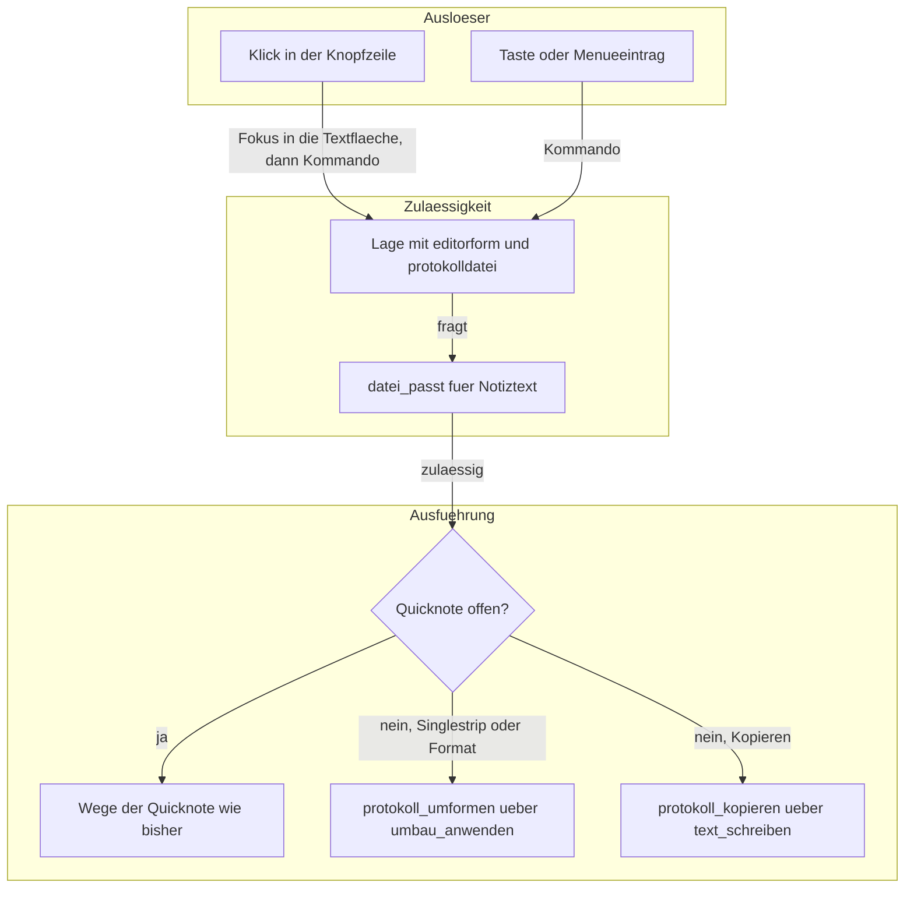
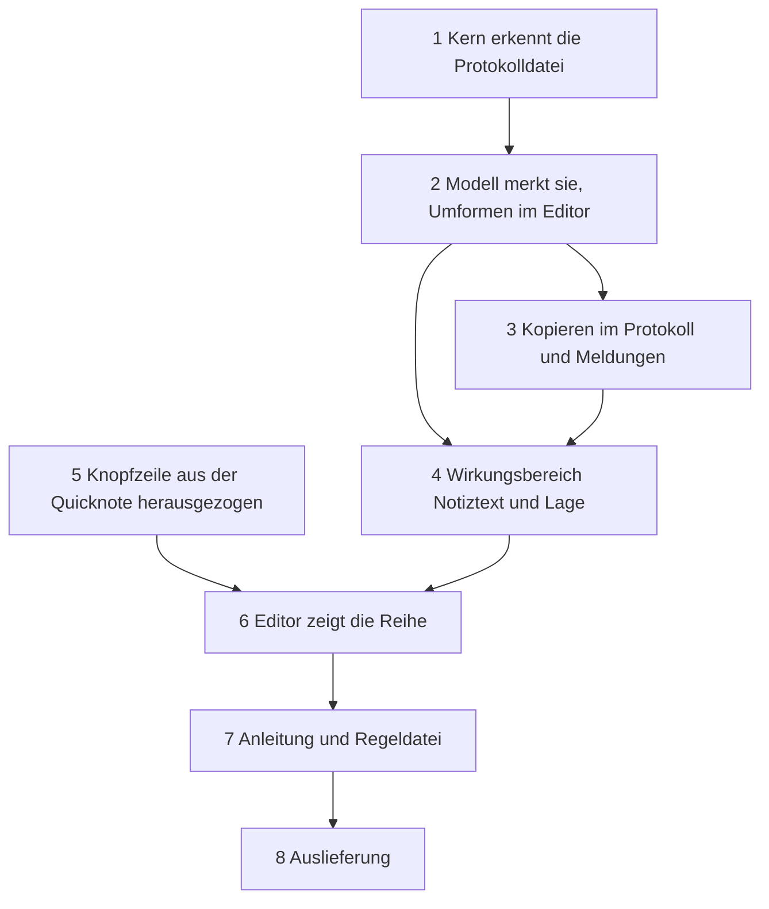

# Implementation Plan: Die drei Schaltflächen der Quicknote stehen auch im Editor einer Protokolldatei

**Date:** 2026-11-11
**Spec:** none — planned from raw request (`261111-2242-minutes-editor-traegt-kopieren-singlestrip-format.md`, Abschnitt `## Die Worte des Nutzers`)
**Decidability:** Die tragende Frage lautet: hält der Editor eine Datei unmittelbar in `minutes/` des geltenden Notizordners, und zeigt er sie in der Textfläche? Sie ist aus den Eingaben entscheidbar, die der Mechanismus hat: dem Pfadtext der geladenen Datei, den zwei Pfadformen des `Heimordner` und der `Editorform`. Unter einer dritten Schreibweise des Notizordners antwortet sie nein wie `Heimordner::ist_protokollordner`; dann fehlen die Schaltflächen, und nichts wirkt an der falschen Datei. Ein Wechsel des Mechanismus ist nicht nötig.

## Directive

Der Editor zeigt „Kopieren“, „Singlestrip“ und „Format“ auch vor einer Datei aus `minutes/`, und jede wirkt dort auf den Text der Datei. Die verbindliche Formulierung steht im Narrativ des Arbeitspakets unter `## Directive`; der zweite Satz des Nutzers ist der Auftrag zur Auslieferung.

## Current State

Am Baum gelesen, Stand `717eecd3`:

- **Die Schaltflächen gehören heute der Quicknote allein.** `Quicknote::knoepfe_bauen` (`crates/krk-ui/src/appkit/quicknote.rs`) baut fünf `NSButton` in die Rolle der Quicknote: Leeren, Schließen, Kopieren, Singlestrip, Format. Jede hat einen eigenen Selektor an der Klasse `Quicknote`, und alle fünf gehen über `Quicknote::geklickt`: erst der Fokus in die Textfläche, dann das Kommando an den Knopfmelder, den `Editorbereich::quicknote_bauen` auf `Editorbereich::kommando_melden` legt. Ein Klick ist damit ein Kommando und geht durch dieselbe Zulässigkeit wie die Taste.
- **Die Quicknote hat eine eigene Textfläche.** Eine Protokolldatei ist dagegen eine gewöhnliche `.md`-Datei in der Textfläche des Editors (`EditorIvars::text` in der Rolle `textrolle`, `Flaeche::Textflaeche`, `Editorform::Text`). Die Textfläche des Editors trägt heute keine Schaltflächenreihe.
- **An den drei Schaltflächen hängen Kommandos, Menüeinträge und eine Taste.** `Kommando::QuicknoteKopieren` (`quicknote_kopieren`, ab Werk `shift+f10`), `Kommando::QuicknoteSinglestrip` und `Kommando::QuicknoteFormat` (beide ab Werk unbelegt) stehen im Menü „Editor“ (`krk-ui/src/menuemodell.rs`). Alle drei tragen mit `QuicknoteLeeren` den `Wirkungsbereich::Quicknote` (`krk-core/src/tasten/belegung.rs`), und `form_passt` (`krk-ui/src/kommandos/zulaessigkeit.rs`) sagt für ihn allein in `Editorform::Quicknote` ja.
- **Ausgeführt wird beim Anwendungsdelegierten.** `quicknote_kopieren` (`appkit/anwendung.rs`) liest `Editorbereich::quicknote_text`, schreibt über `zwischenablage::text_schreiben`, leert ohne Rückgängig und schließt. `quicknote_umformen` ruft `Editorbereich::quicknote_umformen`, das über `Quicknote::auswahl_oder_alles`, die reine Funktion `umgeformt` (`appkit/editor.rs`, über `krk_core::text::glaetten`) und `Quicknote::ersetzen` geht.
- **Der Editor hat für einen Umbau seines Standes schon einen Weg.** `Editorbereich::umbau_anwenden` bildet einen `Umkehrpunkt`, ruft `Editormodell::bearbeiten` und schreibt über `stand_erneuern` durch die eine Schreibstelle `stand_einsetzen`; `cmd+z` nimmt den Umbau als eine Handlung zurück. `eintrag_im_text_hinzufuegen` und `treffer_ersetzen` nutzen ihn.
- **`minutes/` erkennt der Kern am Pfadtext.** `Heimordner::ist_protokollordner` (`krk-core/src/heimordner/mod.rs`) fragt den Ordner; eine Frage nach der Datei gibt es noch nicht. Das `Editormodell` ordnet eine geladene Datei beim Übernehmen über `Dateityp::von_pfad` und den `Heimgriff` ein, ohne Systemaufruf.
- **„Format“ taugt für eine `.md`-Datei.** `glaetten::fliesstext` lässt Aufzählungspunkte, Markdown-Tabellen (Zeilen mit `|`), Code-Zäune und kurze Zeilen wie Überschriften stehen und verbindet allein eingerückte Fortsetzungen bei belegter Breite; ein schon formatierter Text bleibt gleich (Modulkopf, „Format“). Dieselbe Funktion hat in beiden Lagen dieselbe Wirkung.

## Approach

Ein Befund trägt den Zuschnitt: die drei Schaltflächen sind Kommandos, und ihr Erscheinen und ihre Geltung sind dieselbe Frage. Der Plan beantwortet sie einmal und hängt Anzeige, Menü und Taste daran.

- **E1, die Erkennung steht im Kern.** `Heimordner::ist_protokolldatei(pfad)` antwortet ja, wenn der Elternordner `ist_protokollordner` erfüllt. Jede Datei unmittelbar in `minutes/` zählt, gleich welche Endung; eine Datei in einem Unterordner zählt nicht, wie beim Anlegen (C4.6 des Spec der Protokolle).
- **E2, das Modell merkt die Antwort beim Laden.** `Editormodell` hält `protokolldatei: bool` neben dem `Dateityp` und setzt beide an derselben Stelle. Die Lage je Tastenbefehl liest danach einen Wahrheitswert.
- **E3, ein neuer Wirkungsbereich trägt die drei.** `Wirkungsbereich::Notiztext` gilt mit dem Fokus im Editor, wenn der Editor die Quicknote zeigt oder den Text einer Protokolldatei. `QuicknoteKopieren`, `QuicknoteSinglestrip` und `QuicknoteFormat` wechseln zu ihm; `QuicknoteLeeren` bleibt bei `Wirkungsbereich::Quicknote`, denn Leeren ist keine der drei. Die Kennungen bleiben, eine eigene `keymap.toml` liest sich wie vorher.
- **E4, die Regel steht einmal.** Eine reine Funktion `protokolltext(form, protokolldatei)` in `kommandos/zulaessigkeit.rs` sagt, ob der Editor den Text einer Protokolldatei zeigt (`Editorform::Text` und das Kennzeichen). `datei_passt` fragt sie für `Notiztext`, und der Editorbereich fragt sie für die Sichtbarkeit der Reihe. Eine CSV in `minutes/` trägt die Reihe damit in der Rohansicht und nicht in der Tabelle.
- **E5, eine Schaltflächenreihe für beide Flächen.** Der Bau der Reihe zieht aus `quicknote.rs` in eine Klasse `Knopfzeile` (`appkit/knopfzeile.rs`). Sie nimmt eine Liste aus Beschriftung und Kommando, eine Textfläche als Fokusziel und einen Kommandomelder. Die Quicknote gibt ihr fünf Einträge, der Editorbereich drei, und die drei sind dieselben Listeneinträge wie in der Quicknote.
- **E6, Umformen geht durch den einen Umbauweg des Editors.** Singlestrip und Format rechnen an der Auswahl der Textfläche, sonst am ganzen Stand, über dasselbe `umgeformt`, und schreiben über `umbau_anwenden`. Gesichert wird wie bei jeder Datei mit `cmd+s`; eine Selbstsicherung wie bei `quicknote.txt` bekommt das Protokoll nicht.
- **E7, Kopieren kopiert im Protokoll allein.** Der ganze Text geht über `zwischenablage::text_schreiben` in die Zwischenablage; Datei und Editor bleiben. Die Begründung und die zwei anderen Lesarten stehen in `261111-2248-leert-und-schliesst-kopieren-auch-eine-protokolldatei-oder-kopiert-es-dort-allein.md`.
- **E8, die Reihe entsteht beim ersten Bedarf.** Der Editorbereich baut sie, wenn er zum ersten Mal den Text einer Protokolldatei zeigt, wie die Fläche der Quicknote beim ersten `f10`. Der Startweg bleibt ohne sie.

## Implementation Steps

Jeder Codeschritt ist einzeln einzutragen und endet mit grünem `make check` (cargo liegt unter `$HOME/.cargo/bin`; das `Makefile` setzt den Pfad selbst).

1. **Der Kern erkennt eine Protokolldatei am Pfadtext**
   - Executor: code-implementer
   - Files: `crates/krk-core/src/heimordner/mod.rs`, `crates/krk-core/tests/heimordner.rs`
   - Changes: `Heimordner::ist_protokolldatei(&self, pfad: &Path) -> bool` neben `ist_protokollordner`, gebaut auf ihm (`pfad.parent()`), mit Doc-Kommentar zu E1 und zur dritten Schreibweise. Probe als Tafel über beide Pfadformen: Datei in `minutes/` ja; Datei im Notizordner selbst, in `minutes/2026/`, in `anderswo/minutes/` und in `Minutes/` nein. Die Probe `ist_und_sonderdatei_stellen_keinen_systemaufruf` bekommt die neue Funktion in ihre Liste der gelesenen Rümpfe.
   - Dependencies: none
   - Abnahme: `make check` grün.

2. **Das Modell merkt die Protokolldatei, und der Editor formt ihren Text um**
   - Executor: code-implementer
   - Files: `crates/krk-ui/src/editormodell.rs`, `crates/krk-ui/src/appkit/editor.rs`, `crates/krk-ui/src/appkit/anwendung.rs`
   - Changes: `Editormodell` bekommt das Feld `protokolldatei`, gesetzt an der Stelle, an der es den `Dateityp` aus `Dateityp::von_pfad` setzt, über `heimgriff::lesen` und `Heimordner::ist_protokolldatei`; ohne Datei und ohne Heimordner `false`. Lesende Methode `Editormodell::protokolldatei()`. Im Editorbereich: `haelt_protokolldatei()` und eine reine Funktion, die aus Art, Stand und Auswahl (UTF-16-Bereich der Fläche, leer heißt alles) den neuen Stand und den Bereich des Ergebnisses rechnet oder `None`, wenn `umgeformt` nichts ändert. `Editorbereich::protokoll_umformen(art)` ruft sie und schreibt über `umbau_anwenden`, danach `stelle_zeigen` auf das Ergebnis; unverändert antwortet es `Editormeldung::QuicknoteUnveraendert(art)`, deren zwei Sätze die Quicknote nicht nennen. `Editorbereich::notiztext_umformen(art)` wählt: Quicknote offen, dann `quicknote_umformen`, sonst `protokoll_umformen`, und der Rumpf von `Anwendungsdelegierter::quicknote_umformen` ruft diese Wahl. Der Doc-Kommentar von `protokoll_umformen` sagt, warum `zelle_uebernehmen` hier nicht steht (Textform, die Tabelle ist ausgeblendet; derselbe Grund wie an `eintrag_im_text_hinzufuegen`). Proben: das Modell setzt das Kennzeichen für eine Datei in `minutes/` unter beiden Pfadformen und für keine andere; die reine Funktion an Auswahl, an leerer Auswahl und am unveränderten Text, je für Singlestrip und Format, auch mit einem Zeichen außerhalb der BMP vor der Auswahl; eine Quelltextprobe hält, dass `protokoll_umformen` über `umbau_anwenden` geht und `quicknote_umformen` unverändert über `quicknote.ersetzen`.
   - Dependencies: 1
   - Abnahme: `make check` grün. Bis Schritt 4 lässt die Zulässigkeit die Befehle vor einer Protokolldatei nicht durch; der neue Zweig ist erreichbarer Code ohne Auslöser.

3. **Kopieren im Protokoll und seine drei Meldungen**
   - Executor: code-implementer
   - Files: `crates/krk-core/src/sprache/schluessel.rs`, `crates/krk-core/src/sprache/tabelle/de.rs`, `crates/krk-core/src/sprache/tabelle/fr.rs`, `crates/krk-core/src/sprache/tabelle/en.rs`, `crates/krk-ui/src/appkit/editor.rs`, `crates/krk-ui/src/appkit/anwendung.rs`
   - Changes: Drei Schlüssel der Sprachtabelle in allen drei Sprachen: ein `Zahlwort` für „kopiert, n Zeichen“ und zwei `Text` für „das Protokoll ist leer“ und „ließ sich nicht kopieren“, gebaut nach den Sätzen der Quicknote, ohne „geleert“ und „geschlossen“. Drei Werte von `Editormeldung` dazu. `Editorbereich::protokolltext() -> Option<String>` liefert den Stand, wenn `protokolltext(form, haelt_protokolldatei)` gilt (bis Schritt 4 als Bedingung im Rumpf ausgeschrieben, dort auf die eine Funktion umgestellt). `Anwendungsdelegierter::protokoll_kopieren` ruft `quicknote::kopieren(&text, zwischenablage::text_schreiben)` und meldet den Ausgang, ohne zu leeren und ohne zu schließen (E7). Der Ausführungszweig von `Kommando::QuicknoteKopieren` wählt: Quicknote offen, dann `quicknote_kopieren` unverändert, sonst `protokoll_kopieren`. Der Doc-Kommentar sagt, dass `haelt_geheimnisse` hier nicht gefragt wird: die Zwischenablage ist eine erlaubte Ausfuhr durch den Nutzer, und eine Protokolldatei ist nach ihrem Pfad nie `secrets.txt`. Proben: Quelltextprobe am Rumpf von `protokoll_kopieren` (schreibt über `zwischenablage::text_schreiben`, nennt weder `nach_kopie_leeren` noch `quicknote_schliessen`); die bestehende Probe `das_kopieren_der_quicknote_schreibt_ueber_die_eine_huelle` bleibt unverändert grün; die drei Sätze sind in jeder Sprache verschieden und nennen die Quicknote nicht.
   - Source: `261111-2248-leert-und-schliesst-kopieren-auch-eine-protokolldatei-oder-kopiert-es-dort-allein.md` (Möglichkeit 1 als Stand des Plans)
   - Dependencies: 2
   - Abnahme: `make check` grün.

4. **`Wirkungsbereich::Notiztext` und `Lage::protokolldatei`**
   - Executor: code-implementer
   - Files: `crates/krk-core/src/tasten/belegung.rs`, `crates/krk-core/src/sprache/schluessel.rs`, `crates/krk-core/src/sprache/tabelle/de.rs`, `crates/krk-core/src/sprache/tabelle/fr.rs`, `crates/krk-core/src/sprache/tabelle/en.rs`, `crates/krk-core/tests/belegung.rs`, `crates/krk-ui/src/kommandos/zulaessigkeit.rs`, `crates/krk-ui/src/kommandos/fokus.rs`, `crates/krk-ui/src/appkit/anwendung.rs`, `crates/krk-ui/src/appkit/editor.rs`, dazu jede Datei, an der der Übersetzer eine vollständige Fallunterscheidung über `Wirkungsbereich` oder ein Literal von `Lage` anhält
   - Changes: Neuer Wert `Wirkungsbereich::Notiztext` mit Doc-Kommentar (E3), auf `Seite::Editor`, ohne Verengungspaar, mit Namen in drei Sprachen (deutsch etwa „Quicknote und Protokolle im Editor“). `Kommando::wirkungsbereich` stellt die drei Kommandos auf ihn, `QuicknoteLeeren` bleibt. `Lage` bekommt `protokolldatei: bool`, erhoben in `Anwendungsdelegierter::lage` über `Editorbereich::haelt_protokolldatei`. In `zulaessigkeit.rs`: die reine Funktion `protokolltext(form, protokolldatei)`; `form_passt` sagt für `Notiztext` in `Text` und `Quicknote` ja und in jeder Tabellenform nein; `datei_passt` sagt für `Notiztext` in `Editorform::Quicknote` ja und sonst `protokolltext(lage.editorform, lage.protokolldatei)`; `folge_passt` und `fokus::wirkt` ordnen den Wert ein wie `Quicknote`. `Editorbereich::protokolltext()` aus Schritt 3 fragt jetzt die eine Funktion. Proben: die Tafel in `zulaessigkeit.rs` bekommt die Zeile des neuen Bereichs und `jede_lage` beide Werte des neuen Feldes; eine neue Probe über jede Lage hält, dass die drei Kommandos genau mit dem Fokus im Editor in der Quicknote oder vor dem Text einer Protokolldatei zulässig sind, dass `QuicknoteLeeren` vor einer Protokolldatei nie zulässig ist und dass kein anderes Kommando `protokolldatei` fragt (Muster: `allein_eintrag_hinzufuegen_fragt_eintragsdatei`); die Kernprobe zum Wirkungsbereich der Quicknote-Befehle und `eine_verengung_reicht_nie_ueber_die_grenze_der_seiten` bleiben grün. Die Doc-Kommentare von `form_passt` und `datei_passt` zählen ihre Frager neu.
   - Dependencies: 2, 3
   - Abnahme: `make check` grün. Von hier an wirken `shift+f10` und die zwei Menüeinträge vor einer Protokolldatei.

5. **Die Schaltflächenreihe zieht aus der Quicknote in `Knopfzeile`**
   - Executor: code-implementer
   - Files: `crates/krk-ui/src/appkit/knopfzeile.rs` (neu), `crates/krk-ui/src/appkit/mod.rs`, `crates/krk-ui/src/appkit/quicknote.rs`, `crates/krk-ui/src/appkit/hauptfaden.rs`
   - Changes: Neue Klasse `Knopfzeile` (`NSObject`, `MainThreadOnly`): hält ihre Ansicht (Höhe `KNOPFZEILE`), die Liste ihrer Einträge `(Text, Kommando)`, die Textfläche als Fokusziel und den `Kommandomelder`. Ein Selektor für alle Schaltflächen, das Kommando kommt über die Marke (`tag`) aus der gehaltenen Liste; eine fremde Marke tut nichts. `geklickt` behält die Reihenfolge Fokus vor Kommando. Zwei Listen als Daten in derselben Datei: die fünf der Quicknote in der heutigen Reihenfolge und die drei des Protokolls, gebildet als Ausschnitt der fünf. `Quicknote` baut ihre Reihe über `Knopfzeile` und verliert die fünf Aktionsmethoden, `knoepfe_bauen` und `geklickt`; `knopfmelder_setzen` reicht an die Reihe weiter. Aussehen, Reihenfolge und Verhalten der Quicknote bleiben. Modulkopf von `knopfzeile.rs` mit dem Abschnitt `# Ab welchem macOS die angesprochenen Klassen stehen` (dazu `tag` und `setTag:` an `NSControl`); der Abschnitt in `quicknote.rs` folgt seinen verbliebenen Importen. Proben: `die_aktionen_melden_ihre_kommandos` zieht mit um und hält die Liste der fünf und die Reihenfolge Fokus vor Kommando; neu, dass die drei des Protokolls Kopieren, Singlestrip, Format in dieser Reihenfolge und Einträge der fünf sind; eine Hauptfadenprobe baut eine Reihe aus den dreien, prüft drei Schaltflächen mit den Titeln der Sprachtabelle und dass `performClick:` das Kommando des Eintrags meldet. Die neue Liste `HAUPTFADENPROBEN` bekommt ihre Zeile in `appkit::hauptfaden::alle`. Die Probe `die_quicknote_nennt_die_zwischenablage_nicht` gilt sinngemäß auch für `knopfzeile.rs`.
   - Dependencies: none
   - Abnahme: `make check` grün; `cargo test -p krk-ui --test hauptfaden` führt die neue Probe.

6. **Der Editor zeigt die Reihe vor dem Text einer Protokolldatei**
   - Executor: code-implementer
   - Files: `crates/krk-ui/src/appkit/editor.rs`
   - Changes: `EditorIvars` bekommt `protokollknoepfe: OnceCell<Retained<Knopfzeile>>` (E8). Eine Stelle führt die Reihe nach, gerufen aus `flaeche_waehlen`: gilt `protokolltext(form, haelt_protokolldatei)`, wird die Reihe gebaut, falls sie fehlt (Fokusziel `EditorIvars::text`, Melder auf `kommando_melden`, schwach gehalten wie bei der Quicknote), oben in die Fläche unter dem Kopf gelegt und gezeigt, und `textrolle` gibt ihr `KNOPFZEILE` an Höhe ab; sonst ist sie ausgeblendet, und `textrolle` füllt die Fläche. Die zwei Rahmen rechnet eine reine Funktion aus dem Flächenrahmen und dem Wahrheitswert. **`quicknote_bauen` nimmt seinen Rahmen danach aus dem Flächenrahmen und nicht mehr aus `textrolle.frame()`**, sonst entstünde eine Quicknote, die beim ersten `f10` über einem Protokoll geöffnet wird, um eine Reihe zu niedrig. Die Reihe klebt oben (`ViewMinYMargin`, in der Breite mitwachsend); `textrolle` behält ihre Maske. Proben: die reine Rahmenfunktion (mit Reihe ist die Textrolle um `KNOPFZEILE` niedriger und die Reihe liegt darüber, ohne Reihe füllt die Textrolle); eine Hauptfadenprobe am Editorbereich: nach dem Nachführen mit einer Protokolldatei in der Textform steht die Reihe sichtbar mit drei Schaltflächen, mit einer anderen Datei, in der Quicknote und in einer Tabellenform nicht; eine Quelltextprobe hält, dass die Nachführung in `flaeche_waehlen` steht und `Knopfzeile` im Editor an genau dieser einen Stelle gebaut wird.
   - Dependencies: 4, 5
   - Abnahme: `make check` grün.

7. **Anleitung und Regeldatei folgen dem Umbau**
   - Executor: code-implementer
   - Files: `HowTo.md`, `.claude/rules/coding-was-man-nicht-sieht.md`, `README.md` (nur, wenn `grep -n 'Quicknote kopieren' README.md` eine Aussage findet, die im Protokoll falsch wird)
   - Changes: `HowTo.md`: unter `### Protokolle in minutes/` ein Absatz zu den drei Schaltflächen (wo sie stehen, dass sie allein vor einer Datei unmittelbar in `minutes/` in der Textansicht erscheinen, dass Kopieren den ganzen Text kopiert und das Protokoll stehen lässt, dass Singlestrip und Format an der Auswahl oder am ganzen Text wirken, mit `cmd+z` zurückzunehmen sind und erst `cmd+s` sichert, dass `shift+f10` dort kopiert); unter `## Die Quicknote` und `### Singlestrip und Format` je ein Verweis darauf, und jeder Satz dort, der „nur in der Quicknote“ sagt, wird berichtigt. Regeldatei: der Absatz über Singlestrip und Format nennt den zweiten Ort und seinen Schreibweg (`umbau_anwenden`); der Absatz über das stehende Blatt und `form_passt` nennt `Notiztext`, `Lage::protokolldatei` und die eine Funktion `protokolltext`, an der Anzeige und Geltung gemeinsam hängen; der Absatz über die Wege, auf denen Editorinhalt KRK verlässt, nennt `protokoll_kopieren` als Weg in die Zwischenablage, der `haelt_geheimnisse` nicht fragt, mit dem Grund; der Absatz über die Quicknote sagt, dass ihre Reihe aus `appkit/knopfzeile.rs` kommt und `quicknote_bauen` den Flächenrahmen nimmt. `CLAUDE.md` wird nicht geändert: der Absatz über `Wirkungsbereich` dort führt keine Zahl und keine vollständige Liste, und keine Aussage wird falsch.
   - Dependencies: 6
   - Abnahme: `make check` grün (die Proben über `HowTo.md` in `crates/krk-core/tests/glaetten.rs` lesen die Beispiele wörtlich); `grep -n -i 'nur in der Quicknote\|allein in der Quicknote' HowTo.md` zeigt keinen Satz mehr, der die drei Schaltflächen meint.

8. **Auslieferung als 4.1.0**
   - Executor: der Orchestrator selbst, kein Executor aus dem Satz (so im Auftrag der Planung festgelegt)
   - Files: `Cargo.toml` und `Cargo.lock` über `cargo xtask version`, geschrieben vom Lauf
   - Changes: Die Stufe ist **Minor**: eine neue Fähigkeit, keine Kombination fällt weg, und `shift+f10` bekommt vor einer Protokolldatei eine Wirkung, wo es vorher ausgegraut war (`README.md` `### Versionsstufen`). Von 4.0.0 wird 4.1.0. Lauf: `./release.sh 4.1.0` aus der Projektwurzel, bei sauberem Arbeitsbaum, nach Schritt 7 und nach dem Eintragen aller Schritte.
   - Dependencies: 7
   - Abnahme: `git tag -l v4.1.0` nennt den Tag, und `gh release view v4.1.0` zeigt die Releaseseite.

## Where this work stops

- `make check` ist nach Schritt 7 grün: ja oder nein.
- Die Proben aus den Schritten 2 bis 6 halten Erscheinen und Wirkung der drei Schaltflächen vor einer Datei in `minutes/`, und die Proben der Quicknote sind unverändert grün: ja oder nein.
- Die Fassung 4.1.0 ist über `./release.sh 4.1.0` ausgeliefert, mit Tag und Releaseseite: ja oder nein.
- Vorbedingung der Auslieferung: alle Schritte 1 bis 7 sind eingetragen, und der Arbeitsbaum ist sauber. Die Antwort auf `261111-2248-schuldet-das-protokollknopf-paket-einen-abnahmelauf-gegen-die-zehn-zusagen.md` ist keine Vorbedingung; lautet sie „messen“, ist der Lauf Nutzerarbeit nach der Auslieferung.
- Die Antwort auf `261111-2248-leert-und-schliesst-kopieren-auch-eine-protokolldatei-oder-kopiert-es-dort-allein.md` steht vor Schritt 3: ja oder nein. Der Plan ist auf Möglichkeit 1 geschrieben.
- Nicht Teil dieser Arbeit: die Wirkung im laufenden Bündel zu prüfen (Klick, Lage der Reihe, `cmd+z` nach einer Umformung). Das ist Nutzerarbeit, und bis dahin ist die Arbeit gebaut und nicht abgenommen.

## Data Structures

- `Heimordner::ist_protokolldatei(&self, pfad: &Path) -> bool` (Kern).
- `Editormodell::protokolldatei: bool`, gesetzt beim Übernehmen.
- `Wirkungsbereich::Notiztext` (Kern), `Lage::protokolldatei: bool`, `fn protokolltext(form: Editorform, protokolldatei: bool) -> bool` (`krk-ui`).
- `Knopfzeile` (`appkit/knopfzeile.rs`) mit den zwei Listen aus `(Text, Kommando)`.
- Drei Werte von `Editormeldung` und drei Schlüssel der Sprachtabelle für das Kopieren im Protokoll, ein Schlüssel für den Namen des Wirkungsbereichs.

## API Changes

Keine Kennung der Belegung ändert sich, keine fällt weg, keine Ablagedatei bekommt ein Feld. Die Befehlsnamen in F1 und im Menü bleiben.

## Testing Strategy

Jede Regel steht als reine Funktion mit einer Tafel: die Erkennung im Kern, das Kennzeichen im Modell, `protokolltext`, die Zulässigkeit über jede Lage, die Umformung am Stand, die zwei Rahmen. Quelltextproben halten die Wege, die keine Tafel sieht (ein Schreibweg, eine Baustelle der Reihe, Kopieren ohne Leeren). Zwei Hauptfadenproben bauen die Reihe und den Editorbereich. Was keine Probe sieht, steht unter „Where this work stops“ als Nutzerarbeit.

## Risks & Mitigations

| Risk | Mitigation |
|------|------------|
| Die Auswahl der Textfläche zählt in UTF-16, der Stand in Bytes; ein falscher Schnitt verdirbt den Text. | Die Rechnung ist eine reine Funktion mit einer Probe an einem Zeichen außerhalb der BMP (Schritt 2). |
| Die Textfläche trägt in einem Augenblick nicht den Stand des Modells, und der Bereich passt nicht. | `umbau_anwenden` und `stand_einsetzen` tragen die Invariante und den Rückfall auf den ganzen Stand schon; der Schritt baut keinen zweiten Schreibweg. |
| Die Quicknote entsteht über einem Protokoll mit zu niedrigem Rahmen. | Schritt 6 stellt `quicknote_bauen` auf den Flächenrahmen um. |
| Die neuen Einträge in `fr.rs` und `en.rs` hat ein Agent übersetzt; die Durchsicht vom 261014 deckt sie nicht. | Kurze Sätze nach dem Muster der vorhandenen Quicknote-Sätze; die Durchsicht in der laufenden Anwendung bleibt Nutzerarbeit wie bisher. |
| Ein Wechsel des Notizordners über „Ort wählen…“ bei offener Datei lässt das Kennzeichen beim alten Stand. | Dieselbe Lage wie beim `Dateityp`; das Kennzeichen gilt ab dem nächsten Laden, und der Doc-Kommentar sagt es. |
| Der Befehlsname „Quicknote kopieren und schließen“ beschreibt im Protokoll nur das Kopieren. | `HowTo.md` sagt es (Schritt 7); die Namensfrage steht unter den offenen Fragen. |

## Open Questions

- [ ] Kopieren im Protokoll: allein kopieren, oder auch leeren und schließen? Als Datensatz gestellt, `261111-2248-leert-und-schliesst-kopieren-auch-eine-protokolldatei-oder-kopiert-es-dort-allein.md`; der Plan folgt der Empfehlung (Möglichkeit 1).
- [ ] Abnahmelauf gegen die zehn Zusagen: als Datensatz gestellt, `261111-2248-schuldet-das-protokollknopf-paket-einen-abnahmelauf-gegen-die-zehn-zusagen.md`; Empfehlung „nicht messen“, die Auslieferung wartet nicht darauf.
- [ ] Bleiben die drei Befehlsnamen („Quicknote kopieren und schließen“, „Quicknote: Befehl auf eine Zeile bringen (Singlestrip)“, „Quicknote: Fließtext formatieren (Format)“), obwohl die Befehle jetzt auch im Protokoll wirken? Der Plan lässt sie stehen; eine Umbenennung wäre je ein Eintrag in drei Tabellen und ändert keine Kennung.
